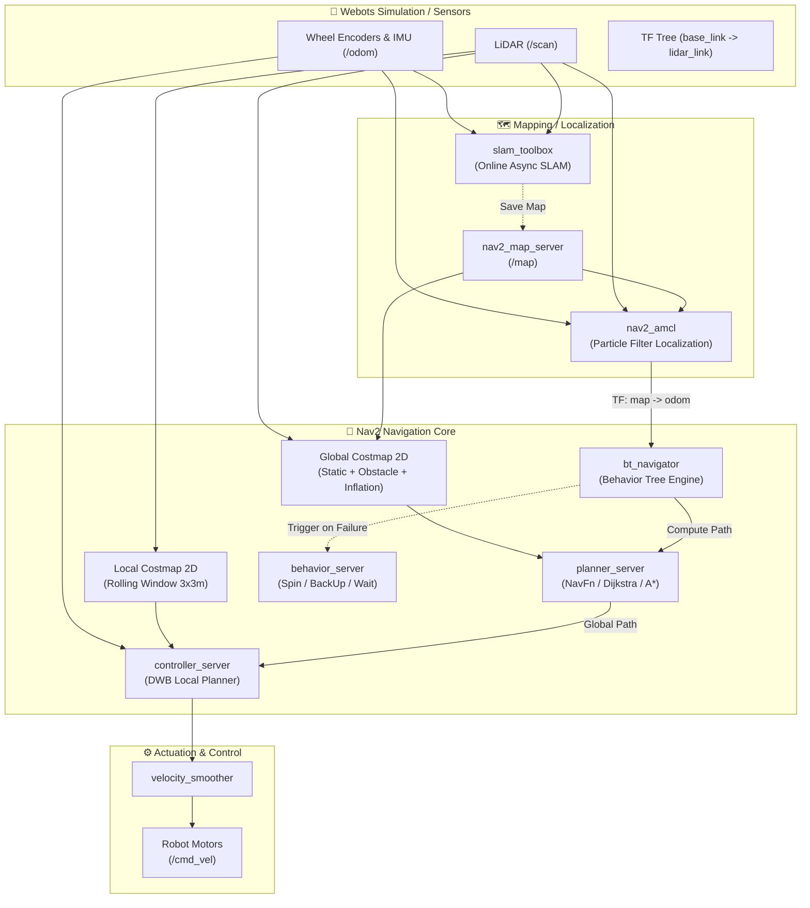
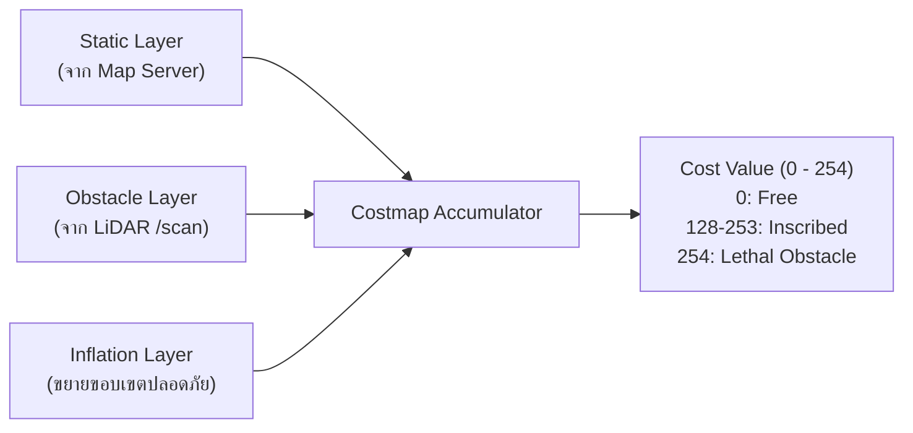
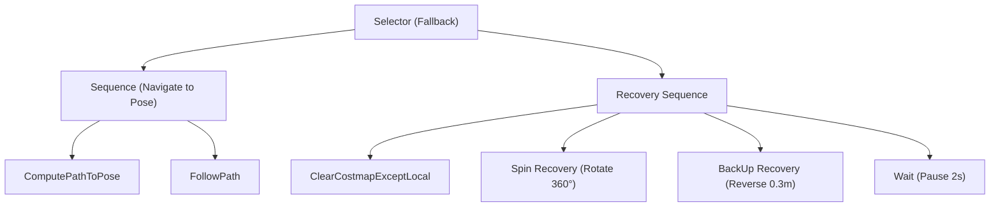

# 🧭 Navigation 2 (Nav2) Architecture & Autonomous Navigation

> **Comprehensive ROS 2 Navigation System Guide: From SLAM Mapping to Autonomous Waypoint Patrol**

---

## 📌 สารบัญ (Table of Contents)
1. [ภาพรวมสถาปัตยกรรม Nav2 (Architecture Overview)](#1-ภาพรวมสถาปัตยกรรม-nav2-architecture-overview)
2. [ระบบสร้างแผนที่ SLAM Toolbox (Simultaneous Localization & Mapping)](#2-ระบบสร้างแผนที่-slam-toolbox)
3. [Map Server และ Costmap 2D (Global & Local Costmaps)](#3-map-server-และ-costmap-2d)
4. [ระบบระบุตำแหน่ง AMCL (Adaptive Monte Carlo Localization)](#4-ระบบระบุตำแหน่ง-amcl)
5. [Planner Server & Controller Server (Path Planning & Tracking)](#5-planner-server--controller-server)
6. [Behavior Trees & Recovery Behaviors](#6-behavior-trees--recovery-behaviors)
7. [Nav2 Simple Commander Python API](#7-nav2-simple-commander-python-api)
8. [โครงสร้างไดเรกทอรีของโมดูล 3_Nav2](#8-โครงสร้างไดเรกทอรีของโมดูล-3_nav2)
9. [การใช้งานและคำสั่ง Quick Start](#9-การใช้งานและคำสั่ง-quick-start)

---

## 1. ภาพรวมสถาปัตยกรรม Nav2 (Architecture Overview)

**Navigation 2 (Nav2)** คือซอฟต์แวร์สแต็กหลักของ **ROS 2** สำหรับการนำทางหุ่นยนต์เคลื่อนที่อัตโนมัติ (Autonomous Mobile Robots - AMRs) โดยได้รับการพัฒนาต่อยอดจาก ROS 1 Navigation Stack ให้รองรับ **Managed Lifecycle Nodes**, สถาปัตยกรรม **Behavior Trees (BT)**, และการสื่อสารแบบ Real-time Control Loops



### Coordinate Frames (TF Tree)
ในระบบนำทาง Nav2 พิกัดอ้างอิงมาตรฐานตาม [REP-105](https://www.ros.org/reps/rep-0105.html) มีดังนี้:
- **`map`**: พิกัดอ้างอิงคงที่ของโลก (Global Reference Frame) มีความแม่นยำระยะยาว ไม่ดริฟต์ (Drift-free) เผยแพร่โดย AMCL หรือ SLAM
- **`odom`**: พิกัดการเคลื่อนที่สะสมคำนวณจาก Dead Reckoning (Encoders + IMU) ต่อเนื่องเรียบเนียน (Smooth & Continuous) แต่อาจดริฟต์ตามเวลา
- **`base_link`**: พิกัดกึ่งกลางเพลาล้อขับเคลื่อนของตัวหุ่นยนต์
- **`lidar_link`**: พิกัดจุดติดตั้งเซนเซอร์ LiDAR

---

## 2. ระบบสร้างแผนที่ SLAM Toolbox

[SLAM Toolbox](https://github.com/SteveMacenski/slam_toolbox) เป็นแพ็กเกจ SLAM ระดับมืออาชีพที่ได้รับความนิยมสูงสุดใน ROS 2 รองรับการประมวลผลแบบ Online และ Offline Graph-Based SLAM

### หลักการทำงานสำคัญ
1. **Scan Matching**: เปรียบเทียบข้อมูล `sensor_msgs/LaserScan` ล่าสุดกับ Pose Graph เพื่อคำนวณ Odometry Correction
2. **Loop Closure Detection**: เมื่อหุ่นยนต์วนกลับมายังตำแหน่งเดิม อัลกอริทึมจะตรวจจับความสอดคล้องของเส้นผนังและทำการแก้สมการ Pose Graph Optimization ด้วย Ceres Solver
3. **Lifelong Mapping**: รองรับการโหลดแผนที่เดิมขึ้นมาเพื่อสำรวจพื้นที่ใหม่เพิ่มเติมโดยไม่ลบส่วนเดิมทิ้ง

### คอนฟิกูเรชันหลัก ([`slam_toolbox_params.yaml`](file:///Volumes/ExDisk/Google%20Drive%20Ksu/KSU/Git/ROS/3_Nav2/config/slam_toolbox_params.yaml))
| พารามิเตอร์ | ค่าที่กำหนด | คำอธิบาย |
|---|---|---|
| `scan_topic` | `/scan` | ท็อปปิกข้อมูลเลเซอร์สแกน |
| `odom_frame` | `odom` | เฟรม Odometry |
| `map_frame` | `map` | เฟรมแผนที่สากล |
| `base_frame` | `base_link` | เฟรมกึ่งกลางหุ่นยนต์ |
| `laser_max_range` | `4.0` | ระยะวัดสูงสุดของ LiDAR ใน Webots Robot |
| `resolution` | `0.05` | ขนาดกริด 5 ซม. ต่อนิ้วพิกเซล |

---

## 3. Map Server และ Costmap 2D

### Map Server & Map Format
แผนที่มาตรฐาน Nav2 ประกอบด้วย 2 ไฟล์:
1. **`.pgm` (Portable Graymap)**: ภาพระดับสีเทาแทนความน่าจะเป็นของสิ่งกีดขวาง
   - `0 (สีดำ)`: สิ่งกีดขวาง (Occupied)
   - `254 (สีขาว)`: พื้นที่ว่าง (Free Space)
   - `205 (สีเทา)`: พื้นที่ที่ยังไม่เคยสำรวจ (Unknown)
2. **`.yaml` (Metadata)**: ข้อมูลมาตราส่วนและจุดกำเนิด
   ```yaml
   image: warehouse_map.pgm
   mode: trinary
   resolution: 0.050000
   origin: [-7.500000, -7.500000, 0.000000]
   negate: 0
   occupied_thresh: 0.65
   free_thresh: 0.25
   ```

### Costmap 2D Structure
Nav2 แบ่งตารางความคุ้มค่า (Costmap) ออกเป็น 2 ประเภทหลัก:
1. **Global Costmap**: ครอบคลุมพื้นที่ทั้งแผนที่ ใช้ในการคำนวณเส้นทางภาพรวมระยะไกล (Global Path Planning)
2. **Local Costmap**: เลื่อนตามหุ่นยนต์ (Rolling Window, ขนาด $3\text{m} \times 3\text{m}$) อัปเดตด้วยความถี่สูง ($20\text{Hz}$) เพื่อหลบสิ่งกีดขวางแบบไดนามิก



#### Inflation Cost Formula
ค่าความเสี่ยงรอบสิ่งกีดขวางคำนวณตามสูตร Exponential Decay:
$$\text{cost} = \text{LETHAL} \times \exp(-\alpha \cdot (d - r_{\text{inscribed}}))$$
- $\alpha$: `cost_scaling_factor` (ยิ่งมาก ยิ่งลดลงเร็ว)
- $d$: ระยะห่างจากสิ่งกีดขวาง
- $r_{\text{inscribed}}$: รัศมีตัวหุ่นยนต์รอบจุดศูนย์กลาง ($0.22\text{m}$)

---

## 4. ระบบระบุตำแหน่ง AMCL

**AMCL (Adaptive Monte Carlo Localization)** ใช้หลักการ **Particle Filter (KLD-Sampling)** ในการคาดเดาตำแหน่งของหุ่นยนต์ในแผนที่ 2 มิติ

$$X_t = \{ x_t^{[1]}, x_t^{[2]}, \dots, x_t^{[M]} \}$$

แต่ละอนุภาค (Particle) มีสถานะพิกัด $[x, y, \theta]$ และค่าน้ำหนักความน่าจะเป็น $w$:
1. **Motion Model Prediction**: เมื่อหุ่นยนต์เคลื่อนที่ตาม Encoders/IMU อนุภาคทุกตัวจะถูกขยับตามแบบจำลอง Differential Motion Model พร้อมสัญญาณรบกวน ($\alpha_1 - \alpha_4$)
2. **Sensor Likelihood Measurement**: เมื่อ LiDAR ยิงลำแสงกระทบผนัง ระบบจะนำระยะทางจริงมาเทียบกับระยะทางจำลองจากแผนที่ (Likelihood Field Model)
3. **Importance Resampling**: สุ่มอนุภาคใหม่โดยให้อนุภาคที่มีน้ำหนักสูงอยู่รอด และกำจัดอนุภาคที่ไม่ตรงกับความเป็นจริง

---

## 5. Planner Server & Controller Server

### 1. Global Planner (`planner_server`)
- ใช้ **Navfn Planner** (Dijkstra Algorithm หรือ Fast Marching Method)
- คำนวณเส้นทางที่สั้นที่สุดและปลอดภัยที่สุดจากจุดเริ่มต้นไปยังเป้าหมาย โดยหลีกเลี่ยงพื้นที่ Lethal และ Inscribed Cost

### 2. Local Controller (`controller_server`)
- ใช้ **DWB (Dynamic Window Approach - DWB Local Planner)**
- คำนวณความเร็ว $v$ และ $\omega$ ในแต่ละรอบเวลา ($20\text{Hz}$)
- สุ่มเวกเตอร์ความเร็วตัวอย่าง (Velocity Samples) หลายสิบรูปแบบ แล้วคำนวณ Trajectory ล่วงหน้า $1.7$ วินาที
- ประเมินคะแนนด้วย **Critics**:
  - `BaseObstacle`: ตรวจสอบไม่ให้ชนสิ่งกีดขวาง
  - `PathAlign` & `GoalAlign`: ให้หัวหุ่นยนต์มุ่งไปตามเส้นทาง
  - `PathDist` & `GoalDist`: ดึงให้ตัวหุ่นยนต์เกาะติดเส้นทาง
  - `RotateToGoal`: หมุนตัวตรงเป้าหมายเมื่อถึงพิกัดปลายทาง

---

## 6. Behavior Trees & Recovery Behaviors

Nav2 ควบคุมตรรกะการตัดสินใจระดับสูงด้วย **BehaviorTree.CPP (v3)**:



หาก `FollowPath` ล้มเหลวเนื่องจากทางตันหรือติดสิ่งกีดขวาง BT จะส่งคำสั่งไปยัง `behavior_server` เพื่อถอยหลัง (`BackUp`), หมุนกวาดเรดาร์ (`Spin`), หรือล้างกริดสิ่งกีดขวางชั่วคราว (`ClearCostmap`) ก่อนคำนวณเส้นทางใหม่อัตโนมัติ

---

## 7. Nav2 Simple Commander Python API

Nav2 มีโมดูล Python ระดับสูงชื่อ `nav2_simple_commander` ช่วยให้นักพัฒนาสามารถเขียนโค้ดสั่งการหุ่นยนต์อัตโนมัติได้อย่างรวดเร็ว:

```python
from nav2_simple_commander.robot_navigator import BasicNavigator, TaskResult
from geometry_msgs.msg import PoseStamped

navigator = BasicNavigator()
navigator.waitUntilNav2Active()

# กำหนดเป้าหมาย
goal_pose = PoseStamped()
goal_pose.header.frame_id = 'map'
goal_pose.pose.position.x = 2.5
goal_pose.pose.position.y = 3.5
goal_pose.pose.orientation.w = 1.0

# สั่งเดินทาง
navigator.goToPose(goal_pose)
while not navigator.isTaskComplete():
    feedback = navigator.getFeedback()
    print(f"ระยะทางคงเหลือ: {feedback.distance_remaining:.2f} เมตร")

result = navigator.getResult()
if result == TaskResult.SUCCEEDED:
    print("ถึงเป้าหมายเรียบร้อยแล้ว!")
```

---

## 8. โครงสร้างไดเรกทอรีของโมดูล 3_Nav2

```text
3_Nav2/
├── Readme.md                     # เอกสารสถาปัตยกรรม Nav2 ฉบับสมบูรณ์ (ไฟล์นี้)
├── Lab_Exercises.md              # ใบงานปฏิบัติการ 4 แล็บแบบ Step-by-Step
├── config/
│   ├── slam_toolbox_params.yaml  # คอนฟิก Online Async SLAM
│   └── nav2_params.yaml          # คอนฟิกหลัก Nav2 Stack (AMCL, Costmaps, DWB, BT)
├── maps/
│   ├── warehouse_map.yaml        # ค่าคอนฟิกแผนที่สำหรับ map_server
│   ├── warehouse_map.pgm         # ไฟล์รูปภาพแผนที่คลังสินค้าความละเอียด 5cm
│   └── generate_sample_map.py    # สคริปต์ Python สร้างแผนที่จำลอง
├── launch/
│   └── nav2_bringup.launch.py    # Launch file สำหรับเปิดระบบ Nav2 Stack ครบวงจร
├── rviz/
│   └── nav2_default_view.rviz    # คอนฟิก RViz2 พร้อมเลเยอร์ Costmaps, TF, LaserScan
└── src/
    ├── amcl_initial_pose.py      # สคริปต์กำหนดตำแหน่งเริ่มต้นหุ่นยนต์ (/initialpose)
    └── waypoint_patrol.py        # โหนดลาดตระเวน Waypoints อัตโนมัติ (Simple Commander)
```

---

## 9. การใช้งานและคำสั่ง Quick Start

### ขั้นตอนที่ 1: ติดตั้ง Nav2 Packages บน ROS 2 Jazzy
```bash
sudo apt update
sudo apt install -y \
  ros-jazzy-navigation2 \
  ros-jazzy-nav2-bringup \
  ros-jazzy-slam-toolbox \
  ros-jazzy-nav2-simple-commander
```

### ขั้นตอนที่ 2: รันการจำลองหุ่นยนต์ Webots และสร้างแผนที่ (SLAM)
```bash
# Terminal 1: เปิดหุ่นยนต์จำลองใน Webots
ros2 launch ce_webots slam_mapping.launch.py

# Terminal 2: เปิดโหนด SLAM Toolbox
ros2 run slam_toolbox async_slam_toolbox_node --ros-args \
  --params-file "/Volumes/ExDisk/Google Drive Ksu/KSU/Git/ROS/3_Nav2/config/slam_toolbox_params.yaml"

# Terminal 3: เปิด RViz2 ตรวจสอบการทำแผนที่
rviz2 -d "/Volumes/ExDisk/Google Drive Ksu/KSU/Git/ROS/3_Nav2/rviz/nav2_default_view.rviz"
```

### ขั้นตอนที่ 3: บันทึกแผนที่เมื่อขับสำรวจครบ
```bash
# บันทึกผ่านโหนด ce_webots map saver
ros2 run ce_webots save_map --ros-args -p map_name:=warehouse_map -p output_dir:=maps/
```

### ขั้นตอนที่ 4: เริ่มต้นระบบนำทางอัตโนมัติ (Autonomous Navigation)
```bash
# Terminal 1: รัน Nav2 Stack
ros2 launch "/Volumes/ExDisk/Google Drive Ksu/KSU/Git/ROS/3_Nav2/launch/nav2_bringup.launch.py"

# Terminal 2: ตั้งค่า Initial Pose ให้ AMCL
python3 "/Volumes/ExDisk/Google Drive Ksu/KSU/Git/ROS/3_Nav2/src/amcl_initial_pose.py" --ros-args -p x:=0.0 -p y:=0.0 -p theta:=0.0

# Terminal 3: เริ่มภารกิจลาดตระเวน Multi-Waypoint Patrol
python3 "/Volumes/ExDisk/Google Drive Ksu/KSU/Git/ROS/3_Nav2/src/waypoint_patrol.py"
```
