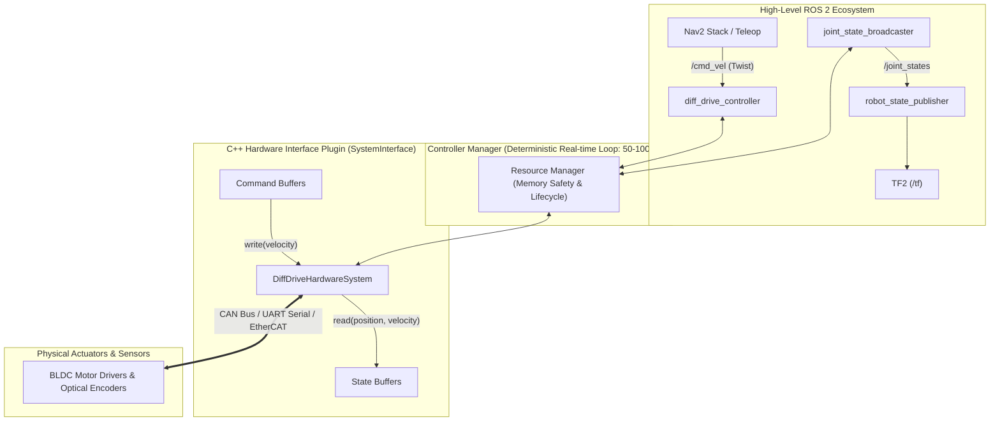
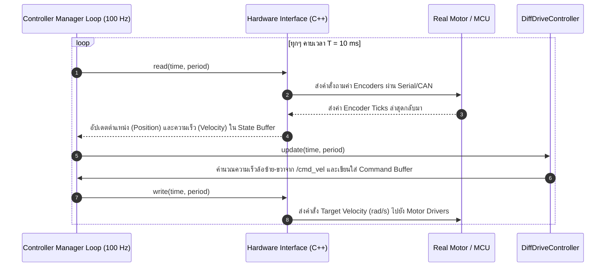
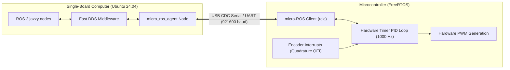

# 📖 บทที่ 1: การควบคุมฮาร์ดแวร์จริงด้วย ros2_control และ micro-ROS
**รหัสวิชา:** AMR-201 Advanced ROS 2 & Industrial Fleet Robotics  
**เวลาเรียน:** บรรยาย 2 ชั่วโมง | ปฏิบัติการ 3 ชั่วโมง | ทบทวนและค้นคว้าด้วยตนเอง 5 ชั่วโมง  
**เอกสารปฏิบัติการ:** [ใบงานแล็บปฏิบัติการที่ 1](Lab_Exercises.md)

---

## 🎯 วัตถุประสงค์การเรียนรู้เชิงพฤติกรรม (Measurable Learning Objectives)
1. **เข้าใจสถาปัตยกรรมระดับแกนกลางของ `ros2_control`:** อธิบายความสัมพันธ์ระหว่าง `Controller Manager`, `Resource Manager`, `Hardware Interface`, และ `Controllers` ได้อย่างละเอียด
2. **ออกแบบและกำหนดค่าคอนโทรลเลอร์ขับเคลื่อนสองล้อ:** ปรับแต่งไฟล์คอนฟิก YAML สำหรับ `diff_drive_controller` และ `joint_state_broadcaster` พร้อมกำหนดค่าความเร่งสูงสุดและความเร็วปลอดภัย
3. **เขียน URDF/Xacro สำหรับ Hardware Interfaces:** กำหนด `<command_interface>` และ `<state_interface>` สำหรับข้อต่อมอเตอร์ตามมาตรฐาน ROS 2
4. **เชื่อมโยงไมโครคอนโทรลเลอร์ด้วย micro-ROS:** อธิบายการทำงานของระบบลูปปิด PID (Closed-loop Control) บนไมโครคอนโทรลเลอร์ (ESP32/STM32) และการบริดจ์ข้อมูลผ่าน `micro_ros_agent`
5. **วิเคราะห์ปัญหาแบบเรียลไทม์ (Real-time Constraints):** วิเคราะห์สาเหตุของ Jitter และความจำเป็นของ PREEMPT_RT Linux Kernel ในงานอุตสาหกรรม

---

## 🏗️ สถาปัตยกรรม ros2_control (Industrial Hardware Abstraction Layer)

ในยุคของ ROS 1 การต่อเชื่อมมอเตอร์มักทำผ่านโหนด Python หรือ C++ ธรรมดาที่ Subscribe หัวข้อ `/cmd_vel` แล้วเขียนข้อมูลออกทาง Serial Port โดยตรง ซึ่งก่อให้เกิดปัญหาความล่าช้า (Latency), จังหวะสัญญาณที่ไม่คงที่ (Jitter), และไม่ปลอดภัยสำหรับเครื่องจักรอุตสาหกรรม

ใน **ROS 2** เฟรมเวิร์ก **`ros2_control`** ได้รับการพัฒนาขึ้นเป็นมาตรฐานสากล เพื่อแยกซอฟต์แวร์ระดับบน (High-Level Navigation) ออกจากไดรเวอร์ฮาร์ดแวร์ระดับล่าง (Low-Level Motor Drivers) อย่างเป็นระบบ:



---

## ⚙️ วงจรการทำงานของ Hardware Interface (C++ Execution Lifecycle)

`ros2_control` ทำงานผ่าน Interface มาตรฐาน 3 ประเภท:
1. **`ActuatorInterface`:** สำหรับควบคุมมอเตอร์อิสระ 1 แกน (1 Degree of Freedom)
2. **`SensorInterface`:** สำหรับอ่านค่าเซนเซอร์ที่ไม่มีคำสั่งควบคุม (เช่น IMU, Force-Torque Sensor)
3. **`SystemInterface`:** สำหรับระบบหุ่นยนต์ที่มีทั้งมอเตอร์และเซนเซอร์เชื่อมโยงกัน (เช่น หุ่นยนต์ล้อต่างความเร็ว Differential Drive AMR หรือแขนกลอุตสาหกรรม)



---

## 📐 คณิตศาสตร์การควบคุมความเร็วล้อและการแปลงสัญญาณเอ็นโค้ดเดอร์ (Closed-Loop PID)

### 1. การแปลงคำสั่งการเคลื่อนที่จาก Body Twist สู่ความเร็วล้อแต่ละข้าง
กำหนดให้:
- $v$: ความเร็วเชิงเส้นในแนวแกน $X$ ($\text{m/s}$)
- $\omega$: ความเร็วเชิงมุมรอบแกน $Z$ ($\text{rad/s}$)
- $L$: ระยะห่างระหว่างล้อซ้ายและล้อขวา (Wheel Separation / Baseline)
- $r$: รัศมีของล้อ (Wheel Radius)

ความเร็วเชิงเส้นของล้อซ้าย ($v_L$) และล้อขวา ($v_R$):
$$v_L = v - \frac{\omega L}{2}$$
$$v_R = v + \frac{\omega L}{2}$$

แปลงเป็นความเร็วเชิงมุมของล้อ ($\text{rad/s}$):
$$\omega_L = \frac{v_L}{r} = \frac{2v - \omega L}{2r}$$
$$\omega_R = \frac{v_R}{r} = \frac{2v + \omega L}{2r}$$

---

### 2. อัลกอริทึมควบคุม PID ความเร็วรอบบนไมโครคอนโทรลเลอร์ (Discrete PID Controller)
เมื่อไมโครคอนโทรลเลอร์อ่านค่าความเร็วรอบปัจจุบัน ($\omega_{\text{current}}$) จาก Encoder เทียบกับเป้าหมาย ($\omega_{\text{target}}$):

$$e[k] = \omega_{\text{target}}[k] - \omega_{\text{current}}[k]$$

สัญญาณควบคุมแรงดัน PWM ส่งไปยังมอเตอร์:
$$u[k] = K_p e[k] + K_i \sum_{j=0}^{k} e[j] \Delta t + K_d \frac{e[k] - e[k-1]}{\Delta t}$$

> [!TIP]
> **เทคนิค Anti-Windup สำหรับมอเตอร์:** เมื่อสัญญาณ PWM อิ่มตัวที่ค่าสูงสุด ($u[k] \ge PWM_{\max}$) ต้องทำการตัดการสะสมของพจน์ Integral ทันที เพื่อป้องกันไม่ให้มอเตอร์หมุนเกิน (Overshoot) เมื่อหุ่นยนต์หยุดกะทันหัน

---

## 🔌 การต่อเชื่อมไมโครคอนโทรลเลอร์ด้วย micro-ROS

สำหรับระบบ AMR ที่ใช้ไมโครคอนโทรลเลอร์ยอดนิยม เช่น **ESP32** หรือ **STM32F4** สื่อสารกับคอมพิวเตอร์ออนบอร์ด (เช่น Jetson Orin หรือ Raspberry Pi 5):



### คำสั่งรัน micro-ROS Agent บนคอมพิวเตอร์ออนบอร์ด:
```bash
# รัน Agent ผ่าน Serial พอร์ต /dev/ttyUSB0 ความเร็วสูง
ros2 run micro_ros_agent micro_ros_agent serial --dev /dev/ttyUSB0 -b 921600
```

---

## ⌨️ ตารางคำสั่ง CLI สำหรับจัดการ ros2_control

```bash
# แสดงรายชื่อ Controller Manager และคอนโทรลเลอร์ทั้งหมดในระบบ
ros2 control list_controllers

# ตรวจสอบสถานะและประเภทของ Hardware Interface (Read/Write Interfaces)
ros2 control list_hardware_interfaces

# สั่งเปลี่ยนสถานะของ Controller (Active / Inactive)
ros2 control set_controller_state diff_drive_controller active

# โหลดคอนโทรลเลอร์ตัวใหม่เข้าสู่ Controller Manager แบบ Dynamic
ros2 control load_controller my_new_controller

# สั่งให้ Controller Manager สลับคอนโทรลเลอร์แบบไร้รอยต่อ (Switch Controllers)
ros2 control switch_controllers --activate diff_drive_controller --deactivate manual_teleop_controller
```

---

## ⚠️ ปัญหาที่พบบ่อยในระดับอุตสาหกรรม (Troubleshooting & Best Practices)

| อาการที่พบ (Symptom) | สาเหตุทางวิศวกรรม (Root Cause) | แนวทางแก้ไข (Solution) |
| :--- | :--- | :--- |
| **ล้อสะดุดหรือหมุนกระตุกที่ความเร็วต่ำ** | **Motor Deadband:** แรงดันไฟฟ้าต่ำเกินกว่าจะเอาชนะแรงเสียดทานสถิต (Static Friction) | ใส่ Deadband Offset ใน PID Code ของ MCU ชดเชยแรงเสียดทานขั้นต่ำ |
| **หุ่นยนต์เลี้ยวแล้วตำแหน่งหลุดจากความเป็นจริง** | **Wheel Slip & Odometry Drift:** ค่า `wheel_separation` ในไฟล์ YAML ไม่ตรงกับจุดสัมผัสพื้นจริง | ปรับจูนค่า `wheel_separation_multiplier` โดยสั่งให้หุ่นหมุน 360 องศา แล้วเทียบกับค่าจริง |
| **Controller Manager แจ้งเตือน Late Update** | **Real-Time Jitter:** Linux OS ทั่วไปไม่มี Kernel แบบ Real-time ทำให้เธรดอื่นแย่งเวลา CPU | ติดตั้ง **PREEMPT_RT Kernel Patch** บน Ubuntu และกำหนด Process Priority สูงสุด (`chrt -f 99`) |

---

## 📝 แบบทดสอบท้ายบทเชิงลึก (Self-Assessment Quiz)

1. **คำถาม:** เพราะเหตุใดในสถาปัตยกรรม `ros2_control` การอ่านข้อมูลจากเซนเซอร์และการสั่งการมอเตอร์จึงถูกบังคับให้อยู่ในฟังก์ชัน `read()` และ `write()` ของคลาสเดียว แทนที่จะกระจายอยู่ในโหนดแยก?
   - <details><summary><b>เฉลย</b></summary>เพื่อความปลอดภัยระดับหน่วยความจำ (Memory Thread-Safety) และการันตี Deterministic Execution Loop ที่ไม่มีปัญหา Data Race หรือ Deadlock ในการเข้าถึงพอร์ตฮาร์ดแวร์ชิ้นเดียวกันในระดับเรียลไทม์</details>

2. **คำถาม:** หากหุ่นยนต์ AMR วิ่งด้วยความเร็ว $v = 0.5 \text{ m/s}$ และต้องการเลี้ยวด้วยความเร็วเชิงมุม $\omega = 1.0 \text{ rad/s}$ โดยมีรัศมีล้อ $r = 0.08 \text{ m}$ และระยะห่างล้อ $L = 0.24 \text{ m}$ จงคำนวณหาความเร็วเชิงมุมของล้อขวา ($\omega_R$) ในหน่วย $\text{rad/s}$
   - <details><summary><b>เฉลย</b></summary>จากสูตร $\omega_R = \frac{v + \frac{\omega L}{2}}{r} = \frac{0.5 + \frac{1.0 \times 0.24}{2}}{0.08} = \frac{0.5 + 0.12}{0.08} = \frac{0.62}{0.08} = \mathbf{7.75 \text{ rad/s}}$</details>
