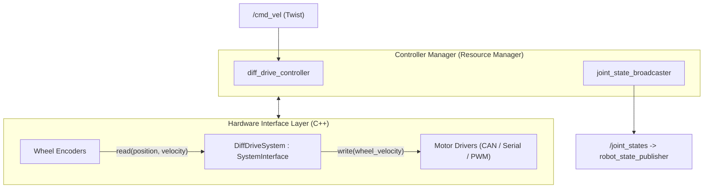
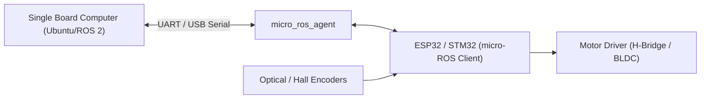

# ⚙️ Tutorial: ros2_control & Real Hardware Interface

---

## 🎯 วัตถุประสงค์การเรียนรู้
1. เข้าใจสถาปัตยกรรมของเฟรมเวิร์ก **`ros2_control`** ซึ่งเป็นมาตรฐานอุตสาหกรรมในการเชื่อมโยง ROS 2 เข้ากับมอเตอร์และเซนเซอร์จริง
2. เข้าใจการทำงานของ `controller_manager`, `hardware_interface` และ Controller ต่างๆ
3. สามารถกำหนดค่าและรัน `diff_drive_controller` ร่วมกับ `joint_state_broadcaster`
4. เข้าใจแนวทางการเชื่อมต่อไมโครคอนโทรลเลอร์ (STM32 / ESP32) ผ่าน **micro-ROS**

---

## 🏗️ สถาปัตยกรรม ros2_control (Architecture Overview)



---

## 📂 โครงสร้างการตั้งค่า
1. **ไฟล์กำหนดค่าคอนโทรลเลอร์:** [`config/diff_drive_controller.yaml`](config/diff_drive_controller.yaml)
   - กำหนดชื่อข้อต่อ (Joint Names): `left_wheel_joint`, `right_wheel_joint`
   - กำหนดขนาดทางกายภาพ: `wheel_separation`, `wheel_radius`
   - กำหนดขีดจำกัดความเร็วและความเร่ง (Velocity & Acceleration Limits)
2. **ไฟล์นิยาม Hardware Interface ใน URDF:** [`urdf/diff_drive_ros2_control.xacro`](urdf/diff_drive_ros2_control.xacro)
   - กำหนด `<command_interface name="velocity">`
   - กำหนด `<state_interface name="position">` และ `<state_interface name="velocity">`

---

## 🔌 การต่อเชื่อม Hardware จริงด้วย micro-ROS

สำหรับการขับเคลื่อนมอเตอร์จริง นิยมใช้ไมโครคอนโทรลเลอร์ (เช่น **ESP32** หรือ **STM32**) ทำหน้าที่ปิดลูป PID ควบคุมความเร็วล้อ และส่งข้อมูลตำแหน่งล้อขึ้นมายังคอมพิวเตอร์หลัก (SBC) ผ่าน **micro-ROS Agent**:



### คำสั่งรัน micro-ROS Agent ผ่าน Serial Port:
```bash
ros2 run micro_ros_agent micro_ros_agent serial --dev /dev/ttyUSB0 -b 115200
```
