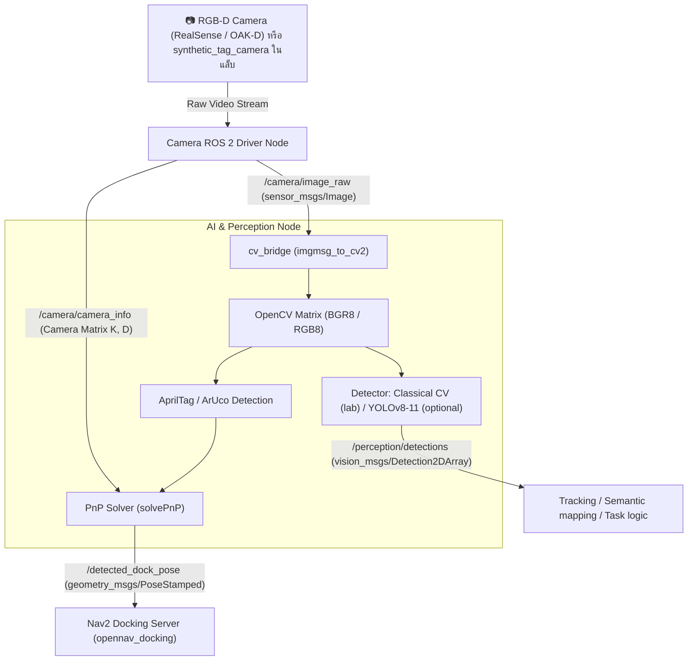
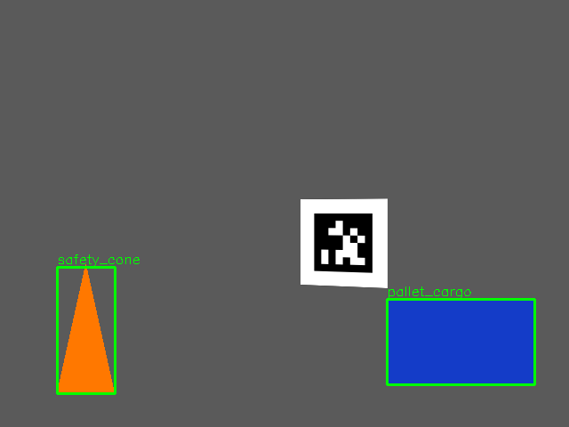

# 📖 บทที่ 2: ระบบการมองเห็นและการรับรู้ด้วยปัญญาประดิษฐ์ (Vision & AI Perception)
**รหัสวิชา:** AMR-201 Advanced ROS 2 & Industrial Fleet Robotics  
**เวลาเรียน:** บรรยาย 2 ชั่วโมง | ปฏิบัติการ 3 ชั่วโมง | ทบทวนและค้นคว้าด้วยตนเอง 5 ชั่วโมง  
**เอกสารปฏิบัติการ:** [ใบงานแล็บปฏิบัติการที่ 2](Lab_Exercises.md)

---

## 🎯 วัตถุประสงค์การเรียนรู้เชิงพฤติกรรม (Measurable Learning Objectives)
1. **เข้าใจสถาปัตยกรรม ROS 2 Image Transport และ `cv_bridge`:** สามารถแปลงข้อมูลระหว่าง `sensor_msgs/msg/Image` ของ ROS 2 และ Mat Array ของ OpenCV โดยไม่มีการรั่วไหลของหน่วยความจำ (Memory Leak)
2. **บูรณาการตัวตรวจจับวัตถุเข้ากับ ROS 2:** แปลงผลการตรวจจับ (Bounding Boxes) เป็นข้อความมาตรฐาน **`vision_msgs/msg/Detection2DArray`** โดยคง `header` (stamp + frame) ของภาพต้นฉบับ — ในแล็บใช้ตัวตรวจจับแบบ Classical CV ที่รันบน CPU ได้ทุกเครื่อง และมีแบบฝึกหัดเสริมสลับไปใช้โมเดล Deep Learning (Ultralytics YOLOv8/YOLO11)
3. **เข้าใจคณิตศาสตร์ Perspective-n-Point (PnP) สำหรับ Visual Markers:** คำนวณหาตำแหน่งและทิศทาง 6-DoF ($X, Y, Z, \text{Roll}, \text{Pitch}, \text{Yaw}$) ของแท่นชาร์จจาก AprilTag / ArUco ผ่าน Camera Matrix
4. **ประมวลผล 3D Point Cloud เบื้องต้น:** เข้าใจการกรองข้อมูลพอยต์คลาวด์ขนาดใหญ่ด้วย Voxel Grid Downsampling และ PassThrough Filter เพื่อลดภาระการคำนวณของคอมพิวเตอร์ออนบอร์ด

---

## 👁️ สถาปัตยกรรม Computer Vision Pipeline ใน ROS 2

การประมวลผลภาพในงานหุ่นยนต์มีความท้าทายเรื่องปริมาณข้อมูลมหาศาล (ภาพ Full HD 1080p ที่ 30 FPS มีอัตราข้อมูลสูงกว่า 180 MB/s):



---

## 📐 คณิตศาสตร์การประมาณท่าทาง 6-DoF จากมาร์กเกอร์ (Perspective-n-Point Problem)

กล้องรูเข็ม (Pinhole Camera Model) แปลงพิกัด 3 มิติในโลก ($X_w, Y_w, Z_w$) เป็นพิกัดพิกเซลบนภาพ 2 มิติ ($u, v$):

$$s \begin{bmatrix} u \\ v \\ 1 \end{bmatrix} = \mathbf{K} \begin{bmatrix} \mathbf{R} & \mathbf{t} \end{bmatrix} \begin{bmatrix} X_w \\ Y_w \\ Z_w \\ 1 \end{bmatrix}$$

โดยที่:
- $\mathbf{K}$: เมทริกซ์พารามิเตอร์ภายในของกล้อง (Camera Intrinsic Matrix):
  $$\mathbf{K} = \begin{bmatrix} f_x & 0 & c_x \\ 0 & f_y & c_y \\ 0 & 0 & 1 \end{bmatrix}$$
  *(โดย $f_x, f_y$ คือความยาวโฟกัสในหน่วยพิกเซล และ $c_x, c_y$ คือจุดกึ่งกลางของระนาบรับภาพ)*
- $\mathbf{R}$: เมทริกซ์การหมุน $3 \times 3$ (Rotation Matrix)
- $\mathbf{t}$: เวกเตอร์การเลื่อนตำแหน่ง $3 \times 1$ (Translation Vector $\begin{bmatrix} t_x & t_y & t_z \end{bmatrix}^T$)
- $s$: ปัจจัยการปรับสเกลสเกลาร์ (Scale Factor)

> [!NOTE]
> เมื่อหุ่นยนต์ตรวจจับมุมทั้ง 4 มุมของ AprilTag ซึ่งเราทราบขนาดทางกายภาพจริงของมาร์กเกอร์ ($W \times W$ เมตร) ระบบจะใช้ฟังก์ชัน `cv2.solvePnP()` เพื่อถอดสมการหาค่า $\mathbf{R}$ และ $\mathbf{t}$ ทำให้หุ่นยนต์ทราบว่าตนเองอยู่ห่างจากแท่นชาร์จกี่เมตร และเอียงทำมุมกี่เรเดียน

---

> [!IMPORTANT]
> **Detection ไม่ได้ถูกส่งเข้า Nav2 Costmap โดยตรง:** Costmap ของ Nav2 รับข้อมูลเซนเซอร์แบบ `LaserScan`/`PointCloud2` (Obstacle/Voxel layer) ไม่ได้อ่านกรอบสี่เหลี่ยม 2D ใดๆ การนำผล Detection ไปใช้กับการนำทางต้องมีขั้นตอนเพิ่ม เช่น ใช้ depth แปลงเป็นตำแหน่ง 3D แล้วเขียน costmap layer/plugin เอง หรือใช้กับ logic ระดับงาน (หยุดเมื่อพบคน, จัดลำดับงานหยิบพาเลท)

---

## 🛠️ แพ็กเกจ `amr_adv02` และการวิเคราะห์โค้ด (รันได้จริงบน CPU แบบ Headless)

ทุกอย่างในแล็บนี้รันได้โดย **ไม่มีกล้องจริง ไม่มี GPU และไม่มี Gazebo** เพราะภาพถูก "เรนเดอร์" ด้วย OpenCV ผ่านเมทริกซ์ $\mathbf{K}$ ที่ทราบค่า จึงรู้ค่าจริง (ground truth) และวัดความคลาดเคลื่อนของระบบได้แม่นยำ

| ไฟล์ / executable | หน้าที่ | เป็นของจริงหรือจำลอง? |
| :--- | :--- | :--- |
| [`src/synthetic_tag_camera.py`](src/synthetic_tag_camera.py) `synthetic_tag_camera` | วาด AprilTag 36h11 (id 0, 10 cm) ที่ท่าทางที่กำหนดลงในภาพ 640×480 ผ่าน pinhole model ($f_x = f_y = 525$) แล้ว publish `/camera/image_raw` + `/camera/camera_info` (QoS `sensor_data`) และ `/camera/tag_pose_ground_truth` | **กล้องจำลอง** (ภาพสังเคราะห์) |
| [`src/apriltag_dock_tracker.py`](src/apriltag_dock_tracker.py) `apriltag_dock_tracker` | ตรวจจับแท็กด้วย `cv2.aruco` (`DICT_APRILTAG_36h11`) + `cv2.solvePnP(SOLVEPNP_IPPE_SQUARE)` โดยใช้ $\mathbf{K}, \mathbf{D}$ จาก `CameraInfo` แล้ว publish `geometry_msgs/PoseStamped` ที่ **`detected_dock_pose`** (header เดียวกับภาพ) และ **ไม่ publish เลยเมื่อไม่เห็นแท็ก** | **อัลกอริทึมจริง** ใช้กับกล้องจริงได้ทันที |
| [`src/object_detector_node.py`](src/object_detector_node.py) `object_detector` | `backend:=color` (ค่าเริ่มต้น): **Classical CV** — HSV threshold + contour → `vision_msgs/Detection2DArray` บน `/perception/detections` และภาพ debug `/perception/debug_image`; `backend:=yolo`: Ultralytics YOLO (ต้องติดตั้งเอง) | Classical CV จริง (**ไม่ใช่โครงข่ายประสาทเทียม**); YOLO เป็นแบบฝึกหัดเสริม |
| [`src/pose_error_monitor.py`](src/pose_error_monitor.py) `pose_error_monitor` | จับคู่ pose ที่ตรวจได้กับ ground truth ตาม stamp แล้วพิมพ์ error (mm / deg) | เครื่องมือวัดผล |
| [`src/vision_utils.py`](src/vision_utils.py) | ฟังก์ชันล้วน (ไม่ใช้ ROS): render, detect, PnP, colour detector | — |
| [`launch/vision_pipeline.launch.py`](launch/vision_pipeline.launch.py) | รันทั้ง 3 โหนด, arguments `tag_x tag_y tag_z tag_yaw_deg tag_size tag_visible` | — |

> [!NOTE]
> **`score` ของ backend `color` ไม่ใช่ความน่าจะเป็น:** เป็นอัตราส่วนพื้นที่ contour ต่อกรอบ (fill ratio) เช่น สี่เหลี่ยม (พาเลท) ≈ 0.98 สามเหลี่ยม (กรวย) ≈ 0.50 ใช้เพื่อสาธิตการบรรจุข้อมูลลง `ObjectHypothesis.score` เท่านั้น

### บทเรียนจากการรันจริง: PnP ของมาร์กเกอร์ที่หันตรงเข้ากล้อง
- ตำแหน่ง ($t$) จาก PnP แม่นมาก (ระดับ 1 mm ที่ 0.8 m) แต่ **มุม** ของแท็กที่หันตรงเข้ากล้อง (fronto-parallel) ไวต่อ noise ของมุมภาพมาก: corner error เพียง ~0.15 px ทำให้มุมเอียงผิดได้ 2–4° ที่ระยะ > 1 m (จากการสุ่มทดสอบ 300 ท่าทางใน `vision_utils`) เพราะการเอียงเล็กน้อยแทบไม่เปลี่ยนรูปทรงที่ฉายลงภาพ — เข้าใกล้ขึ้นหรือมองเฉียงจะแม่นขึ้น
- OpenCV 4.6 (ใน Ubuntu 24.04) `SOLVEPNP_IPPE_SQUARE` บางครั้งคืนค่า **NaN** หรือคำตอบที่หมุนกลับ 180° เมื่อแท็กหันตรงเข้ากล้องพอดี ตัว tracker จึงตรวจทุกคำตอบด้วย reprojection error และมี fallback (`IPPE`, `SQPNP`) — ข้อผิดพลาดนี้พบจากการรัน docking จริงในบทที่ 3 (pose เป็น NaN ทำให้ docking server สูญเสียตำแหน่งแท่นชาร์จ)
- Quaternion $q$ และ $-q$ คือการหมุนเดียวกัน แท็กที่หันเข้ากล้องมี $w \approx 0$ ถ้ากำหนดเครื่องหมายตายตัว ค่าจะสลับเครื่องหมายไปมาระหว่างเฟรม ตัวกรองปลายทางที่เฉลี่ย quaternion จะได้ค่าเกือบศูนย์ → NaN ตัว tracker จึงรักษาความต่อเนื่องของเครื่องหมาย

### แบบฝึกหัดเสริม: เปลี่ยนเป็น YOLO จริง (Ultralytics)
Image ของแล็บไม่มี PyTorch/Ultralytics (ขนาดหลาย GB) หากต้องการทดลองบนเครื่องที่มีทรัพยากรพอ ให้ติดตั้งใน venv ที่มองเห็นแพ็กเกจของ ROS:
```bash
python3 -m venv --system-site-packages ~/yolo && ~/yolo/bin/pip install ultralytics
# รันโหนดด้วย python ของ venv (ไฟล์ yolov8n.pt จะถูกดาวน์โหลดครั้งแรก — ตรวจสอบสัญญาอนุญาต AGPL-3.0 ของ Ultralytics)
~/yolo/bin/python -m amr_adv02.object_detector_node --ros-args -p backend:=yolo -p model:=yolov8n.pt
```
`YoloBackend` แปลงผล `result.boxes` (xywh, class, conf) เป็นรูปแบบเดียวกับ backend `color` ส่วนที่เหลือของโหนด (cv_bridge, QoS, `Detection2DArray`) ไม่ต้องแก้ — นี่คือข้อดีของการแยก "อัลกอริทึม" ออกจาก "ROS interface" (ภาพสังเคราะห์ในแล็บไม่มีวัตถุในคลาสของ COCO จึงควรทดสอบกับภาพจริงผ่าน `image_publisher`)

---

## ⌨️ ตารางคำสั่ง CLI สำหรับระบบ Vision & Image Processing

```bash
# ตรวจสอบอัตราความถี่ (FPS) ของภาพจากกล้อง
ros2 topic hz /camera/image_raw

# ตรวจสอบปริมาณการใช้แบนด์วิดท์เครือข่ายของภาพ
ros2 topic bw /camera/image_raw

# แสดงผลภาพจากกล้อง/ภาพ debug ผ่านหน้าต่าง GUI (ต้องมี X11/DISPLAY)
ros2 run rqt_image_view rqt_image_view /perception/debug_image

# ส่งภาพจากไฟล์ (ภาพจริง) เข้าระบบแทนกล้อง
ros2 run image_publisher image_publisher_node my_photo.jpg --ros-args -r image_raw:=/camera/image_raw

# ดูโครงสร้างข้อมูล Camera Info (ความยาวโฟกัสและ Distortion Coefficients)
ros2 topic echo --once /camera/camera_info
```

---

## ⚠️ ปัญหาพบบ่อยในระดับอุตสาหกรรม (Troubleshooting & Best Practices)

| อาการที่พบ (Symptom) | สาเหตุทางวิศวกรรม (Root Cause) | แนวทางแก้ไข (Solution) |
| :--- | :--- | :--- |
| **ภาพแล็ก (Latency สูงขึ้นเรื่อยๆ)** | Subscriber คิวบัฟเฟอร์ยาวเกินไป และประมวลผลช้ากว่าอัตราเฟรมภาพที่ส่งมา | กำหนด QoS Depth = 1 และตั้งค่า `rclpy.qos.qos_profile_sensor_data` |
| **PnP Solver คำนวณพิกัดกระโดด** | ค่า Distortion Coefficients ในกล้องไม่ถูก Calibrate หรือแสงสะท้อนบนพื้นผิว Tag | ทำ Camera Calibration ด้วย `ros-jazzy-camera-calibration` และใช้ Tag ผิวด้าน (Matte) |
| **CPU รัน 100% จนระบบค้าง** | รัน Deep Learning Inference บน CPU โดยตรง | ส่งโมเดลไปรันบน GPU หรือ NPU ผ่าน TensorRT Engine หรือ OpenVINO |

---

## 📝 แบบทดสอบท้ายบทเชิงลึก (Self-Assessment Quiz)

1. **คำถาม:** ในระบบ Vision ของหุ่นยนต์เคลื่อนที่อัตโนมัติ เหตุใดจึงนิยมใช้ QoS แบบ `BEST_EFFORT` กับภาพวิดีโอจากกล้อง แทนที่จะใช้ `RELIABLE`?
   - <details><summary><b>เฉลย</b></summary>เนื่องจากภาพจากกล้องมีขนาดใหญ่และส่งมาอย่างต่อเนื่อง หากแพ็กเก็ตภาพหลุดไป การส่งซ้ำ (Retransmission) ของ Reliable จะทำให้เกิดความล่าช้าสะสมและแบนด์วิดท์อุดตัน ข้อมูลภาพเก่าที่มาช้าไม่มีประโยชน์ต่อระบบหลบหลีกสิ่งกีดขวางแบบเรียลไทม์</details>

2. **คำถาม:** หากจุด Principal Point $(c_x, c_y)$ ของภาพความละเอียด $640 \times 480$ อยู่กึ่งกลางภาพพอดี ค่าพิกัด $(c_x, c_y)$ ใน Camera Matrix จะมีค่าเท่าใด?
   - <details><summary><b>เฉลย</b></summary>$c_x = 640 / 2 = 320.0$ และ $c_y = 480 / 2 = 240.0$</details>

---

## 📟 ผลการรันจริง (Real Run Output)
บันทึกจากการรันจริงใน ros:lab-runner (ROS 2 Jazzy, Gazebo Sim 8.15.0) บน Linux 7.0 เมื่อ 2026-10-29 — ผลเต็ม: [`results/vision_pipeline.txt`](results/vision_pipeline.txt), ผลทดสอบอัตโนมัติ: [`results/colcon_test.txt`](results/colcon_test.txt)

```console
$ ros2 launch amr_adv02 vision_pipeline.launch.py      # tag at x=0.10 y=0.05 z=0.80 m, yaw 15 deg
[object_detector-3] [INFO] [1793246172.444208199] [object_detector]: Object detector ready: classical HSV colour + contour detector (no neural network)
[apriltag_dock_tracker-2] [INFO] [1793246172.497067509] [apriltag_dock_tracker]: tag 0: x=+0.100 y=+0.050 z=0.801 m  yaw=+15.1 deg

$ ros2 run amr_adv02 pose_error_monitor --ros-args -p count:=10
stamp 1793246196.970792411 detected z=0.8010 m truth z=0.8000 m | position error   0.99 mm  rotation error  0.23 deg
...
10 frames: position error mean 0.99 mm max 0.99 mm | rotation error mean 0.23 deg max 0.23 deg

$ ros2 launch amr_adv02 vision_pipeline.launch.py tag_visible:=false
$ timeout 5 ros2 topic echo /detected_dock_pose
# (exit after 5 s: no message)
```


*ภาพ: เฟรมจริงจาก `/perception/debug_image` ที่บันทึกระหว่างการรัน (`results/vision_pipeline.txt`) (ภาพสังเคราะห์จาก `synthetic_tag_camera` + กรอบที่ backend `color` ตรวจพบ) — AprilTag ถูกตรวจโดย `apriltag_dock_tracker` แยกต่างหาก*
