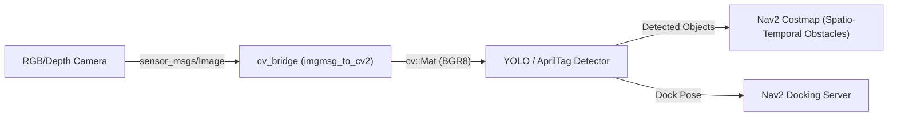

# 👁️ Tutorial: Computer Vision & AI Perception Pipeline

---

## 🎯 วัตถุประสงค์การเรียนรู้
1. เข้าใจกลไกการสตรีมและบีบอัดภาพด้วย `image_transport` และการแปลงข้อมูลภาพด้วย `cv_bridge`
2. การนำโมเดล Deep Learning (YOLOv8 / YOLO11) มาตรวจจับสิ่งกีดขวาง พาเลทสินค้า และคนในคลังสินค้า
3. การตรวจจับและคำนวณตำแหน่ง 3 มิติของ Visual Marker (AprilTag / ArUco) เพื่อนำทางเข้าสู่จุดจอดชาร์จแบตเตอรี่

---

## 🏗️ โครงสร้างระบบประมวลผลภาพ (Vision Pipeline)



---

## 💻 โหนดตัวอย่างในโมดูลนี้
1. **โหนดตรวจจับวัตถุด้วย AI:** [`src/cv_bridge_yolo_node.py`](src/cv_bridge_yolo_node.py)
   - Subscribe ท็อปปิกภาพ `/camera/image_raw`
   - รัน Object Detection สกัด Bounding Boxes และพิกัด
   - Publish ข้อมูลวัตถุที่ตรวจจับได้ไปยังระบบนำทาง
2. **โหนดตรวจจับมาร์กเกอร์แท่นชาร์จ:** [`src/apriltag_dock_tracker.py`](src/apriltag_dock_tracker.py)
   - คำนวณหาตำแหน่ง Relative Transform ระหว่างกล้องของหุ่นยนต์กับแท่นชาร์จ
   - Publish `geometry_msgs/PoseStamped` ไปยัง `/docking/target_pose`

---

## 📝 คำสั่งทดสอบรัน
```bash
# รันโหนดตรวจจับวัตถุ AI
./docker/run_lab.sh python3 Advanced_ROS/02_Vision_AI_Perception/src/cv_bridge_yolo_node.py

# รันโหนดตรวจจับแท่นชาร์จด้วย Visual Marker
./docker/run_lab.sh python3 Advanced_ROS/02_Vision_AI_Perception/src/apriltag_dock_tracker.py
```
