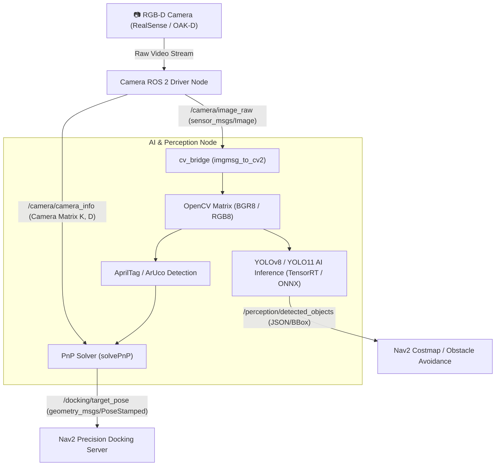

# 📖 บทที่ 2: ระบบการมองเห็นและการรับรู้ด้วยปัญญาประดิษฐ์ (Vision & AI Perception)
**รหัสวิชา:** AMR-201 Advanced ROS 2 & Industrial Fleet Robotics  
**เวลาเรียน:** บรรยาย 2 ชั่วโมง | ปฏิบัติการ 3 ชั่วโมง | ทบทวนและค้นคว้าด้วยตนเอง 5 ชั่วโมง  
**เอกสารปฏิบัติการ:** [ใบงานแล็บปฏิบัติการที่ 2](Lab_Exercises.md)

---

## 🎯 วัตถุประสงค์การเรียนรู้เชิงพฤติกรรม (Measurable Learning Objectives)
1. **เข้าใจสถาปัตยกรรม ROS 2 Image Transport และ `cv_bridge`:** สามารถแปลงข้อมูลระหว่าง `sensor_msgs/msg/Image` ของ ROS 2 และ Mat Array ของ OpenCV โดยไม่มีการรั่วไหลของหน่วยความจำ (Memory Leak)
2. **ออกแบบและฝังโมเดล Deep Learning (YOLOv8/11):** บูรณาการโมเดลตรวจจับวัตถุแบบเรียลไทม์เข้ากับ ROS 2 Node และแปลง Bounding Boxes เป็นข้อความ ROS Message
3. **เข้าใจคณิตศาสตร์ Perspective-n-Point (PnP) สำหรับ Visual Markers:** คำนวณหาตำแหน่งและทิศทาง 6-DoF ($X, Y, Z, \text{Roll}, \text{Pitch}, \text{Yaw}$) ของแท่นชาร์จจาก AprilTag / ArUco ผ่าน Camera Matrix
4. **ประมวลผล 3D Point Cloud เบื้องต้น:** เข้าใจการกรองข้อมูลพอยต์คลาวด์ขนาดใหญ่ด้วย Voxel Grid Downsampling และ PassThrough Filter เพื่อลดภาระการคำนวณของคอมพิวเตอร์ออนบอร์ด

---

## 👁️ สถาปัตยกรรม Computer Vision Pipeline ใน ROS 2

การประมวลผลภาพในงานหุ่นยนต์มีความท้าทายเรื่องปริมาณข้อมูลมหาศาล (ภาพ Full HD 1080p ที่ 30 FPS มีอัตราข้อมูลสูงกว่า 180 MB/s):



---

## 📐 คณิตศาสตร์การประมาณท่าทาง 6-DoF จากมาร์กเกอร์ (Perspective-n-Point Problem)

กล้องรูเข็ม (Pinhole Camera Model) แปลงพิกัด 3 มิติในโลก ($X_w, Y_w, Z_w$) เป็นพิกัดพิกเซลบนภาพ 2 มิติ ($u, v$):

$$s \begin{bmatrix} u \\ v \\ 1 \end{bmatrix} = \mathbf{K} \begin{bmatrix} \mathbf{R} & \mathbf{t} \end{bmatrix} \begin{bmatrix} X_w \\ Y_w \\ Z_w \\ 1 \end{bmatrix}$$

โดยที่:
- $\mathbf{K}$: เมทริกซ์พารามิเตอร์ภายในของกล้อง (Camera Intrinsic Matrix):
  $$\mathbf{K} = \begin{bmatrix} f_x & 0 & c_x \\ 0 & f_y & c_y \\ 0 & 0 & 1 \end{bmatrix}$$
  *(โดย $f_x, f_y$ คือความยาวโฟกัสในหน่วยพิกเซล และ $c_x, c_y$ คือจุดกึ่งกลางของระนาบรับภาพ)*
- $\mathbf{R}$: เมทริกซ์การหมุน $3 \times 3$ (Rotation Matrix)
- $\mathbf{t}$: เวกเตอร์การเลื่อนตำแหน่ง $3 \times 1$ (Translation Vector $\begin{bmatrix} t_x & t_y & t_z \end{bmatrix}^T$)
- $s$: ปัจจัยการปรับสเกลสเกลาร์ (Scale Factor)

> [!NOTE]
> เมื่อหุ่นยนต์ตรวจจับมุมทั้ง 4 มุมของ AprilTag ซึ่งเราทราบขนาดทางกายภาพจริงของมาร์กเกอร์ ($W \times W$ เมตร) ระบบจะใช้ฟังก์ชัน `cv2.solvePnP()` เพื่อถอดสมการหาค่า $\mathbf{R}$ และ $\mathbf{t}$ ทำให้หุ่นยนต์ทราบว่าตนเองอยู่ห่างจากแท่นชาร์จกี่เมตร และเอียงทำมุมกี่เรเดียน

---

## 🛠️ การวิเคราะห์โค้ดตัวอย่างในโมดูล

### 1. โหนดประมวลผล AI Object Detection: [`src/cv_bridge_yolo_node.py`](src/cv_bridge_yolo_node.py)
- **การแปลงข้อมูล:** ใช้ `self.bridge.imgmsg_to_cv2(msg, desired_encoding='bgr8')` เพื่อแปลง Image Message เป็น Numpy Array ของ OpenCV
- **การจัดการหน่วยความจำ:** หากประมวลผลไม่ทัน ควรใช้ QoS Policy `sensor_data` (Best Effort, Queue Depth = 1) เพื่อป้องกันไม่ให้เฟรมภาพค้างในบัฟเฟอร์

### 2. โหนดตรวจจับแท่นชาร์จอัตโนมัติ: [`src/apriltag_dock_tracker.py`](src/apriltag_dock_tracker.py)
- รับข้อมูล `/camera/camera_info` เพื่ออ่านค่า Camera Matrix $\mathbf{K}$
- เผยแพร่ตำแหน่งเป้าหมายไปยัง `/docking/target_pose` ในรูปแบบ `geometry_msgs/msg/PoseStamped` บนพิกัด `camera_optical_link`

---

## ⌨️ ตารางคำสั่ง CLI สำหรับระบบ Vision & Image Processing

```bash
# ตรวจสอบอัตราความถี่ (FPS) ของภาพจากกล้อง
ros2 topic hz /camera/image_raw

# ตรวจสอบปริมาณการใช้แบนด์วิดท์เครือข่ายของภาพ
ros2 topic bw /camera/image_raw

# แสดงผลภาพจากกล้องผ่านหน้าต่าง GUI แบบเร็ว
ros2 run rqt_image_view rqt_image_view

# ดูโครงสร้างข้อมูล Camera Info (ความยาวโฟกัสและ Distortion Coefficients)
ros2 topic echo --once /camera/camera_info
```

---

## ⚠️ ปัญหาพบบ่อยในระดับอุตสาหกรรม (Troubleshooting & Best Practices)

| อาการที่พบ (Symptom) | สาเหตุทางวิศวกรรม (Root Cause) | แนวทางแก้ไข (Solution) |
| :--- | :--- | :--- |
| **ภาพแล็ก (Latency สูงขึ้นเรื่อยๆ)** | Subscriber คิวบัฟเฟอร์ยาวเกินไป และประมวลผลช้ากว่าอัตราเฟรมภาพที่ส่งมา | กำหนด QoS Depth = 1 และตั้งค่า `rclpy.qos.qos_profile_sensor_data` |
| **PnP Solver คำนวณพิกัดกระโดด** | ค่า Distortion Coefficients ในกล้องไม่ถูก Calibrate หรือแสงสะท้อนบนพื้นผิว Tag | ทำ Camera Calibration ด้วย `ros-jazzy-camera-calibration` และใช้ Tag ผิวด้าน (Matte) |
| **CPU รัน 100% จนระบบค้าง** | รัน Deep Learning Inference บน CPU โดยตรง | ส่งโมเดลไปรันบน GPU หรือ NPU ผ่าน TensorRT Engine หรือ OpenVINO |

---

## 📝 แบบทดสอบท้ายบทเชิงลึก (Self-Assessment Quiz)

1. **คำถาม:** ในระบบ Vision ของหุ่นยนต์เคลื่อนที่อัตโนมัติ เหตุใดจึงนิยมใช้ QoS แบบ `BEST_EFFORT` กับภาพวิดีโอจากกล้อง แทนที่จะใช้ `RELIABLE`?
   - <details><summary><b>เฉลย</b></summary>เนื่องจากภาพจากกล้องมีขนาดใหญ่และส่งมาอย่างต่อเนื่อง หากแพ็กเก็ตภาพหลุดไป การส่งซ้ำ (Retransmission) ของ Reliable จะทำให้เกิดความล่าช้าสะสมและแบนด์วิดท์อุดตัน ข้อมูลภาพเก่าที่มาช้าไม่มีประโยชน์ต่อระบบหลบหลีกสิ่งกีดขวางแบบเรียลไทม์</details>

2. **คำถาม:** หากจุด Principal Point $(c_x, c_y)$ ของภาพความละเอียด $640 \times 480$ อยู่กึ่งกลางภาพพอดี ค่าพิกัด $(c_x, c_y)$ ใน Camera Matrix จะมีค่าเท่าใด?
   - <details><summary><b>เฉลย</b></summary>$c_x = 640 / 2 = 320.0$ และ $c_y = 480 / 2 = 240.0$</details>
