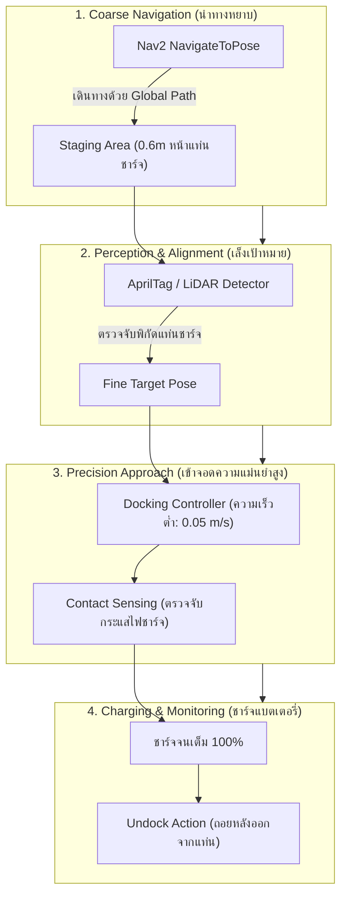
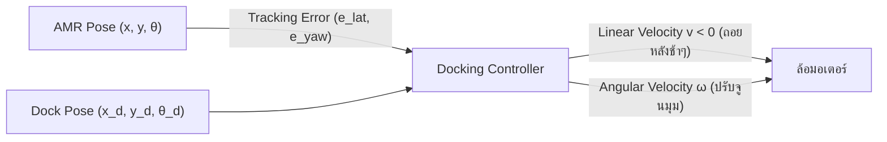

# 📖 บทที่ 3: ระบบการเข้าแท่นชาร์จความแม่นยำสูง (Nav2 Precision Docking)
**รหัสวิชา:** AMR-201 Advanced ROS 2 & Industrial Fleet Robotics  
**เวลาเรียน:** บรรยาย 2 ชั่วโมง | ปฏิบัติการ 3 ชั่วโมง | ทบทวนและค้นคว้าด้วยตนเอง 5 ชั่วโมง  
**เอกสารปฏิบัติการ:** [ใบงานแล็บปฏิบัติการที่ 3](Lab_Exercises.md)

---

## 🎯 วัตถุประสงค์การเรียนรู้เชิงพฤติกรรม (Measurable Learning Objectives)
1. **เข้าใจสถาปัตยกรรม 4 ลำดับขั้นของ Nav2 Docking Server:** อธิบายกระบวนการ Coarse Navigation, Staging Area, Fine Perception Alignment, และ Contact Verification ได้อย่างเป็นลำดับ
2. **ออกแบบและกำหนดค่า Docking Plugins:** กำหนดพารามิเตอร์ `docking_threshold`, `staging_x_offset`, และการรับค่า `target_pose` จาก External Vision Detector
3. **สร้างและปรับแต่ง Nav2 Behavior Trees ขั้นสูง:** เขียนเงื่อนไขการตรวจจับระดับแบตเตอรี่ (`IsBatteryLow`) และผูกเข้ากับ Action Node สำหรับการชาร์จไฟอัตโนมัติ
4. **วิเคราะห์จลนศาสตร์การถอยหลังเข้าซอง (Reverse Motion Kinematics):** อธิบายความแตกต่างของการควบคุมหุ่นยนต์เดินหน้าเทียบกับถอยหลังเข้าแท่นชาร์จ

---

## 🔌 สถาปัตยกรรม Nav2 Precision Docking Server

ในงานคลังสินค้า หุ่นยนต์ AMR ต้องวิ่งทำงานต่อเนื่องตลอด 24 ชั่วโมง โดยต้องสามารถกลับเข้าสถานีชาร์จ (Charging Station) ได้เองโดยไม่มีมนุษย์ช่วยเหลือ ความคลาดเคลื่อนในการจอดต้องน้อยกว่า **$\pm 5\text{ mm}$** เพื่อให้ขั้วสัมผัสทองแดง (Pogo Pins) แตะสัมผัสกันได้พอดี

การใช้เพียงระบบนำทางปกติ (Nav2 Planner/Controller) ไม่สามารถให้ความแม่นยำระดับมิลลิเมตรได้ เนื่องจากความละเอียดของแผนที่ SLAM ถูกจำกัดไว้ที่ 5 เซนติเมตร ดังนั้น ROS 2 จึงพัฒนาโมดูลเฉพาะทางที่เรียกว่า **`opennav_docking` (Nav2 Docking Server)**:



---

## 📐 จลนศาสตร์และการควบคุมการถอยเข้าจอด (Precision Reversing Control)

สำหรับการเข้าชาร์จที่ขั้วชาร์จอยู่ด้านท้ายของหุ่นยนต์ การควบคุมถอยหลังของระบบ Differential Drive มีความอ่อนไหวต่อความผิดพลาดเชิงมุม (Angular Instability) มากกว่าการเดินหน้า:



สมการควบคุมมุมเลี้ยวระหว่างถอยหลังเข้าหาเส้นแนวแกนกลางแท่นชาร์จ:
$$\omega(t) = -K_{\text{yaw}} e_{\text{yaw}}(t) - K_{\text{lat}} e_{\text{lat}}(t)$$

โดยที่:
- $e_{\text{lat}}$ คือระยะคลาดเคลื่อนด้านข้าง (Lateral Offset ในแนวตั้งฉากกับแท่นชาร์จ)
- $e_{\text{yaw}}$ คือมุมเอียงสัมพัทธ์ระหว่างหุ่นยนต์กับแท่นชาร์จ
- $K_{\text{yaw}}$ และ $K_{\text{lat}}$ คือเกนการควบคุมสัดส่วน (Proportional Gains)

---

## 🛠️ การวิเคราะห์ไฟล์คอนฟิกในโมดูล

### 1. ไฟล์พารามิเตอร์ของ Docking Server: [`config/docking_server_params.yaml`](config/docking_server_params.yaml)
- `controller_frequency: 20.0`: ความถี่ของวงรอบควบคุมระหว่างเข้าจอดคือ 20 Hz
- `staging_x_offset: -0.6`: หุ่นยนต์จะหยุดตั้งลำที่จุด Staging Area ห่างจากแท่นชาร์จ 60 ซม. เพื่อทำการล็อกเป้าด้วยกล้อง
- `docking_threshold: 0.03`: ยอมรับความคลาดเคลื่อนในการเข้าจอดไม่เกิน 3 เซนติเมตร
- `use_external_detection_pose: true`: อนุญาตให้ใช้พิกัดจากโหนดตรวจจับภายนอก (`/docking/target_pose` จาก AprilTag)

### 2. แผนผังพฤติกรรม Behavior Tree: [`behavior_trees/dock_and_charge_bt.xml`](behavior_trees/dock_and_charge_bt.xml)
- เริ่มต้นด้วยการตรวจสอบว่าแบตเตอรี่ต่ำกว่า 20% หรือไม่ผ่าน `<Condition ID="IsBatteryLow" min_battery="20.0"/>`
- หากเป็นจริง สั่งการนำทางไปยัง `staging_pose`
- เรียกใช้ Action `<Action ID="DockRobot" dock_id="charging_dock"/>` เพื่อประมวลผลการเข้าจอดละเอียด

---

## ⌨️ ตารางคำสั่ง CLI สำหรับทดสอบระบบ Docking

```bash
# ตรวจสอบว่า Action Server ของ Docking พร้อมทำงานหรือไม่
ros2 action list | grep dock

# ดูข้อมูลสถานะของ Action
ros2 action info /dock_robot

# ส่งคำสั่งให้หุ่นยนต์เข้าจอดแท่นชาร์จ 'charging_dock' ด้วยตนเอง
ros2 action send_goal -f /dock_robot opennav_docking_msgs/action/DockRobot "{dock_id: 'charging_dock'}"

# สั่งให้หุ่นยนต์ถอยออกจากแท่นชาร์จ (Undock)
ros2 action send_goal -f /undock_robot opennav_docking_msgs/action/UndockRobot "{max_undocking_time: 10.0}"
```

---

## ⚠️ ปัญหาพบบ่อยในระดับอุตสาหกรรม (Troubleshooting & Best Practices)

| อาการที่พบ (Symptom) | สาเหตุทางวิศวกรรม (Root Cause) | แนวทางแก้ไข (Solution) |
| :--- | :--- | :--- |
| **หุ่นยนต์หมุนวนที่หน้าแท่นชาร์จไม่ยอมถอยเข้า** | กล้องสูญเสียการมองเห็น Tag เมื่อหุ่นยนต์ขยับเข้าใกล้เกินไป (Out of FOV) | วาง Tag ไว้ในระดับสายตา หรือใช้ LiDAR Intensity ในช่วง 20 cm สุดท้าย |
| **ล้อลื่นไถลตอนสัมผัสขั้วชาร์จ** | หุ่นยนต์ชนขั้วชาร์จแต่ระบบควบคุมยังคงสั่งให้ล้อหมุนดันต่อไป | ตรวจจับกระแสไฟชาร์จจาก BMS เพื่อสั่งหยุดมอเตอร์ทันทีที่เริ่มชาร์จ |
| **Docking Action หมดเวลา (Timeout)** | ค่า `dock_approach_timeout` สั้นเกินไปเมื่อเทียบกับระยะทางของ Staging Area | ปรับเพิ่ม Timeout ใน YAML หรือขยับจุด Staging Area ให้ใกล้ขึ้น |

---

## 📝 แบบทดสอบท้ายบทเชิงลึก (Self-Assessment Quiz)

1. **คำถาม:** เหตุใดการนำทางขั้นสุดท้ายเข้าสู่แท่นชาร์จ (Final Docking Phase) จึงไม่ควรเปิดใช้งาน Dynamic Obstacle Avoidance ของ Nav2 Local Costmap?
   - <details><summary><b>เฉลย</b></summary>เนื่องจากแท่นชาร์จหรือเสากั้นของสถานีชาร์จจะถูกมองเป็นสิ่งกีดขวาง (Obstacle) บน Costmap หากไม่ปิดระบบหลบหลีก หุ่นยนต์จะพยายามหักหลบและไม่สามารถวิ่งเข้าแนบสนิทกับแท่นชาร์จได้</details>

2. **คำถาม:** พารามิเตอร์ `staging_x_offset: -0.6` ใน `docking_server_params.yaml` มีความหมายเชิงกายภาพอย่างไร?
   - <details><summary><b>เฉลย</b></summary>หมายถึงจุดพักเตรียมความพร้อม (Staging Pose) ซึ่งอยู่ด้านหน้าของแท่นชาร์จตามแนวแกน $X$ เป็นระยะทาง 60 เซนติเมตร เพื่อให้กล้องหรือเซนเซอร์มีระยะโฟกัสที่เหมาะสมในการตรวจจับมาร์กเกอร์ก่อนเริ่มกระบวนการเข้าจอดละเอียด</details>
