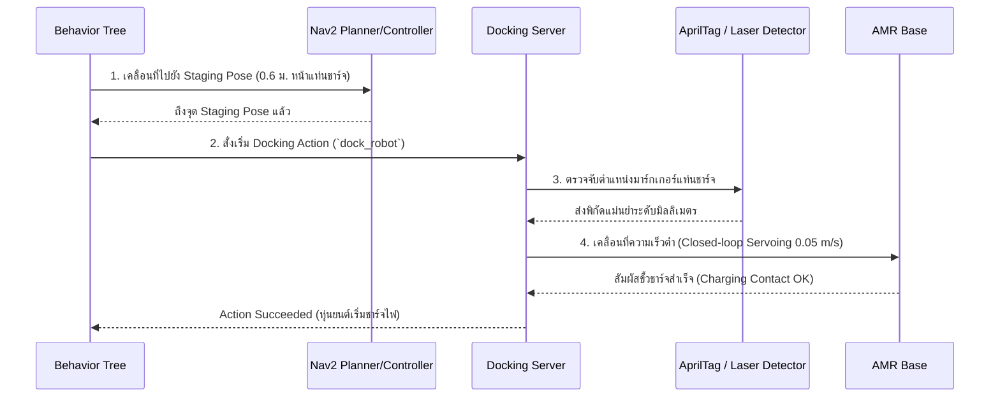

# 🔌 Tutorial: Nav2 Precision Docking Server (`opennav_docking`)

---

## 🎯 วัตถุประสงค์การเรียนรู้
1. เข้าใจข้อจำกัดของ AMCL ในการระบุตำแหน่งละเอียดระดับมิลลิเมตรเพื่อเสียบขั้วชาร์จไฟ
2. ใช้งาน **Nav2 Docking Server (`opennav_docking`)** ซึ่งเป็นฟีเจอร์ใหม่มาตรฐานใน ROS 2 Jazzy
3. เข้าใจขั้นตอน Staging Pose -> Detection -> Dock Approach -> Contact Verification -> Undocking
4. ออกแบบ Behavior Tree สำหรับระบบชาร์จไฟอัตโนมัติ

---

## 🔄 ลำดับขั้นตอนการทำงาน (Docking Lifecycle)

---

## 📂 ไฟล์คอนฟิกและ Behavior Tree
- **ไฟล์พารามิเตอร์ของ Docking Server:** [`config/docking_server_params.yaml`](config/docking_server_params.yaml)
- **ไฟล์ Behavior Tree:** [`behavior_trees/dock_and_charge_bt.xml`](behavior_trees/dock_and_charge_bt.xml)
