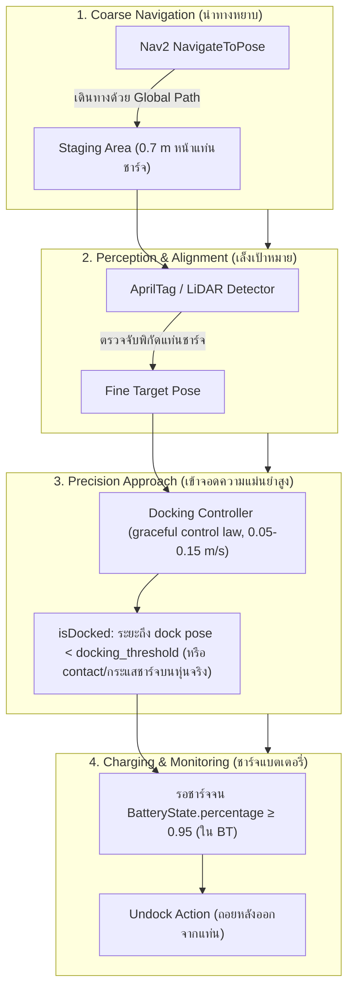
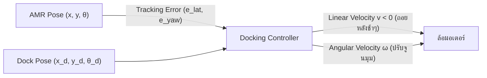
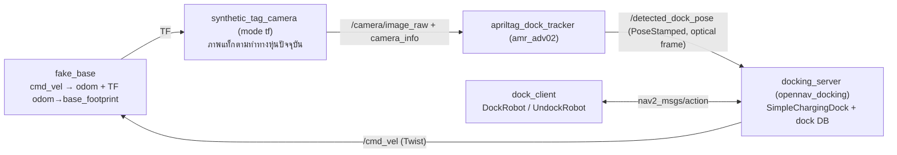

# 📖 บทที่ 3: ระบบการเข้าแท่นชาร์จความแม่นยำสูง (Nav2 Precision Docking)
**รหัสวิชา:** AMR-201 Advanced ROS 2 & Industrial Fleet Robotics  
**เวลาเรียน:** บรรยาย 2 ชั่วโมง | ปฏิบัติการ 3 ชั่วโมง | ทบทวนและค้นคว้าด้วยตนเอง 5 ชั่วโมง  
**เอกสารปฏิบัติการ:** [ใบงานแล็บปฏิบัติการที่ 3](Lab_Exercises.md)

---

## 🎯 วัตถุประสงค์การเรียนรู้เชิงพฤติกรรม (Measurable Learning Objectives)
1. **เข้าใจสถาปัตยกรรม 4 ลำดับขั้นของ Nav2 Docking Server:** อธิบายกระบวนการ Coarse Navigation, Staging Area, Fine Perception Alignment, และ Contact Verification ได้อย่างเป็นลำดับ
2. **ออกแบบและกำหนดค่า Docking Plugins:** กำหนด dock database, พารามิเตอร์ `docking_threshold`, `staging_x_offset`, และการรับ `detected_dock_pose` จาก External Vision Detector (AprilTag tracker ของบทที่ 2)
3. **สร้างและปรับแต่ง Nav2 Behavior Trees ขั้นสูง:** เขียนเงื่อนไขการตรวจจับระดับแบตเตอรี่ (`IsBatteryLow`) และผูกเข้ากับ Action Node สำหรับการชาร์จไฟอัตโนมัติ
4. **วิเคราะห์จลนศาสตร์การถอยหลังเข้าซอง (Reverse Motion Kinematics):** อธิบายความแตกต่างของการควบคุมหุ่นยนต์เดินหน้าเทียบกับถอยหลังเข้าแท่นชาร์จ

---

## 🔌 สถาปัตยกรรม Nav2 Precision Docking Server

ในงานคลังสินค้า หุ่นยนต์ AMR ต้องวิ่งทำงานต่อเนื่องตลอด 24 ชั่วโมง โดยต้องสามารถกลับเข้าสถานีชาร์จ (Charging Station) ได้เองโดยไม่มีมนุษย์ช่วยเหลือ และต้องจอดให้แม่นพอที่ขั้วชาร์จ (เช่น Pogo Pins หรือแผ่นทองแดง) จะสัมผัสกัน — ค่าที่ยอมรับได้ขึ้นกับการออกแบบขั้วและตัวนำร่องเชิงกล (funnel) ของแท่นชาร์จแต่ละรุ่น ในรายวิชานี้ใช้เกณฑ์ **ความคลาดเคลื่อนตำแหน่ง ≤ 15 mm** (`docking_threshold: 0.015` และ KPI ของ Capstone) ซึ่งระบบในแล็บวัดได้จริง 11–15 mm (ดูหัวข้อผลการรันจริง)

การใช้เพียงระบบนำทางปกติ (Nav2 Planner/Controller) ไม่สามารถให้ความแม่นยำระดับมิลลิเมตรได้ ข้อจำกัดหลัก **ไม่ใช่** ความละเอียดของแผนที่ (resolution ตั้งค่าได้ ค่า 0.05 m เป็นเพียงค่าที่นิยม) แต่คือ **ความแม่นยำของการระบุตำแหน่ง (localization)** ด้วย AMCL/SLAM ที่ปกติคลาดเคลื่อนระดับหลายเซนติเมตร และ goal tolerance ของ controller (`xy_goal_tolerance` ค่าเริ่มต้น 0.25 m) ทางแก้คือวัดตำแหน่งแท่นชาร์จ **สัมพัทธ์กับหุ่นยนต์โดยตรง** ด้วยเซนเซอร์ระยะใกล้ (กล้อง + AprilTag, LiDAR) แล้วควบคุมเข้าจอดด้วย control law เฉพาะ — ROS 2 จึงมีโมดูล **`opennav_docking` (Nav2 Docking Server)**:



---

## 📐 จลนศาสตร์และการควบคุมการถอยเข้าจอด (Precision Reversing Control)

สำหรับการเข้าชาร์จที่ขั้วชาร์จอยู่ด้านท้ายของหุ่นยนต์ การควบคุมถอยหลังของระบบ Differential Drive มีความอ่อนไหวต่อความผิดพลาดเชิงมุม (Angular Instability) มากกว่าการเดินหน้า:



สมการควบคุมมุมเลี้ยวระหว่างถอยหลังเข้าหาเส้นแนวแกนกลางแท่นชาร์จ:
$$\omega(t) = -K_{\text{yaw}} e_{\text{yaw}}(t) - K_{\text{lat}} e_{\text{lat}}(t)$$

โดยที่:
- $e_{\text{lat}}$ คือระยะคลาดเคลื่อนด้านข้าง (Lateral Offset ในแนวตั้งฉากกับแท่นชาร์จ)
- $e_{\text{yaw}}$ คือมุมเอียงสัมพัทธ์ระหว่างหุ่นยนต์กับแท่นชาร์จ
- $K_{\text{yaw}}$ และ $K_{\text{lat}}$ คือเกนการควบคุมสัดส่วน (Proportional Gains)

---

## 🛠️ แพ็กเกจ `amr_adv03` และการวิเคราะห์ไฟล์คอนฟิก (รันได้จริงแบบ Headless)

แล็บนี้รัน **Docking Server ตัวจริงของ Nav2** โดยไม่ต้องมี Gazebo หรือหุ่นยนต์จริง: ฐานหุ่นยนต์เป็นแบบจลนศาสตร์ (kinematic) และ "กล้อง" เรนเดอร์ AprilTag จากตำแหน่งปัจจุบันของหุ่นยนต์ (vision-in-the-loop) จึงวัดความคลาดเคลื่อนเทียบกับตำแหน่งจริงได้แม่นยำ



| ไฟล์ | หน้าที่ |
| :--- | :--- |
| [`config/docking_server_params.yaml`](config/docking_server_params.yaml) | พารามิเตอร์ docking server, dock plugin, **dock database** และ controller |
| [`launch/docking_sim.launch.py`](launch/docking_sim.launch.py) | fake base + static TF กล้อง + กล้องสังเคราะห์ + tracker + docking_server + lifecycle_manager (args: `dock_x dock_y dock_yaw start_x start_y start_yaw db_error_y docking_threshold use_vision`) |
| [`src/fake_base.py`](src/fake_base.py) | ฐานหุ่นยนต์จลนศาสตร์ (จำกัดความเร็ว/ความเร่ง, หยุดเมื่อ cmd_vel หมดอายุ 0.5 s) — ตำแหน่งของมันคือ ground truth |
| [`src/dock_client.py`](src/dock_client.py) | ส่ง `nav2_msgs/action/DockRobot` → วัด error เทียบตำแหน่งจริง → `UndockRobot` |
| [`behavior_trees/dock_and_charge_bt.xml`](behavior_trees/dock_and_charge_bt.xml) + [`config/bt_navigator_docking.yaml`](config/bt_navigator_docking.yaml) | BT สำหรับ bt_navigator และ plugin libraries ที่ต้องเพิ่ม |
| [`src/bt_check.py`](src/bt_check.py) | `ros2 run amr_adv03 check_bt` ตรวจ BT เทียบกับโมเดลของ BT node ที่ **ติดตั้งจริง** |

### 1. ไฟล์พารามิเตอร์ของ Docking Server: [`config/docking_server_params.yaml`](config/docking_server_params.yaml)
- `controller_frequency: 20.0`: ความถี่ของวงรอบควบคุมระหว่างเข้าจอดคือ 20 Hz
- `dock_plugins: ["simple_charging_dock"]` = **ชนิด** ของแท่นชาร์จ (plugin `opennav_docking::SimpleChargingDock`) ส่วน **`docks: ["home_dock"]`** คือ **ฐานข้อมูลแท่นชาร์จ** (instance) แต่ละตัวมี `type` (ชื่อ plugin), `frame` และ `pose: [x, y, yaw]` — goal `DockRobot` อ้างอิงด้วย `dock_id: home_dock` (ถ้าไม่มีฐานข้อมูลจะได้ `DOCK_NOT_IN_DB` = 901)
- `staging_x_offset: -0.7`: จุด Staging อยู่ห่างจาก dock pose 70 ซม. ไปทาง $-x$ ของเฟรมแท่นชาร์จ (หน้าแท่น) เพื่อให้กล้องเห็นแท็กเต็มก่อนเริ่มเข้าจอด
- `docking_threshold: 0.015`: นับว่า "จอดแล้ว" เมื่อตำแหน่งหุ่นอยู่ใกล้ dock pose (ที่ตรวจจับได้) ไม่เกิน 1.5 ซม. — ผลการรันจริงจึงมี error ตามแนวเข้าจอด (longitudinal) ใกล้ 15 mm เพราะหุ่นหยุดทันทีที่เข้าเขตนี้ ส่วนแนวขวาง (lateral) ขึ้นกับความแม่นยำของ vision
- `use_external_detection_pose: true` + `external_detection_translation_x: -0.40` และ `rotation_roll/pitch = -1.57/1.57`: รับ `PoseStamped` จากหัวข้อ **`detected_dock_pose`** (เฟรมกล้อง) แปลงเข้า `fixed_frame` ด้วย TF แล้วหมุนเฟรมแท็ก (แกน z ชี้ออกจากหน้าแท็ก) ให้เป็นเฟรมแท่นชาร์จ (แกน x ชี้เข้าแท่น) และเลื่อน 0.40 m จากแท็กมาที่ตำแหน่งจอดของ `base_footprint`
- `use_battery_status: false`: ไม่มี `/battery_state` ในแล็บ → "กำลังชาร์จ" เทียบเท่า "จอดแล้ว" (ค่าเริ่มต้น true จะรอสัญญาณชาร์จจนหมดเวลา)
- `controller:` (graceful control law) `k_phi`, `k_delta`, `v_linear_min/max`, `use_collision_detection: false` (ไม่มี costmap ในแล็บ)

### 2. แผนผังพฤติกรรม Behavior Tree: [`behavior_trees/dock_and_charge_bt.xml`](behavior_trees/dock_and_charge_bt.xml)
- รันใน `bt_navigator` เป็น `behavior_tree` ของ goal `NavigateToPose` ที่ใช้ **staging pose** เป็นเป้าหมาย (blackboard `{goal}`)
- `<IsBatteryLow min_battery="0.2"/>`: `BatteryState.percentage` มีค่า 0–1 (เดิมเขียน 20.0 ทำให้ "แบตต่ำ" ตลอดเวลา)
- `ComputePathToPose` + `FollowPath` ไปยัง `{goal}` แล้ว `<DockRobot dock_id="home_dock" navigate_to_staging_pose="false"/>` — ต้องเป็น false เพราะ BT นี้รันอยู่ใน action `navigate_to_pose` เอง หาก docking server เรียก `NavigateToPose` ซ้ำจะไปแย่ง (preempt) goal ของ BT ที่เรียกมันอยู่
- รอชาร์จด้วย `RetryUntilSuccessful` + `Wait 10 s` + `Inverter(IsBatteryLow 0.95)` (แทน `Wait 30` ที่ไม่ได้ตรวจแบตเลย) แล้ว `UndockRobot`
- `DockRobot`/`UndockRobot` อยู่ในไลบรารี `opennav_dock_action_bt_node` / `opennav_undock_action_bt_node` ซึ่ง **ไม่อยู่ในรายการ plugin เริ่มต้น** ของ Nav2 ต้องเพิ่มใน `plugin_lib_names` ([`config/bt_navigator_docking.yaml`](config/bt_navigator_docking.yaml))

```bash
colcon build --base-paths Essential_ROS Advanced_ROS --packages-up-to amr_adv03
ros2 launch amr_adv03 docking_sim.launch.py        # Terminal 1
ros2 run amr_adv03 dock_client                     # Terminal 2: dock -> measure -> undock
ros2 run amr_adv03 check_bt                        # validate the BT
```

---

## ⌨️ ตารางคำสั่ง CLI สำหรับทดสอบระบบ Docking

```bash
# ตรวจสอบว่า Action Server ของ Docking พร้อมทำงานหรือไม่
ros2 action list | grep dock

# ดูข้อมูลสถานะของ Action
ros2 action info /dock_robot

# ส่งคำสั่งให้หุ่นยนต์เข้าจอดแท่นชาร์จ 'home_dock' (ID จาก dock database) ด้วยตนเอง
# (ROS 2 Jazzy: action อยู่ใน nav2_msgs — ไม่มีแพ็กเกจ opennav_docking_msgs)
ros2 action send_goal -f /dock_robot nav2_msgs/action/DockRobot "{dock_id: 'home_dock', navigate_to_staging_pose: false}"

# สั่งให้หุ่นยนต์ถอยออกจากแท่นชาร์จ (Undock)
ros2 action send_goal -f /undock_robot nav2_msgs/action/UndockRobot "{dock_type: 'simple_charging_dock', max_undocking_time: 30.0}"
```

---

## ⚠️ ปัญหาพบบ่อยในระดับอุตสาหกรรม (Troubleshooting & Best Practices)

| อาการที่พบ (Symptom) | สาเหตุทางวิศวกรรม (Root Cause) | แนวทางแก้ไข (Solution) |
| :--- | :--- | :--- |
| **หุ่นยนต์หมุนวนที่หน้าแท่นชาร์จไม่ยอมถอยเข้า** | กล้องสูญเสียการมองเห็น Tag เมื่อหุ่นยนต์ขยับเข้าใกล้เกินไป (Out of FOV) | วาง Tag ไว้ในระดับสายตา หรือใช้ LiDAR Intensity ในช่วง 20 cm สุดท้าย |
| **ล้อลื่นไถลตอนสัมผัสขั้วชาร์จ** | หุ่นยนต์ชนขั้วชาร์จแต่ระบบควบคุมยังคงสั่งให้ล้อหมุนดันต่อไป | ตรวจจับกระแสไฟชาร์จจาก BMS เพื่อสั่งหยุดมอเตอร์ทันทีที่เริ่มชาร์จ |
| **`Lost detection or did not detect: timeout exceeded` แล้ว retry** | `detected_dock_pose` เก่ากว่า `external_detection_timeout` (แท็กหลุดเฟรม, ภาพช้า หรือ detector ส่ง pose ผิดปกติ) | ดู `ros2 topic hz /detected_dock_pose`; ในแล็บนี้เคยพบ pose เป็น NaN จาก PnP และ quaternion สลับเครื่องหมาย (แก้ใน tracker บทที่ 2) ทำให้หุ่นวิ่งเลยแท่นชาร์จ |
| **`DOCK_NOT_IN_DB` (901)** | `dock_id` ไม่มีในฐานข้อมูล `docks:` (หรือใช้ชื่อ plugin แทนชื่อ dock) | ตรวจ `docks: [...]` และส่ง `dock_id` ให้ตรง เช่น `home_dock` |
| **Docking Action หมดเวลา (Timeout)** | ค่า `dock_approach_timeout` สั้นเกินไปเมื่อเทียบกับระยะทางของ Staging Area | ปรับเพิ่ม Timeout ใน YAML หรือขยับจุด Staging Area ให้ใกล้ขึ้น |

---

## 📝 แบบทดสอบท้ายบทเชิงลึก (Self-Assessment Quiz)

1. **คำถาม:** เหตุใดการนำทางขั้นสุดท้ายเข้าสู่แท่นชาร์จ (Final Docking Phase) จึงไม่ควรเปิดใช้งาน Dynamic Obstacle Avoidance ของ Nav2 Local Costmap?
   - <details><summary><b>เฉลย</b></summary>เนื่องจากแท่นชาร์จหรือเสากั้นของสถานีชาร์จจะถูกมองเป็นสิ่งกีดขวาง (Obstacle) บน Costmap หากไม่ปิดระบบหลบหลีก หุ่นยนต์จะพยายามหักหลบและไม่สามารถวิ่งเข้าแนบสนิทกับแท่นชาร์จได้</details>

2. **คำถาม:** พารามิเตอร์ `staging_x_offset: -0.6` ใน `docking_server_params.yaml` มีความหมายเชิงกายภาพอย่างไร?
   - <details><summary><b>เฉลย</b></summary>หมายถึงจุดพักเตรียมความพร้อม (Staging Pose) ซึ่งอยู่ด้านหน้าของแท่นชาร์จ (ทาง $-x$ ของเฟรมแท่นชาร์จ ซึ่งแกน $x$ ชี้เข้าแท่น) เป็นระยะทาง 60 เซนติเมตร (ไฟล์ของแล็บใช้ -0.7 = 70 ซม.) เพื่อให้กล้องหรือเซนเซอร์มีระยะโฟกัสที่เหมาะสมในการตรวจจับมาร์กเกอร์ก่อนเริ่มกระบวนการเข้าจอดละเอียด</details>

---

## 📟 ผลการรันจริง (Real Run Output)
บันทึกจากการรันจริงใน ros:lab-runner (ROS 2 Jazzy, Gazebo Sim 8.15.0) บน Linux 7.0 เมื่อ 2026-10-29 — ผลเต็ม: [`results/docking_run.txt`](results/docking_run.txt), [`results/docking_scenarios.txt`](results/docking_scenarios.txt), [`results/check_bt_and_interfaces.txt`](results/check_bt_and_interfaces.txt), [`results/colcon_test.txt`](results/colcon_test.txt)

**1) Dock → วัดผล → Undock** (dock database ถูกตั้งให้ผิด 5 cm โดยตั้งใจ; vision ต้องแก้)
```console
$ ros2 run amr_adv03 dock_client
DockRobot dock_id=home_dock  start pose: x=0.000 y=-0.080 yaw=8.6 deg
  feedback: NAV_TO_STAGING_POSE  t= 0.00 s  retries=0
  feedback: INITIAL_PERCEPTION   t= 0.00 s  retries=0
  feedback: CONTROLLING          t= 0.00 s  retries=0
  feedback: WAIT_FOR_CHARGE      t= 6.75 s  retries=0
DockRobot result: success=True error_code=0 (NONE) num_retries=0  (6.8 s)
docked: robot x=0.9860 y=-0.0014 yaw=0.90 deg | true dock x=1.000 y=0.000 yaw=0.00 deg
docked: error = 14.1 mm (lateral -1.4 mm, longitudinal -14.0 mm), yaw error = +0.90 deg
UndockRobot result: success=True error_code=0 (5.8 s)
after undock: robot x=0.3343 y=-0.0116 yaw=0.90 deg | true dock x=1.000 y=0.000 yaw=0.00 deg
after undock: error = 665.8 mm (lateral -11.6 mm, longitudinal -665.7 mm), yaw error = +0.90 deg
```

**2) ความแม่นยำใน 4 สถานการณ์ + เทียบกับการจอดแบบไม่ใช้กล้อง** (error = ตำแหน่งจริงของหุ่นเทียบ dock pose จริง)
```console
$ ros2 launch amr_adv03 docking_sim.launch.py 
docked: error = 14.5 mm (lateral -0.6 mm, longitudinal -14.5 mm), yaw error = +0.79 deg
$ ros2 launch amr_adv03 docking_sim.launch.py start_y:=0.12 start_yaw:=-0.2
docked: error = 11.4 mm (lateral +3.0 mm, longitudinal -11.0 mm), yaw error = -1.60 deg
$ ros2 launch amr_adv03 docking_sim.launch.py dock_y:=0.2 dock_yaw:=0.3 start_yaw:=0.0
docked: error = 14.3 mm (lateral -0.9 mm, longitudinal -14.3 mm), yaw error = +0.83 deg
$ ros2 launch amr_adv03 docking_sim.launch.py start_x:=-0.3 start_y:=0.05 start_yaw:=0.0
docked: error = 14.3 mm (lateral +1.2 mm, longitudinal -14.3 mm), yaw error = -0.58 deg
$ ros2 launch amr_adv03 docking_sim.launch.py use_vision:=false
docked: error = 48.9 mm (lateral +47.5 mm, longitudinal -11.6 mm), yaw error = +1.55 deg
```
สรุปจากการรันจริง: ใช้กล้อง + AprilTag → error รวม 11–15 mm (lateral ≤ 3 mm, longitudinal ≈ `docking_threshold`), ไม่ใช้กล้อง (`use_vision:=false`) → 48.9 mm เพราะเชื่อตำแหน่งในฐานข้อมูลที่คลาดเคลื่อน 5 cm

**3) ตรวจ Behavior Tree เทียบกับ BT node ที่ติดตั้งจริง**
```console
$ ros2 run amr_adv03 check_bt
installed models: 63 Nav2 BT nodes, 2 docking BT nodes (DockRobot, UndockRobot)
dock_and_charge_bt.xml: 11 nodes: Sequence, IsBatteryLow, ComputePathToPose, FollowPath, DockRobot, RetryUntilSuccessful, Sequence, Wait, Inverter, IsBatteryLow, UndockRobot
RESULT: VALID
```
