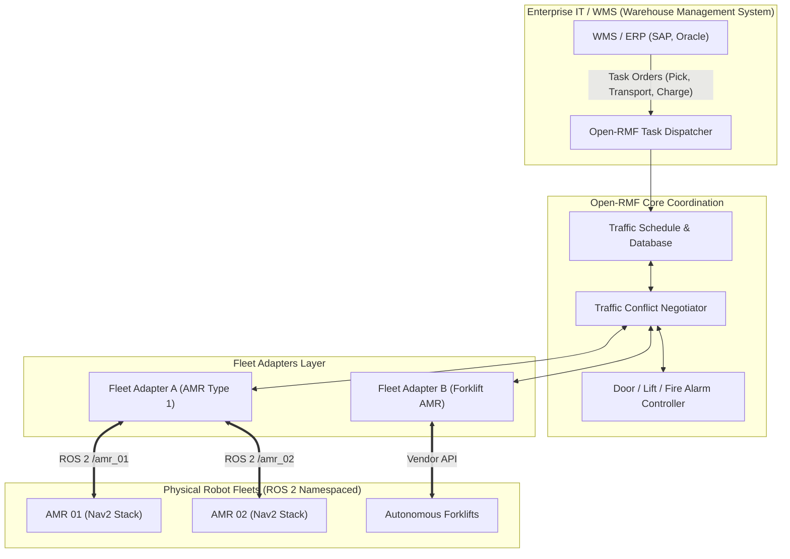
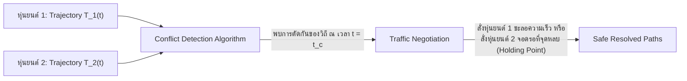

# 📖 บทที่ 4: ระบบบริหารจัดการฝูงหุ่นยนต์คลังสินค้าด้วย Open-RMF
**รหัสวิชา:** AMR-201 Advanced ROS 2 & Industrial Fleet Robotics  
**เวลาเรียน:** บรรยาย 2 ชั่วโมง | ปฏิบัติการ 3 ชั่วโมง | ทบทวนและค้นคว้าด้วยตนเอง 5 ชั่วโมง  
**เอกสารปฏิบัติการ:** [ใบงานแล็บปฏิบัติการที่ 4](Lab_Exercises.md)

---

## 🎯 วัตถุประสงค์การเรียนรู้เชิงพฤติกรรม (Measurable Learning Objectives)
1. **เข้าใจหลักการ Namespacing และ TF Frame Prefixing:** สามารถจัดสรรกลุ่ม Node, Topic, และ TF Tree สำหรับหุ่นยนต์หลายตัวในเครือข่ายเดียวกันโดยไม่เกิดการชนกันของชื่อ (Name Collision)
2. **เข้าใจสถาปัตยกรรม Open-RMF (Robotics Middleware Framework):** อธิบายหน้าที่ของ `Traffic Deconfliction`, `Fleet Adapter`, `Task Dispatcher`, และการเชื่อมโยงระบบอาคารอัตโนมัติ (Doors/Lifts)
3. **วิเคราะห์คณิตศาสตร์การแก้ปัญหาการชนกันเชิงมิติเวลา (Space-Time Trajectory Conflict Resolution):** คำนวณระยะเว้นปลอดภัยระหว่างเส้นทางของหุ่นยนต์ 2 ตัวตามแกนเวลา
4. **กำหนดค่า Fleet Adapter Configuration:** ปรับแต่งไฟล์คอนฟิกขีดจำกัดความเร็ว ขนาดรัศมีความปลอดภัย (Footprint & Vicinity) และระบบบริหารพลังงานของฝูงหุ่นยนต์

---

## 🏢 สถาปัตยกรรมระบบบริหารจัดการฝูงหุ่นยนต์ (Open-RMF Ecosystem)

เมื่อมีหุ่นยนต์หลายร้อยตัวจากต่างยี่ห้อทำงานร่วมกันในคลังสินค้าเดียวกัน การใช้เพียง ROS 2 ปกติจะไม่สามารถจัดการการจราจรได้ หุ่นยนต์จะเกิดสภาวะติดขัดที่ทางแยก (Deadlock) หรือแย่งกันเข้าสถานีชาร์จ

**Open-RMF (Open Robotics Middleware Framework)** ได้รับการพัฒนาขึ้นโดย Open Robotics ร่วมกับรัฐบาลสิงคโปร์ เพื่อเป็นแพลตฟอร์มกลางระดับโลกในการประสานงานระหว่างฝูงหุ่นยนต์ (Heterogeneous Fleets) และระบบโครงสร้างพื้นฐานอัจฉริยะ:



---

## 📐 คณิตศาสตร์การหลบหลีกการชนกันในมิติเวลา (Space-Time Trajectory Deconfliction)

Open-RMF ไม่ได้ดูแค่พิกัด 2 มิติ $(x, y)$ บนแผนที่ แต่ดูเป็น **วิถีการเคลื่อนที่ใน 4 มิติ $(x(t), y(t), \theta(t), t)$**:



เงื่อนไขความปลอดภัย: ณ ทุกๆ จุดเวลา $t$ ระยะห่างระหว่างจุดศูนย์กลางของหุ่นยนต์ตัวที่ 1 และตัวที่ 2 ต้องมากกว่าผลรวมของรัศมีความปลอดภัย (Safety Vicinity):

$$\sqrt{(x_1(t) - x_2(t))^2 + (y_1(t) - y_2(t))^2} \ge R_{\text{vicinity}, 1} + R_{\text{vicinity}, 2} + \delta_{\text{margin}}$$

หากสมการนี้ถูกละเมิด ณ ช่วงเวลา $t_c \pm \Delta t$ ระบบ Open-RMF Negotiator จะเริ่มกระบวนการต่อรอง (Negotiation Protocol) โดยคำนวณต้นทุนการรอคอย (Cost of Waiting) และสั่งให้หุ่นยนต์ตัวที่มีงานด่วนกว่าวิ่งผ่านไปก่อน ในขณะที่อีกตัวจอดรอที่ Holding Point

---

## 🛠️ การวิเคราะห์การแยกกลุ่มเครือข่าย (Namespacing Strategy)

ในไฟล์ Launch: [`launch/multi_robot_fleet.launch.py`](launch/multi_robot_fleet.launch.py)

```python
# แยกกลุ่มหุ่นยนต์ด้วย PushRosNamespace และกำหนด frame_prefix
PushRosNamespace('amr_01'),
Node(
    package='robot_state_publisher',
    executable='robot_state_publisher',
    name='robot_state_publisher',
    parameters=[{
        'robot_description': robot_desc,
        'frame_prefix': 'amr_01/'  # ทำให้ base_link กลายเป็น amr_01/base_link
    }]
)
```

- **Topic Isolation:** โหนดของหุ่นยนต์แต่ละตัวจะแยกสื่อสารผ่าน `/amr_01/cmd_vel`, `/amr_01/odom`, `/amr_02/cmd_vel`, `/amr_02/odom` ทำให้คำสั่งควบคุมไม่ตีกัน
- **TF Tree Isolation:** พารามิเตอร์ `frame_prefix` ทำให้โครงสร้างแกนพิกัดแยกออกจากกันโดยสิ้นเชิง โดยเชื่อมโยงกับ Global Map Frame เดียวกัน (`map -> amr_01/odom` และ `map -> amr_02/odom`)

---

## ⌨️ ตารางคำสั่ง CLI สำหรับมอนิเตอร์ฝูงหุ่นยนต์

```bash
# แสดงรายชื่อ Node ทั้งหมดพร้อม Namespace แยกชัดเจน
ros2 node list

# ตรวจสอบว่า Topic แยกกลุ่มอย่างถูกต้องหรือไม่
ros2 topic list | grep -E "amr_01|amr_02"

# ดูแผนผังการเชื่อมโยงระบบทั้งหมดผ่าน rqt_graph
ros2 run rqt_graph rqt_graph

# ตรวจสอบสถานะ Traffic Schedule ของ Open-RMF
ros2 topic echo /rmf_traffic/schedule
```

---

## ⚠️ ปัญหาพบบ่อยในระดับอุตสาหกรรม (Troubleshooting & Best Practices)

| อาการที่พบ (Symptom) | สาเหตุทางวิศวกรรม (Root Cause) | แนวทางแก้ไข (Solution) |
| :--- | :--- | :--- |
| **TF2 Tree กระพริบหรือทับซ้อนกัน** | ลืมใส่ `frame_prefix` ทำให้ทั้งสองตัวแย่งกันประกาศพิกัด `base_link` บน Topic `/tf` เดียวกัน | กำหนด `frame_prefix: 'amr_XX/'` ใน `robot_state_publisher` ทุกตัว |
| **DDS Multicast สัญญาณหน่วงใน Wi-Fi** | เมื่อมีหุ่นยนต์เกิน 10 ตัว แพ็กเก็ต Multicast ส่งสัญญาณกระจายทั่ววงเน็ตเวิร์กจน Access Point รับไม่ไหว | เปลี่ยน RMW เป็น **CycloneDDS** และตั้งค่า Unicast Whitelist ในไฟล์ XML |
| **หุ่นยนต์หยุดจ้องหน้ากันตรงทางแยก (Deadlock)** | หุ่นยนต์ไม่มีระบบเจรจาจราจรส่วนกลาง และต่างฝ่ายต่างรอให้อีกฝ่ายถอย | ติดตั้ง Open-RMF Traffic Negotiator เพื่อกำหนดลำดับความสำคัญ (Priority Yield) |

---

## 📝 แบบทดสอบท้ายบทเชิงลึก (Self-Assessment Quiz)

1. **คำถาม:** หากไม่กำหนด `frame_prefix` ใน `robot_state_publisher` เมื่อรันหุ่นยนต์ 2 ตัวในระบบเดียวกัน จะเกิดผลกระทบอย่างไรต่อระบบ TF2?
   - <details><summary><b>เฉลย</b></summary>ระบบ TF2 Buffer จะได้รับข้อมูลการแปลงพิกัดของ `base_link` จากโหนด 2 ตัวที่ตำแหน่งต่างกันในเวลาเดียวกัน ทำให้เกิดปัญหา TF Tearing และโมเดลหุ่นยนต์บน RViz2 จะกระโดดสลับไปมาระหว่างหุ่นยนต์ทั้งสองตัว</details>

2. **คำถาม:** รัศมี `vicinity` ในไฟล์คอนฟิก Open-RMF มีหน้าที่ต่างจาก `footprint` อย่างไร?
   - <details><summary><b>เฉลย</b></summary>`footprint` คือขนาดกายภาพจริงของตัวหุ่นยนต์ ส่วน `vicinity` คือขอบเขตฟองสบู่นิรภัยจำลอง (Safety Bubble) รอบตัวหุ่นยนต์ที่ห้ามมิให้หุ่นยนต์ตัวอื่นล่วงล้ำเข้ามา เพื่อป้องกันการชนและเผื่อระยะหยุดฉุกเฉิน</details>
