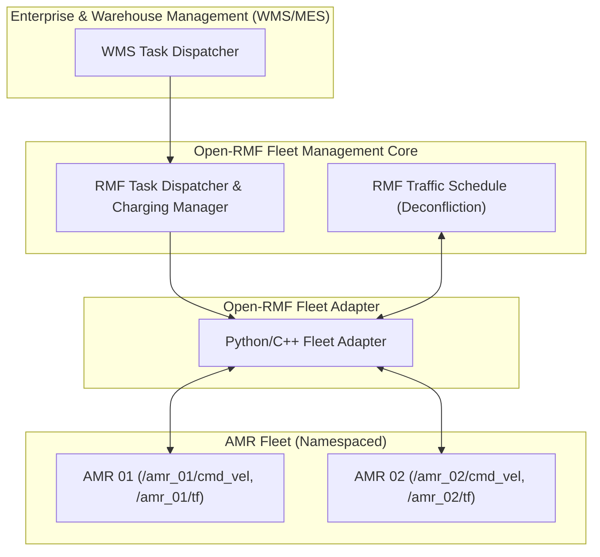

# 🏢 Tutorial: Multi-Robot Fleet Management & Open-RMF

---

## 🎯 วัตถุประสงค์การเรียนรู้
1. เข้าใจสถาปัตยกรรมการควบคุมหุ่นยนต์หลายตัว (Multi-Robot Fleet) ในพื้นที่ปฏิบัติงานเดียวกัน
2. การจัดการ Namespace และการใช้ `frame_prefix` เพื่อป้องกันปัญหาชนกันของ TF Tree และ Topics
3. การจัดการ Traffic หุ่นยนต์ และการแก้ปัญหาทางแยกผ่าน **Open-RMF (Robotics Middleware Framework)**
4. การใช้ Zenoh Router เชื่อมต่อเครือข่ายระหว่างหุ่นยนต์กับ Fleet Management Server

---

## 🏗️ สถาปัตยกรรม Open-RMF & Multi-Robot Fleet



---

## 📂 ไฟล์ในโมดูลนี้
- **คอนฟิก Open-RMF Fleet Adapter:** [`config/fleet_adapter_config.yaml`](config/fleet_adapter_config.yaml)
- **Launch File รันหุ่นยนต์หลายตัว:** [`launch/multi_robot_fleet.launch.py`](launch/multi_robot_fleet.launch.py)

---

## 📝 คำสั่งทดสอบรัน
```bash
# รันหุ่นยนต์ 2 ตัวแยก Namespace และ TF Prefix
./docker/run_lab.sh ros2 launch Advanced_ROS/04_Multi_Robot_Fleet_OpenRMF/launch/multi_robot_fleet.launch.py
```
