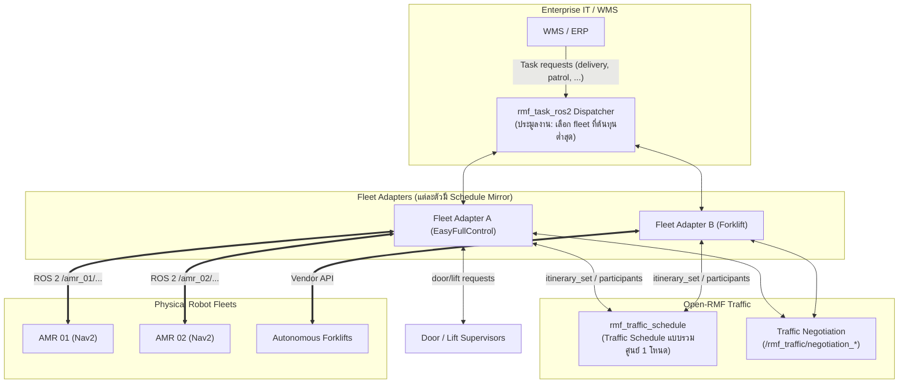
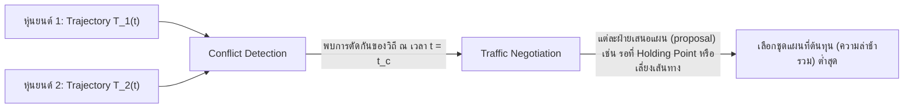
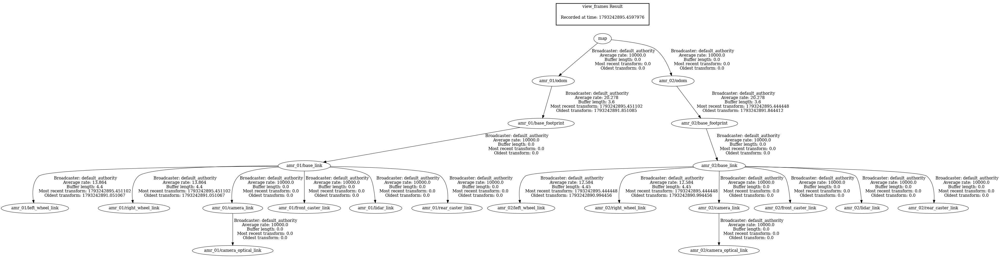

# 📖 บทที่ 4: ระบบบริหารจัดการฝูงหุ่นยนต์คลังสินค้าด้วย Open-RMF
**รหัสวิชา:** AMR-201 Advanced ROS 2 & Industrial Fleet Robotics  
**เวลาเรียน:** บรรยาย 2 ชั่วโมง | ปฏิบัติการ 3 ชั่วโมง | ทบทวนและค้นคว้าด้วยตนเอง 5 ชั่วโมง  
**เอกสารปฏิบัติการ:** [ใบงานแล็บปฏิบัติการที่ 4](Lab_Exercises.md)  
**แพ็กเกจ ROS 2:** `amr_adv04` (ament_python, โฟลเดอร์นี้) — ใช้ URDF จาก `amr_week07`

---

## 🎯 วัตถุประสงค์การเรียนรู้เชิงพฤติกรรม (Measurable Learning Objectives)
1. **เข้าใจหลักการ Namespacing และ TF Frame Prefixing:** สามารถจัดสรรกลุ่ม Node, Topic, และ TF Frame สำหรับหุ่นยนต์หลายตัวในเครือข่ายเดียวกันโดยไม่เกิดการชนกันของชื่อ (Name Collision) และอธิบายได้ว่าอะไร "แยก" และอะไร "ใช้ร่วมกัน"
2. **เข้าใจสถาปัตยกรรม Open-RMF (Robotics Middleware Framework):** อธิบายหน้าที่ของ Traffic Schedule, Traffic Negotiation, Fleet Adapter, Task Dispatcher และการเชื่อมโยงระบบอาคาร (Doors/Lifts)
3. **วิเคราะห์คณิตศาสตร์การแก้ปัญหาการชนกันเชิงมิติเวลา (Space-Time Trajectory Conflict Resolution):** คำนวณระยะเว้นปลอดภัยระหว่างเส้นทางของหุ่นยนต์ 2 ตัวตามแกนเวลา
4. **กำหนดค่า Fleet Adapter Configuration:** เขียนไฟล์คอนฟิก EasyFullControl และ Navigation Graph ที่ `rmf_fleet_adapter` ยอมรับจริง (ขีดจำกัดความเร็ว, Footprint/Vicinity, ระบบพลังงาน, สถานีชาร์จ)

---

## 🏗️ Build แพ็กเกจก่อนเริ่ม

ทุกคำสั่งรันผ่าน Docker image `ros:lab-runner` (ROS 2 Jazzy) จากโฟลเดอร์ราก `/mnt/sda/ros`:

```bash
# build แพ็กเกจของบทนี้ (และ amr_week07 ที่มันพึ่งพา)
./docker/run_lab.sh colcon build --base-paths Essential_ROS Advanced_ROS --packages-up-to amr_adv04
# run_lab.sh จะ source install/setup.bash ให้อัตโนมัติ จากนั้นใช้ได้เลย:
./docker/run_lab.sh ros2 launch amr_adv04 multi_robot_fleet.launch.py
# ทดสอบอัตโนมัติ (unit + launch_testing + ตรวจคอนฟิก RMF ด้วย parser จริง)
./docker/run_lab.sh colcon test --base-paths Advanced_ROS --packages-select amr_adv04
./docker/run_lab.sh colcon test-result --verbose
```

| ไฟล์ | หน้าที่ |
| :--- | :--- |
| [`launch/multi_robot_fleet.launch.py`](launch/multi_robot_fleet.launch.py) | เปิดหุ่นยนต์ N ตัว (`robots:=amr_01,amr_02`) แต่ละตัวอยู่ใน Namespace ของตัวเอง |
| [`src/fake_diff_drive.py`](src/fake_diff_drive.py) | ตัวจำลองจลนศาสตร์ (kinematic) ของหุ่นยนต์ขับเคลื่อนแบบ differential drive — รับ `cmd_vel` แล้วคำนวณ `odom`, `joint_states`, TF โดยไม่ต้องใช้ Gazebo/GPU |
| [`src/fleet_config_check.py`](src/fleet_config_check.py) | โหลดคอนฟิก Open-RMF ด้วย parser ของ `rmf_fleet_adapter` จริง แล้วตรวจความสอดคล้องกับ nav graph |
| [`config/fleet_adapter_config.yaml`](config/fleet_adapter_config.yaml) | คอนฟิก Fleet Adapter (schema EasyFullControl ของ Jazzy) |
| [`config/nav_graph.yaml`](config/nav_graph.yaml) | Navigation Graph ขั้นต่ำของคลังสินค้า (6 waypoints, 12 lanes) |
| [`test/`](test/) | `test_multi_robot_launch.py` (launch_testing), `test_fleet_config.py`, `test_fake_diff_drive_kinematics.py` |

---

## 🏢 สถาปัตยกรรมระบบบริหารจัดการฝูงหุ่นยนต์ (Open-RMF Ecosystem)

เมื่อมีหุ่นยนต์หลายสิบตัวจากต่างยี่ห้อทำงานร่วมกันในคลังสินค้าเดียวกัน ROS 2 เพียงอย่างเดียวไม่มีกลไกจัดการจราจรระหว่างฝูง หุ่นยนต์อาจติดขัดที่ทางแยก (Deadlock) หรือแย่งกันเข้าสถานีชาร์จ

**Open-RMF (Open Robotics Middleware Framework)** เป็นชุดซอฟต์แวร์โอเพนซอร์สที่เริ่มพัฒนาโดย Open Robotics ด้วยทุนจากหน่วยงานรัฐของสิงคโปร์ (เดิมมุ่งใช้ในโรงพยาบาล) ปัจจุบันเป็นโครงการภายใต้ Open Source Robotics Alliance (OSRA) ใช้ประสานงานฝูงหุ่นยนต์ต่างยี่ห้อ (Heterogeneous Fleets) และโครงสร้างพื้นฐานอาคาร:



- **Traffic Schedule** เป็น **โหนดกลางเพียงโหนดเดียว** (`rmf_traffic_ros2/rmf_traffic_schedule`) ที่เก็บ itinerary (เส้นทาง + เวลา) ของทุก participant; Fleet Adapter แต่ละตัวถือ **Schedule Mirror** (สำเนาที่ได้รับ patch จากโหนดกลาง) ไว้วางแผนเส้นทางในเครื่องของตัวเอง — จึงเป็นระบบ "รวมศูนย์ + มิเรอร์" ไม่ใช่ฐานข้อมูลแบบกระจาย (ระบบ production มักเปิด schedule node สำรองไว้ทำ fail-over)
- **Fleet Adapter** แปลงคำสั่งระดับ RMF (ไป waypoint, เทียบท่า, ชาร์จ) เป็น API ของหุ่นยนต์แต่ละยี่ห้อ และรายงานตำแหน่ง/แบตเตอรี่กลับ
- **Door/Lift** ถูกควบคุมผ่าน door/lift supervisor โดย Fleet Adapter ร้องขอเมื่อเส้นทางผ่านประตูหรือลิฟต์ ไม่ได้ผ่านตัว negotiation

ผลการรัน `rmf_traffic_schedule` จริงใน image ของวิชา (ดู [`results/rmf_traffic_schedule.txt`](results/rmf_traffic_schedule.txt)) แสดง topic/service ที่มีอยู่จริง เช่น `/rmf_traffic/participants`, `/rmf_traffic/itinerary_set`, `/rmf_traffic/negotiation_notice`, service `/rmf_traffic/register_participant` — **ไม่มี** topic ชื่อ `/rmf_traffic/schedule`

---

## 📐 คณิตศาสตร์การหลบหลีกการชนกันในมิติเวลา (Space-Time Trajectory Deconfliction)

Open-RMF ไม่ได้ดูแค่พิกัด 2 มิติ $(x, y)$ บนแผนที่ แต่ดู **วิถีการเคลื่อนที่ตามเวลา $(x(t), y(t), \theta(t))$** ที่แต่ละ participant ประกาศไว้ใน schedule:



เงื่อนไขความปลอดภัย: ณ ทุกจุดเวลา $t$ footprint ของหุ่นยนต์ตัวหนึ่งต้องไม่ล้ำเข้าไปใน vicinity ของอีกตัว (โปรไฟล์ทั้งสองเป็นวงกลมใน `fleet_adapter_config.yaml`):

$$\sqrt{(x_1(t) - x_2(t))^2 + (y_1(t) - y_2(t))^2} \ge \max\big(R_{\text{footprint},1} + R_{\text{vicinity},2},\; R_{\text{vicinity},1} + R_{\text{footprint},2}\big)$$

ตัวอย่าง: footprint 0.3 m, vicinity 0.5 m ทั้งสองตัว → ต้องห่างกันอย่างน้อย 0.8 m ตลอดเวลา

หากเงื่อนไขนี้ถูกละเมิดในช่วงเวลา $t_c \pm \Delta t$ ระบบจะเปิด **Negotiation** ระหว่าง participant ที่ขัดแย้งกัน: แต่ละฝ่ายเสนอ itinerary ทางเลือก (เช่น จอดรอที่ Holding Point แล้วค่อยไป) จากนั้นตัวเลือกผล (Evaluator) ค่าเริ่มต้นคือ `QuickestFinishEvaluator` ของ `rmf_traffic` จะเลือกชุดข้อเสนอที่ **ผลรวมความล่าช้าของทุกตัว (เทียบกับเวลาถึงที่ดีที่สุดของแต่ละตัว) ต่ำที่สุด** — คือเลือกตาม "ต้นทุนเวลา" ไม่ใช่ตาม "ความด่วนของงาน" (การจัดลำดับงานเป็นเรื่องของการประมูลงานใน Task Dispatcher ซึ่งก็ใช้ `QuickestFinishEvaluator` เป็นค่าเริ่มต้นเช่นกัน)

---

## 🛠️ การแยกกลุ่มหุ่นยนต์: Namespacing + `frame_prefix` (สิ่งที่แยกจริง vs. สิ่งที่ใช้ร่วมกัน)

ในไฟล์ Launch [`launch/multi_robot_fleet.launch.py`](launch/multi_robot_fleet.launch.py) หุ่นยนต์แต่ละตัวคือ `GroupAction` หนึ่งก้อน:

```python
GroupAction([
    PushRosNamespace('amr_01'),
    Node(package='robot_state_publisher', executable='robot_state_publisher',
         parameters=[{'robot_description': robot_desc,
                      'frame_prefix': 'amr_01/'}]),          # base_link -> amr_01/base_link
    Node(package='amr_adv04', executable='fake_diff_drive',  # cmd_vel -> odom, joint_states, TF
         parameters=[{'frame_prefix': 'amr_01/'}]),
    Node(package='tf2_ros', executable='static_transform_publisher', name='map_to_odom',
         arguments=['--x', '0.0', '--y', '0.0',
                    '--frame-id', 'map', '--child-frame-id', 'amr_01/odom']),
])
```

`PushRosNamespace` มีผลกับ **ชื่อโหนด** และ **ชื่อ topic/service แบบสัมพัทธ์ (relative)** เท่านั้น:

| สิ่งที่เห็นในระบบ (จากการรันจริง) | แยกตาม Namespace? | เหตุผล |
| :--- | :---: | :--- |
| `/amr_01/robot_state_publisher`, `/amr_01/fake_diff_drive` | ✅ | ชื่อโหนดถูกเติม namespace |
| `/amr_01/cmd_vel`, `/amr_01/odom`, `/amr_01/joint_states`, `/amr_01/robot_description` | ✅ | โค้ดใช้ชื่อแบบ relative (`'cmd_vel'` ไม่ใช่ `'/cmd_vel'`) |
| `/tf`, `/tf_static` | ❌ ใช้ร่วมกัน | tf2 ใช้ชื่อ absolute `"/tf"` เสมอ namespace จึงไม่มีผล |
| ชื่อ frame `amr_01/base_link`, `amr_01/left_wheel_link` | ✅ | มาจาก `frame_prefix` ไม่ใช่จาก namespace |

ดังนั้นสิ่งที่ได้คือ **TF tree เดียวที่มีหุ่นยนต์ทุกตัวอยู่ในนั้น** โดยชื่อ frame ไม่ชนกัน:

```text
map ─┬─ amr_01/odom ── amr_01/base_footprint ── amr_01/base_link ─┬─ amr_01/left_wheel_link ...
     └─ amr_02/odom ── amr_02/base_footprint ── amr_02/base_link ─┴─ amr_02/left_wheel_link ...
```



*ภาพ: ผลจริงจาก `ros2 run tf2_tools view_frames` ระหว่างรัน `multi_robot_fleet.launch.py` (ไฟล์ `.gv` ที่ได้ถูกแปลงเป็น PNG ด้วย `dot -Tpng`) — frame ของล้อ (`*_wheel_link`) ปรากฏเพราะ `fake_diff_drive` ส่ง `/amr_0X/joint_states` ให้ `robot_state_publisher`; ถ้าไม่มีผู้ส่ง joint_states ล้อซึ่งเป็น continuous joint จะไม่มี TF เลย*

### ทางเลือกสองแบบในการแยก TF ของหุ่นยนต์หลายตัว

| | **A. Shared `/tf` + `frame_prefix`** (ที่ใช้ในบทนี้) | **B. Remap `/tf`→`tf` ต่อ namespace** (แบบ Nav2 multi-robot bringup) |
| :--- | :--- | :--- |
| วิธีทำ | `frame_prefix: 'amr_01/'` ใน `robot_state_publisher` และ frame อื่นๆ (odom, scan) ต้องเติม prefix เอง | `remappings=[('/tf', 'tf'), ('/tf_static', 'tf_static')]` ทุกโหนดของหุ่นยนต์ ได้ `/amr_01/tf` แยกต่อตัว ชื่อ frame ไม่ต้องเติม prefix |
| ข้อดี | เครื่องมือมาตรฐาน (`tf2_echo`, RViz, `view_frames`) เห็นทุกตัวใน tree เดียว ระบบระดับฝูงหาตำแหน่งสัมพัทธ์ระหว่างหุ่นยนต์ได้ทันที | หุ่นยนต์แต่ละตัวรับเฉพาะ TF ของตัวเอง ทราฟฟิกต่อโหนดไม่โตตามจำนวนหุ่นยนต์ ใช้ config Nav2 เดิมได้ (`base_link`, `odom`) |
| ข้อเสีย | ทุกโหนดที่ subscribe `/tf` ได้รับ TF ของ **ทุก** ตัว (ทราฟฟิกโตตามจำนวนหุ่นยนต์ เปลือง Wi-Fi) ต้องตั้งชื่อ frame ให้ตรงกันทุกที่ (Nav2, sensor `frame_id`) | เครื่องมือต้อง remap ด้วย เช่น `ros2 run tf2_ros tf2_echo base_link left_wheel_link --ros-args -r /tf:=/amr_01/tf -r /tf_static:=/amr_01/tf_static` และดูหลายตัวพร้อมกันใน RViz ยากขึ้น |

> ในระบบที่มี Open-RMF หุ่นยนต์แต่ละตัวมักรัน Nav2 บนคอมพิวเตอร์ของตัวเอง (แบบ B หรือแยก `ROS_DOMAIN_ID`/เครือข่าย) และให้ Fleet Adapter เป็นผู้รวบรวมตำแหน่งส่งเข้า RMF แทนการแชร์ `/tf` ทั้งฝูง

---

## ⚙️ คอนฟิก Open-RMF Fleet Adapter (EasyFullControl, Jazzy)

[`config/fleet_adapter_config.yaml`](config/fleet_adapter_config.yaml) ถูกอ่านด้วย `EasyFullControl::FleetConfiguration::from_config_files(config, nav_graph)` ของ `rmf_fleet_adapter` 2.7.x (ใน Python: `rmf_adapter.easy_full_control.FleetConfiguration.from_config_files`) ซึ่ง **คืนค่า `None` ถ้าขาดหัวข้อบังคับ**:

| คีย์ใต้ `rmf_fleet:` | บังคับ? | ความหมาย |
| :--- | :---: | :--- |
| `name` | ✅ | ชื่อ fleet |
| `limits.linear` / `limits.angular` | ✅ | `[ความเร็ว, ความเร่ง]` nominal ที่ planner ใช้ประมาณเวลา |
| `profile.footprint` / `profile.vicinity` | ✅ | รัศมีตัวหุ่นยนต์ / รัศมีพื้นที่ส่วนตัว (m) |
| `battery_system.{voltage, capacity, charging_current}` | ✅ | แบตเตอรี่ (V, Ah, A) |
| `mechanical_system.{mass, moment_of_inertia, friction_coefficient}` | ✅ | ใช้คำนวณพลังงานที่ใช้ขณะเคลื่อนที่ |
| `ambient_system.power`, `tool_system.power` | ✅ | กำลังไฟฟ้าที่ใช้ตลอดเวลา / ของอุปกรณ์เสริม (W) |
| `recharge_threshold`, `recharge_soc` | มีค่าเริ่มต้น | ระดับแบตขั้นต่ำก่อนต้องไปชาร์จ / ชาร์จถึงระดับใด (อยู่ที่ระดับ `rmf_fleet` **ไม่ใช่** ใต้ `battery_system`) |
| `account_for_battery_drain` | ค่าเริ่มต้น `true` | ให้ task planner คิดการใช้แบตหรือไม่ |
| `task_capabilities`, `actions`, `finishing_request` | ไม่บังคับ | งานที่รับได้ (`loop`=patrol, `delivery`), action เพิ่มเติม, ทำอะไรหลังจบงาน (`park`/`charge`/`nothing`) |
| `robots.<name>.charger` | ไม่บังคับ | สถานีชาร์จของหุ่นยนต์แต่ละตัว = ชื่อ waypoint ที่มี `is_charger: true` ใน nav graph |

ข้อสังเกตสำคัญ:
- ไม่มีคีย์ `initial_waypoint` และ `drain_battery_factor` ใน schema นี้ — ตำแหน่งเริ่มต้นมาจาก **สถานะที่หุ่นยนต์รายงาน** ตอน Fleet Adapter เพิ่มหุ่นยนต์เข้า fleet (adapter จะหา waypoint/lane ที่ใกล้ที่สุดบน nav graph เอง)
- ไฟล์คอนฟิกต้องมาคู่กับ **Navigation Graph** ([`config/nav_graph.yaml`](config/nav_graph.yaml)) ซึ่งปกติสร้างจาก `rmf_traffic_editor`/`rmf_building_map_tools`; lane เป็น **ทางเดียว** ต้องใส่ทั้งไปและกลับ
- parser **ไม่ได้ตรวจ** ว่าชื่อ charger มีอยู่ใน nav graph — `fleet_config_check` จึงตรวจเพิ่มให้

```bash
./docker/run_lab.sh ros2 run amr_adv04 fleet_config_check          # exit code 0 = ใช้ได้
```

---

## ⌨️ ตารางคำสั่ง CLI สำหรับมอนิเตอร์ฝูงหุ่นยนต์

```bash
# แสดงรายชื่อ Node ทั้งหมดพร้อม Namespace
ros2 node list

# ตรวจสอบว่า Topic ของหุ่นยนต์แต่ละตัวแยกกัน (และ /tf ใช้ร่วมกัน)
ros2 topic list | grep -E "amr_01|amr_02|tf"

# ใครส่ง/รับ joint_states ของ amr_01
ros2 topic info -v /amr_01/joint_states

# ดู TF ระหว่าง frame ของหุ่นยนต์ตัวเดียวกัน หรือข้ามตัว
ros2 run tf2_ros tf2_echo amr_01/base_link amr_01/left_wheel_link
ros2 run tf2_ros tf2_echo amr_01/base_link amr_02/base_link

# สั่งหุ่นยนต์ทีละตัว
ros2 topic pub --times 20 --rate 10 /amr_01/cmd_vel geometry_msgs/msg/Twist "{linear: {x: 0.5}}"

# Open-RMF traffic schedule (รันโหนด schedule ก่อน)
ros2 run rmf_traffic_ros2 rmf_traffic_schedule
ros2 topic echo /rmf_traffic/participants      # รายชื่อ participant ที่ลงทะเบียนแล้ว
ros2 topic list | grep rmf_traffic             # itinerary_* และ negotiation_* topics
```

---

## ⚠️ ปัญหาพบบ่อยในระดับอุตสาหกรรม (Troubleshooting & Best Practices)

| อาการที่พบ (Symptom) | สาเหตุทางวิศวกรรม (Root Cause) | แนวทางแก้ไข (Solution) |
| :--- | :--- | :--- |
| **โมเดลใน RViz กระโดดสลับระหว่างสองตำแหน่ง** | ลืมใส่ `frame_prefix` ทำให้ทั้งสองตัวประกาศ `odom -> base_footprint` ชื่อเดียวกันบน `/tf` ที่ใช้ร่วมกัน | กำหนด `frame_prefix: 'amr_XX/'` ใน `robot_state_publisher` และใช้ prefix เดียวกันกับ odom/sensor frame (หรือใช้แบบ remap `/tf`→`tf`) |
| **`tf2_echo amr_01/base_link amr_01/left_wheel_link` รอไม่จบ** | ไม่มีใครส่ง `/amr_01/joint_states` (ล้อเป็น continuous joint) หรือ joint_states ไปอยู่ผิด namespace (`/joint_states`) | ตรวจด้วย `ros2 topic info -v /amr_01/joint_states` ต้องมีทั้ง publisher และ subscriber ใน namespace เดียวกัน |
| **สั่ง `/cmd_vel` แล้วหุ่นยนต์ไม่ขยับ** | หุ่นยนต์ฟังที่ `/amr_01/cmd_vel` | ส่งไปที่ topic ใน namespace หรือ remap ที่ฝั่ง teleop |
| **DDS discovery หน่วงใน Wi-Fi เมื่อหุ่นยนต์มาก** | Simple Discovery ใช้ multicast และทุก participant ต้องรู้จักทุก participant (ทราฟฟิกโตแบบ O(N²)) | ใช้ Discovery Server ของ Fast DDS, กำหนด peers แบบ unicast (CycloneDDS) หรือ `rmw_zenoh_cpp` ที่มี router (ดูบทที่ 5) |
| **หุ่นยนต์หยุดจ้องหน้ากันตรงทางแยก (Deadlock)** | แต่ละ fleet วางแผนเองโดยไม่รู้เส้นทางของอีก fleet | ให้ทุก fleet ลงทะเบียนเป็น participant ใน RMF Traffic Schedule และใช้ Negotiation + Holding Points ใน nav graph |

---

## 📝 แบบทดสอบท้ายบทเชิงลึก (Self-Assessment Quiz)

1. **คำถาม:** หากไม่กำหนด `frame_prefix` ใน `robot_state_publisher` เมื่อรันหุ่นยนต์ 2 ตัวในระบบเดียวกัน จะเกิดผลกระทบอย่างไรต่อระบบ TF2?
   - <details><summary><b>เฉลย</b></summary>ทั้งสองโหนดจะประกาศ frame ชื่อเดียวกัน (`base_link`, `left_wheel_link`, ...) บน `/tf` และ `/tf_static` ที่ใช้ร่วมกัน (namespace ไม่ช่วยเพราะ tf2 ใช้ชื่อ absolute) TF buffer มองเป็น frame เดียว การแปลงที่มาจาก odometry ของสองตัวจะสลับกันเขียนทับ โมเดลบน RViz2 กระโดดไปมา และ Nav2 ของแต่ละตัวได้ตำแหน่งผิด</details>

2. **คำถาม:** รัศมี `vicinity` ในไฟล์คอนฟิก Open-RMF มีหน้าที่ต่างจาก `footprint` อย่างไร?
   - <details><summary><b>เฉลย</b></summary>`footprint` คือขนาดกายภาพของตัวหุ่นยนต์ ส่วน `vicinity` คือขอบเขตพื้นที่ส่วนตัว (Safety Bubble) ที่ footprint ของหุ่นยนต์ตัวอื่นห้ามล้ำเข้ามา ตัวตรวจ conflict ของ rmf_traffic เทียบ footprint ของตัวหนึ่งกับ vicinity ของอีกตัว เพื่อเผื่อระยะหยุดและความคลาดเคลื่อนของตำแหน่ง</details>

3. **คำถาม:** ใน `ros2 topic list` ของแล็บนี้ ทำไมเห็น `/amr_01/odom` แต่ไม่เห็น `/amr_01/tf`?
   - <details><summary><b>เฉลย</b></summary>`fake_diff_drive` สร้าง publisher ด้วยชื่อ relative `'odom'` จึงถูกเติม namespace เป็น `/amr_01/odom` ส่วน `TransformBroadcaster` ของ tf2 ใช้ชื่อ absolute `/tf` เสมอ การแยก TF ต่อ namespace ต้อง remap `/tf:=tf` เอง (แบบ B ในตารางด้านบน)</details>

4. **คำถาม:** Traffic Schedule ของ Open-RMF เป็นแบบรวมศูนย์หรือกระจาย และ Fleet Adapter ใช้ข้อมูลจาก schedule อย่างไร?
   - <details><summary><b>เฉลย</b></summary>รวมศูนย์: มีโหนด `rmf_traffic_schedule` หนึ่งโหนดเป็นเจ้าของ schedule (participant ลงทะเบียนผ่าน service `/rmf_traffic/register_participant` และส่ง itinerary ผ่าน `/rmf_traffic/itinerary_*`) Fleet Adapter แต่ละตัวมี Schedule Mirror ที่ได้รับ patch จากโหนดกลาง ใช้วางแผนเส้นทางที่ไม่ชนกับ itinerary ของผู้อื่นในเครื่องตัวเอง</details>

---

## 📟 ผลการรันจริง (Real Run Output)

บันทึกจากการรันจริงใน ros:lab-runner (ROS 2 Jazzy, Gazebo Sim 8.15.0) บน Linux 7.0 เมื่อ 2026-10-29 (บทนี้ไม่ใช้ Gazebo — หุ่นยนต์เป็นตัวจำลองจลนศาสตร์ `fake_diff_drive`)

ไฟล์ผลลัพธ์ฉบับเต็ม: [`results/multi_robot_fleet.txt`](results/multi_robot_fleet.txt) · [`results/fleet_config_check.txt`](results/fleet_config_check.txt) · [`results/rmf_traffic_schedule.txt`](results/rmf_traffic_schedule.txt)

```console
$ ros2 node list
/amr_01/fake_diff_drive
/amr_01/map_to_odom
/amr_01/robot_state_publisher
/amr_02/fake_diff_drive
/amr_02/map_to_odom
/amr_02/robot_state_publisher
$ ros2 topic list
/amr_01/cmd_vel
/amr_01/joint_states
/amr_01/odom
/amr_01/robot_description
/amr_02/cmd_vel
/amr_02/joint_states
/amr_02/odom
/amr_02/robot_description
/parameter_events
/rosout
/tf
/tf_static
$ ros2 run tf2_ros tf2_echo amr_01/base_link amr_01/left_wheel_link
...
- Translation: [0.000, 0.120, 0.000]
- Rotation: in Quaternion (xyzw) [0.000, 0.000, 0.000, 1.000]
...
$ ros2 topic pub --times 20 --rate 10 /amr_01/cmd_vel geometry_msgs/msg/Twist "{linear: {x: 0.5}}"
...
$ ros2 topic echo --once /amr_01/odom nav_msgs/msg/Odometry --field pose.pose.position
x: 1.1999999999999997
y: 0.0
z: 0.0
---
$ ros2 topic echo --once /amr_02/odom nav_msgs/msg/Odometry --field pose.pose.position
x: 0.0
y: 0.0
z: 0.0
---
```

> `amr_01` เคลื่อนที่ 1.2 m ≈ 0.5 m/s × 2.4 s (ข้อความแรกถึงข้อความที่ 20 ห่างกัน 1.9 s และ `fake_diff_drive` ยังใช้คำสั่งล่าสุดต่ออีก `cmd_vel_timeout` = 0.5 s ก่อนหยุด) ส่วน `amr_02` ไม่ขยับเลย — การสั่งงานแยกกันจริง

```console
$ ros2 run amr_adv04 fleet_config_check
...
fleet_name            : warehouse_amr_fleet
...
recharge_threshold    : 0.20
recharge_soc          : 1.00
...
nav graph             : 6 waypoints, 12 lanes
  [0] charger_alpha  L1 ( 0.0,  0.0) charger,parking,holding
  [1] charger_beta   L1 ( 0.0,  1.5) charger,parking,holding
...
robot amr_01          : chargers=['charger_alpha']
robot amr_02          : chargers=['charger_beta']
OK: FleetConfiguration.from_config_files() accepted the config and all cross-checks passed
$ ros2 run amr_adv04 fleet_config_check --config /tmp/old_fleet.yaml     # คอนฟิกเดิมก่อนแก้
...
Fleet [mechanical_system] information is not provided
INVALID: rmf_fleet_adapter rejected /tmp/old_fleet.yaml (see the message printed above)
```

ชุดทดสอบอัตโนมัติ (`colcon test --packages-select amr_adv04`): 23 tests ผ่านทั้งหมด — รวม launch_testing 5 กรณี (ชื่อโหนดใน namespace, topic ไม่ชนกัน, TF ล้อของแต่ละตัว, TF tree เดียวพร้อมตำแหน่งเริ่มต้น, สั่ง `/amr_01/cmd_vel` แล้วขยับเฉพาะ `amr_01`) ดู [`results/colcon_test.txt`](results/colcon_test.txt)
