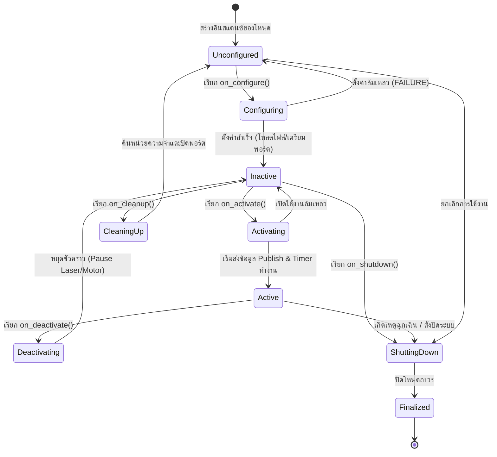
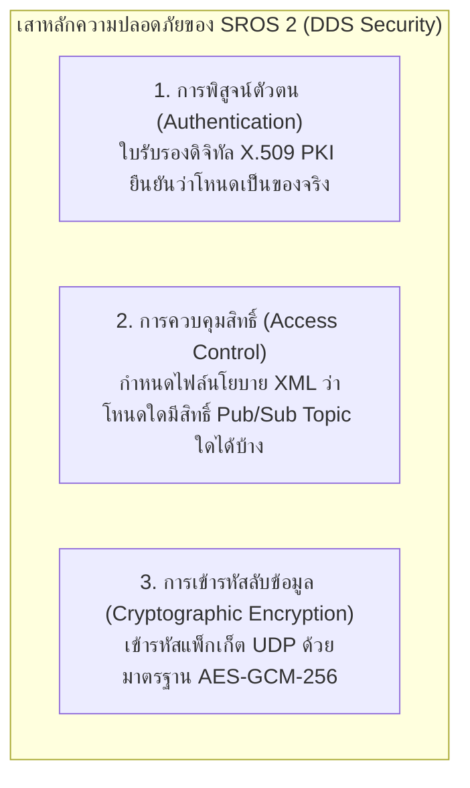

# 📖 บทที่ 5: สถาปัตยกรรมการผลิต ความปลอดภัยไซเบอร์ (SROS 2) และ CI/CD
**รหัสวิชา:** AMR-201 Advanced ROS 2 & Industrial Fleet Robotics  
**เวลาเรียน:** บรรยาย 2 ชั่วโมง | ปฏิบัติการ 3 ชั่วโมง | ทบทวนและค้นคว้าด้วยตนเอง 5 ชั่วโมง  
**เอกสารปฏิบัติการ:** [ใบงานแล็บปฏิบัติการที่ 5](Lab_Exercises.md)

---

## 🎯 วัตถุประสงค์การเรียนรู้เชิงพฤติกรรม (Measurable Learning Objectives)
1. **เข้าใจเครื่องจักรสถานะของ Lifecycle Nodes (ROS 2 Managed Nodes):** อธิบายความแตกต่างระหว่าง Primary States (`Unconfigured`, `Inactive`, `Active`, `Finalized`) และ Transition Callbacks ได้อย่างลึกซึ้ง
2. **เข้าใจการรักษาความมั่นคงปลอดภัยด้วย SROS 2:** อธิบายกลไกการเข้ารหัสข้อมูล DDS (DDS Security Specification), การสร้าง Keystore และการออกใบรับรองดิจิทัล X.509
3. **ออกแบบกระบวนการทดสอบอัตโนมัติ (Automated Integration Testing):** พัฒนาชุดทดสอบระบบด้วย `launch_testing` และ `pytest` เพื่อเชื่อมต่อกับระบบ CI/CD (GitHub Actions)
4. **จัดการข้อผิดพลาดระดับฮาร์ดแวร์แบบ Fail-Safe:** เขียนโค้ดดักจับความผิดปกติของเซนเซอร์และสั่ง Transition โหนดกลับสู่สถานะ `Inactive` ได้อย่างปลอดภัย

---

## 🔄 สถาปัตยกรรม Managed Lifecycle Nodes

ในโหนด ROS ทั่วไป เมื่อสั่งรันโหนด โค้ดจะเริ่ม Subscribe, Publish, และเชื่อมต่อฮาร์ดแวร์ทันที หากฮาร์ดแวร์ยังไม่พร้อม โหนดจะ Crash และทำให้ระบบรวน ในระดับอุตสาหกรรม ROS 2 จึงนำเสนอมาตรฐาน **Managed Lifecycle Node** เพื่อให้โหนดภายนอก (เช่น System Supervisor หรือ Nav2 Lifecycle Manager) เป็นผู้ควบคุมจังหวะการเปิด-ปิด:



### หน้าที่ของ 4 สถานะหลัก (Primary States):
1. **`Unconfigured`:** โหนดยังไม่ได้อ่านไฟล์คอนฟิก และยังไม่ได้จองหน่วยความจำหรือเปิดพอร์ตฮาร์ดแวร์
2. **`Inactive`:** โหลดไฟล์คอนฟิกและเชื่อมต่อฮาร์ดแวร์แล้ว แต่ยังไม่อนุญาตให้ Publish ข้อมูลใดๆ ออกสู่เครือข่าย
3. **`Active`:** ระบบทำงานเต็มรูปแบบ Publish ข้อความและประมวลผล Timer ตามปกติ
4. **`Finalized`:** ทำลายการเชื่อมต่อทั้งหมดและเตรียมปิดโปรเซสอย่างปลอดภัย

---

## 🔒 ความมั่นคงปลอดภัยไซเบอร์ระดับอุตสาหกรรมด้วย SROS 2

ในการใช้งานหุ่นยนต์ในโรงงานหรือโรงพยาบาล สัญญาณเครือข่าย Wi-Fi มีความเสี่ยงต่อการถูกโจมตี (Eavesdropping, Man-in-the-Middle, หรือ Malicious Command Injection) **SROS 2 (Secure ROS 2)** ขยายขีดความสามารถของ DDS Security Specification เพื่อปกป้องข้อมูล:



### ขั้นตอนการสร้าง Keystore และออกใบรับรองความปลอดภัย:
```bash
# 1. สร้าง Root Keystore กลางสำหรับโครงการ
ros2 security create_keystore ~/my_keystore

# 2. สร้าง Enclave และออกใบรับรอง X.509 ประจำโหนด
ros2 security create_enclave ~/my_keystore /amr_system/teleop_node

# 3. กำหนดตัวแปรสภาพแวดล้อมเพื่อเปิดใช้งานความปลอดภัย
export ROS_SECURITY_ENABLE=true
export ROS_SECURITY_STRATEGY=Enforce
export ROS_SECURITY_KEYSTORE=~/my_keystore
```

---

## 🧪 การทดสอบระบบอัตโนมัติ (CI/CD Pipeline with launch_testing)

สำหรับการพัฒนาซอฟต์แวร์ระดับมืออาชีพ ทุกครั้งที่มีการ Commit โค้ดใหม่เข้า GitHub โค้ดจะต้องผ่านการทดสอบแบบอัตโนมัติผ่าน GitHub Actions:


---

## ⌨️ ตารางคำสั่ง CLI สำหรับจัดการ Lifecycle Nodes

```bash
# แสดงรายชื่อ Lifecycle Nodes ทั้งหมดในระบบ
ros2 lifecycle nodes

# ตรวจสอบสถานะปัจจุบันของโหนด
ros2 lifecycle get /lifecycle_laser_sensor

# สั่ง Transition โหนดเข้าสู่สถานะ configure
ros2 lifecycle set /lifecycle_laser_sensor configure

# สั่ง Transition โหนดเข้าสู่สถานะ activate
ros2 lifecycle set /lifecycle_laser_sensor activate

# สั่ง Deactivate ชั่วคราว (หยุดยิงเลเซอร์เพื่อความปลอดภัย)
ros2 lifecycle set /lifecycle_laser_sensor deactivate

# สั่งปิดระบบอย่างถาวร
ros2 lifecycle set /lifecycle_laser_sensor shutdown
```

---

## ⚠️ ปัญหาพบบ่อยในระดับอุตสาหกรรม (Troubleshooting & Best Practices)

| อาการที่พบ (Symptom) | สาเหตุทางวิศวกรรม (Root Cause) | แนวทางแก้ไข (Solution) |
| :--- | :--- | :--- |
| **โหนดอื่น Subscribe ข้อมูลไม่ได้** | โหนด Lifecycle Sensor ยังอยู่ในสถานะ `Inactive` ทำให้ `LifecyclePublisher` ระงับการส่งข้อความ | ตรวจสอบสถานะด้วย `ros2 lifecycle get` และสั่ง `activate` ผ่าน CLI หรือ Supervisor Node |
| **SROS 2 แจ้งเตือน Certificate Expired** | นาฬิกาของหุ่นยนต์ (System Time) เดินไม่ตรงกับเครื่องออกใบรับรอง (Clock Skew) | ติดตั้ง NTP Client (`chrony`) เพื่อซิงก์เวลาระดับเสี้ยววินาทีผ่านเครือข่ายโรงงาน |
| **`launch_testing` ค้างไม่ยอมปิดตัวเอง** | มีโหนดบางตัวไม่ยอมรับสัญญาณ SIGINT / SIGTERM และติดลูปการทำงาน | ตรวจสอบการทำลายโหนดและ `rclpy.shutdown()` ในบล็อก `finally` ของโค้ด Python |

---

## 📝 แบบทดสอบท้ายบทเชิงลึก (Self-Assessment Quiz)

1. **คำถาม:** ในสถานะ `Inactive` ของ Lifecycle Node โหนดสามารถรับข้อความจาก Topic ที่ Subscribe ไว้ได้หรือไม่ และสามารถ Publish ข้อความออกไปได้หรือไม่?
   - <details><summary><b>เฉลย</b></summary>ในสถานะ `Inactive` โหนด<b>สามารถรับข้อความ</b> (Subscriptions ทำงาน) แต่ <b>LifecyclePublisher จะไม่ส่งข้อความใดๆ ออกไป</b> ข้อมูลที่สั่ง publish จะถูกทิ้งทั้งหมดจนกว่าจะเปลี่ยนสถานะเป็น `Active`</details>

2. **คำถาม:** ตัวแปรสภาพแวดล้อม `ROS_SECURITY_STRATEGY=Enforce` มีพฤติกรรมอย่างไรหากพบโหนดที่ไม่ได้รับการลงนามด้วยใบรับรองความปลอดภัยที่ถูกต้อง?
   - <details><summary><b>เฉลย</b></summary>ระบบ Middleware จะปฏิเสธการเข้าร่วมเครือข่ายของโหนดนั้นทันที และไม่อนุญาตให้สร้าง Participant หรือส่งข้อมูลใดๆ ข้ามระบบเครือข่าย</details>
