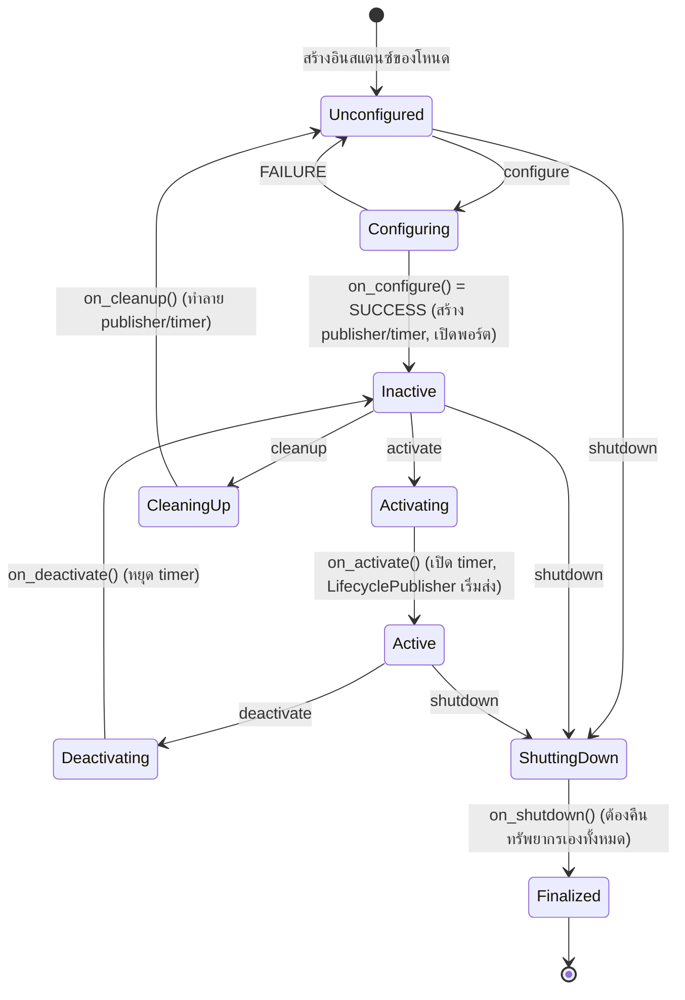
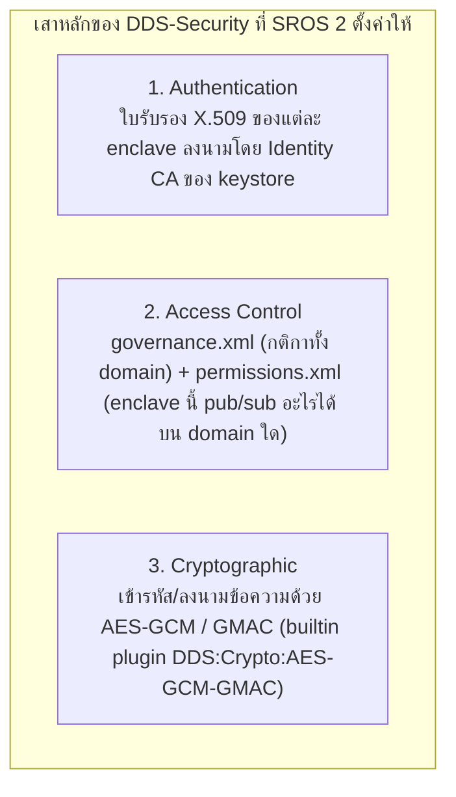
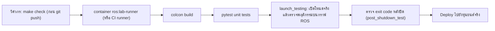

# 📖 บทที่ 5: สถาปัตยกรรมการผลิต ความปลอดภัยไซเบอร์ (SROS 2) และ CI/CD
**รหัสวิชา:** AMR-201 Advanced ROS 2 & Industrial Fleet Robotics  
**เวลาเรียน:** บรรยาย 2 ชั่วโมง | ปฏิบัติการ 3 ชั่วโมง | ทบทวนและค้นคว้าด้วยตนเอง 5 ชั่วโมง  
**เอกสารปฏิบัติการ:** [ใบงานแล็บปฏิบัติการที่ 5](Lab_Exercises.md)  
**แพ็กเกจ ROS 2:** `amr_adv05` (ament_python, โฟลเดอร์นี้)

---

## 🎯 วัตถุประสงค์การเรียนรู้เชิงพฤติกรรม (Measurable Learning Objectives)
1. **เข้าใจเครื่องจักรสถานะของ Lifecycle Nodes (ROS 2 Managed Nodes):** อธิบายความแตกต่างระหว่าง Primary States (`Unconfigured`, `Inactive`, `Active`, `Finalized`) และ Transition Callbacks และจัดการทรัพยากรให้ถูกต้องในทุกเส้นทางของ state machine
2. **เข้าใจการรักษาความมั่นคงปลอดภัยด้วย SROS 2:** อธิบายกลไก DDS Security (Authentication, Access Control, Encryption) สร้าง Keystore/Enclave และรันโหนดในโหมด `Enforce` ได้จริง
3. **ออกแบบกระบวนการทดสอบอัตโนมัติ (Automated Integration Testing):** พัฒนาชุดทดสอบระบบด้วย `launch_testing` และ `pytest` ที่ตรวจพฤติกรรมจริงบนกราฟ ROS เพื่อเชื่อมต่อกับระบบ CI/CD (GitHub Actions)
4. **จัดการข้อผิดพลาดแบบ Fail-Safe:** คืนทรัพยากร (timer, publisher) ใน `on_cleanup`/`on_shutdown`/`on_error` เพื่อไม่ให้โหนดที่ถูกปิดแล้วยังส่งข้อมูลออกไป
5. **เปรียบเทียบ Middleware:** อธิบายความต่างระหว่าง DDS (Fast DDS) กับ `rmw_zenoh_cpp` และสลับ RMW ได้

---

## 🏗️ Build แพ็กเกจก่อนเริ่ม

```bash
./docker/run_lab.sh colcon build --base-paths Advanced_ROS --packages-select amr_adv05
./docker/run_lab.sh ros2 run amr_adv05 lifecycle_laser_sensor      # หรือ python3 Advanced_ROS/05_Production_CI_CD_Security/src/lifecycle_laser_sensor.py
./docker/run_lab.sh colcon test --base-paths Advanced_ROS --packages-select amr_adv05
./docker/run_lab.sh colcon test-result --verbose
```

| ไฟล์ | หน้าที่ |
| :--- | :--- |
| [`src/lifecycle_laser_sensor.py`](src/lifecycle_laser_sensor.py) | Lifecycle node ส่ง `sensor_msgs/LaserScan` 360 ลำแสง 10 Hz บน `/scan_managed` |
| [`test/test_lifecycle_launch.py`](test/test_lifecycle_launch.py) | launch_testing: นับข้อความในทุกสถานะ (0 ตอน Inactive, ~10 Hz ตอน Active, 0 หลัง deactivate/shutdown) |
| [`test/test_sros2_enforce.py`](test/test_sros2_enforce.py) | สร้าง keystore จริงใน temp dir แล้วพิสูจน์พฤติกรรม SROS2 Enforce |

---

## 🔄 สถาปัตยกรรม Managed Lifecycle Nodes

ในโหนด ROS ทั่วไป เมื่อสั่งรันโหนด โค้ดจะเริ่ม Subscribe, Publish, และเชื่อมต่อฮาร์ดแวร์ทันที หากฮาร์ดแวร์ยังไม่พร้อม โหนดจะ Crash และทำให้ระบบรวน ROS 2 จึงมีมาตรฐาน **Managed Lifecycle Node** เพื่อให้โหนดภายนอก (เช่น System Supervisor หรือ Nav2 Lifecycle Manager) เป็นผู้ควบคุมจังหวะการเปิด-ปิด:



### หน้าที่ของ 4 สถานะหลัก (Primary States):
1. **`Unconfigured`:** โหนดถูกสร้างแล้ว (มี service `~/change_state`, `~/get_state`) แต่ยังไม่ได้อ่านพารามิเตอร์ ยังไม่สร้าง publisher และยังไม่เปิดฮาร์ดแวร์
2. **`Inactive`:** โหลดคอนฟิกและสร้างทรัพยากรแล้ว แต่ `LifecyclePublisher` จะ **ทิ้ง** ทุกการเรียก `publish()` (ไม่มีข้อมูลออกสู่เครือข่าย)
3. **`Active`:** ทำงานเต็มรูปแบบ Publish ข้อความและประมวลผล Timer ตามปกติ
4. **`Finalized`:** สถานะสุดท้ายก่อนทำลายโหนด — ไม่มี transition ออกจากสถานะนี้

### ⚠️ บั๊กที่พบบ่อย (และเคยอยู่ในโค้ดตัวอย่างของบทนี้)
| บั๊ก | ผลที่เกิดจริง | วิธีแก้ใน [`src/lifecycle_laser_sensor.py`](src/lifecycle_laser_sensor.py) |
| :--- | :--- | :--- |
| `on_shutdown()` แค่พิมพ์ log แล้ว `return SUCCESS` | สั่ง `shutdown` ตอน Active → สถานะเป็น `finalized` แต่ timer ยังเดินและ publisher ยัง activated: `/scan_managed` ยังออก ~10 Hz | `on_shutdown()` (และ `on_cleanup()`/`on_error()`) เรียก `_release()`: cancel + destroy timer และ `destroy_lifecycle_publisher()` |
| ใช้ `destroy_publisher()` กับ LifecyclePublisher | publisher ถูกทำลายแต่ยังค้างอยู่ในรายการ managed entities ของ node | ใช้ `destroy_lifecycle_publisher()` |
| `LaserScan` ที่ `angle_min = angle_max = angle_increment = 0` | RViz2/Nav2/slam_toolbox ตีความลำแสงไม่ได้ (ทุกลำทับมุมเดียวกัน) | ตั้ง `angle_increment = 2π/N`, `angle_min = -π`, `angle_max = angle_min + (N-1)·increment`, `scan_time`, `time_increment` |

ชุดทดสอบ [`test/test_lifecycle_launch.py`](test/test_lifecycle_launch.py) ล้มเหลวกับโค้ดเดิม 3 จุด (ทดสอบจริงก่อนแก้): `angle_increment` เป็น 0, ยังได้รับ 15 ข้อความใน 1.5 s หลัง `finalized`, และโหนดจบด้วย exit code 1 ตอน Ctrl-C (เรียก `rclpy.shutdown()` ซ้ำ — แก้เป็น `rclpy.try_shutdown()`)

---

## 🔒 ความมั่นคงปลอดภัยไซเบอร์ระดับอุตสาหกรรมด้วย SROS 2

ในโรงงานหรือโรงพยาบาล เครือข่าย Wi-Fi เสี่ยงต่อการถูกดักฟัง (Eavesdropping), Man-in-the-Middle หรือการฉีดคำสั่งปลอม (เช่น ส่ง `/cmd_vel` ปลอม) **SROS 2** คือชุดเครื่องมือของ ROS 2 ที่ตั้งค่า **DDS-Security** (มาตรฐาน OMG) ให้แต่ละโหนด:



### ขั้นตอนสร้าง Keystore, Enclave และรันแบบ Enforce
```bash
# (บนเครื่องที่รันผ่าน run_lab.sh: repo อยู่ที่ /workspace ภายใน container)
export ROS_DOMAIN_ID=21          # ต้องตั้งก่อน create_enclave: domain id ถูกเขียนลงใน permissions.xml

# 1. สร้าง Keystore (CA + governance) — โฟลเดอร์ sros2_keystore/ ถูก .gitignore ไว้ ห้าม commit private key
./docker/run_lab.sh ros2 security create_keystore Advanced_ROS/05_Production_CI_CD_Security/sros2_keystore

# 2. สร้าง Enclave (ใบรับรอง + สิทธิ์) ต่อหนึ่งโปรเซส
./docker/run_lab.sh ros2 security create_enclave Advanced_ROS/05_Production_CI_CD_Security/sros2_keystore /talker_listener/talker
./docker/run_lab.sh ros2 security create_enclave Advanced_ROS/05_Production_CI_CD_Security/sros2_keystore /talker_listener/listener

# 3. เปิดความปลอดภัยแบบ Enforce (run_lab.sh ส่งต่อตัวแปร ROS_SECURITY_* เข้า container)
export ROS_SECURITY_KEYSTORE=/workspace/Advanced_ROS/05_Production_CI_CD_Security/sros2_keystore
export ROS_SECURITY_ENABLE=true
export ROS_SECURITY_STRATEGY=Enforce

# 4. ทุกโปรเซสต้องบอกว่าใช้ enclave ใด ด้วย --ros-args --enclave
./docker/run_lab.sh ros2 run demo_nodes_py talker   --ros-args --enclave /talker_listener/talker
./docker/run_lab.sh ros2 run demo_nodes_py listener --ros-args --enclave /talker_listener/listener
```

**ความหมายของตัวแปร (สำคัญ):**
- `ROS_SECURITY_ENABLE=true` เปิดใช้ DDS-Security กับ participant ของ **โปรเซสนี้** (ถ้าไม่ตั้ง โปรเซสจะไม่ปลอดภัยเลย)
- `ROS_SECURITY_STRATEGY=Enforce` กำหนดว่า **ถ้าหาไฟล์ของ enclave ของโปรเซสนี้ไม่ครบ ให้โปรเซสนี้ล้มเหลว (สร้างโหนดไม่ได้)** แทนที่จะรันแบบไม่ปลอดภัยต่อไป (`Permissive`) — ในการรันจริง talker ที่ลืม `--enclave` (จึงมองหา enclave `/` ซึ่งไม่มี) จบด้วย `RCLError: error creating node: couldn't find all security files!`
- การ **ปฏิเสธ participant อื่นที่ไม่มีใบรับรอง** ไม่ได้มาจาก `Enforce` แต่มาจาก DDS-Security handshake ของ participant ที่เปิด security อยู่ ร่วมกับ `governance.xml` ของ SROS 2 (`allow_unauthenticated_participants=false`, `enable_join_access_control=true`, ข้อมูล topic เข้ารหัส) — ในการรันจริง listener ที่ไม่ตั้ง `ROS_SECURITY_*` บน domain เดียวกันไม่ได้รับข้อความเลยแม้แต่ข้อความเดียว
- `permissions.xml` ที่ `create_enclave` สร้างให้อนุญาตทุก topic (`rt/*`) แต่ **ผูกกับ domain id ตอนสร้าง** หากต้องการจำกัดสิทธิ์จริง ใช้ `ros2 security generate_artifacts -k <keystore> -p policy.xml` กับไฟล์ policy ที่ระบุ topic ต่อโหนด

---

## 🌐 DDS vs Zenoh (`rmw_zenoh_cpp`)

ROS 2 เปลี่ยน middleware ได้ด้วยตัวแปร `RMW_IMPLEMENTATION` โดยไม่ต้องแก้โค้ด ค่าเริ่มต้นของ Jazzy คือ Fast DDS (`rmw_fastrtps_cpp`) ส่วน `rmw_zenoh_cpp` (Eclipse Zenoh) เป็นทางเลือกที่ออกแบบมาสำหรับเครือข่ายไร้สาย/ข้ามเครือข่าย:

| | DDS (Fast DDS, CycloneDDS) | Zenoh (`rmw_zenoh_cpp`) |
| :--- | :--- | :--- |
| Discovery | Simple Discovery แบบ multicast ทุก participant คุยกับทุก participant | ผ่าน **router** (`rmw_zenohd`) โหนดเชื่อมต่อ router ด้วย TCP แล้ว router กระจาย discovery ให้ |
| เครือข่ายที่เหมาะ | LAN ที่ multicast ใช้ได้ดี | Wi-Fi, ข้าม subnet/อินเทอร์เน็ต (router ต่อกันเป็นลำดับชั้นได้) |
| สิ่งที่ต้องรันเพิ่ม | ไม่มี | `ros2 run rmw_zenoh_cpp rmw_zenohd` (1 ตัวต่อเครื่อง/เครือข่าย) |
| ใช้ร่วมกันได้ไหม | — | **ไม่ได้** โหนด Zenoh กับโหนด DDS ไม่เห็นกัน (ต้องใช้ RMW เดียวกันทั้งระบบ หรือ bridge) |
| Security | DDS-Security (SROS 2 ข้างบน) | ใช้ TLS/mTLS และ access control ของ Zenoh (กำหนดใน config ของ Zenoh) |

```bash
export RMW_IMPLEMENTATION=rmw_zenoh_cpp
./docker/run_lab.sh ros2 run rmw_zenoh_cpp rmw_zenohd          # Terminal 1: router (tcp/[::]:7447)
./docker/run_lab.sh ros2 run demo_nodes_py talker              # Terminal 2
./docker/run_lab.sh ros2 run demo_nodes_py listener            # Terminal 3
```

---

## 🧪 การทดสอบระบบอัตโนมัติ (CI/CD Pipeline with launch_testing)

repo นี้รันชุดทดสอบบนเครื่องก่อน push ด้วย `make check` (lint + `colcon build` + `colcon test` ใน container `ros:lab-runner`
เดียวกับที่ใช้ในห้องแล็บ) ในงานจริงนำคำสั่งเดียวกันไปใส่ใน CI runner (เช่น GitHub Actions หรือ GitLab CI) เพื่อให้รันอัตโนมัติทุกครั้งที่ push:



โครงสร้างของ launch test ที่ดี (ดู [`test/test_lifecycle_launch.py`](test/test_lifecycle_launch.py)):
1. `@pytest.mark.launch_test` + `generate_test_description()` คืน `LaunchDescription` ที่มีโหนดภายใต้การทดสอบ และ `ReadyToTest()`
2. คลาส `unittest.TestCase` ที่สร้างโหนดทดสอบของตัวเอง เรียก service `/lifecycle_laser_sensor/change_state` และ **นับข้อความจริง** ใน `/scan_managed` ในแต่ละสถานะ
3. `@launch_testing.post_shutdown_test()` ตรวจว่าโปรเซสปิดตัวด้วย exit code ที่ยอมรับได้
4. อย่าเขียน `assertTrue(True)` — การทดสอบต้อง **ล้มเหลวได้** เมื่อพฤติกรรมผิด

---

## ⌨️ ตารางคำสั่ง CLI สำหรับจัดการ Lifecycle Nodes

```bash
ros2 lifecycle nodes                                     # รายชื่อ Lifecycle Nodes
ros2 lifecycle get /lifecycle_laser_sensor               # สถานะปัจจุบัน เช่น unconfigured [1]
ros2 lifecycle list /lifecycle_laser_sensor              # transition ที่ทำได้จากสถานะนี้
ros2 lifecycle set /lifecycle_laser_sensor configure     # -> inactive
ros2 lifecycle set /lifecycle_laser_sensor activate      # -> active (เริ่มส่ง 10 Hz)
ros2 lifecycle set /lifecycle_laser_sensor deactivate    # -> inactive (หยุดส่ง)
ros2 lifecycle set /lifecycle_laser_sensor cleanup       # -> unconfigured (คืนทรัพยากร)
ros2 lifecycle set /lifecycle_laser_sensor shutdown      # -> finalized
ros2 topic hz /scan_managed                              # วัดอัตราการส่งจริง
```

---

## ⚠️ ปัญหาพบบ่อยในระดับอุตสาหกรรม (Troubleshooting & Best Practices)

| อาการที่พบ (Symptom) | สาเหตุทางวิศวกรรม (Root Cause) | แนวทางแก้ไข (Solution) |
| :--- | :--- | :--- |
| **โหนดอื่น Subscribe ข้อมูลไม่ได้** | Lifecycle node ยังอยู่ในสถานะ `Inactive` ทำให้ `LifecyclePublisher` ทิ้งข้อความ | ตรวจด้วย `ros2 lifecycle get` และสั่ง `activate` ผ่าน CLI หรือ Lifecycle Manager |
| **โหนด `finalized` แล้วแต่ยังมีข้อมูลออกมา** | `on_shutdown()` ไม่ได้หยุด timer/ทำลาย publisher (shutdown จาก Active ไม่ผ่าน `on_deactivate`) | คืนทรัพยากรใน `on_shutdown()` และ `on_error()` ด้วย |
| **`RCLError: error creating node: couldn't find all security files!`** | ตั้ง `ROS_SECURITY_STRATEGY=Enforce` แต่ไม่ได้ใส่ `--ros-args --enclave /...` หรือ path ของ keystore ผิด (ต้องเป็น path ภายใน container) | ใส่ `--enclave` ให้ตรงกับที่ `create_enclave` และตรวจ `ros2 security list_enclaves <keystore>` |
| **โหนดที่ secure ทั้งคู่ไม่เห็นกัน** | สร้าง enclave ตอน `ROS_DOMAIN_ID` ต่างจากที่รัน (permissions ผูก domain id) หรือนาฬิกาเครื่องไม่ตรงทำให้ใบรับรองยังไม่ถึง/เลยช่วง validity | สร้าง enclave ใหม่ด้วย domain ที่ถูกต้อง และซิงก์เวลาด้วย NTP (`chrony`) |
| **โหนด Zenoh ไม่เห็นโหนด DDS** | ใช้ RMW ต่างกันในระบบเดียว | ตั้ง `RMW_IMPLEMENTATION` ให้เหมือนกันทุกโปรเซส และเปิด `rmw_zenohd` ก่อน |
| **`launch_testing` ค้างไม่ยอมปิดตัวเอง** | มีโหนดไม่ตอบสนอง SIGINT/SIGTERM และติดลูป | จับ `KeyboardInterrupt`/`ExternalShutdownException` แล้ว `destroy_node()` + `rclpy.try_shutdown()` ในบล็อก `finally` |

---

## 📝 แบบทดสอบท้ายบทเชิงลึก (Self-Assessment Quiz)

1. **คำถาม:** ในสถานะ `Inactive` ของ Lifecycle Node โหนดสามารถรับข้อความจาก Topic ที่ Subscribe ไว้ได้หรือไม่ และสามารถ Publish ข้อความออกไปได้หรือไม่?
   - <details><summary><b>เฉลย</b></summary>Subscription ธรรมดาใน rclpy ไม่ได้ผูกกับสถานะ lifecycle จึง<b>ยังรับข้อความได้</b> (ถ้าต้องการให้หยุดรับ ต้องเช็คสถานะใน callback หรือสร้าง subscription ใน on_activate เอง) ส่วน <b>LifecyclePublisher จะไม่ส่งข้อความใดๆ ออกไป</b> — การเรียก publish() ถูกทิ้งจนกว่าจะเป็น `Active` (ผลรันจริง: `ros2 topic hz` ไม่ได้รับข้อความเลยตอน inactive)</details>

2. **คำถาม:** `ROS_SECURITY_STRATEGY=Enforce` มีผลอย่างไร และอะไรคือกลไกที่ทำให้โหนดที่ไม่มีใบรับรองรับข้อมูลจากโหนดที่ปลอดภัยไม่ได้?
   - <details><summary><b>เฉลย</b></summary>`Enforce` มีผลกับ<b>โปรเซสที่ตั้งตัวแปรนี้เอง</b>: ถ้าหาไฟล์ของ enclave (cert, key, governance, permissions) ไม่ครบ โปรเซสจะสร้างโหนดไม่ได้และจบการทำงาน แทนที่จะรันแบบไม่ปลอดภัย (`Permissive`) ส่วนการที่โหนดไม่มีใบรับรองคุยด้วยไม่ได้เป็นผลของ DDS-Security handshake (authentication) และ governance ที่ไม่อนุญาต unauthenticated participant ซึ่งทำงานเมื่อ participant เปิด security (`ROS_SECURITY_ENABLE=true`) ไม่ว่า strategy จะเป็นอะไร</details>

3. **คำถาม:** สั่ง `shutdown` ขณะโหนดอยู่ในสถานะ `Active` ทำไม `on_deactivate()` ไม่ถูกเรียก และโค้ดต้องรับมืออย่างไร?
   - <details><summary><b>เฉลย</b></summary>state machine มี transition `Active → ShuttingDown` โดยตรง (transition id 7 `active_shutdown`) จึงข้าม `on_deactivate()` ไป `on_shutdown()` ทันที ถ้า `on_shutdown()` ไม่หยุด timer และไม่ทำลาย publisher โหนดจะเป็น `finalized` แต่ยังส่งข้อมูลต่อ จึงต้องคืนทรัพยากรทั้งหมดใน `on_shutdown()`</details>

4. **คำถาม:** เมื่อใดควรเลือก `rmw_zenoh_cpp` แทน DDS?
   - <details><summary><b>เฉลย</b></summary>เมื่อเครือข่าย multicast ใช้ไม่ได้หรือไม่เสถียร (Wi-Fi ในโรงงาน, ข้าม subnet, ผ่านอินเทอร์เน็ต) หรือมีหุ่นยนต์/โหนดจำนวนมากจน discovery แบบทุกคนคุยกับทุกคนหนักเกินไป แลกกับการต้องรัน router และทุกโปรเซสในระบบต้องใช้ RMW เดียวกัน</details>

---

## 📟 ผลการรันจริง (Real Run Output)

บันทึกจากการรันจริงใน ros:lab-runner (ROS 2 Jazzy, Gazebo Sim 8.15.0) บน Linux 7.0 เมื่อ 2026-10-29 (บทนี้ไม่ใช้ Gazebo)

ไฟล์ผลลัพธ์ฉบับเต็ม: [`results/lifecycle_cli.txt`](results/lifecycle_cli.txt) · [`results/sros2_enforce.txt`](results/sros2_enforce.txt) · [`results/dds_vs_zenoh.txt`](results/dds_vs_zenoh.txt) · [`results/colcon_test.txt`](results/colcon_test.txt)

**Lifecycle (Lab 5.1–5.2):**
```console
$ ros2 lifecycle get /lifecycle_laser_sensor
unconfigured [1]
$ ros2 lifecycle set /lifecycle_laser_sensor configure
Transitioning successful
$ ros2 topic hz /scan_managed    # (4 s window)
[hz window closed]
$ ros2 lifecycle set /lifecycle_laser_sensor activate
Transitioning successful
$ ros2 topic hz /scan_managed    # (6 s window)
WARNING: topic [/scan_managed] does not appear to be published yet
average rate: 9.998
	min: 0.100s max: 0.100s std dev: 0.00022s window: 12
...
$ ros2 topic echo --once --no-arr /scan_managed
...
angle_min: -3.1415927410125732
angle_max: 3.1241393089294434
angle_increment: 0.01745329238474369
...
$ ros2 lifecycle set /lifecycle_laser_sensor shutdown
Transitioning successful
$ ros2 lifecycle get /lifecycle_laser_sensor
finalized [4]
$ ros2 topic hz /scan_managed    # (4 s window)
WARNING: topic [/scan_managed] does not appear to be published yet
[hz window closed]
```

**SROS2 Enforce (Lab 5.4):**
```console
$ ./docker/run_lab.sh ros2 run demo_nodes_py talker        # Enforce แต่ไม่มี --enclave
[INFO] [...] [rcl]: Found security directory: /workspace/Advanced_ROS/05_Production_CI_CD_Security/sros2_keystore/enclaves
...
rclpy._rclpy_pybind11.RCLError: error creating node: couldn't find all security files!, at ./src/participant.cpp:360, at ./src/rcl/node.c:252
[ros2run]: Process exited with failure 1
--- Terminal 2 (secured listener, --enclave /talker_listener/listener) ---
[INFO] [1793242130.307006239] [rcl]: Found security directory: /workspace/Advanced_ROS/05_Production_CI_CD_Security/sros2_keystore/enclaves/talker_listener/listener
[INFO] [1793242131.421782129] [listener]: I heard: [Hello World: 0]
[INFO] [1793242132.400730106] [listener]: I heard: [Hello World: 1]
...
--- Terminal 3 (ไม่มี ROS_SECURITY_*, domain เดียวกัน) ---
(no output: 0 'I heard' lines in 12 s)
```

**DDS vs Zenoh:**
```console
$ ros2 doctor --report | grep -A3 "RMW MIDDLEWARE"
   RMW MIDDLEWARE
middleware name    : rmw_zenoh_cpp
...
[INFO] [1793242946.859865132] [listener]: I heard: [Hello World: 0]
...
$ RMW_IMPLEMENTATION=rmw_fastrtps_cpp ros2 run demo_nodes_py listener   # (5 s)
[Fast DDS listener lines containing 'I heard': 0]
```

ชุดทดสอบอัตโนมัติ (`colcon test --packages-select amr_adv05`): ผ่านทั้งหมด — launch test ของ lifecycle (6 กรณี + ตรวจ exit code) และ SROS2 3 กรณี (โครงสร้าง keystore, Enforce ไม่มี enclave ต้องล้มเหลว, คู่ secure สื่อสารได้ขณะที่ listener ไม่ secure ไม่ได้รับข้อมูล)
