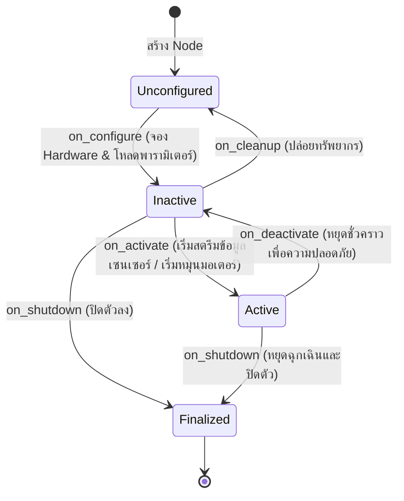

# 🔒 Tutorial: Production Engineering, SROS2 Security & CI/CD

---

## 🎯 วัตถุประสงค์การเรียนรู้
1. เข้าใจกลไก **Managed Lifecycle Nodes** (`rclcpp_lifecycle` / `rclpy.lifecycle`) เพื่อความปลอดภัยในการเปิด-ปิดฮาร์ดแวร์จริง
2. ติดตั้งและเปิดใช้งาน **SROS 2 (Secure ROS 2)** สำหรับเข้ารหัสข้อมูล (Encryption), ยืนยันตัวตน (Authentication) และป้องกันการเจาะระบบ
3. การเขียนชุดทดสอบอัตโนมัติด้วย **`launch_testing`** และการสร้าง GitHub Actions Workflow สำหรับระบบหุ่นยนต์

---

## 🔄 วงจรสถานะของ Managed Lifecycle Node



---

## 🛡️ การเปิดใช้งาน SROS 2 (Secure ROS 2)

ในระบบอุตสาหกรรม หุ่นยนต์ต้องป้องกันการถูกแทรกแซงหรือสวมรอยคำสั่ง `/cmd_vel` ผ่านเครือข่าย Wi-Fi:

```bash
# 1. สร้าง Keystore สำหรับเก็บใบรับรองความปลอดภัย
ros2 security create_keystore ~/sros2_keystore

# 2. สร้างกุญแจเข้ารหัสสำหรับโหนดหุ่นยนต์
ros2 security create_enclave ~/sros2_keystore /amr_secure_node

# 3. สั่งรัน ROS 2 ภายใต้โหมดเข้ารหัสแบบเบ็ดเสร็จ
export ROS_SECURITY_ENABLE=true
export ROS_SECURITY_STRATEGY=Enforce
export ROS_SECURITY_KEYSTORE=~/sros2_keystore
```

---

## 💻 โค้ดและชุดทดสอบในโมดูลนี้
- **โหนดเซนเซอร์แบบ Lifecycle:** [`src/lifecycle_laser_sensor.py`](src/lifecycle_laser_sensor.py)
- **ชุดทดสอบ Integration Test:** [`tests/test_amr_launch.py`](tests/test_amr_launch.py)

---

## 📝 คำสั่งทดสอบรัน
```bash
# ทดสอบรันโหนด Lifecycle Sensor
./docker/run_lab.sh python3 Advanced_ROS/05_Production_CI_CD_Security/src/lifecycle_laser_sensor.py

# ตรวจสอบสถานะและสั่ง Transition ผ่าน CLI
ros2 lifecycle get /lifecycle_laser_sensor
ros2 lifecycle set /lifecycle_laser_sensor configure
ros2 lifecycle set /lifecycle_laser_sensor activate
```
