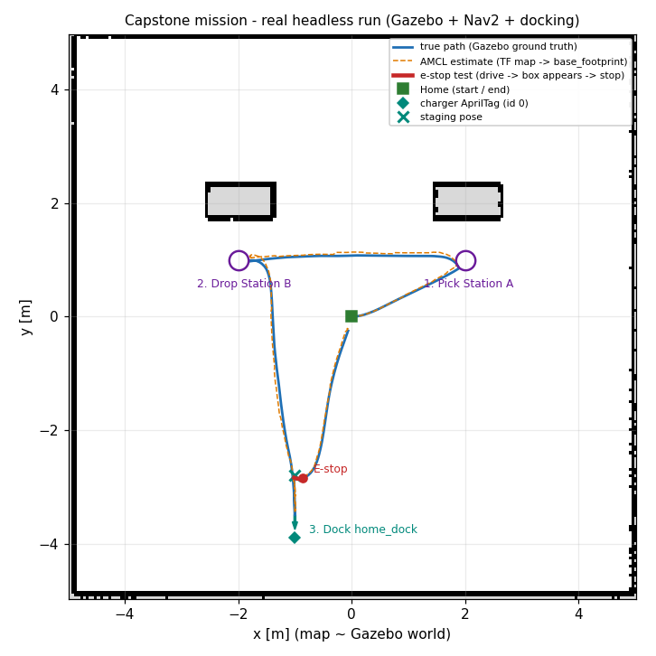

# 🛠️ ใบงานโครงงานบูรณาการ: การทดสอบระบบหุ่นยนต์คลังสินค้าแบบครบวงจร
**วิชา:** AMR-201 Advanced ROS 2 & Industrial Fleet Robotics  
**เวลาปฏิบัติการ:** 8 ชั่วโมง  
**ระดับ:** โครงงานจบรายวิชา (Capstone Project)  
**แพ็กเกจ:** `amr_adv06`  
**เอกสารประกอบการบรรยาย:** [คู่มือบรรยายโครงงาน](Readme.md) | [เกณฑ์การประเมิน 5 มิติ](rubrics.md)

---

## 🎯 วัตถุประสงค์ของใบงานโครงงาน (Capstone Tasks)
1. Build และรันระบบหุ่นยนต์คลังสินค้าแบบบูรณาการผ่าน [`launch/full_warehouse_system.launch.py`](launch/full_warehouse_system.launch.py) แบบ headless
2. ตรวจสอบการเชื่อมต่อระหว่าง Gazebo Sim, ros_gz_bridge, TF2, Nav2, docking server และ pipeline AprilTag
3. รันภารกิจ `capstone_mission` และอ่านตาราง KPI ที่วัดเทียบ Ground Truth
4. ทดสอบสถานการณ์ Fault Injection (Kidnapped Robot, E-stop) และอธิบายผล
5. บันทึกผลจริง (log, ภาพเส้นทาง, rosbag) เพื่อจัดทำรายงานและเตรียมสอบป้องกันโครงงาน

---

## 📋 ข้อกำหนดก่อนเริ่มปฏิบัติการ (Prerequisites & Setup)
- เข้าสู่ไดเรกทอรีโครงการ `/mnt/sda/ros` (เครื่องที่ใช้ร่วมกันให้ตั้ง `export ROS_DOMAIN_ID=<เลขของคุณ> GZ_PARTITION=<ชื่อของคุณ>` ก่อนทุกคำสั่ง)
- ตรวจสอบไฟล์โมเดลหุ่นยนต์ (URDF ของสัปดาห์ที่ 7 ที่ระบบนี้ใช้):
  ```bash
  ./docker/run_lab.sh check_urdf Essential_ROS/Week_07_URDF_Robot_Modeling/urdf/diff_drive_robot.urdf
  ```
- Build แพ็กเกจโครงงานพร้อมแพ็กเกจที่พึ่งพา:
  ```bash
  ./docker/run_lab.sh colcon build --base-paths Essential_ROS Advanced_ROS --packages-up-to amr_adv06
  ```

---

## 🧪 ขั้นตอนการทดสอบระบบ (System Test Cases)

### 🔹 Test Case 1: One-Click System Bringup
1. รัน Master Launch File (เทอร์มินัล 1 ปล่อยทิ้งไว้):
   ```bash
   ./docker/run_lab.sh ros2 launch amr_adv06 full_warehouse_system.launch.py headless:=true
   ```
2. ตรวจสอบ Topics/Actions/Lifecycle ที่จำเป็น (เทอร์มินัล 2):
   ```bash
   ./docker/run_lab.sh ros2 topic list --no-daemon --spin-time 5 | grep -E "^/(cmd_vel|scan|odom|tf|detected_dock_pose|camera/image_raw)$"
   ./docker/run_lab.sh ros2 action list | grep -E "navigate_to_pose|dock_robot|undock_robot"
   ./docker/run_lab.sh ros2 service call /docking_server/get_state lifecycle_msgs/srv/GetState
   ./docker/run_lab.sh ros2 param get /collision_monitor polygons
   ```
   *เกณฑ์ผ่าน:* มี topic ครบทั้ง 6 ตัว, action ทั้ง 3 ตัว, docking server อยู่ในสถานะ `active` และ collision monitor มี `StopZone`

---

### 🔹 Test Case 2: ภารกิจครบวงจรและ KPI
1. รันภารกิจ (เทอร์มินัล 2 ขณะที่เทอร์มินัล 1 ยังเปิดระบบอยู่):
   ```bash
   ./docker/run_lab.sh ros2 run amr_adv06 capstone_mission --ros-args -p use_sim_time:=true \
       -p path_csv:=results/capstone_path.csv
   echo "exit code: $?"
   ```
2. อ่านบรรทัด `Stage N ...: PASS/FAIL` (มี duration, ความคลาดเคลื่อนจริง, AMCL error) และตาราง `KPI ...` ท้าย log
3. วาดเส้นทางจริง:
   ```bash
   ./docker/run_lab.sh ros2 run amr_adv06 plot_capstone results/capstone_path.csv images/capstone_path_real.png
   ```
   *เกณฑ์ผ่าน:* `MISSION SUMMARY: 7/7 stages PASS, 7/7 KPIs met ... -> PASS` และ exit code 0 (เป้าหมาย KPI อยู่ใน [Readme.md](Readme.md) และ [`config/kpi_targets.yaml`](config/kpi_targets.yaml))

---

### 🔹 Test Case 3: Kidnapped Robot และ Global Localization
1. รีสตาร์ทระบบในเทอร์มินัล 1 (เพื่อเริ่มที่ Home) แล้วรัน:
   ```bash
   ./docker/run_lab.sh ros2 run amr_adv06 kidnap_demo --ros-args -p use_sim_time:=true
   ```
   สคริปต์จะย้ายหุ่นยนต์ใน Gazebo (`/world/warehouse/set_pose`) แล้วลอง 2 วิธี: (ก) `/reinitialize_global_localization` + หมุน 360° + `/request_nomotion_update` และ (ข) ส่ง `/initialpose` ใหม่
2. ถ้าเปิดระบบแบบมี GUI (`rviz:=true`) ให้เพิ่ม display `ParticleCloud` (topic `/particle_cloud`) เพื่อดู particle กระจายทั่วแผนที่หลัง `/reinitialize_global_localization` แล้วค่อยๆ รวมกลุ่มระหว่างหุ่นยนต์หมุน
   *เกณฑ์ผ่าน:* อธิบายได้ว่าทำไม AMCL ไม่ฟื้นตัวเอง (`recovery_alpha_*` = 0), ทำไม Global Localization ในคลังสินค้าที่สมมาตรอาจลู่เข้าตำแหน่งกระจก (perceptual aliasing) และหลังแก้ AMCL error ต้อง ≤ 0.10 m (`kidnap_demo` จบด้วย exit code 0)

---

### 🔹 Test Case 4: การทดสอบการเบรกฉุกเฉิน (E-Stop)
1. Stage 5 ของ `capstone_mission` คือการทดสอบนี้: ขณะหุ่นยนต์วิ่ง ≥ 0.15 m/s จะมีกล่องโผล่ห่างหน้า `base_footprint` 0.35 m (ห่างกันชน 0.15 m ซึ่งอยู่ใน StopZone 0.20–0.40 m)
2. ระหว่างรันภารกิจ ดูการตัดสินใจของ collision monitor และคำสั่งที่ส่งถึงล้อ:
   ```bash
   ./docker/run_lab.sh ros2 topic echo /collision_monitor_state
   ./docker/run_lab.sh ros2 topic echo /cmd_vel --field linear.x
   ```
   *เกณฑ์ผ่าน:* log Stage 5 รายงาน `scan stamp -> cmd_vel=0` ≤ 150 ms (sim time) และ `robot stopped with` ระยะเหลือ ≥ 2 cm ระหว่างกันชนกับกล่อง (ค่า `linear.x` และ `angular.z` บน `/cmd_vel` เป็น 0.0 ตลอดเวลาที่กล่องอยู่ใน StopZone)

---

## 📟 ผลการรันจริง (Real Run Output)

บันทึกจากการรันจริงใน ros:lab-runner (ROS 2 Jazzy, Gazebo Sim 8.15.0) บน Linux 7.0 เมื่อ 2026-10-29 (ไฟล์เต็มอยู่ใน [`results/`](results/system_check.txt): [`system_check.txt`](results/system_check.txt), [`capstone_mission_run.txt`](results/capstone_mission_run.txt), [`kpi_repeatability.txt`](results/kpi_repeatability.txt), [`kidnapped_robot.txt`](results/kidnapped_robot.txt), [`check_urdf.txt`](results/check_urdf.txt))

**Test Case 1** (~30 s หลังเปิดระบบ):
```console
$ ros2 topic list --no-daemon --spin-time 5 | grep -E "^/(cmd_vel|scan|odom|tf|detected_dock_pose|camera/image_raw)$"
/camera/image_raw
/cmd_vel
/detected_dock_pose
/odom
/scan
/tf

$ ros2 action list
/assisted_teleop
/backup
/compute_path_through_poses
/compute_path_to_pose
/dock_robot
/drive_on_heading
/follow_gps_waypoints
/follow_path
/follow_waypoints
/navigate_through_poses
/navigate_to_pose
/smooth_path
/spin
/undock_robot
/wait

$ ros2 service call /docking_server/get_state lifecycle_msgs/srv/GetState
waiting for service to become available...
requester: making request: lifecycle_msgs.srv.GetState_Request()

response:
lifecycle_msgs.srv.GetState_Response(current_state=lifecycle_msgs.msg.State(id=3, label='active'))

$ ros2 param get /collision_monitor polygons
String values are: ['StopZone', 'FootprintApproach']
```

**Test Case 2 + 4** (บรรทัดผลของแต่ละ stage และ KPI; ตัด prefix `[timestamp] [capstone_mission]:` ออก ค่าไม่ถูกแก้):
```console
$ ros2 run amr_adv06 capstone_mission --ros-args -p use_sim_time:=true -p path_csv:=.colcon/f/scratch/capture/capstone_path.csv   # CSV copied to results/capstone_path.csv
[INFO] Stage 0 System bringup: PASS in 4.4 s (sim) | 11/11 lifecycle nodes ACTIVE, ground truth x=-0.000 y=0.000
[INFO] Stage 1 Pick Station A: PASS in 10.4 s (sim) | SUCCEEDED, true final error 0.189 m / -15.4 deg, AMCL error 0.056 m
[INFO] Stage 2 Drop Station B: PASS in 18.1 s (sim) | SUCCEEDED, true final error 0.192 m / +14.2 deg, AMCL error 0.089 m
[INFO] Stage 3 Dock: PASS in 25.7 s (sim) | success=True error_code=0 (NONE) retries=0; TRUE docking error 3.8 mm (lateral -1.3 mm, longitudinal -3.6 mm), yaw +1.06 deg; robot x=-1.0013 y=-3.4964
[INFO] Stage 4 Undock: PASS in 8.4 s (sim) | SUCCEEDED, robot 0.661 m from the dock (>= 0.50 m required)
[INFO] Stage 5 E-stop test: PASS in 4.6 s (sim) | LiDAR saw the box at 0.190 m; scan stamp -> cmd_vel=0 88.0 ms sim (85.2 ms wall receive-to-receive); box spawn request -> cmd_vel=0 251.0 ms sim; robot stopped with 5.9 cm between bumper and box; box removed=True
[INFO] Stage 6 Home: PASS in 13.3 s (sim) | SUCCEEDED, true final error 0.256 m / +13.3 deg, AMCL error 0.029 m
[INFO] KPI Mission stage success: 100.000 % (passing target >= 100.0 %) -> PASS
[INFO] KPI Navigation final position error (true, max): 0.256 m (passing target <= 0.35 m) -> PASS
[INFO] KPI AMCL localisation error (true, max): 0.089 m (passing target <= 0.1 m) -> PASS
[INFO] KPI Docking position error (true): 3.844 mm (passing target <= 15.0 mm) -> PASS
[INFO] KPI Docking yaw error (true): 1.058 deg (passing target <= 3.0 deg) -> PASS
[INFO] KPI E-stop processing latency (scan -> cmd_vel=0, sim time): 88.000 ms (passing target <= 150.0 ms) -> PASS
[INFO] KPI E-stop remaining bumper gap: 5.890 cm (passing target >= 2.0 cm) -> PASS
[INFO] MISSION SUMMARY: 7/7 stages PASS, 7/7 KPIs met, total 152.6 s (sim time) -> PASS
(exit code 0)
```

**Test Case 3** (ระบบเปิดใหม่):
```console
$ ros2 run amr_adv06 kidnap_demo --ros-args -p use_sim_time:=true
1. localised at Home         : true x=-0.00 y=+0.00 yaw=  +0.0 | AMCL x=+0.00 y=-0.00 yaw=  -0.0 | AMCL error 0.00 m (distance to the mirror pose 0.00 m)
2. KIDNAP: Gazebo set_pose -> x=1.50 y=-2.00 yaw=0 deg: True
   after kidnap (5 updates)  : true x=+1.50 y=-2.00 yaw=  +0.0 | AMCL x=+0.00 y=-0.00 yaw=  -0.0 | AMCL error 2.50 m (distance to the mirror pose 2.50 m)
3. Method A: /reinitialize_global_localization + Spin 360 deg + 10 updates
   after global localization : true x=+1.50 y=-2.00 yaw= +16.3 | AMCL x=-1.99 y=-1.48 yaw= -73.8 | AMCL error 3.53 m (distance to the mirror pose 0.72 m)
4. Method B: operator re-localisation (/initialpose = true pose)
   after /initialpose        : true x=+1.50 y=-2.00 yaw= +16.3 | AMCL x=+1.49 y=-1.97 yaw= +16.2 | AMCL error 0.03 m (distance to the mirror pose 2.99 m)
SUMMARY: kidnapped error 2.50 m (no self-recovery), global localization 3.53 m, operator /initialpose 0.03 m
(exit code 0)
```



*ภาพ: เส้นทาง ground truth (เส้นทึบ) และ AMCL (เส้นประ) ของรอบใน Test Case 2 วาดด้วย `plot_capstone` จาก [`results/capstone_path.csv`](results/capstone_path.csv)*

---

## 📊 สรุปการประเมินผลและการส่งงาน
- ส่ง log ของ `capstone_mission` (exit code 0) และภาพเส้นทางจาก `plot_capstone` ของกลุ่มตัวเอง
- บันทึกไฟล์ ROS Bag ของภารกิจ (ระหว่างรันภารกิจ ในอีกเทอร์มินัล):
  ```bash
  ./docker/run_lab.sh ros2 bag record -s mcap -o capstone_run /tf /tf_static /scan /cmd_vel /odom /amcl_pose /ground_truth/pose /detected_dock_pose
  ```
- ส่งมอบซอร์สโค้ด ผล `colcon test` และรายงานทางเทคนิคตามเกณฑ์ [Rubrics](rubrics.md)
