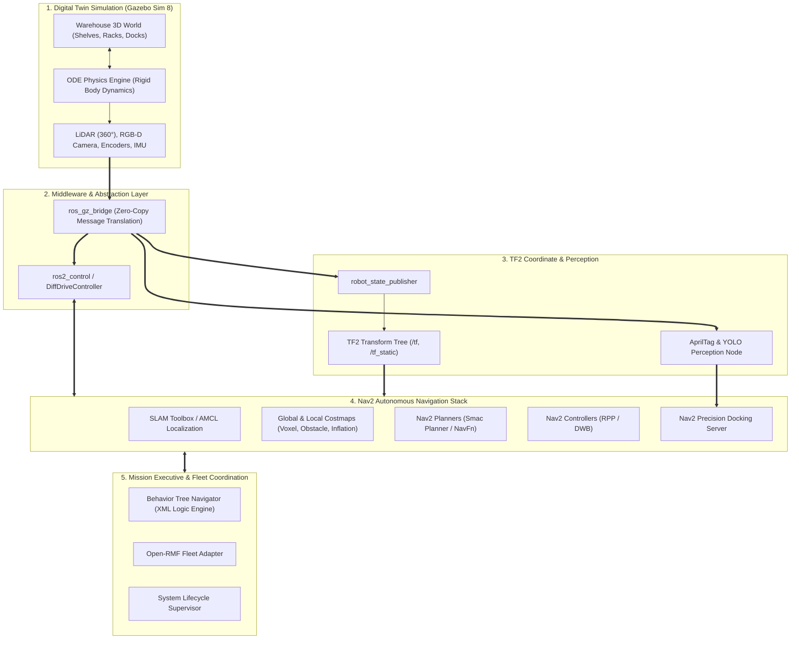
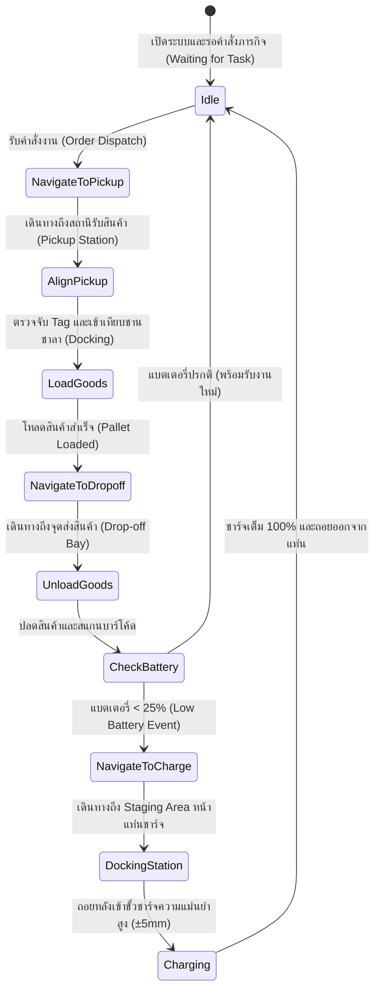

# 📖 บทที่ 6: โครงงานบูรณาการวิศวกรรมหุ่นยนต์คลังสินค้าอัจฉริยะ (Capstone AMR Project)
**รหัสวิชา:** AMR-201 Advanced ROS 2 & Industrial Fleet Robotics  
**เวลาเรียน:** บรรยาย 2 ชั่วโมง | ปฏิบัติการโครงงาน 8 ชั่วโมง | นำเสนอผลงาน 2 ชั่วโมง  
**เอกสารปฏิบัติการ:** [ใบงานโครงงานและขั้นตอนการทดสอบ](Lab_Exercises.md) | [เกณฑ์การประเมิน 5 มิติ](rubrics.md)

---

## 🎯 วัตถุประสงค์และภาพรวมโครงงาน (Capstone Objectives)
โครงงานนี้คือการทดสอบประมวลความรู้รวบยอด (Synthesized Capstone Challenge) โดยผู้เรียนจะต้องสวมบทบาทเป็น **Lead Robotics System Engineer** เพื่อบูรณาการระบบย่อยทั้งหมดเข้าด้วยกัน:
1. **การควบคุมฮาร์ดแวร์แบบปิดลูป:** เชื่อมต่อ `ros2_control` และจำลองพฤติกรรมพลศาสตร์ล้อใน Gazebo Sim Harmonic
2. **ระบบการมองเห็นด้วย AI:** ใช้กล้องและ AprilTag ในการคำนวณตำแหน่ง 6-DoF ของแท่นชาร์จและสินค้า
3. **ระบบการนำทางอัตโนมัติความแม่นยำสูง:** ผสาน Nav2 Stack, Costmap Layers, Recovery Behaviors, และ Precision Docking Server
4. **การประสานงานฝูงหุ่นยนต์และความปลอดภัย:** รองรับ Multi-Robot Namespacing, การป้องกันการชนกัน (Open-RMF Trajectory Deconfliction), และการควบคุมโหนดด้วย Lifecycle Node State Machine
5. **การทดสอบความน่าเชื่อถือระดับอุตสาหกรรม:** รันระบบทั้งหมดผ่านคำสั่ง One-Click Launch และผ่านชุดทดสอบ Integration Test

---

## 🏗️ สถาปัตยกรรมระบบบูรณาการแบบ End-to-End (System Integration Architecture)



---

## 🔄 แผนผังวงจรการปฏิบัติภารกิจอัตโนมัติ (Autonomous Mission Workflow)



---

## 📊 ดัชนีชี้วัดประสิทธิภาพของระบบ (Key Performance Indicators - KPIs)

| มิติการประเมิน (Evaluation Metric) | เป้าหมายขั้นต่ำ (Passing Target) | มาตรฐานอุตสาหกรรม (Industry Excellence) |
| :--- | :---: | :---: |
| **อัตราความสำเร็จของภารกิจ (Mission Success Rate)** | $\ge 90\%$ | $\ge 99.5\%$ (Zero Human Intervention) |
| **ความแม่นยำในการเข้าแท่นชาร์จ (Docking Tolerance)** | $\le \pm 15\text{ mm}$ | $\le \pm 5\text{ mm}$ |
| **ความคลาดเคลื่อนในการระบุตำแหน่ง (AMCL Error)** | $\le 0.10\text{ m}$ | $\le 0.03\text{ m}$ |
| **เวลาตอบสนองการเบรกฉุกเฉิน (E-Stop Latency)** | $\le 100\text{ ms}$ | $\le 30\text{ ms}$ |
| **อัตราการฟื้นตัวจากสิ่งกีดขวาง (Recovery Success)** | $\ge 80\%$ | $\ge 95\%$ (ไม่มีการติด Deadlock) |

---

## 🚀 การสั่งรันระบบแบบบูรณาการ (System Bringup Commands)

### 1. สั่งรันระบบคลังสินค้าครบวงจร (One-Click Launch):
```bash
cd /mnt/sda/ros
./docker/run_lab.sh ros2 launch Advanced_ROS/06_Capstone_Project/launch/full_warehouse_system.launch.py
```

### 2. ตรวจสอบสถานะการทำงานของทุก Subsystem:
```bash
# ตรวจสอบว่าโหนดหลักทั้งหมดออนไลน์ครบถ้วน
./docker/run_lab.sh ros2 node list

# ตรวจสอบว่า Action Server ของระบบนำทางและ Docking พร้อมรับคำสั่ง
./docker/run_lab.sh ros2 action list

# ตรวจสอบการส่งข้อมูลภาพและเซนเซอร์
./docker/run_lab.sh ros2 topic hz /scan /camera/image_raw
```

---

## 📋 คำแนะนำการสอบป้องกันโครงงาน (Oral Defense & Review Guide)

ในวันสอบป้องกันโครงงาน (Week 16) คณะกรรมการจะทำการสุ่มสถานการณ์ฉุกเฉิน (Fault Injection) เพื่อทดสอบความทนทานของระบบ:
1. **Kidnapped Robot Test:** หุ่นยนต์จะถูกคลิกลากย้ายตำแหน่งใน Gazebo กะทันหัน ผู้เรียนต้องสาธิตว่าระบบ AMCL สามารถกระจาย Particle และค้นหาตำแหน่งใหม่ได้เองภายในกี่วินาที
2. **Dynamic Obstacle Blockage:** กรรมการจะวางกล่องกีดขวางทางเดินหลักกะทันหัน หุ่นยนต์ต้องแสดงพฤติกรรมการคำนวณ Global Path อ้อมเส้นทางอื่นโดยไม่พุ่งชน
3. **Emergency Stop Response:** จำลองสิ่งกีดขวางตัดหน้าในระยะ 20 ซม. หุ่นยนต์ต้องหยุดสนิททันทีภายใน 50 ms
