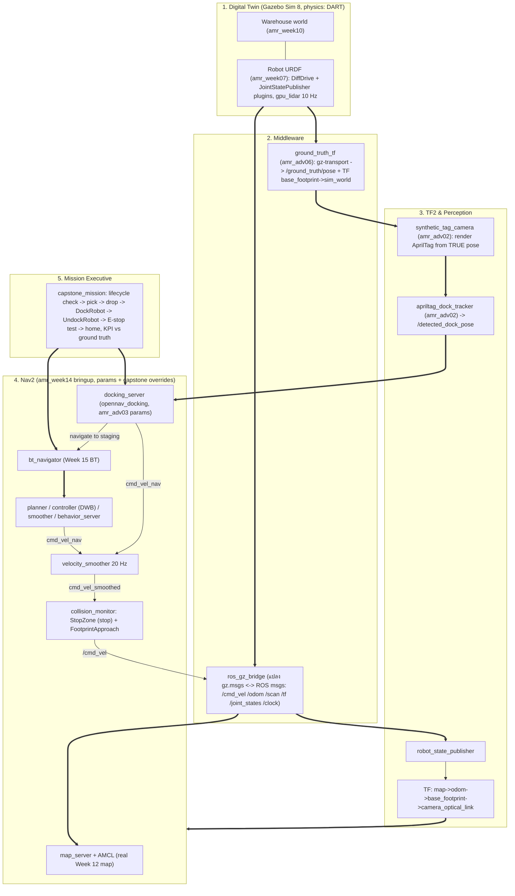
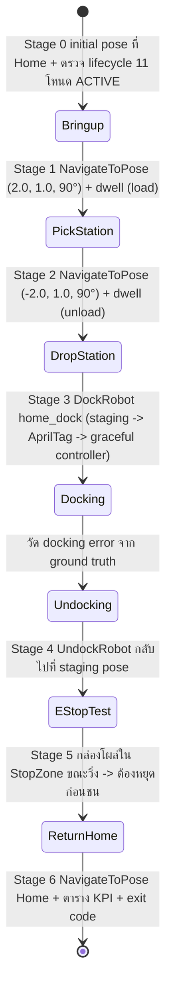

# 📖 บทที่ 6: โครงงานบูรณาการวิศวกรรมหุ่นยนต์คลังสินค้าอัจฉริยะ (Capstone AMR Project)
**รหัสวิชา:** AMR-201 Advanced ROS 2 & Industrial Fleet Robotics  
**เวลาเรียน:** บรรยาย 2 ชั่วโมง | ปฏิบัติการโครงงาน 8 ชั่วโมง | นำเสนอผลงาน 2 ชั่วโมง  
**แพ็กเกจ ROS 2:** `amr_adv06` (โฟลเดอร์นี้)  
**เอกสารปฏิบัติการ:** [ใบงานโครงงานและขั้นตอนการทดสอบ](Lab_Exercises.md) | [เกณฑ์การประเมิน 5 มิติ](rubrics.md)

---

## 🎯 วัตถุประสงค์และภาพรวมโครงงาน (Capstone Objectives)
โครงงานนี้คือการทดสอบประมวลความรู้รวบยอด (Synthesized Capstone Challenge) ผู้เรียนสวมบทบาท **Lead Robotics System Engineer** ที่ต้องประกอบระบบย่อยจากทั้งสองรายวิชาให้ทำงานร่วมกันแบบ headless ในคอนเทนเนอร์ และ **พิสูจน์ด้วยตัวเลขที่วัดได้จริง**:
1. **Digital Twin:** Gazebo Sim Harmonic + โลกคลังสินค้า (สัปดาห์ที่ 10–11) และหุ่นยนต์ URDF (สัปดาห์ที่ 7)
2. **การนำทางอัตโนมัติ:** Nav2 + AMCL บนแผนที่ SLAM จริง (สัปดาห์ที่ 12–15) พร้อม Behavior Tree ของสัปดาห์ที่ 15
3. **ระบบการมองเห็น:** AprilTag 36h11 บนแท่นชาร์จ ตรวจจับด้วย `apriltag_dock_tracker` (โมดูล 02)
4. **Precision Docking:** `opennav_docking` docking server (โมดูล 03) ด้วย action `nav2_msgs/DockRobot` / `UndockRobot`
5. **ความปลอดภัยและ Lifecycle:** Nav2 `collision_monitor` พร้อม StopZone (E-stop) และการตรวจสถานะ lifecycle ของทุกโหนดก่อนเริ่มภารกิจ (โมดูล 05)
6. **การทดสอบระดับอุตสาหกรรม:** one-command launch + `launch_testing` ที่รันภารกิจทั้งหมดและตัดสิน PASS/FAIL ตาม KPI

---

## 🏗️ สถาปัตยกรรมระบบบูรณาการแบบ End-to-End (System Integration Architecture)



**ข้อเท็จจริงทางเทคนิคที่ควรรู้:**
- Gazebo Sim Harmonic ใช้ **DART** (`gz-physics-dartsim-plugin`) เป็น physics engine ค่าเริ่มต้น (ODE เป็นค่าเริ่มต้นของ Gazebo Classic ไม่ใช่ Harmonic)
- `ros_gz_bridge` **ไม่ใช่ zero-copy**: ทุกข้อความถูกแปลงชนิด (เช่น `gz.msgs.LaserScan` → `sensor_msgs/msg/LaserScan`) แล้ว serialize ใหม่เพื่อส่งผ่าน DDS จึงมี overhead ด้าน CPU และ latency เล็กน้อย
- ตัวอย่างข้อจำกัดของ bridge ที่เจอจริงในโครงงานนี้: แปลง `gz.msgs.Pose_V` ของ `/world/warehouse/dynamic_pose/info` เป็น `tf2_msgs/TFMessage` แล้ว `frame_id`, `child_frame_id` และ stamp ว่างเปล่า จึงระบุไม่ได้ว่า pose ไหนเป็นของหุ่นยนต์ — `ground_truth_tf` จึงอ่าน Gazebo transport โดยตรงด้วย Python binding `gz.transport13`

---

## 🧩 การตัดสินใจเชิงออกแบบ (Design Decisions) — ต้องอธิบายได้ในการสอบปากเปล่า

| ประเด็น | ทางเลือกที่ใช้ | เหตุผล |
|---|---|---|
| ขับล้อ: Gazebo DiffDrive plugin หรือ `ros2_control` | **Gazebo `gz-sim-diff-drive-system`** ใน URDF สัปดาห์ที่ 7 | Nav2 ทั้งชุด (สัปดาห์ที่ 11–16) ตั้งค่าไว้กับ `/cmd_vel` (Twist) และ odom/TF จาก plugin นี้ ถ้าเปลี่ยนเป็น `gz_ros2_control` + `diff_drive_controller` (โมดูล 01) ต้องเปลี่ยน URDF, ปิด odom/TF ของ plugin, ใช้ `/diff_drive_controller/cmd_vel` แบบ `TwistStamped` และเพิ่ม controller spawner — สองระบบจะแย่งกันขับล้อถ้าเปิดพร้อมกัน โมดูล 01 จึงสาธิต `ros2_control` แยก (mock + `gz_ros2_control`) และนักศึกษาที่ต้องการคะแนนมิติ 2 ระดับสูงสามารถทำ variant นี้เป็นงานเสริมได้ |
| แท่นชาร์จ + AprilTag | **แท่นชาร์จเสมือน**: `synthetic_tag_camera` (โมดูล 02) โหมด `tf` วาดภาพ tag จากตำแหน่ง **จริง** ของหุ่นยนต์ (TF `camera_optical_link ← sim_world` ผ่าน `ground_truth_tf`) | ไม่ต้องเพิ่มกล้อง render ใน Gazebo (CPU rendering หนักใน container) และไม่ต้องแก้โลก/แผนที่ SLAM ภาพยังผ่าน pipeline จริงทั้งหมด: OpenCV ArUco detector → `solvePnP` → `/detected_dock_pose` → docking server ข้อจำกัด: ไม่มีวัตถุแท่นชาร์จทางฟิสิกส์ใน Gazebo |
| Lifecycle (โมดูล 05) | ทุกเซิร์ฟเวอร์ Nav2 และ `docking_server` เป็น lifecycle node ที่ `lifecycle_manager` เปิดให้ และ Stage 0 ของ `capstone_mission` เป็น **lifecycle supervisor**: เรียก `lifecycle_msgs/srv/GetState` ของทั้ง 11 โหนดจนกว่าจะ ACTIVE ครบ (หมดเวลา 120 s → Stage 0 FAIL แทนที่จะค้างตลอดไปแบบ `waitUntilNav2Active`) ถ้าโหนดค้างใน `unconfigured`/`inactive` เกิน `heal_after` (25 s; โหนด navigation 50 s) จะส่ง `lifecycle_msgs/srv/ChangeState` ให้เองและเขียน WARN | พบจริง 2 ครั้งจาก 21 ครั้งที่เปิดระบบใน container ใหม่ (`amcl`+`map_server` ครั้งหนึ่ง, `docking_server` อีกครั้ง): โหนดทำ transition แล้ว (log ขึ้น "Configuring") แต่คำตอบไม่ถึง `lifecycle_manager` ซึ่งส่งคำขอครั้งเดียวและรอโดยไม่มี timeout ทั้ง bringup จึงค้าง ([`results/lifecycle_supervisor.txt`](results/lifecycle_supervisor.txt)) ส่วน `lifecycle_laser_sensor` ของโมดูล 05 สร้าง scan สังเคราะห์ (ห้องกลมรัศมีคงที่) ถ้าป้อนให้ระบบนี้ AMCL/costmap จะเห็นสิ่งที่ไม่มีจริง จึงไม่นำมาใช้ |
| ความเร็วเข้าแท่น | [`config/docking_overrides.yaml`](config/docking_overrides.yaml): `controller.v_linear_max` 0.15 → **0.10 m/s** (ซ้อนบนพารามิเตอร์ของโมดูล 03) | docking server ประกาศ docked เมื่อเข้าใกล้ pose แท่นภายใน `docking_threshold` 15 mm ซึ่ง ground truth แสดงว่าหุ่นยนต์ยังวิ่งด้วยความเร็วเต็ม (ไม่ชะลอก่อนถึงแท่น) ระยะไถล ≈ v·latency + v²/2a ที่ 0.15 m/s หุ่นยนต์ Gazebo เลยแท่นไป 4–16 mm (วัดจริง 5 รอบ) และรอบที่เลย 16 mm `UndockRobot` ปฏิเสธเพราะ "Robot is not in the dock" |
| E-stop | **`collision_monitor` StopZone** (กล่อง 0.20–0.40 m หน้า `base_footprint`, ±0.17 m) เป็นโหนดสุดท้ายก่อน `/cmd_vel` | คำสั่งทุกแหล่ง (controller, behavior, docking) ต้องผ่านโหนดนี้ — gate `emergency_stop_node` ของสัปดาห์ที่ 11 ทำหน้าที่ซ้ำกันจึงไม่เปิดพร้อมกัน ข้อควรระวัง: แท่นชาร์จจริงที่มีตัวถังจะอยู่ใน StopZone ตอนเทียบแท่น ระบบจริงต้อง "mute" โซนนี้ระหว่าง docking |

---

## 🔄 แผนผังวงจรการปฏิบัติภารกิจอัตโนมัติ (Autonomous Mission Workflow)

สถานะด้านล่างคือสิ่งที่ `capstone_mission` ทำจริง (ตำแหน่งทั้งหมดอยู่ใน [`config/capstone_mission.yaml`](config/capstone_mission.yaml))



> หมายเหตุ: ไม่มีแบตเตอรี่จำลองในโครงงานนี้ (`use_battery_status: false` ใน docking server) "ชาร์จ" จึงหมายถึงเทียบแท่นสำเร็จตาม `docking_threshold` 0.015 m

---

## 📊 ดัชนีชี้วัดประสิทธิภาพของระบบ (Key Performance Indicators - KPIs)

ค่าทั้งหมดมาจาก [`config/kpi_targets.yaml`](config/kpi_targets.yaml) (ไฟล์เดียวกับที่ `capstone_mission` ใช้ตัดสิน และ unit test ตรวจว่าตารางนี้ตรงกับไฟล์) ทุกค่าวัด **เทียบ Ground Truth ของ Gazebo** ไม่ใช่ค่าที่หุ่นยนต์ประมาณเอง คอลัมน์สุดท้ายคือช่วงที่วัดได้จริงจากการรัน 5 รอบ ([`results/kpi_repeatability.txt`](results/kpi_repeatability.txt))

| KPI (คีย์ใน `config/kpi_targets.yaml`) | เป้าหมายขั้นต่ำ (Passing) | ระดับดีเยี่ยม (Excellence) | วัดจริง 5 รอบ (min – max) |
| :--- | :---: | :---: | :---: |
| ความสำเร็จของ stage ในภารกิจ (`mission_success_pct`) | ≥ 100 % ในรอบที่ส่ง | ≥ 100 % ทุกรอบ (5/5) | 100 % (5/5 รอบ) |
| ความคลาดเคลื่อนตำแหน่งปลายทางจริง, ค่าสูงสุดในรอบ (`nav_final_error_m`) | ≤ 0.35 m | ≤ 0.15 m | 0.248 – 0.264 m |
| ความคลาดเคลื่อน AMCL เทียบ ground truth, ค่าสูงสุด (`amcl_error_m`) | ≤ 0.10 m | ≤ 0.05 m | 0.046 – 0.089 m |
| ความคลาดเคลื่อนตำแหน่งเข้าแท่นชาร์จจริง (`docking_error_mm`) | ≤ 15 mm | ≤ 5 mm | 2.2 – 4.5 mm |
| ความคลาดเคลื่อนมุมเข้าแท่นชาร์จ (`docking_yaw_error_deg`) | ≤ 3.0° | ≤ 1.0° | 0.99 – 1.79° |
| E-stop: LiDAR scan → `cmd_vel` = 0, sim time (`estop_processing_ms`) | ≤ 150 ms | ≤ 50 ms | 48 – 104 ms |
| E-stop: ระยะเหลือระหว่างกันชนกับกล่อง (`estop_gap_cm`) | ≥ 2.0 cm | ≥ 5.0 cm | 5.6 – 7.4 cm |

**ทำไมตัวเลขเป็นแบบนี้ (ต้องอธิบายได้):**
- **Navigation error ≈ 0.25 m และ yaw ≈ ±14°:** goal checker ของสัปดาห์ที่ 14 ใช้ `xy_goal_tolerance: 0.25` และ `yaw_goal_tolerance: 0.25` rad (14.3°) Nav2 จึงรายงาน SUCCEEDED ทันทีที่เข้าขอบ tolerance — อยากแม่นขึ้นต้องลด tolerance (แลกกับเวลาและความเสี่ยงสั่นไปมา)
- **Docking error ≤ 15 mm:** docking server ประกาศ "docked" เมื่ออยู่ห่าง pose ที่ตรวจจับได้ไม่เกิน `docking_threshold` 0.015 m ขณะหุ่นยนต์ยังเคลื่อนที่ ความคลาดเคลื่อนแนวยาว (longitudinal) จึงขึ้นกับระยะไถล v·latency + v²/2a — ลดความเร็วเข้าแท่นเหลือ 0.10 m/s แล้วตำแหน่งสุดท้ายอยู่ใกล้ pose แท่นจริงมากขึ้น ส่วนแนวขวาง (lateral) เล็กเพราะ AprilTag + graceful controller จัดแนวได้ดี
- **E-stop latency 48–104 ms:** `collision_monitor` ส่งคำสั่งออกเมื่อมีคำสั่งความเร็วขาเข้า (`cmd_vel_smoothed` จาก `velocity_smoother` 20 Hz ⇒ รอได้ถึง 50 ms หลัง scan มาถึง) และด้วย `base_shift_correction: true` จะแปลงจุด scan ด้วย TF odom ซึ่ง Gazebo ส่งที่ 30 Hz — นี่คือ**สมมติฐาน**ที่อธิบายช่วงค่าที่วัดได้ นักศึกษาที่ต้องการระดับดีเยี่ยม (≤ 50 ms) ควรทดลองเพิ่ม `smoothing_frequency`/ความถี่ odom หรือปิด `base_shift_correction` แล้ววัดซ้ำเพื่อพิสูจน์
- **Kidnapped robot ไม่อยู่ในตาราง:** วัดแยกด้วย `kidnap_demo` (ดูหัวข้อการสอบปากเปล่า)

---

## 🚀 การสั่งรันระบบแบบบูรณาการ (System Bringup Commands)

### 0. Build แพ็กเกจ (ครั้งแรก หรือหลังแก้โค้ด)
```bash
cd /mnt/sda/ros
./docker/run_lab.sh colcon build --base-paths Essential_ROS Advanced_ROS --packages-up-to amr_adv06
```
`--packages-up-to` build แพ็กเกจที่ `amr_adv06` พึ่งพาด้วย (amr_week07/10/11/12/14/15, amr_adv02/03) แล้ว `run_lab.sh` จะ source `install/setup.bash` ให้อัตโนมัติ

### 1. สั่งรันระบบคลังสินค้าครบวงจร (One-Click Launch)
```bash
# เทอร์มินัล 1: ระบบทั้งหมด (headless สำหรับ Docker/CI; เอา headless:=true ออกเพื่อเปิด Gazebo GUI, เพิ่ม rviz:=true เพื่อเปิด RViz2)
./docker/run_lab.sh ros2 launch amr_adv06 full_warehouse_system.launch.py headless:=true

# เทอร์มินัล 2: ภารกิจ + วัด KPI (exit code 0 = ผ่านทุก stage และทุก KPI)
./docker/run_lab.sh ros2 run amr_adv06 capstone_mission --ros-args -p use_sim_time:=true \
    -p path_csv:=results/capstone_path.csv

# วาดเส้นทางจริงบนแผนที่
./docker/run_lab.sh ros2 run amr_adv06 plot_capstone results/capstone_path.csv images/capstone_path_real.png
```
พารามิเตอร์ของ `capstone_mission`: `estop_test` (ค่าเริ่มต้น `true`), `dwell_scale` (คูณเวลาหยุดที่สถานี), `stage_timeout` (s), `mission` / `kpi_file` (ใช้ไฟล์ yaml อื่น)

### 2. ตรวจสอบสถานะการทำงานของทุก Subsystem
```bash
# โหนดทั้งหมด (--no-daemon --spin-time 5 ให้ discovery ครบก่อนแสดงผล)
./docker/run_lab.sh ros2 node list --no-daemon --spin-time 5

# Action server ของการนำทางและ docking (/navigate_to_pose, /dock_robot, /undock_robot ...)
./docker/run_lab.sh ros2 action list

# สถานะ lifecycle ของ docking server (ต้องเป็น active)
./docker/run_lab.sh ros2 service call /docking_server/get_state lifecycle_msgs/srv/GetState

# อัตราข้อมูลเซนเซอร์: LiDAR 10 Hz, ภาพกล้อง AprilTag ~9 Hz (ตั้งไว้ 15 Hz แต่ถูกจำกัดด้วย CPU), ground truth ~30 Hz
./docker/run_lab.sh ros2 topic hz /scan
./docker/run_lab.sh ros2 topic hz /camera/image_raw
./docker/run_lab.sh ros2 topic hz /ground_truth/pose
```

---

## 📟 ผลการรันจริง (Real Run Output)

บันทึกจากการรันจริงใน ros:lab-runner (ROS 2 Jazzy, Gazebo Sim 8.15.0) บน Linux 7.0 เมื่อ 2026-10-29

ไฟล์ผลลัพธ์ทั้งหมด (ข้อความจริงจาก terminal, ตัดเฉพาะบรรทัดซ้ำด้วย `...`):
- [`results/capstone_mission_run.txt`](results/capstone_mission_run.txt) — ภารกิจเต็ม + log ของ docking server/vision
- [`results/kpi_repeatability.txt`](results/kpi_repeatability.txt) — 5 รอบ (เปิด container ใหม่ทุกรอบ) ผ่าน 5/5 พร้อม min/max ของทุก KPI
- [`results/system_check.txt`](results/system_check.txt) — `node list`, `action list`, สถานะ lifecycle, พารามิเตอร์ StopZone, อัตรา topic
- [`results/kidnapped_robot.txt`](results/kidnapped_robot.txt) — สาธิต kidnapped robot, [`results/lifecycle_supervisor.txt`](results/lifecycle_supervisor.txt) — supervisor แก้ lifecycle manager ที่ค้างจริง, [`results/check_urdf.txt`](results/check_urdf.txt)
- [`results/capstone_path.csv`](results/capstone_path.csv) — เส้นทาง ground truth + AMCL ที่ 5 Hz (ใช้วาดภาพด้านล่าง), [`results/colcon_test.txt`](results/colcon_test.txt) — `colcon test` 18 passed

**ภารกิจครบวงจร** (รอบที่บันทึกเส้นทาง):
```console
$ ros2 launch amr_adv06 full_warehouse_system.launch.py headless:=true   # terminal 1 (log excerpt at the end)
$ ros2 run amr_adv06 capstone_mission --ros-args -p use_sim_time:=true -p path_csv:=.colcon/f/scratch/capture/capstone_path.csv   # CSV copied to results/capstone_path.csv
[INFO] [1793252596.056305402] [capstone_mission]: Stage 0 System bringup: waiting for 11 lifecycle nodes, initial pose at Home (0.00, 0.00)
[INFO] [1793252596.402558428] [capstone_mission]: Publishing Initial Pose
...
[INFO] [1793252600.429605251] [capstone_mission]: Nav2 is ready for use!
[INFO] [1793252600.432372082] [capstone_mission]: Stage 0 System bringup: PASS in 4.4 s (sim) | 11/11 lifecycle nodes ACTIVE, ground truth x=-0.000 y=0.000
[INFO] [1793252600.433429408] [capstone_mission]: Stage 1 -> Pick Station A (x=2.00, y=1.00, yaw=90 deg)
[INFO] [1793252600.435714985] [capstone_mission]: Navigating to goal: 2.0 1.0...
[INFO] [1793252610.812530028] [capstone_mission]: Stage 1 Pick Station A: PASS in 10.4 s (sim) | SUCCEEDED, true final error 0.189 m / -15.4 deg, AMCL error 0.056 m
[INFO] [1793252612.826552358] [capstone_mission]: Stage 2 -> Drop Station B (x=-2.00, y=1.00, yaw=90 deg)
[INFO] [1793252612.828727401] [capstone_mission]: Navigating to goal: -2.0 1.0...
[INFO] [1793252631.059947429] [capstone_mission]: Stage 2 Drop Station B: PASS in 18.1 s (sim) | SUCCEEDED, true final error 0.192 m / +14.2 deg, AMCL error 0.089 m
[INFO] [1793252633.069195611] [capstone_mission]: Stage 3 -> DockRobot dock_id=home_dock (true dock x=-1.00 y=-3.50 yaw=-90 deg, staging x=-1.00 y=-2.80)
[INFO] [1793252633.069660390] [capstone_mission]: Waiting for 'DockRobot' action server
[INFO] [1793252633.074008085] [capstone_mission]: Docking at dock ID: home_dock...
[INFO] [1793252633.180184203] [capstone_mission]:   docking feedback: NAV_TO_STAGING_POSE (retries 0)
[INFO] [1793252648.753586169] [capstone_mission]:   docking feedback: CONTROLLING (retries 0)
[INFO] [1793252659.057359183] [capstone_mission]: Stage 3 Dock: PASS in 25.7 s (sim) | success=True error_code=0 (NONE) retries=0; TRUE docking error 3.8 mm (lateral -1.3 mm, longitudinal -3.6 mm), yaw +1.06 deg; robot x=-1.0013 y=-3.4964
[INFO] [1793252659.059329965] [capstone_mission]: Stage 4 -> UndockRobot dock_type=simple_charging_dock
[INFO] [1793252659.059718893] [capstone_mission]: Waiting for 'UndockRobot' action server
[INFO] [1793252659.062607834] [capstone_mission]: Undocking from dock of type: simple_charging_dock...
[INFO] [1793252667.568316778] [capstone_mission]: Stage 4 Undock: PASS in 8.4 s (sim) | SUCCEEDED, robot 0.661 m from the dock (>= 0.50 m required)
[INFO] [1793252667.570409391] [capstone_mission]: Stage 5 -> E-stop fault injection: driving to Home, box appears 0.35 m ahead at >= 0.15 m/s
[INFO] [1793252667.571872441] [capstone_mission]: Navigating to goal: 0.0 0.0...
[INFO] [1793252669.667881938] [capstone_mission]:   box spawned=True at x=-0.544 y=-2.947 (face 0.35 m ahead) while v=0.223 m/s
[INFO] [1793252671.378227447] [capstone_mission]: Canceling current task.
[INFO] [1793252672.388487177] [capstone_mission]: Stage 5 E-stop test: PASS in 4.6 s (sim) | LiDAR saw the box at 0.190 m; scan stamp -> cmd_vel=0 88.0 ms sim (85.2 ms wall receive-to-receive); box spawn request -> cmd_vel=0 251.0 ms sim; robot stopped with 5.9 cm between bumper and box; box removed=True
[INFO] [1793252672.389157886] [capstone_mission]: Stage 6 -> Home (x=0.00, y=0.00, yaw=0 deg)
[INFO] [1793252672.389886289] [capstone_mission]: Navigating to goal: 0.0 0.0...
[INFO] [1793252685.665995476] [capstone_mission]: Stage 6 Home: PASS in 13.3 s (sim) | SUCCEEDED, true final error 0.256 m / +13.3 deg, AMCL error 0.029 m
[INFO] [1793252685.667716835] [capstone_mission]: KPI Mission stage success: 100.000 % (passing target >= 100.0 %) -> PASS
[INFO] [1793252685.668643967] [capstone_mission]: KPI Navigation final position error (true, max): 0.256 m (passing target <= 0.35 m) -> PASS
[INFO] [1793252685.669592190] [capstone_mission]: KPI AMCL localisation error (true, max): 0.089 m (passing target <= 0.1 m) -> PASS
[INFO] [1793252685.669974094] [capstone_mission]: KPI Docking position error (true): 3.844 mm (passing target <= 15.0 mm) -> PASS
[INFO] [1793252685.670673933] [capstone_mission]: KPI Docking yaw error (true): 1.058 deg (passing target <= 3.0 deg) -> PASS
[INFO] [1793252685.671424471] [capstone_mission]: KPI E-stop processing latency (scan -> cmd_vel=0, sim time): 88.000 ms (passing target <= 150.0 ms) -> PASS
[INFO] [1793252685.672062792] [capstone_mission]: KPI E-stop remaining bumper gap: 5.890 cm (passing target >= 2.0 cm) -> PASS
[INFO] [1793252685.672767253] [capstone_mission]: MISSION SUMMARY: 7/7 stages PASS, 7/7 KPIs met, total 152.6 s (sim time) -> PASS
(exit code 0)
$ ros2 run amr_week11 ground_truth_pose
diff_drive_robot ground truth: x=-0.063 y=-0.248 yaw=0.232 rad (13.3 deg)
```


*ภาพ: เส้นทางจริงของรอบข้างบน — เส้นทึบคือ ground truth จาก Gazebo, เส้นประคือค่าประมาณของ AMCL (TF `map → base_footprint`), 440 จุดที่ 5 Hz บนแผนที่ SLAM ของสัปดาห์ที่ 12 วาดด้วย `ros2 run amr_adv06 plot_capstone results/capstone_path.csv images/capstone_path_real.png`*

**Kidnapped robot** (ระบบเปิดใหม่ หุ่นยนต์อยู่ที่ Home):
```console
$ ros2 run amr_adv06 kidnap_demo --ros-args -p use_sim_time:=true
1. localised at Home         : true x=-0.00 y=+0.00 yaw=  +0.0 | AMCL x=+0.00 y=-0.00 yaw=  -0.0 | AMCL error 0.00 m (distance to the mirror pose 0.00 m)
2. KIDNAP: Gazebo set_pose -> x=1.50 y=-2.00 yaw=0 deg: True
   after kidnap (5 updates)  : true x=+1.50 y=-2.00 yaw=  +0.0 | AMCL x=+0.00 y=-0.00 yaw=  -0.0 | AMCL error 2.50 m (distance to the mirror pose 2.50 m)
3. Method A: /reinitialize_global_localization + Spin 360 deg + 10 updates
[INFO] [1793252467.268458913] [kidnap_demo]: Spinning to angle 6.283185307179586....
   after global localization : true x=+1.50 y=-2.00 yaw= +16.3 | AMCL x=-1.99 y=-1.48 yaw= -73.8 | AMCL error 3.53 m (distance to the mirror pose 0.72 m)
4. Method B: operator re-localisation (/initialpose = true pose)
   after /initialpose        : true x=+1.50 y=-2.00 yaw= +16.3 | AMCL x=+1.49 y=-1.97 yaw= +16.2 | AMCL error 0.03 m (distance to the mirror pose 2.99 m)
SUMMARY: kidnapped error 2.50 m (no self-recovery), global localization 3.53 m, operator /initialpose 0.03 m
(exit code 0)
```
อ่านผล: หลังถูกย้าย AMCL ยังเชื่อว่าอยู่ที่ Home (error 2.50 m) — ไม่ฟื้นตัวเองเพราะ `recovery_alpha_*` = 0; Global localization + หมุน 360° ในรอบนี้ **ไม่สำเร็จ** (ไปจบที่ฝั่งตรงข้ามของคลัง ห่างตำแหน่งกระจก 0.72 m แต่ห่างตำแหน่งจริง 3.53 m) — ผลของ particle 2000 ตัวกระจายทั่วแผนที่ 10 × 10 m และคลังที่สมมาตรซ้ายขวา (ชั้นวางที่ x = ±2 m); การส่ง `/initialpose` ใหม่ทำให้ error เหลือ 0.03 m


---

## 🧪 ชุดทดสอบอัตโนมัติ (Automated Tests)

```bash
./docker/run_lab.sh colcon test --base-paths Essential_ROS Advanced_ROS --packages-select amr_adv06 --event-handlers console_direct+
./docker/run_lab.sh colcon test-result --verbose
```
- [`test/test_capstone_config.py`](test/test_capstone_config.py) (unit, ไม่ต้องมี ROS graph): สถานี/staging/แท่นชาร์จอยู่ในพื้นที่ว่างของแผนที่ SLAM จริงห่างสิ่งกีดขวาง > 0.55 m (inflation radius), เรขาคณิต tag ตรงกับ `external_detection_translation_x` ของโมดูล 03, การ merge พารามิเตอร์ Nav2, กล่องทดสอบ E-stop อยู่ใน StopZone, ตาราง KPI ใน Readme และน้ำหนักใน [rubrics.md](rubrics.md) ตรงกับ `config/kpi_targets.yaml`
- [`test/test_capstone_mission.py`](test/test_capstone_mission.py) (`launch_testing`, headless ประมาณ 1.5–2 นาที): เปิดระบบทั้งหมด รัน `capstone_mission` จริง และต้องได้ `MISSION SUMMARY: 7/7 stages PASS, 7/7 KPIs met` พร้อม exit code 0

---

## 📋 คำแนะนำการสอบป้องกันโครงงาน (Oral Defense & Review Guide)

ในวันสอบป้องกันโครงงาน (สัปดาห์ที่ 16) คณะกรรมการจะสุ่มสถานการณ์ฉุกเฉิน (Fault Injection) เพื่อทดสอบความเข้าใจระบบ (เกณฑ์อยู่ใน [rubrics.md](rubrics.md)):
1. **Kidnapped Robot Test:** ย้ายหุ่นยนต์ใน Gazebo กะทันหัน — **AMCL ใน Nav2 ไม่ฟื้นตัวเองโดยอัตโนมัติ** เพราะ `recovery_alpha_slow` และ `recovery_alpha_fast` ตั้งเป็น 0.0 (ค่าเริ่มต้นของ Nav2 และในไฟล์สัปดาห์ที่ 14) จึงไม่มีการสุ่ม particle ใหม่ วิธีที่ถูกต้องคือ (ก) เรียก `/reinitialize_global_localization` (`std_srvs/srv/Empty`) ให้กระจาย particle ทั่วแผนที่ แล้วหมุนหุ่นยนต์/สั่ง `/request_nomotion_update` ให้ filter ลู่เข้า หรือ (ข) ให้ผู้ควบคุมส่ง `/initialpose` ใหม่ (RViz "2D Pose Estimate") หรือ (ค) ตั้ง `recovery_alpha_slow: 0.001`, `recovery_alpha_fast: 0.1` เพื่อให้ AMCL เติม particle สุ่มเมื่อ likelihood ตกเอง (แลกกับความนิ่งของตำแหน่ง) — ผลการสาธิตจริงด้วย `ros2 run amr_adv06 kidnap_demo` อยู่ใน [ผลการรันจริง](#-ผลการรันจริง-real-run-output)
2. **Dynamic Obstacle Blockage:** วางกล่องกีดขวางทางเดินหลักกะทันหัน หุ่นยนต์ต้องหยุดหรือวางแผนอ้อมโดยไม่ชน (obstacle layer ของ costmap + `FootprintApproach`)
3. **Emergency Stop Response:** สิ่งกีดขวางโผล่ใน StopZone (ห่างกันชนไม่เกิน 20 ซม.) ขณะเคลื่อนที่ หุ่นยนต์ต้องสั่ง `cmd_vel = 0` ภายในเป้าหมาย KPI (≤ 150 ms sim time) และหยุดโดยเหลือระยะห่างกันชน ≥ 2 cm (Stage 5 ของ `capstone_mission` วัดทั้งสองค่า)

---

## 🛠️ การแก้ปัญหาที่พบบ่อย (Troubleshooting)
- **`Stage 0 ... not active: docking_server=...`:** docking server ยังไม่ active เพราะ TF/`use_sim_time` ไม่ครบ ตรวจ `ros2 service call /docking_server/get_state lifecycle_msgs/srv/GetState` และ log ของ `lifecycle_manager_docking`
- **`FAILED_TO_DETECT_DOCK (904)`:** กล้องไม่เห็น tag ที่ staging pose ตรวจ `ros2 topic hz /camera/image_raw` และ log `apriltag_dock_tracker` (`tag not visible`) — `tag_beyond_dock` ใน `capstone_mission.yaml` ต้องเท่ากับ `-external_detection_translation_x` ของโมดูล 03
- **E-stop stage: `robot never reached trigger speed`:** Nav2 ถูกยกเลิกหรือเส้นทางสั้นเกินไป ลด `estop_test.trigger_speed`
- **`ros2 node list` แสดงไม่ครบ:** ใช้ `--no-daemon --spin-time 5` (DDS discovery ข้าม container ใช้เวลา)
- **หลายคนรันบนเครื่องเดียวกัน:** ตั้ง `ROS_DOMAIN_ID` และ `GZ_PARTITION` คนละค่า ไม่เช่นนั้น Gazebo/Nav2 ของแต่ละคนจะเห็นกัน
