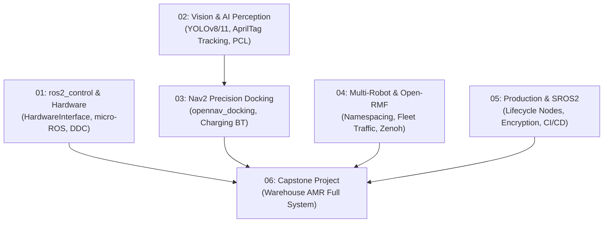

# 🚀 Advanced ROS 2 Tutorial Track (ระบบหุ่นยนต์อุตสาหกรรมขั้นสูง)

ยินดีต้อนรับสู่ **Advanced ROS 2 Track** — เส้นทางการเรียนรู้ระดับวิศวกรรมขั้นสูง มุ่งเน้นการพัฒนา **Autonomous Mobile Robot (AMR)** ที่พร้อมใช้งานในอุตสาหกรรมจริง (Production-Grade) ครอบคลุมการควบคุมฮาร์ดแวร์จริงด้วย `ros2_control`, การประมวลผลภาพด้วย AI, การเข้าจอดชาร์จไฟระดับมิลลิเมตร, การบริหารฝูงหุ่นยนต์ (Open-RMF) และความปลอดภัยระดับองค์กร

> 🎓 **แผนการสอน 16 สัปดาห์เต็ม:** สำหรับอาจารย์ผู้สอนหรือสถาบันการศึกษา สามารถดูโครงสร้างแผนการสอนฉบับเต็มได้ที่ [`course_syllabus_02_advanced_ros2.md`](../course_syllabus_02_advanced_ros2.md)  
> 📖 **คู่มือเนื้อหาบรรยายและขั้นตอนแล็บละเอียด 16 สัปดาห์:** อ่านได้ที่ [`docs/weekly_lectures_and_labs.md`](docs/weekly_lectures_and_labs.md)

---

## 🗺️ โครงสร้างการเรียนรู้ระดับสูง (Advanced Modules)

| โมดูล | หัวข้อการเรียนรู้ | เอกสารคู่มือ | ใบงานแล็บ | โค้ดตัวอย่างสำคัญ |
| :---: | :--- | :--- | :--- | :--- |
| **01** | **`ros2_control` & Hardware** | [`01_ros2_control/README.md`](01_ros2_control_Hardware/README.md) | [`Lab_01.md`](01_ros2_control_Hardware/Lab_Exercises.md) | [`diff_drive_controller.yaml`](01_ros2_control_Hardware/config/diff_drive_controller.yaml) |
| **02** | **Vision & AI Perception** | [`02_Vision_AI/README.md`](02_Vision_AI_Perception/README.md) | [`Lab_02.md`](02_Vision_AI_Perception/Lab_Exercises.md) | [`cv_bridge_yolo_node.py`](02_Vision_AI_Perception/src/cv_bridge_yolo_node.py) |
| **03** | **Nav2 Precision Docking** | [`03_Precision_Docking/README.md`](03_Nav2_Precision_Docking/README.md) | [`Lab_03.md`](03_Nav2_Precision_Docking/Lab_Exercises.md) | [`dock_and_charge_bt.xml`](03_Nav2_Precision_Docking/behavior_trees/dock_and_charge_bt.xml) |
| **04** | **Multi-Robot & Open-RMF** | [`04_Multi_Robot/README.md`](04_Multi_Robot_Fleet_OpenRMF/README.md) | [`Lab_04.md`](04_Multi_Robot_Fleet_OpenRMF/Lab_Exercises.md) | [`multi_robot_fleet.launch.py`](04_Multi_Robot_Fleet_OpenRMF/launch/multi_robot_fleet.launch.py) |
| **05** | **Production & SROS 2** | [`05_Production/README.md`](05_Production_CI_CD_Security/README.md) | [`Lab_05.md`](05_Production_CI_CD_Security/Lab_Exercises.md) | [`lifecycle_laser_sensor.py`](05_Production_CI_CD_Security/src/lifecycle_laser_sensor.py) |
| **06** | **Capstone Warehouse AMR** | [`06_Capstone/Readme.md`](06_Capstone_Project/Readme.md) | [`Lab_06.md`](06_Capstone_Project/Lab_Exercises.md) | [`full_warehouse_system.launch.py`](06_Capstone_Project/launch/full_warehouse_system.launch.py) |

---

## 📑 สารบัญบทเรียนและคู่มือปฏิบัติการ (Advanced Tutorials)

### [Tutorial 1: ros2_control & Real Hardware Interface](01_ros2_control_Hardware/README.md)
- **ประเด็นสำคัญ:** การตัดขาด Application ออกจากฮาร์ดแวร์ด้วย `SystemInterface`, การใช้งาน `diff_drive_controller`, การต่อไมโครคอนโทรลเลอร์ (STM32/ESP32) ด้วย micro-ROS
- **ไฟล์สำคัญ:**
  - คอนฟิกคอนโทรลเลอร์: [`config/diff_drive_controller.yaml`](01_ros2_control_Hardware/config/diff_drive_controller.yaml)
  - อินเตอร์เฟส URDF/Xacro: [`urdf/diff_drive_ros2_control.xacro`](01_ros2_control_Hardware/urdf/diff_drive_ros2_control.xacro)

---

### [Tutorial 2: Computer Vision & AI Perception Pipeline](02_Vision_AI_Perception/README.md)
- **ประเด็นสำคัญ:** การแปลงข้อมูลภาพความเร็วสูงด้วย `cv_bridge`, การเชื่อมโมเดล Deep Learning (YOLOv8/11) ตรวจจับสิ่งกีดขวาง, การหาพิกัด 3D ของ Visual Marker (AprilTag)
- **ไฟล์สำคัญ:**
  - โหนดตรวจจับวัตถุ AI: [`src/cv_bridge_yolo_node.py`](02_Vision_AI_Perception/src/cv_bridge_yolo_node.py)
  - โหนดตรวจจับแท่นชาร์จ: [`src/apriltag_dock_tracker.py`](02_Vision_AI_Perception/src/apriltag_dock_tracker.py)

---

### [Tutorial 3: Nav2 Precision Docking Server (`opennav_docking`)](03_Nav2_Precision_Docking/README.md)
- **ประเด็นสำคัญ:** การเข้าจอดแบบละเอียดระดับมิลลิเมตรเพื่อเสียบขั้วชาร์จไฟ, Staging Area, Closed-loop visual servoing และ Behavior Tree สำหรับการชาร์จแบตเตอรี่อัตโนมัติ
- **ไฟล์สำคัญ:**
  - คอนฟิก Docking Server: [`config/docking_server_params.yaml`](03_Nav2_Precision_Docking/config/docking_server_params.yaml)
  - Behavior Tree ชาร์จไฟ: [`behavior_trees/dock_and_charge_bt.xml`](03_Nav2_Precision_Docking/behavior_trees/dock_and_charge_bt.xml)

---

### [Tutorial 4: Multi-Robot Fleet Management & Open-RMF](04_Multi_Robot_Fleet_OpenRMF/README.md)
- **ประเด็นสำคัญ:** การจัดการหุ่นยนต์หลายตัวในพื้นที่เดียวกัน, การตั้งค่า Namespacing และ TF Prefix, การจัดการจราจรหุ่นยนต์ด้วย Open-RMF, การเชื่อมต่อด้วย Zenoh
- **ไฟล์สำคัญ:**
  - คอนฟิก Open-RMF Fleet: [`config/fleet_adapter_config.yaml`](04_Multi_Robot_Fleet_OpenRMF/config/fleet_adapter_config.yaml)
  - Launch File สปอว์น 2 หุ่นยนต์: [`launch/multi_robot_fleet.launch.py`](04_Multi_Robot_Fleet_OpenRMF/launch/multi_robot_fleet.launch.py)

---

### [Tutorial 5: Production Engineering, SROS2 Security & CI/CD](05_Production_CI_CD_Security/README.md)
- **ประเด็นสำคัญ:** การเขียนโหนดแบบ Managed Lifecycle Nodes (ป้องกันมอเตอร์กระชากขณะบูต), การเข้ารหัสและสิทธิ์การเข้าถึงด้วย SROS 2, การเขียน Integration Test ด้วย `launch_testing`
- **ไฟล์สำคัญ:**
  - โหนดเซนเซอร์แบบ Lifecycle: [`src/lifecycle_laser_sensor.py`](05_Production_CI_CD_Security/src/lifecycle_laser_sensor.py)
  - ชุดทดสอบระบบอัตโนมัติ: [`tests/test_amr_launch.py`](05_Production_CI_CD_Security/tests/test_amr_launch.py)

---

### [Tutorial 6: Capstone Project (Warehouse AMR Automation)](06_Capstone_Project/Readme.md)
- **ประเด็นสำคัญ:** โครงงานบูรณาการระบบคลังสินค้าครบวงจร: สปอว์น Gazebo, ขับขี่สำรวจ, นำทาง Nav2, ลาดตระเวนจุดตรวจ, และรับคำสั่งอัตโนมัติ
- **ไฟล์สำคัญ:**
  - Launch ระบบคลังสินค้าครบวงจร: [`launch/full_warehouse_system.launch.py`](06_Capstone_Project/launch/full_warehouse_system.launch.py)
  - เกณฑ์การประเมิน 5 มิติ: [`rubrics.md`](06_Capstone_Project/rubrics.md)
