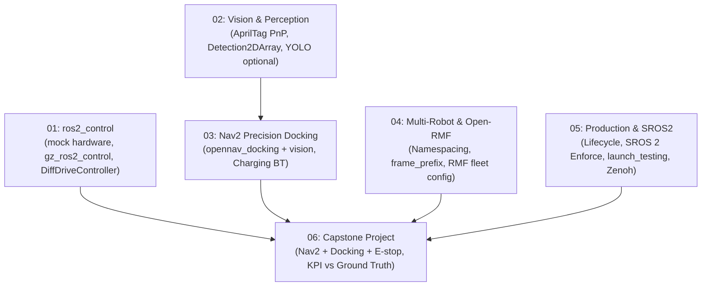

# 🚀 Advanced ROS 2 Tutorial Track (ระบบหุ่นยนต์อุตสาหกรรมขั้นสูง)

ยินดีต้อนรับสู่ **Advanced ROS 2 Track** — เส้นทางการเรียนรู้ระดับวิศวกรรมขั้นสูง มุ่งเน้นการพัฒนา **Autonomous Mobile Robot (AMR)** ที่พร้อมใช้งานในอุตสาหกรรมจริง (Production-Grade) ครอบคลุมการควบคุมฮาร์ดแวร์จริงด้วย `ros2_control`, การประมวลผลภาพด้วย AI, การเข้าจอดชาร์จไฟระดับมิลลิเมตร, การบริหารฝูงหุ่นยนต์ (Open-RMF) และความปลอดภัยระดับองค์กร

> 🎓 **แผนการสอน 16 สัปดาห์เต็ม:** สำหรับอาจารย์ผู้สอนหรือสถาบันการศึกษา สามารถดูโครงสร้างแผนการสอนฉบับเต็มได้ที่ [`course_syllabus_02_advanced_ros2.md`](../course_syllabus_02_advanced_ros2.md)  
> 📖 **คู่มือเนื้อหาบรรยายและขั้นตอนแล็บละเอียด 16 สัปดาห์:** อ่านได้ที่ [`docs/weekly_lectures_and_labs.md`](docs/weekly_lectures_and_labs.md)
> 🧪 **ทุกโมดูลเป็น ROS 2 package (`amr_adv01`…`amr_adv06`)** รันได้จริงแบบ headless ใน `ros:lab-runner` โดยไม่ต้องมีหุ่นยนต์จริงหรือ GPU:
> `make build` แล้ว `make test PKG=amr_adv0N` ผลรันจริงอยู่ในหัวข้อ "ผลการรันจริง" ของแต่ละโมดูลและโฟลเดอร์ `results/`
> การจับคู่ 16 สัปดาห์กับ 6 โมดูล (รวมหัวข้อที่ต้องใช้ฮาร์ดแวร์จริง เช่น micro-ROS) ดูตารางใน [syllabus](../course_syllabus_02_advanced_ros2.md)

---

## 🗺️ โครงสร้างการเรียนรู้ระดับสูง (Advanced Modules)

| โมดูล | หัวข้อการเรียนรู้ | เอกสารคู่มือ | ใบงานแล็บ | โค้ดตัวอย่างสำคัญ |
| :---: | :--- | :--- | :--- | :--- |
| **01** | **`ros2_control` & Hardware** | [`01_ros2_control/README.md`](01_ros2_control_Hardware/README.md) | [`Lab_01.md`](01_ros2_control_Hardware/Lab_Exercises.md) | [`diff_drive_controller.yaml`](01_ros2_control_Hardware/config/diff_drive_controller.yaml) |
| **02** | **Vision & AI Perception** | [`02_Vision_AI/README.md`](02_Vision_AI_Perception/README.md) | [`Lab_02.md`](02_Vision_AI_Perception/Lab_Exercises.md) | [`object_detector_node.py`](02_Vision_AI_Perception/src/object_detector_node.py) |
| **03** | **Nav2 Precision Docking** | [`03_Precision_Docking/README.md`](03_Nav2_Precision_Docking/README.md) | [`Lab_03.md`](03_Nav2_Precision_Docking/Lab_Exercises.md) | [`dock_and_charge_bt.xml`](03_Nav2_Precision_Docking/behavior_trees/dock_and_charge_bt.xml) |
| **04** | **Multi-Robot & Open-RMF** | [`04_Multi_Robot/README.md`](04_Multi_Robot_Fleet_OpenRMF/README.md) | [`Lab_04.md`](04_Multi_Robot_Fleet_OpenRMF/Lab_Exercises.md) | [`multi_robot_fleet.launch.py`](04_Multi_Robot_Fleet_OpenRMF/launch/multi_robot_fleet.launch.py) |
| **05** | **Production & SROS 2** | [`05_Production/README.md`](05_Production_CI_CD_Security/README.md) | [`Lab_05.md`](05_Production_CI_CD_Security/Lab_Exercises.md) | [`lifecycle_laser_sensor.py`](05_Production_CI_CD_Security/src/lifecycle_laser_sensor.py) |
| **06** | **Capstone Warehouse AMR** | [`06_Capstone/Readme.md`](06_Capstone_Project/Readme.md) | [`Lab_06.md`](06_Capstone_Project/Lab_Exercises.md) | [`full_warehouse_system.launch.py`](06_Capstone_Project/launch/full_warehouse_system.launch.py) |

---

## 📑 สารบัญบทเรียนและคู่มือปฏิบัติการ (Advanced Tutorials)

### [Tutorial 1: ros2_control & Real Hardware Interface](01_ros2_control_Hardware/README.md)
- **ประเด็นสำคัญ:** การแยก Application ออกจากฮาร์ดแวร์ด้วย `SystemInterface`, `mock_components/GenericSystem` (ไม่ต้องมีหุ่นจริง) และ `gz_ros2_control` (Gazebo headless), `diff_drive_controller` ของ Jazzy รับ `TwistStamped` ที่ `/diff_drive_controller/cmd_vel` (micro-ROS เป็นหัวข้อบรรยาย ต้องใช้บอร์ดจริง)
- **รัน:** `ros2 launch amr_adv01 mock_diff_drive.launch.py`
- **ไฟล์สำคัญ:**
  - คอนฟิกคอนโทรลเลอร์: [`config/diff_drive_controller.yaml`](01_ros2_control_Hardware/config/diff_drive_controller.yaml)
  - อินเตอร์เฟส URDF/Xacro: [`urdf/diff_drive_ros2_control.xacro`](01_ros2_control_Hardware/urdf/diff_drive_ros2_control.xacro)

---

### [Tutorial 2: Computer Vision & AI Perception Pipeline](02_Vision_AI_Perception/README.md)
- **ประเด็นสำคัญ:** `cv_bridge` + sensor-data QoS, กล้องจำลองเรนเดอร์ AprilTag 36h11 ผ่าน K ที่รู้ค่า, หาพิกัด 3D ด้วย `solvePnP` (วัดจริงคลาด ~1 mm ที่ 0.8 m) ส่งออก `detected_dock_pose`, ตัวตรวจจับวัตถุแบบ classical CV ส่ง `vision_msgs/Detection2DArray` (YOLO/ultralytics เป็นแบบฝึกหัดเสริม)
- **รัน:** `ros2 launch amr_adv02 vision_pipeline.launch.py`
- **ไฟล์สำคัญ:**
  - โหนดตรวจจับวัตถุ (classical CV, YOLO optional): [`src/object_detector_node.py`](02_Vision_AI_Perception/src/object_detector_node.py)
  - โหนดตรวจจับแท่นชาร์จ: [`src/apriltag_dock_tracker.py`](02_Vision_AI_Perception/src/apriltag_dock_tracker.py)

---

### [Tutorial 3: Nav2 Precision Docking Server (`opennav_docking`)](03_Nav2_Precision_Docking/README.md)
- **ประเด็นสำคัญ:** `opennav_docking` (action `nav2_msgs/DockRobot`/`UndockRobot`), dock database, staging pose, external detection จากโมดูล 02 (วัดจริงคลาด 11.4–14.5 mm; ปิดกล้อง 48.9 mm) และ Behavior Tree ชาร์จแบตเตอรี่
- **รัน:** `ros2 launch amr_adv03 docking_sim.launch.py`
- **ไฟล์สำคัญ:**
  - คอนฟิก Docking Server: [`config/docking_server_params.yaml`](03_Nav2_Precision_Docking/config/docking_server_params.yaml)
  - Behavior Tree ชาร์จไฟ: [`behavior_trees/dock_and_charge_bt.xml`](03_Nav2_Precision_Docking/behavior_trees/dock_and_charge_bt.xml)

---

### [Tutorial 4: Multi-Robot Fleet Management & Open-RMF](04_Multi_Robot_Fleet_OpenRMF/README.md)
- **ประเด็นสำคัญ:** หุ่นยนต์หลายตัวด้วย namespace + `frame_prefix` (`/tf` ใช้ร่วมกัน เฟรมมี prefix), ข้อดีข้อเสียเทียบกับการ remap `/tf` แบบ Nav2, config fleet ของ Open-RMF ที่ผ่าน parser จริง และ traffic schedule แบบโหนดกลาง + mirror
- **รัน:** `ros2 launch amr_adv04 multi_robot_fleet.launch.py`
- **ไฟล์สำคัญ:**
  - คอนฟิก Open-RMF Fleet: [`config/fleet_adapter_config.yaml`](04_Multi_Robot_Fleet_OpenRMF/config/fleet_adapter_config.yaml)
  - Launch File สปอว์น 2 หุ่นยนต์: [`launch/multi_robot_fleet.launch.py`](04_Multi_Robot_Fleet_OpenRMF/launch/multi_robot_fleet.launch.py)

---

### [Tutorial 5: Production Engineering, SROS2 Security & CI/CD](05_Production_CI_CD_Security/README.md)
- **ประเด็นสำคัญ:** Managed Lifecycle Nodes (ไม่ publish ขณะ Inactive/Finalized), SROS 2 แบบ Enforce พร้อม `--enclave`, Integration Test ด้วย `launch_testing`, เปรียบเทียบ DDS กับ Zenoh (`rmw_zenoh_cpp`)
- **รัน:** `ros2 run amr_adv05 lifecycle_laser_sensor` แล้วสั่ง `ros2 lifecycle set`
- **ไฟล์สำคัญ:**
  - โหนดเซนเซอร์แบบ Lifecycle: [`src/lifecycle_laser_sensor.py`](05_Production_CI_CD_Security/src/lifecycle_laser_sensor.py)
  - ชุดทดสอบระบบอัตโนมัติ: [`test/test_lifecycle_launch.py`](05_Production_CI_CD_Security/test/test_lifecycle_launch.py)

---

### [Tutorial 6: Capstone Project (Warehouse AMR Automation)](06_Capstone_Project/Readme.md)
- **ประเด็นสำคัญ:** รวมทุกโมดูลเป็นระบบเดียวด้วยคำสั่งเดียว: Gazebo (headless) + Nav2 + `collision_monitor` (StopZone) + `opennav_docking` + AprilTag จากโมดูล 02, ภารกิจ pick → drop → `DockRobot` → `UndockRobot` → ทดสอบ e-stop → กลับบ้าน, วัด KPI เทียบ Ground Truth ของ Gazebo (รันจริง 5/5 ครั้งผ่าน, docking คลาด 2.2–4.5 mm, e-stop 48–104 ms), สาธิต kidnapped robot (AMCL ไม่ฟื้นเองเพราะ `recovery_alpha_*` = 0)
- **รัน:** `ros2 launch amr_adv06 full_warehouse_system.launch.py headless:=true` แล้ว `ros2 run amr_adv06 capstone_mission --ros-args -p use_sim_time:=true` (หรือ `ros2 run amr_adv06 kidnap_demo`)
- **ไฟล์สำคัญ:**
  - Launch ระบบคลังสินค้าครบวงจร: [`launch/full_warehouse_system.launch.py`](06_Capstone_Project/launch/full_warehouse_system.launch.py)
  - ภารกิจและ KPI: [`config/capstone_mission.yaml`](06_Capstone_Project/config/capstone_mission.yaml), [`config/kpi_targets.yaml`](06_Capstone_Project/config/kpi_targets.yaml)
  - เกณฑ์การประเมิน 5 มิติ (20/20/25/20/15 = Capstone 35%, Oral Defense แยกอีก 10%): [`rubrics.md`](06_Capstone_Project/rubrics.md)
