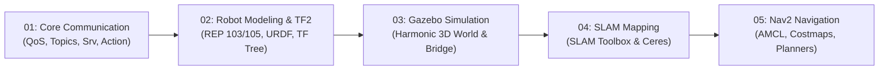

# 📘 Essential ROS 2 Tutorial Track (พื้นฐานสู่วิศวกรหุ่นยนต์ AMR)

ยินดีต้อนรับสู่ **Essential ROS 2 Track** — เส้นทางการเรียนรู้หลักสำหรับวิศวกรที่ต้องการสร้างและควบคุมหุ่นยนต์เคลื่อนที่อัตโนมัติ (Autonomous Mobile Robot - AMR) ตั้งแต่ระดับพื้นฐานจนถึงการขับเคลื่อนอัตโนมัติในแบบจำลอง 3 มิติ ด้วย **ROS 2 Jazzy Jalisco** และ **Gazebo Sim 8 (Harmonic)**

---

## 🗺️ โครงสร้างการเรียนรู้ (Learning Roadmap)



---

## 📑 สารบัญบทเรียนและคู่มือปฏิบัติการ (Tutorials & Labs)

### [Tutorial 1: Core Communication & Architecture](01_Core_Communication/Readme.md)
- **ทฤษฎี:** DDS Middleware, Quality of Service (QoS), Topic Pub/Sub, Service/Client, Action Server, Dynamic Parameters
- **แล็บปฏิบัติการ:** [`01_Core_Communication/Lab_Exercises.md`](01_Core_Communication/Lab_Exercises.md)
  - `Lab 1.1`: Custom QoS Publisher/Subscriber (`sensor_qos_publisher.py`)
  - `Lab 1.2`: Power Management Service Server (`power_service_server.py`)
  - `Lab 1.3`: Long-running Action Server (`navigate_action_server.py`)
  - `Lab 1.4`: Dynamic Parameter Validation (`fleet_parameters.py`)
  - `Lab 1.5`: Modular Launch System (`core_system.launch.py`)
- **คำสั่งรัน:**
  ```bash
  ./docker/run_lab.sh ros2 launch Essential_ROS/01_Core_Communication/launch/core_system.launch.py
  ```

---

### [Tutorial 2: Robot Modeling & TF2 Coordinate Frames](02_Robot_Modeling_TF2/Readme.md)
- **ทฤษฎี:** มาตรฐานหุ่นยนต์ REP 103 (พิกัดและหน่วย) และ REP 105 (เฟรม `map` -> `odom` -> `base_footprint` -> `base_link`), จลนศาสตร์ Differential Drive, กฎของ TF Tree
- **แล็บปฏิบัติการ:** [`02_Robot_Modeling_TF2/Lab_Exercises.md`](02_Robot_Modeling_TF2/Lab_Exercises.md)
  - `Lab 2.1`: ออกแบบหุ่นยนต์ 2 ล้อขับ + 2 Casters ใน [`diff_drive_robot.urdf`](02_Robot_Modeling_TF2/urdf/diff_drive_robot.urdf)
  - `Lab 2.2`: ตรวจสอบความถูกต้องของโมเดลด้วย `check_urdf`
  - `Lab 2.3`: แสดงผลและทดสอบหมุนล้อบน RViz2
- **คำสั่งรัน:**
  ```bash
  ./docker/run_lab.sh check_urdf Essential_ROS/02_Robot_Modeling_TF2/urdf/diff_drive_robot.urdf
  ./docker/run_lab.sh ros2 launch Essential_ROS/02_Robot_Modeling_TF2/launch/display_urdf.launch.py
  ```

---

### [Tutorial 3: 3D Simulation with Gazebo Sim (Harmonic)](03_Gazebo_Simulation/Readme.md)
- **ทฤษฎี:** โครงสร้าง Gazebo Sim 8.15.0 (Harmonic), การเขียน SDF World, การต่อเชื่อม Plugin ฟิสิกส์ (`DiffDrive`, `JointStatePublisher`, `gpu_lidar`), และการ Bridge ข้อมูลด้วย `ros_gz_bridge`
- **แล็บปฏิบัติการ:** [`03_Gazebo_Simulation/Lab_Exercises.md`](03_Gazebo_Simulation/Lab_Exercises.md)
  - `Lab 3.1`: สร้างโลกคลังสินค้า [`warehouse.sdf`](03_Gazebo_Simulation/worlds/warehouse.sdf)
  - `Lab 3.2`: ตั้งค่าสะพานเชื่อมต่อท็อปปิกใน [`ros_gz_bridge.yaml`](03_Gazebo_Simulation/config/ros_gz_bridge.yaml)
  - `Lab 3.3`: สปอว์นหุ่นยนต์และขับขี่ทดสอบฟิสิกส์
- **คำสั่งรัน:**
  ```bash
  ./docker/run_lab.sh ros2 launch Essential_ROS/03_Gazebo_Simulation/launch/gazebo_world.launch.py
  ```

---

### [Tutorial 4: 2D Mapping with SLAM Toolbox](04_SLAM_Mapping/Readme.md)
- **ทฤษฎี:** Occupancy Grid Mapping, Graph-based SLAM, Scan Matching, Loop Closure Detection และ Ceres Solver
- **แล็บปฏิบัติการ:** [`04_SLAM_Mapping/Lab_Exercises.md`](04_SLAM_Mapping/Lab_Exercises.md)
  - `Lab 4.1`: ปรับแต่งคอนฟิกใน [`slam_toolbox_params.yaml`](04_SLAM_Mapping/config/slam_toolbox_params.yaml)
  - `Lab 4.2`: รัน Online Asynchronous SLAM และสำรวจคลังสินค้า
  - `Lab 4.3`: บันทึกแผนที่ออกมาเป็นไฟล์ [`warehouse_map.yaml`](04_SLAM_Mapping/maps/warehouse_map.yaml) และ `.pgm`
- **คำสั่งรัน:**
  ```bash
  ./docker/run_lab.sh ros2 launch Essential_ROS/04_SLAM_Mapping/launch/online_async_slam.launch.py
  ```

---

### [Tutorial 5: Autonomous Navigation with Nav2 Stack](05_Nav2_Navigation/Readme.md)
- **ทฤษฎี:** Nav2 Architecture, Costmap 2D (Static, Obstacle, Inflation), Global Planner (NavFn), Local Controller (DWB), AMCL Localization (Particle Filter)
- **แล็บปฏิบัติการ:** [`05_Nav2_Navigation/Lab_Exercises.md`](05_Nav2_Navigation/Lab_Exercises.md)
  - `Lab 5.1`: ปรับแต่งพารามิเตอร์ Nav2 ใน [`nav2_params.yaml`](05_Nav2_Navigation/config/nav2_params.yaml)
  - `Lab 5.2`: รัน Nav2 Bringup และระบุตำแหน่งเริ่มต้นอัตโนมัติด้วย [`amcl_initial_pose.py`](05_Nav2_Navigation/src/amcl_initial_pose.py)
  - `Lab 5.3`: สั่งภารกิจลาดตระเวนจุดตรวจด้วย [`waypoint_patrol.py`](05_Nav2_Navigation/src/waypoint_patrol.py)
- **คำสั่งรัน:**
  ```bash
  ./docker/run_lab.sh ros2 launch Essential_ROS/05_Nav2_Navigation/launch/nav2_bringup.launch.py
  ```

---

## 🎯 สรุปผลลัพธ์หลังจบ Track นี้
ผู้เรียนจะสามารถ:
1. ออกแบบและเขียนโปรแกรมโครงข่าย ROS 2 Node ได้ตาม Best Practices
2. สร้างโมเดลหุ่นยนต์ 3 มิติพร้อมพิกัด TF ที่ถูกต้องตามมาตรฐานวิศวกรรม
3. สร้างสภาพแวดล้อมจำลองฟิสิกส์ 3 มิติ และเชื่อมต่อข้อมูลเซนเซอร์เข้าสู่ระบบ
4. สร้างแผนที่ดิจิทัลของพื้นที่ปฏิบัติงานจริงด้วย SLAM
5. สั่งการหุ่นยนต์ให้เคลื่อนที่อัตโนมัติอย่างปลอดภัยและหลบสิ่งกีดขวางได้ 100%
