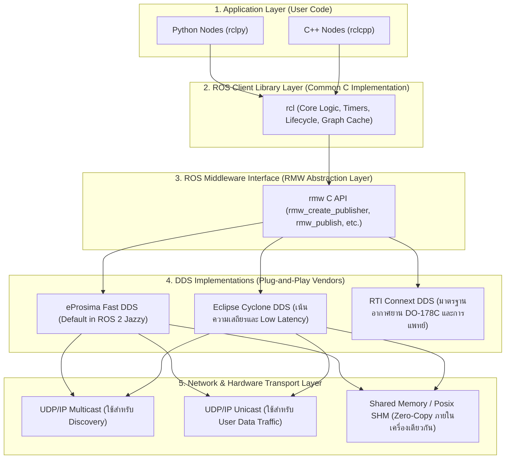
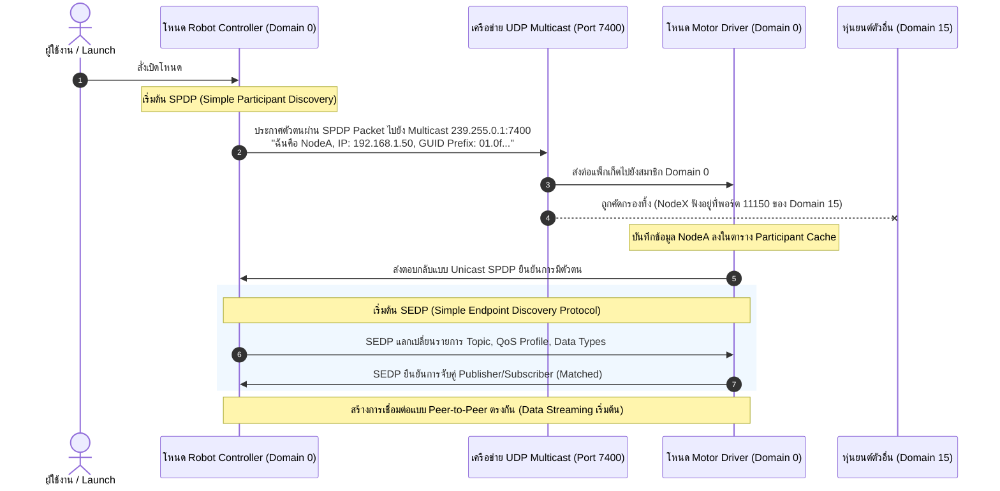
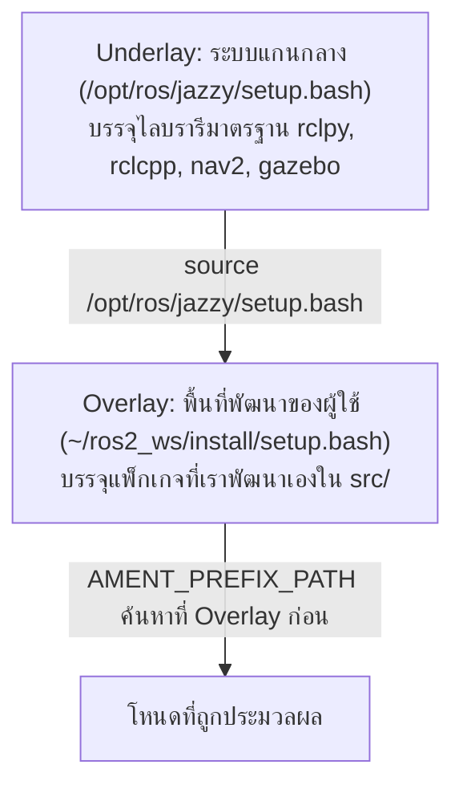
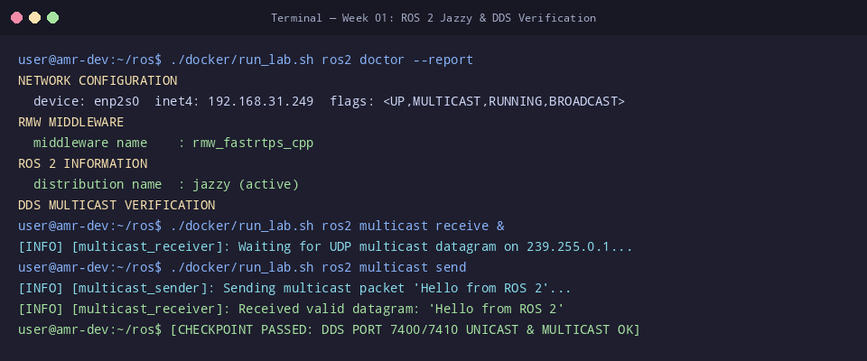

# 📖 Week 01: สภาพแวดล้อม สถาปัตยกรรม ROS 2 และระบบเครือข่าย Data Distribution Service (DDS)
**รหัสวิชา:** AMR-101 Essential ROS 2 for Autonomous Mobile Robots  
**เวลาเรียน:** บรรยาย 2 ชั่วโมง | ปฏิบัติการ 3 ชั่วโมง | ทบทวนและค้นคว้าด้วยตนเอง 5 ชั่วโมง  
**วิชาบังคับก่อน:** ความรู้พื้นฐานระบบปฏิบัติการ Linux (Ubuntu/Debian), Shell Commands, และแนวคิดพื้นฐานของ Docker Container  
**เอกสารปฏิบัติการประจำสัปดาห์:** [ใบงานแล็บสัปดาห์ที่ 1](Lab_Exercises.md)

---

## 🎯 วัตถุประสงค์การเรียนรู้เชิงพฤติกรรม (Measurable Learning Objectives)
เมื่อผ่านการศึกษาบทเรียนและฝึกปฏิบัติการในสัปดาห์นี้ ผู้เรียนจะมีความสามารถดังต่อไปนี้:
1. **วิเคราะห์ความแตกต่างเชิงสถาปัตยกรรม:** จำแนกข้อแตกต่างระดับรากฐานระหว่างระบบรวมศูนย์ (Centralized Master Node) ใน ROS 1 กับระบบกระจายศูนย์แบบเพียร์ทูเพียร์ (Decentralized Peer-to-Peer) บนมาตรฐาน OMG DDS ใน ROS 2 ได้อย่างลึกซึ้ง
2. **อธิบายโครงสร้างซอฟต์แวร์หลายชั้น (Layered Software Stack):** อธิบายความสัมพันธ์และหน้าที่ของแต่ละชั้นเลเยอร์ ได้แก่ Application Layer (`rclpy`/`rclcpp`), ROS Client Library (`rcl`), ROS Middleware Interface (`rmw`), และ Data Distribution Service (DDS Vendors)
3. **ถอดรหัสโปรโตคอลการค้นพบของ DDS (DDS Discovery):** อธิบายกลไกของ **Simple Participant Discovery Protocol (SPDP)** และ **Simple Endpoint Discovery Protocol (SEDP)** ผ่านเครือข่าย UDP Multicast และ Unicast
4. **คำนวณและออกแบบพอร์ตเครือข่าย:** คำนวณช่วงพอร์ต Multicast และ Unicast ตามมาตรฐาน OMG RTPS v2.3 เพื่อจัดสรรกลุ่มสัญญาณเครือข่ายหุ่นยนต์ด้วยตัวแปร `ROS_DOMAIN_ID` โดยไม่เกิดการชนกันของสัญญาณ
5. **เข้าใจการทำงานของ Colcon Workspace:** อธิบายความสัมพันธ์ระหว่าง Underlay (`/opt/ros/jazzy`) และ Overlay Workspace รวมถึงลำดับการ Override ตัวแปรสภาพแวดล้อม
6. **ใช้งานสภาพแวดล้อมพัฒนาผ่าน Docker:** เข้าใจการตั้งค่า Containerization สำหรับงานหุ่นยนต์ ทั้งการแชร์ Host Network (`--net host`), การแชร์ Shared Memory (`--ipc host`), และการเชื่อมต่อ X11 Display Server

---

## ⏱️ แผนการจัดการเรียนรู้ 2 ชั่วโมง (Detailed Lecture Schedule)
| ช่วงเวลา (นาที) | หัวข้อการบรรยาย | กิจกรรมและสื่อการเรียนรู้ | จุดเน้นสำคัญ (Key Takeaways) |
| :---: | :--- | :--- | :--- |
| **00:00 - 00:25** | **วิวัฒนาการจาก ROS 1 สู่ ROS 2:** ปัญหาจุดล้มเหลวเดี่ยว (Single Point of Failure) | บรรยายเปรียบเทียบสถาปัตยกรรม roscore กับ DDS | ทำไมอุตสาหกรรมหุ่นยนต์และยานยนต์ไร้คนขับจึงต้องเปลี่ยนผ่านสู่ ROS 2 |
| **00:25 - 00:55** | **สถาปัตยกรรมเลเยอร์และ RMW Abstraction:** ความเป็นนามธรรมของมิดเดิลแวร์ | วิเคราะห์แผนผัง Layered Architecture และผู้ผลิต DDS | เข้าใจบทบาทของ C Core (`rcl`) และการสลับ Vendor DDS ได้โดยไม่ต้องแก้โค้ด |
| **00:55 - 01:30** | **เจาะลึกโปรโตคอล DDS RTPS & Discovery:** SPDP, SEDP และการคำนวณพอร์ต | แสดง Sequence Diagram ของการ Handshake และเขียนสมการพอร์ต | ที่มาของตัวเลข 7400, 250, และการแยก Domain ID ในโรงงานจริง |
| **01:30 - 01:50** | **โครงสร้าง Colcon Workspace และ Docker Runtime:** Underlay vs Overlay | วิเคราะห์โครงสร้าง `src`, `build`, `install`, `log` และ Script สิ่งแวดล้อม | การทำงานของ `setup.bash` และการส่งผ่าน X11 GUI ไปยัง Docker |
| **01:50 - 02:00** | **การวินิจฉัยระบบด้วย CLI และสรุปก่อนเข้าสู่แล็บ:** ตรวจสอบความพร้อม | สาธิตคำสั่ง `ros2 doctor`, `ros2 multicast`, และ `domain_check.sh` | สรุปประเด็นข้อผิดพลาดที่พบบ่อย และแนะนำขั้นตอนในใบงานปฏิบัติการ |

---

## 🏛️ สถาปัตยกรรมระบบเชิงลึก (In-Depth Architectural Analysis)

### 1. ทำไมอุตสาหกรรมหุ่นยนต์จึงต้องก้าวข้ามจาก ROS 1 สู่ ROS 2?
ในยุคของ **ROS 1 (พ.ศ. 2550 - 2568)** สถาปัตยกรรมถูกออกแบบขึ้นสำหรับการวิจัยในห้องปฏิบัติการทางวิชาการ โดยใช้โปรเซสศูนย์กลางที่เรียกว่า **`roscore` (Master Node)**:
- **จุดล้มเหลวเดี่ยว (Single Point of Failure - SPoF):** หากเครื่องคอมพิวเตอร์ที่รัน `roscore` เกิดไฟดับ แฮงก์ หรือสายแลนหลุด โหนดทั้งหมดในระบบหุ่นยนต์จะไม่สามารถค้นหากันหรือเริ่มการเชื่อมต่อใหม่ได้อีกต่อไป ระบบควบคุมทั้งโรงงานต้องหยุดชะงัก (Downtime)
- **ข้อจำกัดเรื่อง Real-Time:** โค้ดแกนกลางของ ROS 1 พัฒนาด้วยภาษา C++ ยุคเก่า ไม่มีกลไก Deterministic Execution หรือ Memory Pre-allocation สำหรับระบบ Real-Time Operating System (RTOS)
- **ไม่มีการรักษาความปลอดภัย (No Built-in Security):** ข้อความใน ROS 1 ส่งเป็น Plain Text ข้ามเครือข่าย TCP/UDP ใครก็ตามที่เสียบสายแลนเข้าวงเน็ตเวิร์กเดียวกันสามารถดักฟัง (Sniff) หรือส่งคำสั่งปลอมเข้าไปสั่งให้หุ่นยนต์หมุนตัวได้ทันที
- **การเชื่อมต่อไร้สายที่ไม่เสถียร (Unreliable Wireless Links):** ROS 1 อาศัย TCP XML-RPC เป็นหลัก เมื่อหุ่นยนต์ขับผ่านจุดอับสัญญาณ Wi-Fi การเชื่อมต่อ TCP จะหลุดและไม่สามารถ Reconnect อัตโนมัติได้อย่างราบรื่น

ใน **ROS 2 (เริ่มต้นพัฒนา พ.ศ. 2557 จนถึงเวอร์ชัน LTS ปัจจุบัน Jazzy Jalisco)** สถาปัตยกรรมถูกยกเครื่องใหม่ทั้งหมดโดยนำมาตรฐานอุตสาหกรรมระดับสากลอย่าง **OMG Data Distribution Service (DDS)** มาเป็นรากฐาน:



---

### 2. เลเยอร์ RMW (ROS Middleware Interface) และการสลับผู้ให้บริการ DDS
หนึ่งในจุดเด่นของ ROS 2 คือการไม่ผูกขาดกับซอฟต์แวร์ของผู้ให้บริการรายใดรายหนึ่ง (Vendor Agnostic):
- **เลเยอร์ `rmw`** ทำหน้าที่เป็น Abstraction Layer (ส่วนต่อประสานเชิงนามธรรม) ที่นิยามฟังก์ชันมาตรฐานของ C ไว้ เช่น `rmw_init()`, `rmw_create_node()`, `rmw_publish()`
- แต่ละ Vendor จะเขียน Adapter Package เพื่อเชื่อมต่อ API ของตนเองเข้ากับ `rmw`:
  - `rmw_fastrtps_cpp`: เชื่อมกับ eProsima Fast DDS (ติดตั้งมาเป็นค่าปริยายของ ROS 2 Desktop)
  - `rmw_cyclonedds_cpp`: เชื่อมกับ Eclipse Cyclone DDS (นิยมใช้ในงาน SLAM และ Navigation ที่ต้องการความเสถียรสูงของแพ็กเก็ต)
  - `rmw_connextdds`: เชื่อมกับ RTI Connext Professional
- **การสลับ Vendor ทำได้ทันทีโดยไม่ต้องคอมไพล์โค้ดใหม่** ผ่านการตั้งค่าตัวแปรสภาพแวดล้อม:
  ```bash
  export RMW_IMPLEMENTATION=rmw_cyclonedds_cpp
  ```

---

### 3. กลไกการค้นพบของ DDS (DDS Discovery Protocol Deep Dive)
เมื่อโหนดใน ROS 2 ถูกสร้างขึ้นในระบบเครือข่ายที่ไม่มีโหนด Master กลลวงที่ทำให้โหนดสามารถมองเห็นกันได้คือโปรโตคอล **RTPS Discovery** ซึ่งแบ่งออกเป็น 2 ขั้นตอนสำคัญ:



1. **SPDP (Simple Participant Discovery Protocol):**
   - โหนดจะส่งแพ็กเก็ต Multicast Heartbeat เรียกว่า `DATA(p)` ประกาศการมีตัวตนไปยัง IP Multicast ทั่วโลก (`239.255.0.1` หรือ Subnet Multicast)
   - ข้อมูลที่ส่งจะประกอบด้วย Domain ID, GUID (Globally Unique Identifier), และรายการ IP/Port Unicast ที่ตนเองรอรับข้อมูล
2. **SEDP (Simple Endpoint Discovery Protocol):**
   - เมื่อต่างฝ่ายต่างรู้จักกันผ่าน SPDP แล้ว ทั้งสองโหนดจะหันมาคุยกันโดยตรงผ่าน **Unicast (จุดต่อจุด)** เพื่อแลกเปลี่ยนรายละเอียดระดับลึก
   - ส่งข้อมูลว่าแต่ละโหนดมี Publisher หรือ Subscriber ชื่ออะไรบ้าง ใช้ชนิดข้อความอะไร และกำหนดนโยบาย Quality of Service (QoS) แบบใด
   - หาก QoS เข้ากันได้ตามเงื่อนไข (QoS Compatibility) การสตรีมข้อมูลจึงจะเริ่มต้นขึ้น

---

### 4. คณิตศาสตร์การคำนวณพอร์ต DDS RTPS และการจัดการ `ROS_DOMAIN_ID`
เพื่อป้องกันไม่ให้หุ่นยนต์หลายตัวในห้องทดลองหรือในโรงงานที่เชื่อมต่อ Wi-Fi เดียวกันรับส่งข้อมูลตีกัน มาตรฐาน **OMG RTPS Specification (Section 9.6.1.1)** กำหนดสูตรการแปลงค่า Domain ID สู่หมายเลขพอร์ต UDP ไว้อย่างชัดเจน:

$$\text{Port} = PB + (DG \times \text{Domain ID}) + d + (PG \times \text{Participant ID})$$

#### ตัวแปรคงที่ตามมาตรฐานระบบเครือข่าย UDP/IP:
- **$PB$ (Port Base):** $7400$ (จุดเริ่มต้นของพอร์ต RTPS ทั้งหมด)
- **$DG$ (Domain Gain):** $250$ (แต่ละโดเมนจะมีพื้นที่จัดสรรพอร์ตห่างกัน 250 พอร์ต)
- **$PG$ (Participant Gain):** $2$ (แต่ละโหนด Participant จะใช้พอร์ต Unicast คู่กัน 2 พอร์ตเสมอ)
- **$d$ (ค่า Offset จำแนกประเภทการสื่อสาร):**
  - $d = 0$: **Discovery Multicast (SPDP)** — ช่องประกาศตัวตนเริ่มต้น
  - $d = 1$: **User Data Multicast** — ช่องส่งข้อมูลทั่วไปแบบ Multicast
  - $d = 10$: **Discovery Unicast (Metatraffic)** — ช่องแลกเปลี่ยนรายละเอียด SEDP
  - $d = 11$: **User Data Unicast** — ช่องรับส่งข้อมูลเซนเซอร์และคำสั่งควบคุมจริง

#### สมการสรุปที่ใช้บ่อยในทางปฏิบัติ:
1. **Discovery Multicast Port (พอร์ตที่ใช้ค้นหากัน):**
   $$\text{Multicast Port} = 7400 + (250 \times \text{Domain ID})$$
2. **Unicast Metatraffic Base Port (พอร์ตแลกเปลี่ยนข้อมูลจำเพาะตัว):**
   $$\text{Unicast Port} = 7410 + (250 \times \text{Domain ID}) + (2 \times \text{Participant ID})$$

#### ตารางแจกแจงพอร์ตจริงตามค่า `ROS_DOMAIN_ID`:
| `ROS_DOMAIN_ID` | การใช้งานในงานจริง | Discovery Multicast Port | Unicast Port (Participant 0) | ช่วงพอร์ตทั้งหมดที่จองไว้ |
| :---: | :--- | :---: | :---: | :---: |
| **0** | ค่าเริ่มต้น (Default) ของ ROS 2 | **7400** | **7410** | 7400 - 7649 |
| **1** | หุ่นยนต์ตัวที่ 1 (AMR Alpha) | **7650** | **7660** | 7650 - 7899 |
| **2** | หุ่นยนต์ตัวที่ 2 (AMR Beta) | **7900** | **7910** | 7900 - 8149 |
| **10** | กลุ่มห้องทดลองกลุ่มที่ 10 | **9900** | **9910** | 9900 - 10149 |
| **42** | แผนกทดสอบซอฟต์แวร์พิเศษ | **17900** | **17910** | 17900 - 18149 |
| **101** | ค่าสูงสุดที่แนะนำในระบบ Linux | **32650** | **32660** | 32650 - 32899 |

> [!WARNING]
> ทำไม ROS 2 จึงแนะนำให้ใช้ `ROS_DOMAIN_ID` ไม่เกิน **101**?  
> เนื่องจากพอร์ตของ Domain 102 จะเริ่มต้นที่ $7400 + (250 \times 102) = 32900$ ซึ่งจะเริ่มล่วงล้ำเข้าไปในย่าน **Linux Ephemeral Port Range (ช่วง 32768 ถึง 60999)** ซึ่งระบบปฏิบัติการ Linux สงวนไว้สำหรับสุ่มเปิดเชื่อมต่อเครือข่ายชั่วคราว (เช่น การเปิดเว็บเบราว์เซอร์หรือการดาวน์โหลดไฟล์) หากพอร์ตสุ่มของ OS ไปตรงกับพอร์ตของ DDS จะทำให้โหนด ROS 2 Crash ทันทีโดยไม่ทราบสาเหตุ!

---

### 5. สถาปัตยกรรม Colcon Workspace: Underlay และ Overlay
การพัฒนาโปรแกรมบน ROS 2 จะไม่แตะต้องไฟล์ของระบบปฏิบัติการโดยตรง แต่จะใช้ระบบซ้อนทับสภาพแวดล้อม (Chained Environment):



- โครงสร้างโฟลเดอร์ของ Colcon Workspace:
  - `src/`: โฟลเดอร์เก็บ Source Code ต้นฉบับที่ผู้พัฒนาเขียนขึ้น
  - `build/`: โฟลเดอร์ที่ CMake / Python Setuptools ใช้เก็บไฟล์ชั่วคราวระหว่างการคอมไพล์
  - `install/`: โฟลเดอร์เก็บไฟล์ไบนารี สคริปต์ และไฟล์แวดล้อม `setup.bash` ที่พร้อมนำไปรันจริง
  - `log/`: โฟลเดอร์บันทึกประวัติการคอมไพล์และการทำงานของ colcon
- **หลักการ Overlay Shadowing:** หากใน Overlay ของเรามีแพ็กเกจชื่อเดียวกับใน Underlay (เช่น เราดาวน์โหลดซอร์สโค้ดของ `nav2_amcl` มาแก้ไขเอง) ตัวแปรสภาพแวดล้อมจะจัดลำดับความสำคัญให้เรียกใช้เวอร์ชันใน Overlay ก่อนเสมอ ทำให้เราสามารถแก้ไขข้อบกพร่องของระบบได้โดยไม่ต้องมีสิทธิ์ Root

---

### 6. การทำงานของ Docker Container สำหรับหุ่นยนต์
เพื่อให้สภาพแวดล้อมการทำงานของทุกคนในทีมเหมือนกัน 100% สคริปต์ `docker/run_lab.sh` ได้จำลองสภาพแวดล้อมผ่าน Docker โดยมีอาร์กิวเมนต์ทางเทคนิคที่จำเป็น:
- `--net host`: แชร์ Network Namespace ร่วมกับเครื่องโฮสต์โดยตรง ทำให้การส่งแพ็กเก็ต UDP Multicast ของ DDS วิ่งข้ามระหว่างคอมพิวเตอร์และคอนเทนเนอร์ได้เสมือนรันบนเครื่องจริง
- `--ipc host`: แชร์หน่วยความจำร่วม (Inter-Process Communication / Shared Memory) ทำให้โหนดที่รันข้ามคอนเทนเนอร์สามารถส่งข้อมูลขนาดใหญ่ (เช่น ภาพกล้อง 4K) ผ่าน Zero-Copy Transport ได้อย่างรวดเร็ว
- `-v /tmp/.X11-unix:/tmp/.X11-unix`: เมานต์ซ็อกเก็ต X11 ทำให้แอปพลิเคชัน GUI ภายใน Docker (เช่น RViz2, Gazebo) สามารถส่งภาพมาวาดบนหน้าจอของโฮสต์ได้
- `-e ROS_DOMAIN_ID`: ส่งต่อตัวแปรการแยกเครือข่ายเข้าสู่คอนเทนเนอร์

---

### 7. วิธีการติดตั้ง ROS 2 อย่างละเอียด (Native Installation & Containerization Guide)
> 📖 สำหรับคู่มือฉบับเต็มและเจาะลึกทุกแพลตฟอร์ม สามารถอ่านเพิ่มเติมได้ที่ [**คู่มือการติดตั้ง ROS 2 อย่างสมบูรณ์**](../../docs/ros2_installation_guide.md)

#### ก. การติดตั้งแบบเนทีฟบน Ubuntu 24.04 LTS (ROS 2 Jazzy Jalisco)
1. **ตั้งค่า System Locale เป็น UTF-8:**
   ```bash
   sudo apt update && sudo apt install -y locales
   sudo locale-gen en_US en_US.UTF-8
   sudo update-locale LC_ALL=en_US.UTF-8 LANG=en_US.UTF-8
   export LANG=en_US.UTF-8
   ```
2. **เปิดใช้งาน Ubuntu Universe Repository:**
   ```bash
   sudo apt install -y software-properties-common curl gnupg
   sudo add-apt-repository universe -y
   ```
3. **เพิ่ม ROS 2 GPG Key และ Repository:**
   ```bash
   sudo curl -sSL https://raw.githubusercontent.com/ros/rosdistro/master/ros.key -o /usr/share/keyrings/ros-archive-keyring.gpg
   echo "deb [arch=$(dpkg --print-architecture) signed-by=/usr/share/keyrings/ros-archive-keyring.gpg] http://packages.ros.org/ros2/ubuntu $(. /etc/os-release && echo $UBUNTU_CODENAME) main" | sudo tee /etc/apt/sources.list.d/ros2.list > /dev/null
   sudo apt update
   ```
4. **ติดตั้งแพ็กเกจ Desktop และเครื่องมือพัฒนา:**
   ```bash
   sudo apt install -y ros-jazzy-desktop ros-dev-tools python3-colcon-common-extensions python3-rosdep
   sudo rosdep init && rosdep update
   ```
5. **ตั้งค่า Sourcing อัตโนมัติใน `~/.bashrc`:**
   ```bash
   echo "source /opt/ros/jazzy/setup.bash" >> ~/.bashrc
   echo "source /usr/share/colcon_argcomplete/hook/colcon-argcomplete.bash" >> ~/.bashrc
   source ~/.bashrc
   ```

#### ข. การติดตั้งและใช้งานผ่าน Docker Container (Isolated & Lab Runner)
1. ติดตั้ง Docker บน Ubuntu Host และเพิ่มสิทธิ์ User:
   ```bash
   sudo apt update && sudo apt install -y docker.io
   sudo usermod -aG docker $USER
   ```
2. อนุญาตการแสดงผล GUI ไปยังหน้าจอ Host:
   ```bash
   xhost +local:root
   ```
3. รันคอนเทนเนอร์ของวิชาผ่านสคริปต์ที่เตรียมไว้:
   ```bash
   cd /mnt/sda/ros
   ./docker/run_lab.sh
   ```

#### ค. การติดตั้งบน Windows 10/11 ผ่าน WSL2 + WSLg
1. เปิด PowerShell (Admin) แล้วสั่ง `wsl --install -d Ubuntu-24.04`
2. สร้างไฟล์ `.wslconfig` ที่ `C:\Users\<User>\.wslconfig` ใส่ `[wsl2]\nnetworkingMode=mirrored` เพื่อรองรับ UDP Multicast
3. เปิด Ubuntu Terminal บน Windows แล้วทำตามขั้นตอนการติดตั้งแบบเนทีฟข้างต้นทันที โดย GUI (เช่น RViz2) จะเด้งขึ้นมาบน Windows ผ่าน WSLg โดยอัตโนมัติ

---

## 🛠️ การวิเคราะห์โค้ดสคริปต์ในโมดูล (Script Code Walkthrough)

ในโฟลเดอร์ `Essential_ROS/Week_01_Environment_DDS/src/domain_check.sh`:
```bash
#!/usr/bin/env bash
# สคริปต์ตรวจสอบสภาพแวดล้อม ROS 2 และ DDS Discovery อัตโนมัติ

echo "=================================================="
echo "🔍 ROS 2 & DDS Environment Diagnostic Probe"
echo "=================================================="

# 1. ตรวจสอบการ Source สภาพแวดล้อม ROS
if [ -z "$ROS_DISTRO" ]; then
    echo "❌ ERROR: ROS 2 environment is not sourced!"
    exit 1
else
    echo "✅ ROS_DISTRO: $ROS_DISTRO"
fi

# 2. ตรวจสอบค่า ROS_DOMAIN_ID
DOMAIN=${ROS_DOMAIN_ID:-0}
echo "ℹ️ ROS_DOMAIN_ID: $DOMAIN"

# 3. คำนวณ Discovery Multicast Port ตามสูตรมาตรฐาน RTPS
BASE_PORT=7400
MULTICAST_PORT=$((BASE_PORT + 250 * DOMAIN))
UNICAST_PORT=$((BASE_PORT + 250 * DOMAIN + 10))

echo "📡 DDS Discovery Multicast Port: $MULTICAST_PORT"
echo "🔌 DDS Unicast Base Port:       $UNICAST_PORT"

# 4. ตรวจสอบสถานะ ROS 2 Daemon
DAEMON_STATUS=$(ros2 daemon status 2>&1)
echo "🚀 ROS 2 Daemon Status: $DAEMON_STATUS"
echo "=================================================="
```
- **บรรทัดที่ 8-13:** ตรวจสอบว่าตัวแปร `$ROS_DISTRO` ถูกประกาศหรือไม่ หากค่าว่างแสดงว่าผู้ใช้ลืม `source /opt/ros/jazzy/setup.bash`
- **บรรทัดที่ 16-17:** ตรวจสอบตัวแปร `$ROS_DOMAIN_ID` หากไม่ได้ตั้งค่าไว้ จะใช้ค่าปริยายคือ `0`
- **บรรทัดที่ 20-22:** ใช้คณิตศาสตร์ของ Bash `$((...))` คำนวณหมายเลขพอร์ต Discovery Multicast และ Unicast จริงตามสูตร OMG DDS
- **บรรทัดที่ 27:** รันคำสั่ง `ros2 daemon status` เพื่อตรวจสอบว่าเซอร์วิสแคชเบื้องหลังกำลังทำงานอยู่หรือไม่

---

## ⌨️ ตารางคำสั่ง CLI สำคัญสำหรับเครือข่ายและการวินิจฉัย
| คำสั่ง CLI | วัตถุประสงค์การใช้งาน | ตัวอย่างการใช้งานจริง | ตัวอย่างผลลัพธ์ที่คาดหวัง |
| :--- | :--- | :--- | :--- |
| `ros2 doctor` | ตรวจสุขภาพเครือข่ายและระบบของ ROS 2 ภาพรวม | `ros2 doctor` | `All 4 checks passed` |
| `ros2 doctor --report` | แสดงรายงานการตั้งค่าระบบ ฮาร์ดแวร์ RMW อย่างละเอียด | `ros2 doctor --report` | รายการ RMW, IP, Platform, Versions |
| `ros2 multicast receive` | เปิดพอร์ตดักรอรับสัญญาณทดสอบ Multicast บนเครือข่าย | `ros2 multicast receive` | `Received from 192.168.1.10: Hello World!` |
| `ros2 multicast send` | ส่งแพ็กเก็ตทดสอบ Multicast กระจายไปทั่ววงเครือข่าย | `ros2 multicast send` | `Sent 1 packet to 239.255.0.1:7400` |
| `ros2 daemon status` | ตรวจสอบว่าแบ็กกราวด์แคชของ ROS 2 ทำงานอยู่หรือไม่ | `ros2 daemon status` | `The daemon is running` |
| `ros2 daemon stop` | สั่งหยุดและล้างหน่วยความจำแคชเมื่อโหนดค้นหากันไม่เจอ | `ros2 daemon stop` | `The daemon has been stopped` |
| `ros2 daemon start` | สั่งเปิดระบบแบ็กกราวด์แคชใหม่ | `ros2 daemon start` | `The daemon is running` |
| `ros2 topic list` | เรียกดูรายชื่อท็อปปิกทั้งหมดที่มีอยู่ในวงโดเมนปัจจุบัน | `ros2 topic list` | `/parameter_events`<br>`/rosout` |
| `export ROS_DOMAIN_ID=<ID>` | ตั้งค่าระบุหมายเลขโดเมนเครือข่ายใน Terminal นั้นๆ | `export ROS_DOMAIN_ID=15` | *(ไม่มีเอาต์พุต)* |
| `export ROS_AUTOMATIC_DISCOVERY_RANGE=<MODE>` | จำกัดขอบเขตการค้นหาโหนด (`SUBNET`, `LOCALHOST`, `OFF`) | `export ROS_AUTOMATIC_DISCOVERY_RANGE=LOCALHOST` | *(ไม่มีเอาต์พุต)* |

---

## ⚠️ ปัญหาที่พบบ่อยในระดับอุตสาหกรรมและการแก้ไข (Troubleshooting & FAQs)

| ปัญหาและอาการ (Symptom) | สาเหตุที่เป็นไปได้ (Root Cause) | วิธีแก้ไขที่เป็นมาตรฐานวิศวกรรม (Engineering Solution) |
| :--- | :--- | :--- |
| **1. โหนดสองตัวอยู่บนเครื่องเดียวกันแต่มองไม่เห็นกัน** | - ค่า `ROS_DOMAIN_ID` ไม่ตรงกัน<br>- มีการตั้งค่า `ROS_AUTOMATIC_DISCOVERY_RANGE=OFF` ค้างไว้ | 1. รัน `echo $ROS_DOMAIN_ID` ในทั้งสอง Terminal<br>2. ล้างค่าด้วย `unset ROS_AUTOMATIC_DISCOVERY_RANGE` |
| **2. หุ่นยนต์สองเครื่องข้ามวง Wi-Fi สื่อสารกันไม่ได้** | - เราเตอร์ Wi-Fi ของอาคารบล็อกการแพร่สัญญาณ UDP Multicast (Multicast Filtering / IGMP Snooping)<br>- ไฟร์วอลล์ (UFW / iptables) ปิดกั้นพอร์ต UDP ช่วง 7400 | 1. ทดสอบด้วย `ros2 multicast receive` และ `send`<br>2. หาก Multicast ถูกบล็อก ให้เปลี่ยนไปใช้ **Fast DDS Discovery Server (Unicast Architecture)** แทน<br>3. อนุญาตพอร์ต: `sudo ufw allow 7400:33000/udp` |
| **3. โหนดถูกปิดไปแล้วแต่ชื่อท็อปปิกยังค้างอยู่ใน `ros2 topic list`** | ระบบ ROS 2 Daemon ทำการแคชข้อมูลเก่าไว้ในหน่วยความจำและยังไม่หมดเวลา Timeout | สั่งรีสตาร์ตแคชของระบบด้วยคำสั่ง:<br>`ros2 daemon stop && ros2 daemon start` |
| **4. เปิดโปรแกรม GUI (เช่น RViz2) ใน Docker แล้วขึ้น `Cannot open display`** | Docker Container ไม่ได้รับสิทธิ์ให้ติดต่อกับ X11 Display Server ของเครื่องโฮสต์ | บนเครื่องโฮสต์ให้รันคำสั่งอนุญาตสิทธิ์:<br>`xhost +local:docker` ก่อนเปิดคอนเทนเนอร์ |
| **5. หุ่นยนต์ตอบสนองล่าช้าผิดปกติและสูญเสียแพ็กเก็ต (Packet Drops)** | ใช้ `ROS_DOMAIN_ID` ซ้ำกับวิศวกรท่านอื่นในห้องปฏิบัติการ ทำให้สัญญาณรบกวนกัน | ตรวจสอบตารางการจัดสรร Domain ID และเปลี่ยนค่าให้ไม่ซ้ำกับผู้อื่น |
| **6. สลับ RMW เป็น Cyclone DDS แล้วขึ้น `Library not found`** | ยังไม่ได้ติดตั้งแพ็กเกจ RMW ของ Cyclone DDS ในระบบปฏิบัติการ | รันคำสั่งติดตั้ง:<br>`sudo apt update && sudo apt install -y ros-jazzy-rmw-cyclonedds-cpp` |

---

## 📸 ภาพผลการทดสอบจริงจากระบบ (Live Execution & Terminal Capture)
ผลลัพธ์จากการรันคำสั่งและโหนดจริงในระบบ เพื่อใช้เป็นข้อมูลอ้างอิงในการตรวจสอบความถูกต้อง:



```console
user@amr-dev:~/ros$ ./docker/run_lab.sh ros2 doctor --report
NETWORK CONFIGURATION
  device: enp2s0  inet4: 192.168.31.249  flags: <UP,MULTICAST,RUNNING,BROADCAST>
RMW MIDDLEWARE
  middleware name    : rmw_fastrtps_cpp
ROS 2 INFORMATION
  distribution name  : jazzy (active)
DDS MULTICAST VERIFICATION
user@amr-dev:~/ros$ ./docker/run_lab.sh ros2 multicast receive &
[INFO] [multicast_receiver]: Waiting for UDP multicast datagram on 239.255.0.1...
user@amr-dev:~/ros$ ./docker/run_lab.sh ros2 multicast send
[INFO] [multicast_sender]: Sending multicast packet 'Hello from ROS 2'...
[INFO] [multicast_receiver]: Received valid datagram: 'Hello from ROS 2'
user@amr-dev:~/ros$ [CHECKPOINT PASSED: DDS PORT 7400/7410 UNICAST & MULTICAST OK]
```

---

## 📝 แบบทดสอบท้ายบทเชิงลึก (Self-Assessment Quiz)

1. **คำถาม:** สถาปัตยกรรมแบบกระจายศูนย์ (Peer-to-Peer) ของ ROS 2 แก้ไขปัญหา Single Point of Failure ที่เคยมีใน ROS 1 ได้อย่างไร?
2. **คำถาม:** เลเยอร์ RMW (ROS Middleware Interface) มีบทบาทสำคัญอย่างไรในการทำให้นักพัฒนาสามารถเปลี่ยนผู้ให้บริการ DDS ได้โดยไม่ต้องแก้ไขซอร์สโค้ด?
3. **คำถาม:** จงอธิบายความแตกต่างระหว่างโปรโตคอล SPDP และ SEDP ในแง่ของประเภทการส่งข้อมูลทางเครือข่าย (Multicast vs Unicast) และข้อมูลที่แลกเปลี่ยนกัน?
4. **คำถาม:** หากกำหนดให้หุ่นยนต์ทำงานที่ `ROS_DOMAIN_ID = 8` จงคำนวณหาหมายเลขพอร์ต Discovery Multicast และพอร์ต Unicast ของ Participant ลำดับที่ 0?
5. **คำถาม:** เพราะเหตุใดการกำหนดค่า `ROS_DOMAIN_ID` ที่สูงเกิน 101 จึงมีความเสี่ยงที่จะทำให้ระบบหุ่นยนต์เกิดการแฮงก์หรือขัดข้องในระบบปฏิบัติการ Linux?
6. **คำถาม:** หากหุ่นยนต์สองตัวทำงานบนเครื่องเดียวกัน ตัวหนึ่งรันผ่าน Docker ที่ใช้ `--net host` และอีกตัวรันบน Host OS โดยตรง หากทั้งสองใช้ `ROS_DOMAIN_ID = 0` จะสามารถสื่อสารกันได้หรือไม่ เพราะเหตุใด?
7. **คำถาม:** ตัวแปรสภาพแวดล้อม `ROS_AUTOMATIC_DISCOVERY_RANGE = LOCALHOST` มีประโยชน์อย่างไรในแง่ของความปลอดภัย (Security) และการประหยัดทรัพยากรเครือข่าย?
8. **คำถาม:** ในระบบ Colcon Workspace หากใน Underlay มีแพ็กเกจ `sensor_msgs` เวอร์ชันทางการติดตั้งอยู่ แต่ผู้พัฒนาได้ดาวน์โหลด `sensor_msgs` ซอร์สโค้ดมาปรับปรุงใหม่ในโฟลเดอร์ `src/` ของ Overlay ระบบจะเรียกใช้แพ็กเกจจากที่ใดเมื่อสั่งรัน?
9. **คำถาม:** คำสั่ง `ros2 daemon stop` มีความจำเป็นในสถานการณ์ใด?
10. **คำถาม:** หากเครือข่าย Wi-Fi ของโรงงานปิดกั้นการส่งข้อมูลแบบ UDP Multicast โดยสมบูรณ์ ทางออกทางสถาปัตยกรรมที่ดีที่สุดของ ROS 2 ในการทำให้โหนดค้นหากันเจอคืออะไร?

---

<details>
<summary>🔍 คลิกเพื่อดูเฉลยคำตอบและบทวิเคราะห์อย่างละเอียด</summary>

1. **เฉลยข้อ 1:** ใน ROS 1 มี Master Node (`roscore`) เพียงตัวเดียว หากโปรเซสนี้ดับ ระบบทั้งหมดจะไม่สามารถเชื่อมต่อกันได้ แต่ใน ROS 2 โหนดทุกตัวทำงานแบบกระจายศูนย์ผ่านมาตรฐาน DDS โดยเมื่อเปิดโหนดขึ้นมา โหนดจะค้นหากันเองแบบอัตโนมัติผ่านเครือข่าย (Peer-to-Peer) และแลกเปลี่ยนข้อมูลกันโดยตรงโดยไม่ต้องมีเซิร์ฟเวอร์ศูนย์กลางคอยจัดการ หากโหนดใดโหนดหนึ่งดับ โหนดอื่นๆ ในระบบยังคงสื่อสารกันได้ตามปกติ จึงไม่มี Single Point of Failure
2. **เฉลยข้อ 2:** RMW ทำหน้าที่เป็น Abstraction Layer ที่เขียนด้วยภาษา C กำหนดฟังก์ชันมาตรฐานสำหรับการสื่อสารหุ่นยนต์ไว้ โค้ดระดับแอปพลิเคชันของเรา (`rclpy`/`rclcpp`) จะเรียกใช้ฟังก์ชันผ่าน RMW เสมอ และ RMW จะแปลงคำสั่งนั้นไปเป็น API เฉพาะของผู้ให้บริการ DDS (เช่น Fast DDS, Cyclone DDS) การเปลี่ยน Vendor จึงทำได้ง่ายเพียงแค่เปลี่ยนตัวแปร `RMW_IMPLEMENTATION` โดยโครงสร้างโค้ดไม่ต้องเปลี่ยนแปลงเลยแม้แต่บรรทัดเดียว
3. **เฉลยข้อ 3:** 
   - **SPDP (Simple Participant Discovery Protocol):** ส่งข้อมูลแบบ **UDP Multicast** กระจายไปทั่วเครือข่าย มีเป้าหมายเพื่อประกาศการมีตัวตนของโหนด (Node Announcement) แลกเปลี่ยนข้อมูล GUID, IP Address, และพอร์ต
   - **SEDP (Simple Endpoint Discovery Protocol):** เมื่อรู้จักกันแล้ว จะส่งข้อมูลแบบ **UDP Unicast (จุดต่อจุด)** เพื่อแลกเปลี่ยนรายละเอียดปลีกย่อยของ Publisher, Subscriber, Topic Names, Service Interfaces, และนโยบาย QoS เพื่อตรวจสอบความเข้ากันได้ก่อนเริ่มส่งข้อมูลจริง
4. **เฉลยข้อ 4:** 
   - Discovery Multicast Port $= 7400 + (250 \times 8) = 7400 + 2000 = \mathbf{9400}$
   - Unicast Base Port $= 7410 + (250 \times 8) + (2 \times 0) = 7410 + 2000 + 0 = \mathbf{9410}$
5. **เฉลยข้อ 5:** เพราะค่า Domain ID ที่มากกว่า 101 จะส่งผลให้พอร์ตที่คำนวณได้มีค่าเกิน $32767$ ซึ่งจะเริ่มไปทับซ้อนกับช่วง **Ephemeral / Dynamic Ports (32768–60999)** ของระบบปฏิบัติการ Linux ซึ่งเคอร์เนลของ OS มักสุ่มนำไปใช้กับการเชื่อมต่อเครือข่ายชั่วคราว หากพอร์ตของ DDS ไปตรงกับพอร์ตที่ OS สุ่มเปิดใช้งานอยู่ จะเกิดข้อผิดพลาด Port Conflict ทันที
6. **เฉลยข้อ 6:** **สื่อสารกันได้ตามปกติ** เพราะการใช้แฟล็ก `--net host` ทำให้คอนเทนเนอร์ Docker ใช้ Network Stack, Network Interfaces, และ Routing Table เดียวกันกับเครื่องโฮสต์ ทำให้แพ็กเก็ต Multicast และ Loopback Interface (`127.0.0.1`) เชื่อมโยงถึงกันอย่างสมบูรณ์เสมือนรันบนเครื่องเดียวกัน
7. **เฉลยข้อ 7:** ช่วยป้องกันไม่ให้แพ็กเก็ต Multicast Discovery ของหุ่นยนต์รั่วไหลออกสู่วงเครือข่าย Wi-Fi ภายนอก ซึ่งนอกจากจะช่วยป้องกันไม่ให้คอมพิวเตอร์เครื่องอื่นส่งสัญญาณเข้ามารบกวนหุ่นยนต์แล้ว ยังช่วยประหยัดแบนด์วิดท์ของระบบเครือข่ายไร้สายในโรงงานได้อย่างมหาศาล
8. **เฉลยข้อ 8:** ระบบจะเลือกใช้แพ็กเกจจาก **Overlay** เสมอ เนื่องจากเมื่อเราสั่ง `source ~/ros2_ws/install/setup.bash` ระบบจะนำพาธของ Overlay ไปใส่ไว้ที่ลำดับแรกสุดของตัวแปร `AMENT_PREFIX_PATH` ทำให้ระบบค้นหาและโหลดแพ็กเกจใหม่ของเราก่อนแพ็กเกจเดิมของระบบปฏิบัติการ
9. **เฉลยข้อ 9:** จำเป็นเมื่อพบว่าข้อมูลในระบบเกิดการค้าง (Stale Cache) เช่น โหนดถูกปิดไปแล้วแต่ชื่อท็อปปิกยังปรากฏใน `ros2 topic list` หรือเมื่อมีการแก้ไขท็อปปิกแล้วโหนดค้นหากันไม่เจอ การสั่ง `ros2 daemon stop` จะบังคับให้ล้างข้อมูลในหน่วยความจำแคชทิ้ง และเมื่อสั่งคำสั่งถัดไป Daemon จะถูกเปิดขึ้นมาใหม่พร้อมสแกนโครงสร้างเครือข่ายจริงล่าสุด
10. **เฉลยข้อ 10:** ใช้งานสถาปัตยกรรม **Fast DDS Discovery Server (Client-Server Discovery Architecture)** โดยการเปิดโปรเซส Discovery Server ไว้ที่ IP และ Port ที่แน่นอนเพียงเครื่องเดียว จากนั้นกำหนดให้โหนดหุ่นยนต์ทุกตัวเชื่อมต่อแบบ Unicast ไปยังเซิร์ฟเวอร์นี้โดยตรง ซึ่งจะไม่พึ่งพาการส่งสัญญาณ UDP Multicast เลยแม้แต่น้อย
</details>

---

## 📚 แหล่งอ้างอิงและเอกสารศึกษาเพิ่มเติมระดับสากล
- [ROS 2 Official Documentation: About Discovery and Domain ID](https://docs.ros.org/en/jazzy/Concepts/Basic/About-Discovery-and-Domain-ID.html)
- [OMG Data Distribution Service (DDS) v1.4 Specification](https://www.omg.org/spec/DDS/1.4/)
- [OMG Real-Time Publish-Subscribe (RTPS) Wire Protocol v2.3](https://www.omg.org/spec/DDSI-RTPS/2.3/)
- [eProsima Fast DDS Documentation & Discovery Server Architecture](https://fast-dds.docs.eprosima.com/en/latest/fastdds/discovery/discovery_server.html)
- [Eclipse Cyclone DDS Performance & Design](https://cyclonedds.io/)
