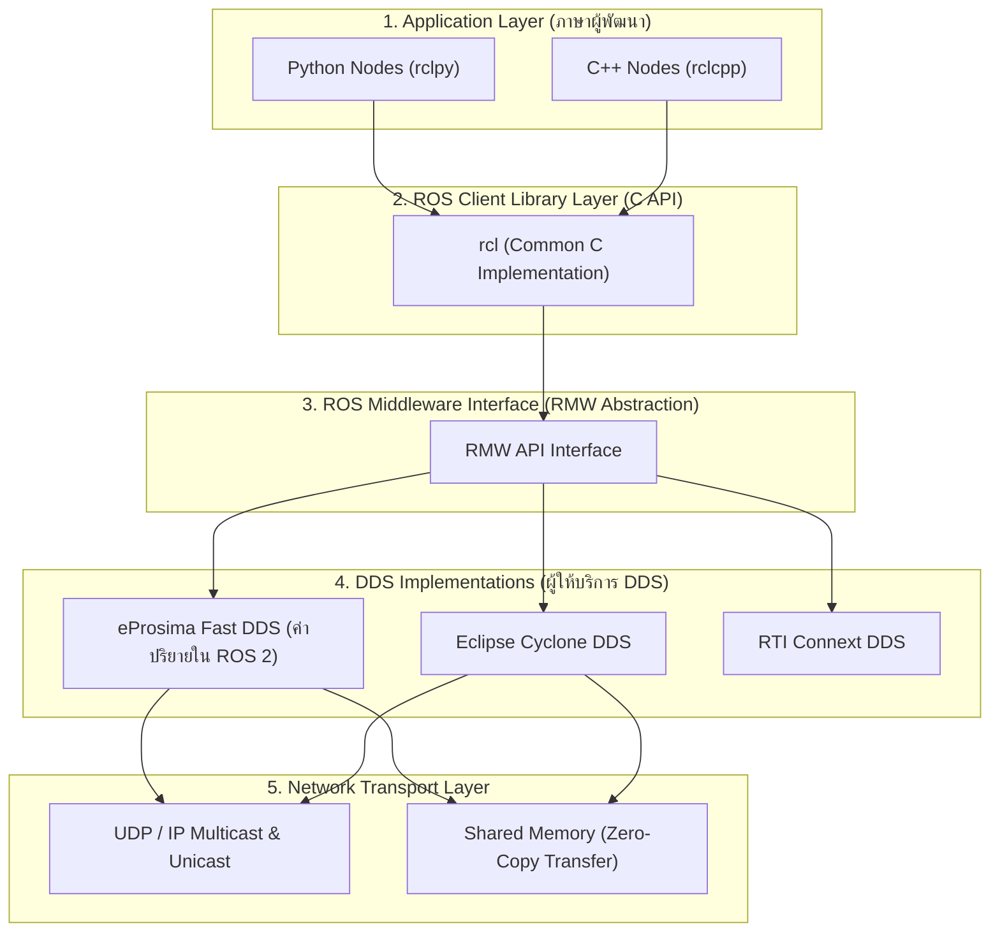
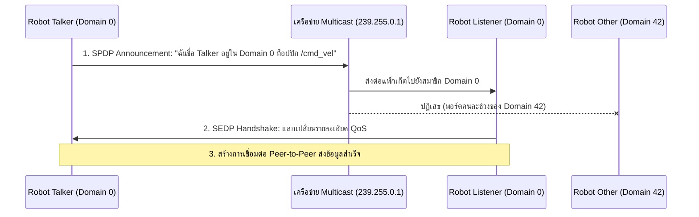

# 📖 Week 01: สภาพแวดล้อม สถาปัตยกรรม ROS 2 และเครือข่าย DDS
**เวลาเรียน:** บรรยาย 2 ชั่วโมง | ปฏิบัติการ 3 ชั่วโมง | ศึกษาค้นคว้าด้วยตนเอง 4 ชั่วโมง  
**วิชาบังคับก่อน:** ความรู้พื้นฐาน Linux Shell Commands และ Docker เบื้องต้น  
**เอกสารปฏิบัติการ:** [ใบงานแล็บสัปดาห์ที่ 1](Lab_Exercises.md)

---

## 🎯 วัตถุประสงค์การเรียนรู้ (Learning Objectives)
เมื่อจบบทเรียนนี้ ผู้เรียนจะสามารถ:
1. อธิบายความแตกต่างเชิงสถาปัตยกรรมระหว่าง ROS 1 (Centralized Master) และ ROS 2 (DDS Decentralized) ได้อย่างถูกต้อง
2. วิเคราะห์โครงสร้างสแตกซอฟต์แวร์ของ ROS 2 ตั้งแต่ระดับ User Application, RCL, RMW จนถึง DDS Middleware
3. คำนวณพอร์ต Multicast และจัดการแยกช่องสัญญาณเครือข่ายหุ่นยนต์ด้วย `ROS_DOMAIN_ID`
4. ใช้งาน Docker Containerization สำหรับการพัฒนาและทดสอบระบบหุ่นยนต์ได้อย่างเชี่ยวชาญ

---

## ⏱️ แผนการสอน 2 ชั่วโมง (Lecture Outline)
| ช่วงเวลา | หัวข้อ | กิจกรรมการเรียนรู้ |
| :---: | :--- | :--- |
| **00:00 - 00:30** | วิวัฒนาการจาก ROS 1 สู่ ROS 2 และปัญหา Single Point of Failure | บรรยายเชิงเปรียบเทียบสถาปัตยกรรม Master vs Peer-to-Peer |
| **00:30 - 01:00** | สถาปัตยกรรมเลเยอร์ของ ROS 2 (RCLPY, RCL, RMW, DDS) | วิเคราะห์ Layered Architecture และ Vendor Implementations |
| **01:00 - 01:30** | โปรโตคอล Data Distribution Service (DDS) และ Discovery Mechanism | เจาะลึก SPDP, Multicast/Unicast, และสมการพอร์ต Domain ID |
| **01:30 - 02:00** | โครงสร้าง Workspace, Colcon Build และสรุปเตรียมความพร้อมสู่ Lab | ตรวจสอบคำสั่ง CLI และตอบคำถามก่อนเริ่มปฏิบัติการ |

---

## 🏛️ สถาปัตยกรรมระบบ (Architectural Deep Dive)

### 1. วิวัฒนาการจาก ROS 1 สู่ ROS 2
ในระบบ **ROS 1** การสื่อสารทุกอย่างต้องพึ่งพาโหนดศูนย์กลางที่ชื่อว่า `roscore` (Master Node):
- ข้อดี: การออกแบบเรียบง่าย โหนดทุกตัวค้นหากันผ่าน Master
- ข้อจำกัดร้ายแรงในงานอุตสาหกรรม: หาก `roscore` หยุดทำงานหรือเกิดข้อผิดพลาด เครือข่ายทั้งหมดจะล่มสลายทันที (Single Point of Failure) และไม่มีการสนับสนุนระบบความปลอดภัย (Security) หรือ Real-Time ในระดับแกนกลาง

ในระบบ **ROS 2** สถาปัตยกรรมถูกเปลี่ยนเป็นแบบกระจายศูนย์ (Fully Decentralized Peer-to-Peer) โดยนำมาตรฐานอุตสาหกรรมการบินและการทหารอย่าง **OMG Data Distribution Service (DDS)** มาเป็นแกนกลาง:



---

### 2. กลไกการค้นพบของ DDS (Discovery Mechanism & SPDP)
เมื่อโหนดใน ROS 2 ถูกสร้างขึ้น โหนดจะไม่ต้องติดต่อกับ Server กลาง แต่จะส่งสัญญาณประกาศตัวเองผ่านโปรโตคอล **Simple Participant Discovery Protocol (SPDP)** ผ่านเครือข่าย UDP Multicast:



---

### 3. การคำนวณพอร์ตและการจัดการ `ROS_DOMAIN_ID`
เพื่อป้องกันไม่ให้หุ่นยนต์ของนักศึกษาหรือหุ่นยนต์ในสายการผลิตหลายตัวที่ใช้ Wi-Fi วงเดียวกันส่งข้อมูลตีกัน ROS 2 ใช้ตัวแปร `ROS_DOMAIN_ID` (ค่า $0 - 101$) ในการแยกช่วงพอร์ต UDP Multicast:

$$\text{Multicast Port} = 7400 + (250 \times \text{Domain ID})$$
$$\text{Unicast Port} = 7410 + (250 \times \text{Domain ID}) + (2 \times \text{Participant ID})$$

#### ตัวอย่างการคำนวณพอร์ต:
- หาก `ROS_DOMAIN_ID=0`: Discovery Port จะอยู่ที่ **7400**
- หาก `ROS_DOMAIN_ID=10`: Discovery Port จะอยู่ที่ $7400 + (250 \times 10) =$ **9900**
- หาก `ROS_DOMAIN_ID=42`: Discovery Port จะอยู่ที่ $7400 + (250 \times 42) =$ **17900**

---

### 4. โครงสร้าง Colcon Workspace และ Overlay / Underlay
การพัฒนาโปรแกรมบน ROS 2 จะจัดการซอฟต์แวร์ผ่าน Colcon Workspace:
- `src/`: โฟลเดอร์สำหรับจัดเก็บ Source Code ของแพ็กเกจ
- `build/`: โฟลเดอร์เก็บไฟล์ Object ชั่วคราวระหว่างการคอมไพล์
- `install/`: โฟลเดอร์เก็บไบนารีและสคริปต์สภาพแวดล้อม (`setup.bash`)
- `log/`: โฟลเดอร์บันทึกประวัติการคอมไพล์

```
Underlay (ROS 2 System: /opt/ros/jazzy)
       ▲
       │  (source /opt/ros/jazzy/setup.bash)
       │
Overlay (User Workspace: ~/ros2_ws/install/setup.bash)
```
> [!NOTE]
> ระบบ Overlay จะค้นหาแพ็กเกจในโฟลเดอร์ของตนเองก่อน หากพบชื่อซ้ำกับ Underlay ระบบจะเลือกใช้เวอร์ชันใน Overlay เสมอ ทำให้เราสามารถปรับแต่งโค้ดได้โดยไม่กระทบกับตัวระบบปฏิบัติการหลัก

---

## 🛠️ โค้ดและสคริปต์ในโมดูลนี้
ในโฟลเดอร์ `src/` มีสคริปต์ตรวจสอบระบบ:
- [`src/domain_check.sh`](src/domain_check.sh): สคริปต์ตรวจสอบสถานะ ROS Distribution, Domain ID, Daemon และคำนวณพอร์ต Multicast อัตโนมัติ

---

## ⌨️ ตารางคำสั่ง CLI สำคัญ
| คำสั่ง | วัตถุประสงค์ | ตัวอย่างการใช้งาน |
| :--- | :--- | :--- |
| `ros2 doctor` | ตรวจสอบความสมบูรณ์ของสภาพแวดล้อมและเน็ตเวิร์ก | `ros2 doctor --report` |
| `ros2 daemon status` | ตรวจสอบสถานะ Background Daemon ของ ROS 2 | `ros2 daemon status` |
| `ros2 daemon stop/start` | รีสตาร์ตแคชการค้นหาโหนดเมื่อระบบค้าง | `ros2 daemon stop` |
| `ros2 multicast receive` | เปิดรับสัญญาณทดสอบ Multicast บนเครือข่าย | `ros2 multicast receive` |
| `ros2 multicast send` | ส่งสัญญาณทดสอบ Multicast บนเครือข่าย | `ros2 multicast send` |
| `export ROS_DOMAIN_ID=<ID>` | ตั้งค่าระบุกลุ่มเครือข่ายชั่วคราวใน Terminal | `export ROS_DOMAIN_ID=15` |

---

## ⚠️ ปัญหาที่พบบ่อยและการแก้ไข (Troubleshooting)
| อาการ | สาเหตุที่เป็นไปได้ | วิธีแก้ไข |
| :--- | :--- | :--- |
| **โหนด 2 ตัวมองไม่เห็นกัน** | ค่า `ROS_DOMAIN_ID` ไม่ตรงกัน หรือไฟร์วอลล์บล็อก UDP Multicast | ตรวจสอบด้วย `echo $ROS_DOMAIN_ID` และทดสอบ `ros2 multicast receive` |
| **Topic เก่าค้าง ไม่ยอมอัปเดต** | ROS 2 Daemon เก็บข้อมูลแคชเดิมค้างไว้ | รันคำสั่ง `ros2 daemon stop && ros2 daemon start` |
| **Cannot open display ใน GUI** | ไม่ได้เปิดสิทธิ์ X11 ให้ Docker บน Host | รัน `xhost +local:docker` บนเครื่อง Host ก่อนเปิด Container |

---

## 📝 แบบทดสอบท้ายบท (Self-Assessment Quiz)
1. สถาปัตยกรรมของ ROS 2 แตกต่างจาก ROS 1 อย่างไรในประเด็น Single Point of Failure?
2. DDS ย่อมาจากอะไร และมีบทบาทอย่างไรในระบบ ROS 2?
3. หากกำหนด `ROS_DOMAIN_ID=4` พอร์ต Discovery Multicast จะมีค่าเท่าใด?
4. โปรโตคอลใดที่ใช้ในการค้นหาโหนดโดยอัตโนมัติเมื่อโหนดเปิดขึ้นมา?
5. หากโหนด Talker รันด้วย `ROS_DOMAIN_ID=0` และ Listener รันด้วย `ROS_DOMAIN_ID=5` ผลลัพธ์จะเป็นอย่างไร?

<details>
<summary>🔍 ดูเฉลยคำตอบ</summary>

1. **ตอบ:** ROS 1 ใช้ Master Node รวมศูนย์ หาก Master ดับระบบทั้งหมดจะล่ม แต่ ROS 2 ใช้ DDS แบบกระจายศูนย์ Peer-to-Peer ทำให้ไม่มี Single Point of Failure
2. **ตอบ:** Data Distribution Service ทำหน้าที่เป็น Middleware มาตรฐานอุตสาหกรรมสำหรับส่งข้อมูลแบบ Real-time ตาม Publish-Subscribe Pattern
3. **ตอบ:** $7400 + (250 \times 4) = 8400$
4. **ตอบ:** Simple Participant Discovery Protocol (SPDP)
5. **ตอบ:** Listener จะไม่ได้รับข้อความใดๆ เลย เนื่องจากพอร์ต Multicast ถูกแยกกันคนละช่วงสัญญาณ
</details>

---

## 📚 แหล่งอ้างอิงและศึกษาเพิ่มเติม
- [ROS 2 Jazzy Installation & Architecture Guide](https://docs.ros.org/en/jazzy/Concepts/Basic/About-Discovery-and-Domain-ID.html)
- [OMG DDS Specification Official Document](https://www.omg.org/spec/DDS/)
- [eProsima Fast DDS Documentation](https://fast-dds.docs.eprosima.com/)
