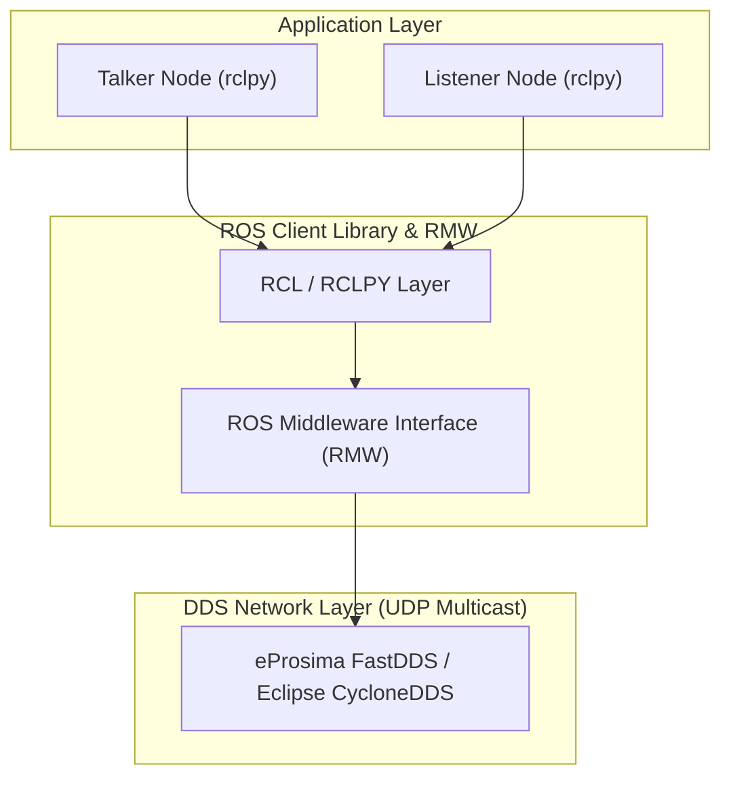

# 📖 Week 01: สภาพแวดล้อม สถาปัตยกรรม ROS 2 และเครือข่าย DDS

---

## 🎯 วัตถุประสงค์การเรียนรู้
1. เข้าใจความแตกต่างระหว่าง ROS 1 (Master-based) กับ ROS 2 (DDS Decentralized)
2. เข้าใจการทำงานของโปรโตคอล Data Distribution Service (DDS) และ Discovery Mechanism (SPDP)
3. รู้วิธีการแบ่งกลุ่มเครือข่ายหุ่นยนต์ด้วย `ROS_DOMAIN_ID`
4. รู้วิธีรันแล็บผ่าน Docker Containerization

---

## 🏗️ ทฤษฎีและสถาปัตยกรรม (Theory)

### การคำนวณพอร์ต Multicast ของ DDS:
$$\text{Discovery Port} = 7400 + (250 \times \text{ROS\_DOMAIN\_ID})$$
หากอยู่ในห้องเรียนที่มีการทดสอบพร้อมกัน การตั้งค่า `ROS_DOMAIN_ID` ต่างกันจะป้องกันไม่ให้หุ่นยนต์รับส่งข้อความข้ามกลุ่มกัน
