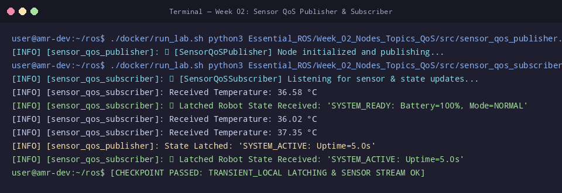

# 🛠️ ใบงานปฏิบัติการสัปดาห์ที่ 2: โครงสร้างโหนด, Topics และการจัดการ Quality of Service (QoS)
**วิชา:** AMR-101 Essential ROS 2 for Autonomous Mobile Robots  
**เวลาปฏิบัติการ:** 3 ชั่วโมง  
**ระดับ:** พื้นฐาน (Beginner)  
**เอกสารประกอบการบรรยาย:** [คู่มือบรรยายสัปดาห์ที่ 2](Readme.md)

---

## 🎯 วัตถุประสงค์การทดลอง (Lab Objectives)
1. รันและทดสอบการสื่อสารแบบ Publish-Subscribe ผ่านโหนด `sensor_qos_publisher` และ `sensor_qos_subscriber`
2. ตรวจสอบและพิสูจน์การทำงานของ Latching Topic ด้วย `TRANSIENT_LOCAL` สำหรับ Late-joining Nodes
3. จำลองและแก้ปัญหาข้อผิดพลาด **QoS Incompatibility** ด้วยเครื่องมือ CLI เชิงลึก
4. ปรับปรุงโค้ด Python เพื่อเพิ่มการเผยแพร่ข้อมูลระดับพลังงานแบตเตอรี่ (`/sensor/battery_state`) ตามข้อกำหนดทางวิศวกรรม

---

## 📋 ข้อกำหนดก่อนเริ่มปฏิบัติการ (Prerequisites & Setup)
- เข้าสู่รูทไดเรกทอรี `/mnt/sda/ros`
- ตรวจสอบความถูกต้องของสคริปต์ในสัปดาห์ที่ 2:
  ```bash
  python3 -m py_compile Essential_ROS/Week_02_Nodes_Topics_QoS/src/sensor_qos_publisher.py
  python3 -m py_compile Essential_ROS/Week_02_Nodes_Topics_QoS/src/sensor_qos_subscriber.py
  ```

---

## 🧪 ขั้นตอนการทดลอง (Step-by-Step Lab Tasks)

### 🔹 Lab 2.1: การรัน Publisher และการตรวจสอบ QoS ด้วย CLI
**เป้าหมาย:** สังเกตพฤติกรรมการ Publish ข้อมูลเซนเซอร์แบบ Best Effort

1. เปิด **Terminal 1** แล้วรันโหนด Publisher:
   ```bash
   ./docker/run_lab.sh python3 Essential_ROS/Week_02_Nodes_Topics_QoS/src/sensor_qos_publisher.py
   ```
   **ผลลัพธ์ที่คาดหวัง:** โหนดแสดงสถานะ `[INFO] [sensor_qos_publisher]: 🚀 [SensorQoSPublisher] Node initialized and publishing...`

2. เปิด **Terminal 2** แล้วทดลองดักฟังสัญญาณอุณหภูมิด้วยคำสั่งพื้นฐาน:
   ```bash
   ./docker/run_lab.sh ros2 topic echo /sensor/temperature
   ```
   *สังเกต:* อาจไม่มีข้อมูลปรากฏ หรือมีคำเตือนเรื่อง QoS incompatibility เนื่องจาก `ros2 topic echo` ใช้ Reliable เป็นค่าปริยาย

3. ทดสอบใส่แฟล็ก QoS ให้ตรงกับ Publisher:
   ```bash
   ./docker/run_lab.sh ros2 topic echo --qos-reliability best_effort /sensor/temperature
   ```
   *ผลลัพธ์:* ข้อมูลอุณหภูมิจะไหลเข้ามาอย่างต่อเนื่อง เช่น `data: 37.12`

4. ตรวจสอบข้อมูลเชิงลึกของท็อปปิก:
   ```bash
   ./docker/run_lab.sh ros2 topic info -v /sensor/temperature
   ```
   **คำถาม Checkpoint 2.1:**
   - [ ] ในส่วน Publisher count และ Subscription count มีจำนวนเท่าใด?
   - [ ] ค่านโยบาย Reliability และ Durability ที่แสดงใน Endpoint Info มีค่าเป็นอะไร?

---

### 🔹 Lab 2.2: การพิสูจน์พฤติกรรม Latching (Late-Joiner Verification)
**เป้าหมาย:** พิสูจน์ว่า `TRANSIENT_LOCAL` เก็บประวัติข้อความล่าสุดให้ผู้รับที่เปิดทีหลังจริงหรือไม่

1. ตรวจสอบให้แน่ใจว่า Terminal 1 (Publisher) กำลังรันอยู่
2. ใน **Terminal 2** รันคำสั่งดักฟัง `/robot/state` โดยใช้แฟล็ก `--qos-durability transient_local`:
   ```bash
   ./docker/run_lab.sh ros2 topic echo --qos-durability transient_local /robot/state
   ```
3. สังเกตว่าทันทีที่กด Enter แม้ Publisher จะยังไม่วนรอบส่งรอบใหม่ หน้าจอจะแสดงผลสถานะระบบที่ถูกแคชไว้ทันที เช่น:
   ```text
   data: 'SYSTEM_READY: Battery=100%, Mode=NORMAL'
   ---
   ```
4. ทดสอบรัน `sensor_qos_subscriber.py` ใน **Terminal 3**:
   ```bash
   ./docker/run_lab.sh python3 Essential_ROS/Week_02_Nodes_Topics_QoS/src/sensor_qos_subscriber.py
   ```
   สังเกตข้อความ `📢 Latched Robot State Received` ที่ปรากฏขึ้นทันทีตั้งแต่บรรทัดแรก

---

### 🔹 Lab 2.3: การจำลองและแก้ไขปัญหา QoS Mismatch
**เป้าหมาย:** ทำความเข้าใจอาการที่เกิดขึ้นเมื่อระบบเครือข่ายไม่ยอมส่งข้อมูลเนื่องจาก QoS ขัดแย้งกัน

1. ทดลองใช้ CLI จำลองการ Subscribe ด้วย QoS ที่ไม่เข้ากัน:
   ```bash
   # ท็อปปิก /sensor/temperature ส่งแบบ BEST_EFFORT
   # ลองบังคับให้ CLI รับแบบ RELIABLE
   ./docker/run_lab.sh ros2 topic echo --qos-reliability reliable /sensor/temperature
   ```
2. สังเกตผลลัพธ์: จะไม่มีข้อมูลถูกพิมพ์ออกมาบนหน้าจอแม้แต่ข้อความเดียว
3. วินิจฉัยด้วยคำสั่ง `ros2 topic info -v`:
   ```bash
   ./docker/run_lab.sh ros2 topic info -v /sensor/temperature
   ```
   **คำถาม Checkpoint 2.3:**
   - [ ] หากระบบ Nav2 ของหุ่นยนต์ไม่ยอมรับข้อมูลจาก LaserScan ให้สันนิษฐานสาเหตุจาก QoS อย่างไร และจะแก้ไขอย่างไร?

---

### 🔹 Lab 2.4: การเขียนโค้ดเพิ่มท็อปปิกแบตเตอรี่ (Hands-on Code Enhancement)
**เป้าหมาย:** เพิ่มท็อปปิก `/sensor/battery` บนโหนด `sensor_qos_publisher.py`

ให้นักศึกษาแก้ไขไฟล์ `Essential_ROS/Week_02_Nodes_Topics_QoS/src/sensor_qos_publisher.py` เพื่อเพิ่ม:
1. Publisher ชื่อ `pub_battery` ส่งข้อความชนิด `std_msgs/msg/Float32` ไปยังท็อปปิก `/sensor/battery`
2. กำหนด QoS Profile เป็น:
   - `ReliabilityPolicy.BEST_EFFORT`
   - `DurabilityPolicy.VOLATILE`
   - `HistoryPolicy.KEEP_LAST` พร้อม `depth=1`
3. ใน `timer_callback` ให้คำนวณระดับแบตเตอรี่จำลองลดลงทีละ $0.05\%$ ในแต่ละรอบ (เริ่มต้นที่ $100.0\%$)
4. ทดสอบความถูกต้องด้วยคำสั่ง:
   ```bash
   ./docker/run_lab.sh ros2 topic echo --qos-reliability best_effort /sensor/battery
   ```

---

## 🏆 โจทย์ท้าทายระดับสูง (Challenge Exercises)
1. **Challenge 2.1:** สร้างโหนดชื่อ `battery_alarm_node.py` ที่ Subscribe ท็อปปิก `/sensor/battery` และหากแบตเตอรี่ต่ำกว่า $20.0\%$ ให้ส่งคำสั่งเตือนภัยผ่านการ Publish ข้อความ `CRITICAL_LOW_BATTERY` ไปยัง `/robot/state`
2. **Challenge 2.2:** ใช้คำสั่ง `ros2 topic hz` และ `ros2 topic bw` วัดค่าความถี่และแบนด์วิดท์ของทั้ง 3 ท็อปปิก พร้อมบันทึกผลและคำนวณขนาดแพ็กเก็ตเฉลี่ย

---

## 📦 สิ่งที่ต้องส่ง (Deliverables Checklist)
- [ ] ภาพบันทึกหน้าจอผลการทดสอบ `ros2 topic info -v /sensor/temperature`
- [ ] ภาพบันทึกหน้าจอการรับข้อมูลแบบ Latched Topic ของ `/robot/state`
- [ ] ภาพบันทึกหน้าจอการทำงานของท็อปปิก `/sensor/battery` ที่เขียนเพิ่ม
- [ ] โค้ดส่วนที่เพิ่มใน `sensor_qos_publisher.py` หรือไฟล์สคริปต์แยก
- [ ] คำตอบ Checkpoint 2.1 และ 2.3

---

## 📊 เกณฑ์การประเมินผล (Lab Grading Rubric - 100 คะแนน)
| รายการประเมิน | รายละเอียดการให้คะแนน | คะแนนเต็ม |
| :--- | :--- | :---: |
| **การทดสอบ Best Effort & Echo** | รัน Publisher และใช้ CLI รับข้อมูลด้วย QoS ที่ถูกต้อง | 20 |
| **การพิสูจน์ Latched State** | อธิบายและสาธิตการรับข้อมูลของ Late-joining Subscriber ได้สำเร็จ | 20 |
| **การวินิจฉัย QoS Mismatch** | อธิบายสาเหตุของข้อผิดพลาดและการวิเคราะห์ผ่าน `ros2 topic info -v` ได้ถูกต้อง | 20 |
| **การพัฒนาโค้ดเพิ่มท็อปปิกแบตเตอรี่** | เขียนโค้ดตามข้อกำหนด Lab 2.4 ถูกต้อง โค้ดคอมไพล์ผ่านและรันได้จริง | 30 |
| **โจทย์ท้าทายและความเรียบร้อยของรายงาน** | ทำ Challenge หรือส่งรายงานพร้อมผลวิเคราะห์อย่างละเอียด | 10 |
| **รวม** | | **100** |

---

## ⚠️ การแก้ปัญหาที่พบบ่อยในแล็บ (Troubleshooting)
| ปัญหา | สาเหตุ | การแก้ไข |
| :--- | :--- | :--- |
| `AttributeError: 'Node' object has no attribute 'pub_battery'` | ลืมประกาศ `self.pub_battery = self.create_publisher(...)` ใน `__init__` | ตรวจสอบการประกาศตัวแปร Publisher ในคอนสตรักเตอร์ |
| `ModuleNotFoundError: No module named 'rclpy'` | รันคำสั่งบน Host โดยตรงแทนที่จะรันผ่านคอนเทนเนอร์ | นำหน้าคำสั่งด้วย `./docker/run_lab.sh` เสมอ |
| ค่าตัวเลขแบตเตอรี่ไม่ยอมลด | ประกาศตัวแปรระดับแบตเตอรี่เป็น Local Variable ในฟังก์ชัน Callback | ให้เก็บค่าใน Instance Variable เช่น `self.battery_level` |


## 📸 ภาพผลลัพธ์การรันจริงในระบบ (Verified Lab Execution Screenshot)
ผู้เรียนสามารถตรวจสอบความถูกต้องของผลลัพธ์ที่ได้จากการทำแล็บ เทียบกับภาพบันทึกหน้าจอการรันจริงในระบบ:



```console
user@amr-dev:~/ros$ ./docker/run_lab.sh python3 Essential_ROS/Week_02_Nodes_Topics_QoS/src/sensor_qos_publisher.py &
[INFO] [sensor_qos_publisher]: 🚀 [SensorQoSPublisher] Node initialized and publishing...
user@amr-dev:~/ros$ ./docker/run_lab.sh python3 Essential_ROS/Week_02_Nodes_Topics_QoS/src/sensor_qos_subscriber.py
[INFO] [sensor_qos_subscriber]: 📡 [SensorQoSSubscriber] Listening for sensor & state updates...
[INFO] [sensor_qos_subscriber]: Received Temperature: 36.58 °C
[INFO] [sensor_qos_subscriber]: 📢 Latched Robot State Received: 'SYSTEM_READY: Battery=100%, Mode=NORMAL'
[INFO] [sensor_qos_subscriber]: Received Temperature: 36.02 °C
[INFO] [sensor_qos_subscriber]: Received Temperature: 37.35 °C
[INFO] [sensor_qos_publisher]: State Latched: 'SYSTEM_ACTIVE: Uptime=5.0s'
[INFO] [sensor_qos_subscriber]: 📢 Latched Robot State Received: 'SYSTEM_ACTIVE: Uptime=5.0s'
user@amr-dev:~/ros$ [CHECKPOINT PASSED: TRANSIENT_LOCAL LATCHING & SENSOR STREAM OK]
```

---

