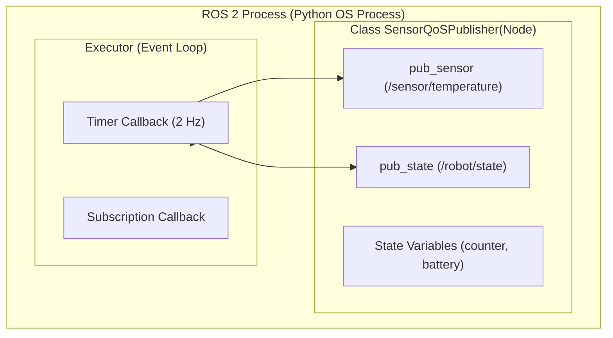

# 📖 Week 02: โครงสร้างโหนด, Topics และการจัดการ Quality of Service (QoS)
**เวลาเรียน:** บรรยาย 2 ชั่วโมง | ปฏิบัติการ 3 ชั่วโมง | ศึกษาค้นคว้าด้วยตนเอง 4 ชั่วโมง  
**วิชาบังคับก่อน:** [สัปดาห์ที่ 1: สภาพแวดล้อม สถาปัตยกรรม ROS 2 และเครือข่าย DDS](../Week_01_Environment_DDS/Readme.md)  
**เอกสารปฏิบัติการ:** [ใบงานแล็บสัปดาห์ที่ 2](Lab_Exercises.md)

---

## 🎯 วัตถุประสงค์การเรียนรู้ (Learning Objectives)
เมื่อจบบทเรียนนี้ ผู้เรียนจะสามารถ:
1. ออกแบบและพัฒนา ROS 2 Node ด้วยภาษา Python (`rclpy`) ตามหลัก Object-Oriented Programming (OOP)
2. อธิบายกลไกการสื่อสารแบบ Publish-Subscribe ผ่าน Topics และโครงสร้าง Data Flow
3. วิเคราะห์นโยบาย **Quality of Service (QoS Policies)** ทั้ง 4 แกนหลัก (Reliability, Durability, History, Depth)
4. วินิจฉัยและแก้ปัญหา **QoS Incompatibility (QoS Mismatch)** ระหว่าง Publisher และ Subscriber ได้อย่างแม่นยำ
5. เลือกใช้ QoS Profiles มาตรฐานอุตสาหกรรม (Sensor Data, Parameters, Services) ให้เหมาะสมกับงานหุ่นยนต์จริง

---

## ⏱️ แผนการสอน 2 ชั่วโมง (Lecture Outline)
| ช่วงเวลา | หัวข้อ | กิจกรรมการเรียนรู้ |
| :---: | :--- | :--- |
| **00:00 - 00:30** | โครงสร้าง Node, Execution Model และ Single-Threaded Executor | บรรยายเชิงลึกพร้อมเปรียบเทียบ Procedural vs Class-based Node |
| **00:30 - 01:00** | Publish-Subscribe Architecture และข้อความ ROS Message Types | วิเคราะห์ Data Pipeline, Interface Definition (`std_msgs`, `sensor_msgs`) |
| **01:00 - 01:30** | คุณภาพการให้บริการ (QoS Policies Deep Dive) | เจาะลึกเมทริกซ์ความเข้ากันได้ (Compatibility Matrix) Reliability & Durability |
| **01:30 - 02:00** | Code Walkthrough, CLI Inspection และเตรียมตัวเข้าสู่ Lab | วิเคราะห์โค้ดตัวอย่างใน `src/` และสาธิตคำสั่ง `ros2 topic info --verbose` |

---

## 🏛️ สถาปัตยกรรมระบบ (Architectural Deep Dive)

### 1. โครงสร้างโหนด (Node Architecture) และ Executor Model
ใน ROS 2 โหนด (Node) คือหน่วยประมวลผลพื้นฐานทางตรรกะ การเขียนโหนดที่ดีในระดับวิศวกรรมต้องสืบทอดคุณสมบัติมาจากคลาส `rclpy.node.Node`:



> [!IMPORTANT]
> `rclpy.spin(node)` ทำหน้าที่เป็น **Event Loop** แบบ Blocking คอยดักฟังและเรียกใช้ Callbacks ต่างๆ เมื่อมีอีเวนต์เกิดขึ้น หากเกิดการค้าง (Blocking call เช่น `time.sleep`) ใน Callback จะทำให้ Callback อื่นๆ ในโหนดไม่สามารถทำงานได้!

---

### 2. โมเดลการสื่อสาร Publish-Subscribe และ Data Flow
การสื่อสารแบบ Topics เป็นการส่งข้อมูลทางเดียวแบบอะซิงโครนัส (Asynchronous Many-to-Many):
- ผู้ส่ง (Publisher) ไม่จำเป็นต้องรู้ว่ามีใครรับบ้าง
- ผู้รับ (Subscriber) ไม่จำเป็นต้องรู้ว่าใครเป็นคนส่ง
- ข้อมูลถูกกำหนดโครงสร้างผ่าน ROS 2 Message Definition (เช่น `std_msgs/msg/String`, `sensor_msgs/msg/LaserScan`)

---

### 3. คุณภาพการให้บริการ (Quality of Service - QoS)
หนึ่งในการอัปเกรดที่สำคัญที่สุดจาก ROS 1 สู่ ROS 2 คือการนำ **QoS Profiles** ของ DDS มาควบคุมพฤติกรรมการส่งข้อมูลระดับเครือข่าย

#### แกนนโยบายหลัก 4 ประการ:
1. **Reliability (ความน่าเชื่อถือ):**
   - `BEST_EFFORT`: ส่งข้อมูลแบบไม่ยืนยันการรับ (เหมือน UDP) ยอมให้ข้อมูลสูญหายได้ เหมาะกับข้อมูลสตรีมมิงความถี่สูง เช่น LiDAR, IMU, ภาพจากกล้อง
   - `RELIABLE`: ส่งข้อมูลพร้อมระบบยืนยัน (ACK/NACK) หากสูญหายจะส่งซ้ำ เหมาะกับข้อมูลสำคัญ เช่น คำสั่งหยุดฉุกเฉิน, สถานะภารกิจ, แผนที่
2. **Durability (ความคงทนของข้อมูล / Latching):**
   - `VOLATILE`: ไม่เก็บประวัติข้อมูล โหนดที่เปิดมาทีหลัง (Late-joiner) จะไม่ได้รับข้อมูลในอดีต
   - `TRANSIENT_LOCAL`: โหนด Publisher จะแคชข้อความล่าสุดไว้ เมื่อมี Subscriber โหนดใหม่เปิดขึ้นมาเชื่อมต่อ ระบบจะส่งข้อความล่าสุดให้ทันที (Latched Topic)
3. **History & Depth:**
   - `KEEP_LAST`: เก็บข้อความไว้จำนวน $N$ ข้อความล่าสุด (กำหนดโดย `depth`)
   - `KEEP_ALL`: เก็บข้อความทั้งหมดไว้จนกว่าหน่วยความจำจะเต็ม

#### ตารางเมทริกซ์ความเข้ากันได้ของ QoS (QoS Compatibility Rule)
กฎเหล็กของ DDS: **ข้อกำหนดของผู้รับ (Subscriber / Rx) ต้องไม่เรียกร้องสูงกว่าความสามารถของผู้ส่ง (Publisher / Tx)**

| Publisher (Tx) | Subscriber (Rx) | การเชื่อมต่อ | คำอธิบาย |
| :---: | :---: | :---: | :--- |
| **BEST_EFFORT** | **BEST_EFFORT** |  **เชื่อมต่อสำเร็จ** | ส่งเร็ว ยอมให้ตกหล่นทั้งคู่ |
| **BEST_EFFORT** | **RELIABLE** | ❌ **ล้มเหลว (Mismatch)** | Rx ต้องการการรับประกัน แต่ Tx ไม่รับประกัน -> **ไม่ส่งข้อมูล!** |
| **RELIABLE** | **BEST_EFFORT** |  **เชื่อมต่อสำเร็จ** | Tx รับประกัน แต่ Rx พอใจแม้ข้อมูลตกหล่น -> เชื่อมต่อได้ |
| **RELIABLE** | **RELIABLE** |  **เชื่อมต่อสำเร็จ** | รับประกันความถูกต้องทั้งคู่ |
| **VOLATILE** | **TRANSIENT_LOCAL** | ❌ **ล้มเหลว (Mismatch)** | Rx ต้องการข้อมูลย้อนหลัง แต่ Tx ไม่เก็บแคช -> **ไม่ส่งข้อมูล!** |
| **TRANSIENT_LOCAL** | **VOLATILE** |  **เชื่อมต่อสำเร็จ** | Tx มีแคชให้ แต่ Rx ไม่ต้องการ -> เชื่อมต่อได้ |

---

## 🛠️ การวิเคราะห์โค้ดตัวอย่างในโมดูล (Code Walkthrough)

### 1. `sensor_qos_publisher.py`
โหนดนี้สร้าง Publisher สองรูปแบบเพื่อแสดงความแตกต่างของ QoS:
```python
# สำหรับข้อมูลเซนเซอร์: BEST_EFFORT + DEPTH 5
sensor_qos = QoSProfile(
    reliability=ReliabilityPolicy.BEST_EFFORT,
    history=HistoryPolicy.KEEP_LAST,
    depth=5
)
self.pub_sensor = self.create_publisher(Float32, '/sensor/temperature', sensor_qos)

# สำหรับสถานะหุ่นยนต์: RELIABLE + TRANSIENT_LOCAL
state_qos = QoSProfile(
    reliability=ReliabilityPolicy.RELIABLE,
    durability=DurabilityPolicy.TRANSIENT_LOCAL,
    history=HistoryPolicy.KEEP_LAST,
    depth=1
)
self.pub_state = self.create_publisher(String, '/robot/state', state_qos)
```
- บรรทัดที่ 42: มีการส่ง `initial_state` ทันทีที่โหนดเริ่มทำงาน เพื่อให้ Subscriber ที่มาเชื่อมต่อทีหลังสามารถอ่านสถานะนี้ได้ทันที

### 2. `sensor_qos_subscriber.py`
สร้าง Subscription ที่มี QoS สอดคล้องกับ Publisher ทำให้สามารถรับข้อมูลได้ครบถ้วนทั้งสองท็อปปิก

---

## ⌨️ ตารางคำสั่ง CLI สำคัญ
| คำสั่ง | วัตถุประสงค์ | ตัวอย่างการใช้งาน |
| :--- | :--- | :--- |
| `ros2 topic list -t` | แสดงรายชื่อท็อปปิกทั้งหมดพร้อม Type ข้อความ | `ros2 topic list -t` |
| `ros2 topic echo <topic>` | แสดงข้อมูลที่กำลังส่งผ่านท็อปปิก | `ros2 topic echo /sensor/temperature` |
| `ros2 topic hz <topic>` | วัดความถี่เฉลี่ยของการ Publish ข้อมูล | `ros2 topic hz /sensor/temperature` |
| `ros2 topic bw <topic>` | วัด Bandwidth การใช้งานเครือข่ายของท็อปปิก | `ros2 topic bw /sensor/temperature` |
| `ros2 topic info -v <topic>` | แสดงข้อมูลเชิงลึกของท็อปปิก รวมถึง QoS Profiles ของทุก Node | `ros2 topic info -v /sensor/temperature` |
| `ros2 topic pub <topic> <type> <args>` | จำลองการ Publish ข้อความผ่าน Command Line | `ros2 topic pub --once /robot/state std_msgs/msg/String "data: 'FORCE_STOP'"` |

---

## ⚠️ ปัญหาที่พบบ่อยและการแก้ไข (Troubleshooting)
| อาการ | สาเหตุที่เป็นไปได้ | วิธีแก้ไข |
| :--- | :--- | :--- |
| `ros2 topic echo` แล้วไม่มีข้อมูลขึ้น | QoS Incompatibility (เช่น Topic ส่งแบบ `BEST_EFFORT` แต่ echo แบบ Default `RELIABLE`) | ใส่แฟล็ก QoS ใน CLI: `ros2 topic echo --qos-reliability best_effort /sensor/temperature` |
| Subscriber ไม่ได้รับข้อมูลเมื่อเพิ่งเปิด | ท็อปปิกเป็น `VOLATILE` ทำให้ไม่ได้รับข้อความที่ถูกส่งไปก่อนหน้า | ปรับ Durability ของ Publisher และ Subscriber เป็น `TRANSIENT_LOCAL` |
| ข้อมูลมาล่าช้า สะสมค้าง (High Latency) | ตั้งค่า History เป็น `KEEP_ALL` หรือ `depth` สูงเกินไปในเครือข่ายที่เน็ตช้า | เปลี่ยนเป็น `KEEP_LAST` พร้อมตั้ง `depth=1` หรือ `depth=5` |

---

## 📝 แบบทดสอบท้ายบท (Self-Assessment Quiz)
1. การสื่อสารแบบ Topics เหมาะสมกับรูปแบบข้อมูลชนิดใดในระบบหุ่นยนต์?
2. หากโหนด Publisher ส่งข้อมูลแบบ `BEST_EFFORT` แต่ Subscriber ร้องขอแบบ `RELIABLE` ผลลัพธ์จะเป็นอย่างไร?
3. Durability แบบ `TRANSIENT_LOCAL` มีประโยชน์อย่างไรในการเริ่มต้นระบบของหุ่นยนต์ (System Bootup)?
4. เพราะเหตุใดข้อมูลจาก LiDAR และ กล้องถ่ายภาพความละเอียดสูง จึงนิยมใช้ QoS แบบ `BEST_EFFORT`?
5. คำสั่งใดใช้สำหรับตรวจสอบ QoS Profile ของโหนดทั้งหมดที่เชื่อมต่อกับท็อปปิก `/sensor/temperature`?

<details>
<summary>🔍 ดูเฉลยคำตอบ</summary>

1. **ตอบ:** เหมาะกับข้อมูลแบบ Continuous Data Streams (ข้อมูลต่อเนื่องความถี่สูง) เช่น ค่าเซนเซอร์ พิกัด Odometry และภาพวิดีโอ
2. **ตอบ:** เกิด QoS Incompatibility (Mismatch) ทำให้ DDS ปฏิเสธการจับคู่ (Handshake) และ Subscriber จะไม่ได้รับข้อมูลใดๆ เลย
3. **ตอบ:** ช่วยให้โหนดที่เปิดขึ้นมาทีหลัง (Late-joining nodes) ได้รับค่าสถานะล่าสุดทันทีโดยไม่ต้องรอให้ Publisher วนรอบส่งใหม่
4. **ตอบ:** เนื่องจากข้อมูลมีขนาดใหญ่และส่งที่ความถี่สูง หากใช้ Reliable ข้อมูลที่ตกหล่นจะถูกส่งซ้ำจนทำให้เกิดคอขวด (Latency Spikes) และข้อมูลเก่าไม่มีประโยชน์ต่อการควบคุมปัจจุบัน
5. **ตอบ:** `ros2 topic info -v /sensor/temperature`
</details>

---

## 📚 แหล่งอ้างอิงและศึกษาเพิ่มเติม
- [About ROS 2 Quality of Service Policies](https://docs.ros.org/en/jazzy/Concepts/Intermediate/About-Quality-of-Service-Settings.html)
- [ROS 2 Topic CLI Official Guide](https://docs.ros.org/en/jazzy/Tutorials/Beginner-CLI-Tools/Understanding-ROS2-Topics/Understanding-ROS2-Topics.html)
- [Writing a Simple Publisher and Subscriber (Python)](https://docs.ros.org/en/jazzy/Tutorials/Beginner-Client-Libraries/Writing-A-Simple-Py-Publisher-And-Subscriber.html)
