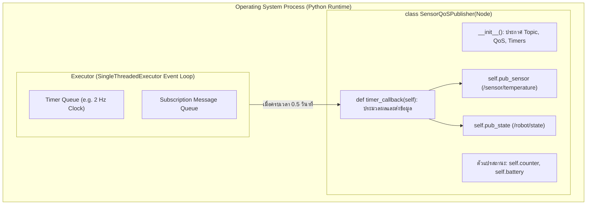

# 📖 Week 02: โครงสร้างโหนด, Topics และการจัดการ Quality of Service (QoS Policies)
**รหัสวิชา:** AMR-101 Essential ROS 2 for Autonomous Mobile Robots  
**เวลาเรียน:** บรรยาย 2 ชั่วโมง | ปฏิบัติการ 3 ชั่วโมง | ทบทวนและค้นคว้าด้วยตนเอง 5 ชั่วโมง  
**วิชาบังคับก่อน:** [สัปดาห์ที่ 1: สภาพแวดล้อม สถาปัตยกรรม ROS 2 และเครือข่าย DDS](../Week_01_Environment_DDS/Readme.md)  
**เอกสารปฏิบัติการประจำสัปดาห์:** [ใบงานแล็บสัปดาห์ที่ 2](Lab_Exercises.md)

---

## 🎯 วัตถุประสงค์การเรียนรู้เชิงพฤติกรรม (Measurable Learning Objectives)
เมื่อผ่านการศึกษาบทเรียนและฝึกปฏิบัติการในสัปดาห์นี้ ผู้เรียนจะมีความสามารถดังต่อไปนี้:
1. **ออกแบบและพัฒนาโครงสร้างโหนดด้วยภาษา Python (`rclpy`):** ประยุกต์ใช้หลักการเขียนโปรแกรมเชิงวัตถุ (Object-Oriented Programming - OOP) โดยสืบทอดคุณสมบัติจากคลาส `rclpy.node.Node` ได้อย่างถูกต้องตามแบบแผนวิศวกรรมซอฟต์แวร์หุ่นยนต์
2. **เข้าใจกลไกการทำงานของ Executor Event Loop:** อธิบายการทำงานของ `SingleThreadedExecutor`, การจัดคิวของ Callbacks (Timers, Subscriptions), และผลกระทบของการเขียน Blocking Code ที่ทำให้ระบบหุ่นยนต์ค้าง
3. **วิเคราะห์สถาปัตยกรรม Publish-Subscribe:** ออกแบบไปป์ไลน์การส่งข้อมูลทางเดียวแบบอะซิงโครนัส (Asynchronous Many-to-Many Data Stream) ด้วยข้อความมาตรฐาน ROS 2 Interfaces
4. **เจาะลึกนโยบาย Quality of Service (QoS) ทั้ง 4 มิติ:** วิเคราะห์ผลกระทบของ Reliability, Durability, History/Depth, และ Liveliness ต่อการทำงานของเซนเซอร์หุ่นยนต์จริง
5. **แก้ปัญหาความเข้ากันไม่ได้ของ QoS (QoS Incompatibility / Mismatch):** ใช้สมการกฎความเข้ากันได้ ($QoS_{Rx} \le QoS_{Tx}$) ในการวิเคราะห์และแก้ไขปัญหาโหนดไม่สามารถรับส่งข้อมูลกันได้ด้วยเครื่องมือ CLI เชิงลึก
6. **เลือกใช้ Standard QoS Profiles ในงานอุตสาหกรรม:** เลือกใช้โปรไฟล์มาตรฐาน เช่น `SensorDataQoS`, `SystemDefaultsQoS`, และ `ParametersQoS` ได้เหมาะสมกับแบนด์วิดท์และข้อจำกัดของฮาร์ดแวร์

---

## ⏱️ แผนการจัดการเรียนรู้ 2 ชั่วโมง (Detailed Lecture Schedule)
| ช่วงเวลา (นาที) | หัวข้อการบรรยาย | กิจกรรมและสื่อการเรียนรู้ | จุดเน้นสำคัญ (Key Takeaways) |
| :---: | :--- | :--- | :--- |
| **00:00 - 00:25** | **สถาปัตยกรรม Node ใน ROS 2:** เปรียบเทียบ Procedural vs OOP Class | บรรยายเปรียบเทียบโค้ดสไตล์ ROS 1 กับคลาส `rclpy.node.Node` | ทำไมการเขียนโหนดเป็นคลาสจึงจำเป็นต่อระบบ Multi-threading และ Lifecycle |
| **00:25 - 00:50** | **วงจรชีวิตและการหมุนของ Executor (Execution Model):** Spin & Callbacks | เขียนแผนภาพแสดงการทำงานของ Event Loop ภายใน `rclpy.spin()` | อันตรายของการใช้ `time.sleep()` ภายในฟังก์ชัน Callback |
| **00:50 - 01:25** | **เจาะลึก 4 แกนหลักของ Quality of Service (QoS Policies):** กลไกระดับสายส่ง | บรรยายรายละเอียด Reliability, Durability, History, Depth | เข้าใจการทำงานของ ACK/NACK, Transmit Cache และ Late-joiners |
| **01:25 - 01:45** | **กฎความเข้ากันได้ของ QoS (Compatibility Rule) และ Standard Profiles:** | วิเคราะห์ตาราง Compatibility Matrix และโปรไฟล์มาตรฐาน | สูตรจำ $QoS_{Rx} \le QoS_{Tx}$ และการแก้ปัญหา Mismatch |
| **01:45 - 02:00** | **Code Walkthrough, CLI Inspection และเตรียมตัวเข้าสู่แล็บ:** | วิเคราะห์โค้ดใน `src/` และสาธิตคำสั่ง `ros2 topic info -v` | ชี้แนะแนวทางการทดลองในใบงานปฏิบัติการประจำสัปดาห์ |

---

## 🏛️ สถาปัตยกรรมระบบเชิงลึก (In-Depth Architectural Analysis)

### 1. วิวัฒนาการโครงสร้างโหนด: จาก Procedural สู่ Object-Oriented Node
ในยุคของ ROS 1 นักพัฒนามักเขียนโหนดในรูปแบบฟังก์ชันตามลำดับ (Procedural Style) เช่น:
```python
# ❌ รูปแบบดั้งเดิมของ ROS 1 (เลิกใช้งานใน ROS 2)
rospy.init_node('my_node')
pub = rospy.Publisher('/chatter', String, queue_size=10)
while not rospy.is_shutdown():
    pub.publish('hello')
    rospy.sleep(1.0)
```
รูปแบบนี้มีข้อจำกัดอย่างร้ายแรง: ไม่สามารถจัดการ State ตัวแปรภายในโหนดได้ดี, ไม่สามารถรวมหลายโหนดไว้ในโปรเซสเดียวกันได้ (Component Composition), และยากต่อการทำ Unit Testing

ใน **ROS 2** สถาปัตยกรรมบังคับใช้แนวทาง **Class-based Object-Oriented Programming (OOP)** โดยสืบทอดมาจากคลาส `rclpy.node.Node`:



#### ทำไม `rclpy.spin(node)` จึงเป็นหัวใจสำคัญ?
- `rclpy.spin(node)` คือการรัน **Event Loop** แบบบล็อกรอสัญญาณ (Event-Driven Loop)
- หน้าที่ของมันคือการคอยตรวจสอบว่ามี "เหตุการณ์ (Event)" ใดเกิดขึ้นหรือไม่ เช่น:
  - ตัวนับเวลา (Timer) เดินมาถึงเวลาที่กำหนดหรือยัง?
  - มีแพ็กเก็ตข้อมูลใหม่ส่งเข้ามาทางเครือข่ายสำหรับ Subscription หรือไม่?
  - มีคำขอบริการ (Service Request) วิ่งเข้ามาหา Server หรือไม่?
- **กฎเหล็กของระบบ Event-Driven:** **ห้ามใส่โค้ดที่ทำงานนานหรือคำสั่งหยุดรอ (เช่น `time.sleep`) ภายในฟังก์ชัน Callback เด็ดขาด!** เพราะในขณะที่ Thread ตัวเดียวกำลังหลับอยู่ใน Callback หนึ่ง ฟังก์ชัน Callback อื่นๆ ทั้งหมดในระบบจะถูกบล็อกและหยุดทำงานตามไปด้วย ส่งผลให้ข้อมูลเซนเซอร์ตกหล่นและหุ่นยนต์ไม่ตอบสนองต่อการควบคุม

---

### 2. สถาปัตยกรรม Publish-Subscribe และการไหลของข้อมูล (Data Pipeline)
การสื่อสารแบบ Topics เป็นหัวใจของระบบสตรีมมิงข้อมูลความถี่สูงของหุ่นยนต์:
- **Asynchronous Many-to-Many:** โหนด Publisher หลายตัวสามารถส่งเข้าท็อปปิกเดียวกันได้ และมีโหนด Subscriber หลายตัวมารอฟังได้พร้อมกัน
- **Decoupled in Time and Space:** ผู้ส่งและผู้รับไม่จำเป็นต้องรู้ IP Address หรือตำแหน่งของกันและกัน และไม่จำเป็นต้องเปิดทำงานพร้อมกัน (ขึ้นอยู่กับนโยบาย Durability)
- **Typed Interfaces:** ข้อมูลทุกอย่างถูกตรวจสอบโครงสร้างชนิดข้อมูลอย่างเข้มงวดผ่านไฟล์ `.msg` เช่น `std_msgs/msg/Float32` หรือ `sensor_msgs/msg/LaserScan`

---

### 3. เจาะลึก 4 แกนหลักของ Quality of Service (QoS Policies Deep Dive)
DDS นำแนวคิด QoS มาควบคุมพฤติกรรมของเครือข่ายในระดับแพ็กเก็ต ซึ่งในงานวิศวกรรมหุ่นยนต์มี 4 นโยบายหลักที่ต้องทำความเข้าใจอย่างถ่องแท้:

#### ก. Reliability Policy (ความน่าเชื่อถือของการส่งมอบข้อมูล)
1. **`BEST_EFFORT` (ส่งข้อมูลแบบดีที่สุดเท่าที่ทำได้):**
   - ส่งแพ็กเก็ตออกไปบนเครือข่าย UDP ทันทีโดย **ไม่มีการตอบรับ (No Acknowledgment / No ACKs)**
   - หากเครือข่ายมีสัญญาณรบกวนและแพ็กเก็ตตกหล่น ข้อมูลนั้นจะสูญหายไปเลยและจะไม่มีการส่งซ้ำ
   - **ข้อดี:** ความหน่วงเวลาต่ำที่สุด (Ultra-low Latency) และไม่ทำให้เกิดคอขวดสะสมในบัฟเฟอร์
   - **การใช้งาน:** เหมาะอย่างยิ่งกับข้อมูลเซนเซอร์ความถี่สูง (Continuous Streams) เช่น LiDAR (10–20 Hz), กล้องถ่ายภาพ (30–60 Hz), และ IMU (100–500 Hz) เนื่องจากข้อมูลที่ตกหล่นไปเพียงเฟรมเดียวไม่มีประโยชน์ที่จะส่งซ้ำ เพราะข้อมูลเฟรมถัดไปที่ใหม่กว่ากำลังจะมาถึงแล้ว
2. **`RELIABLE` (รับประกันการส่งมอบสำเร็จ):**
   - มีการแลกเปลี่ยนแพ็กเก็ตยืนยันผลการรับ (**ACK/NACK Protocol**) ระหว่างผู้ส่งและผู้รับ
   - ฝั่ง Publisher จะเก็บสำเนาของข้อความไว้ใน History Cache จนกว่าจะได้รับสัญญาณยืนยันจาก Subscriber ทุกตัวว่าได้รับข้อมูลเรียบร้อยแล้ว หากพบว่าข้อมูลตกหล่น ระบบ DDS จะสั่งส่งซ้ำ (Retransmit) ทันที
   - **การใช้งาน:** ข้อมูลสำคัญยิ่งยวดที่ห้ามสูญหายแม้แต่แพ็กเก็ตเดียว เช่น คำสั่งหยุดฉุกเฉิน (`/cmd_vel` stop), สถานะระบบภารกิจ, แผนที่โกดัง (Map Data)

---

#### ข. Durability Policy (ความคงทนของข้อมูลและระบบ Latching)
1. **`VOLATILE` (ข้อมูลชั่วคราว):**
   - ข้อมูลจะถูกส่งออกไปในเสี้ยววินาทีนั้น หากในขณะนั้นยังไม่มี Subscriber โหนดใดเปิดรอรับ ข้อมูลนั้นจะถูกทิ้งทันที
   - โหนดที่เปิดขึ้นมาทีหลัง (Late-joining Nodes) จะไม่ได้รับข้อมูลในอดีตใดๆ ทั้งสิ้น
2. **`TRANSIENT_LOCAL` (การคงอยู่ชั่วคราวระดับโหนด / Latched Topic):**
   - โหนด Publisher จะทำการแคชข้อความล่าสุดตามจำนวนที่กำหนดไว้ใน `depth` ไว้ในหน่วยความจำของตนเอง
   - เมื่อมี Subscriber โหนดใหม่เพิ่งเปิดตัวขึ้นมาเชื่อมต่อ (Late-joiner) และแจ้งว่าตนเองต้องการข้อมูลแบบ `TRANSIENT_LOCAL` เช่นกัน ระบบ DDS จะส่งข้อความล่าสุดที่แคชไว้นี้ให้แก่ Subscriber ใหม่ทันทีโดยอัตโนมัติ
   - **การใช้งานจริง:** การประกาศสถานะความพร้อมของระบบ (System State), พารามิเตอร์เริ่มต้น, แผนที่คงที่จาก SLAM (`/map`), หรือข้อมูลทรานส์ฟอร์มคงที่ (`/tf_static`)

---

#### ค. History & Depth Policies (การจัดการคิวบัฟเฟอร์หน่วยความจำ)
- **`KEEP_LAST` ร่วมกับ `depth = N`:**
  - กำหนดให้เก็บบันทึกข้อความไว้ในคิวบัฟเฟอร์ได้ไม่เกิน $N$ ข้อความล่าสุด
  - หากมีข้อความใหม่เข้ามาจนล้นคิว ระบบจะทิ้งข้อความที่เก่าที่สุดออกไป (**Drop Oldest**)
- **`KEEP_ALL`:**
  - สั่งให้เก็บข้อความทุกข้อความไว้จนกว่าจะส่งมอบสำเร็จ
  - **ข้อควรระวัง:** หากใช้ร่วมกับ `RELIABLE` ในเครือข่ายที่เชื่อมต่อไม่เสถียร หน่วยความจำ RAM ของหุ่นยนต์จะถูกกินจนหมดอย่างรวดเร็ว (Out of Memory - OOM Crash)

---

#### ง. Liveliness & Lease Duration (การตรวจสอบการมีชีวิตของโหนด)
- ใช้สำหรับตรวจจับสภาวะโหนดค้างหรือตาย (Node Failure Detection):
  - `AUTOMATIC`: DDS จะส่งสัญญาณ Heartbeat ให้อัตโนมัติเมื่อโหนดทำงานอยู่
  - `MANUAL_BY_TOPIC`: โหนดต้องทำการ Publish ข้อมูลภายในเวลา `lease_duration` (เช่น ภายใน 1.0 วินาที) หากเกินเวลา ระบบจะแจ้งเตือนว่าโหนดนี้ล้มเหลว (Liveliness Lost Event) ซึ่งจำเป็นมากในระบบความปลอดภัยทางการแพทย์และระบบควบคุมยานยนต์

---

### 4. กฎเหล็กความเข้ากันได้ของ QoS (QoS Compatibility Rule)

> [!IMPORTANT]
> **กฎความเข้ากันได้ของ DDS (The Request vs Offered Contract):**  
> **"ข้อกำหนดของผู้รับ (Subscriber / Rx) ต้องไม่เรียกร้องสูงกว่าความสามารถที่ผู้ส่งยินดีมอบให้ (Publisher / Tx)"**
> 
> $$QoS_{\text{Subscriber (Requested)}} \le QoS_{\text{Publisher (Offered)}}$$

#### กราฟการตัดสินใจความเข้ากันได้ของ Reliability:
```
Publisher (Tx): Offered         Subscriber (Rx): Requested       สถานะการเชื่อมต่อ (DDS Handshake)
--------------------------------------------------------------------------------------------------
BEST_EFFORT              -->    BEST_EFFORT                ===>  ✅ สำเร็จ (เข้ากันได้)
BEST_EFFORT              -->    RELIABLE                   ===>  ❌ ล้มเหลว (QoS Mismatch! ไม่ส่งข้อมูล)
RELIABLE                 -->    BEST_EFFORT                ===>  ✅ สำเร็จ (ผู้ส่งรับประกัน แต่ผู้รับยอมรับได้)
RELIABLE                 -->    RELIABLE                   ===>  ✅ สำเร็จ (รับประกันทั้งคู่)
```

#### กราฟการตัดสินใจความเข้ากันได้ของ Durability:
```
Publisher (Tx): Offered         Subscriber (Rx): Requested       สถานะการเชื่อมต่อ (DDS Handshake)
--------------------------------------------------------------------------------------------------
VOLATILE                 -->    VOLATILE                   ===>  ✅ สำเร็จ (เข้ากันได้)
VOLATILE                 -->    TRANSIENT_LOCAL            ===>  ❌ ล้มเหลว (QoS Mismatch! ไม่ส่งข้อมูล)
TRANSIENT_LOCAL          -->    VOLATILE                   ===>  ✅ สำเร็จ (ผู้ส่งมีแคช แต่ผู้รับไม่ต้องการ)
TRANSIENT_LOCAL          -->    TRANSIENT_LOCAL            ===>  ✅ สำเร็จ (ส่งมอบข้อมูลแคชให้ Late-joiner)
```

---

### 5. โปรไฟล์ QoS มาตรฐานอุตสาหกรรมใน ROS 2 (Standard Built-in Profiles)
แทนที่จะต้องตั้งค่าตัวแปรทีละตัว `rclpy` ได้จัดเตรียมพรีเซ็ตสำเร็จรูปที่ปรับแต่งค่ามาอย่างเหมาะสมสำหรับงานแต่ละประเภท:
1. **`rclpy.qos.SensorDataQoS()`:**
   - Reliability: `BEST_EFFORT`
   - Durability: `VOLATILE`
   - History: `KEEP_LAST`, Depth: `5`
   - *เหมาะสำหรับ:* สตรีมข้อมูลจากเซนเซอร์ทุกชนิด (LiDAR, Camera, IMU, Encoders)
2. **`rclpy.qos.SystemDefaultsQoS()`:**
   - ใช้ค่ามาตรฐานของ RMW Vendor นั้นๆ (โดยทั่วไปคือ `RELIABLE` + `VOLATILE`)
3. **โปรไฟล์สำหรับ Latched State (สร้างด้วยตนเอง):**
   - Reliability: `RELIABLE`
   - Durability: `TRANSIENT_LOCAL`
   - History: `KEEP_LAST`, Depth: `1`
   - *เหมาะสำหรับ:* สถานะหุ่นยนต์, แผนที่ SLAM, การแปลงพิกัดคงที่

---

## 🛠️ การวิเคราะห์โค้ดตัวอย่างในโมดูลอย่างละเอียด (Line-by-Line Code Walkthrough)

### 1. ไฟล์ `sensor_qos_publisher.py`
```python
#!/usr/bin/env python3
import rclpy
from rclpy.node import Node
from rclpy.qos import QoSProfile, ReliabilityPolicy, HistoryPolicy, DurabilityPolicy
from std_msgs.msg import String, Float32
import random

class SensorQoSPublisher(Node):
    def __init__(self):
        super().__init__('sensor_qos_publisher')

        # 1. กำหนด QoS Profile สำหรับสตรีมข้อมูลอุณหภูมิเซนเซอร์ความถี่สูง
        sensor_qos = QoSProfile(
            reliability=ReliabilityPolicy.BEST_EFFORT, # ยอมรับข้อมูลตกหล่นได้ เน้นความเร็ว
            history=HistoryPolicy.KEEP_LAST,          # เก็บเฉพาะข้อความล่าสุด
            depth=5                                    # บัฟเฟอร์ขนาด 5 ข้อความ
        )

        # 2. กำหนด QoS Profile สำหรับสถานะหุ่นยนต์ (ข้อมูลสำคัญ มีระบบแคชสำหรับ Late-joiners)
        state_qos = QoSProfile(
            reliability=ReliabilityPolicy.RELIABLE,           # ต้องส่งมอบสำเร็จ 100%
            durability=DurabilityPolicy.TRANSIENT_LOCAL,      # บันทึกแคชข้อความล่าสุดไว้ให้ผู้รับที่เปิดทีหลัง
            history=HistoryPolicy.KEEP_LAST,
            depth=1
        )

        # 3. สร้าง Publishers
        self.pub_sensor = self.create_publisher(Float32, '/sensor/temperature', sensor_qos)
        self.pub_state = self.create_publisher(String, '/robot/state', state_qos)

        # 4. สร้าง Timer ทำงานที่ความถี่ 2 Hz (ทุก 0.5 วินาที)
        self.timer = self.create_timer(0.5, self.timer_callback)
        self.counter = 0

        # 5. เผยแพร่สถานะเริ่มต้นทันทีที่โหนดเริ่มทำงาน (Latching Test)
        initial_state = String()
        initial_state.data = 'SYSTEM_READY: Battery=100%, Mode=NORMAL'
        self.pub_state.publish(initial_state)

        self.get_logger().info('🚀 [SensorQoSPublisher] Node initialized and publishing...')

    def timer_callback(self):
        self.counter += 1
        
        # ส่งข้อมูลอุณหภูมิจำลอง
        temp_msg = Float32()
        temp_msg.data = 36.5 + random.uniform(-0.5, 1.2)
        self.pub_sensor.publish(temp_msg)

        # ทุกๆ 5 วินาที (10 ticks) ส่งอัปเดตสถานะหุ่นยนต์
        if self.counter % 10 == 0:
            state_msg = String()
            state_msg.data = f'SYSTEM_ACTIVE: Uptime={self.counter * 0.5:.1f}s'
            self.pub_state.publish(state_msg)
            self.get_logger().info(f'State Latched: "{state_msg.data}"')
```
- **บรรทัดที่ 16-23:** สร้างอ็อบเจกต์ `QoSProfile` สำหรับเซนเซอร์ โดยเจาะจงใช้ `BEST_EFFORT` ร่วมกับ `KEEP_LAST(5)` เพื่อให้ข้อมูลไหลลื่นที่สุด
- **บรรทัดที่ 26-31:** สร้างอ็อบเจกต์ `QoSProfile` สำหรับสถานะหุ่นยนต์ โดยกำหนด `TRANSIENT_LOCAL` เพื่อเปิดฟังก์ชัน Latching
- **บรรทัดที่ 41-43:** ทำการ Publish ค่า `initial_state` ตั้งแต่อยู่ใน Constructor ซึ่งเป็นจุดสำคัญที่สุด: หากโหนด Subscriber เปิดทำงานหลังจากนี้ 10 นาที Subscriber ตัวนั้นจะยังคงได้รับข้อความนี้ทันทีตั้งแต่เสี้ยววินาทีแรกที่เชื่อมต่อสำเร็จ

### 2. ไฟล์ `sensor_qos_subscriber.py`
```python
class SensorQoSSubscriber(Node):
    def __init__(self):
        super().__init__('sensor_qos_subscriber')

        sensor_qos = QoSProfile(
            reliability=ReliabilityPolicy.BEST_EFFORT, # ต้องตรงกันหรือต่ำกว่า Publisher
            history=HistoryPolicy.KEEP_LAST,
            depth=5
        )

        state_qos = QoSProfile(
            reliability=ReliabilityPolicy.RELIABLE,
            durability=DurabilityPolicy.TRANSIENT_LOCAL, # ต้องร้องขอแบบ TRANSIENT_LOCAL จึงจะได้ข้อมูลแคช
            history=HistoryPolicy.KEEP_LAST,
            depth=1
        )

        self.sub_sensor = self.create_subscription(
            Float32, '/sensor/temperature', self.sensor_callback, sensor_qos
        )
        self.sub_state = self.create_subscription(
            String, '/robot/state', self.state_callback, state_qos
        )
```
- **บรรทัดที่ 18:** ร้องขอ Reliability แบบ `BEST_EFFORT` จึงจับคู่กับ Publisher ที่ส่งแบบ `BEST_EFFORT` ได้อย่างถูกต้อง (หากบรรทัดนี้ใส่เป็น `RELIABLE` จะเกิดข้อผิดพลาด QoS Mismatch ทันที)
- **บรรทัดที่ 25:** ร้องขอ Durability แบบ `TRANSIENT_LOCAL` ทำให้ Subscriber ได้รับสถานะล่าสุดของหุ่นยนต์ทันทีที่เริ่มต้นทำงาน

---

## ⌨️ ตารางคำสั่ง CLI สำคัญสำหรับ Topics และ QoS
| คำสั่ง CLI | วัตถุประสงค์การใช้งาน | ตัวอย่างคำสั่งจริง | ตัวอย่างผลลัพธ์ที่คาดหวัง |
| :--- | :--- | :--- | :--- |
| `ros2 topic list -t` | แสดงรายชื่อท็อปปิกทั้งหมดพร้อมชนิดของข้อความ (Message Type) | `ros2 topic list -t` | `/sensor/temperature [std_msgs/msg/Float32]`<br>`/robot/state [std_msgs/msg/String]` |
| `ros2 topic echo <topic>` | แสดงข้อมูลสดที่กำลังส่งผ่านท็อปปิกด้วย Default QoS | `ros2 topic echo /robot/state` | `data: 'SYSTEM_READY...'` |
| `ros2 topic echo --qos-reliability <policy> <topic>` | สั่ง echo โดยระบุค่า Reliability ให้ตรงกับ Publisher | `ros2 topic echo --qos-reliability best_effort /sensor/temperature` | `data: 36.85` |
| `ros2 topic echo --qos-durability <policy> <topic>` | สั่ง echo เพื่อดึงข้อมูล Latched Topic ที่ส่งไปแล้วในอดีต | `ros2 topic echo --qos-durability transient_local /robot/state` | `data: 'SYSTEM_ACTIVE...'` |
| `ros2 topic info -v <topic>` | ตรวจสอบข้อมูลเชิงลึก แสดง Endpoint Info และ QoS Profiles ทุกโหนด | `ros2 topic info -v /sensor/temperature` | แสดง Publisher/Subscription count, Reliability, Durability รายละเอียดครบ |
| `ros2 topic hz <topic>` | วัดความถี่เฉลี่ย (Hertz) ในการ Publish ข้อมูล | `ros2 topic hz /sensor/temperature` | `average rate: 2.001 min: 0.499s max: 0.501s` |
| `ros2 topic bw <topic>` | วัดปริมาณแบนด์วิดท์ (Bandwidth / Throughput) ของเครือข่าย | `ros2 topic bw /sensor/temperature` | `80 B/s available` |
| `ros2 topic pub <topic> <type> <args>` | จำลองการส่งข้อมูลเข้าไปยังท็อปปิกผ่านเทอร์มินัล | `ros2 topic pub --once /robot/state std_msgs/msg/String "data: 'EMERGENCY_STOP'"` | `publishing #1: std_msgs.msg.String(data='EMERGENCY_STOP')` |

---

## ⚠️ ปัญหาที่พบบ่อยในระดับอุตสาหกรรมและการแก้ไข (Troubleshooting & FAQs)

| ปัญหาและอาการ (Symptom) | สาเหตุที่เป็นไปได้ (Root Cause) | วิธีแก้ไขที่เป็นมาตรฐานวิศวกรรม (Engineering Solution) |
| :--- | :--- | :--- |
| **1. รัน `ros2 topic echo` แล้วไม่มีข้อมูลปรากฏ ทั้งที่ Publisher รันอยู่** | ท็อปปิกนั้นเผยแพร่ด้วย QoS `BEST_EFFORT` แต่คำสั่ง `ros2 topic echo` ใช้ `RELIABLE` เป็นค่าเริ่มต้น ทำให้เกิด **QoS Mismatch** | เพิ่มแฟล็ก QoS ในคำสั่ง CLI:<br>`ros2 topic echo --qos-reliability best_effort /topic_name` |
| **2. Subscriber เปิดทีหลังไม่ได้รับข้อมูลสถานะของหุ่นยนต์** | Publisher หรือ Subscriber ตั้งค่า Durability เป็น `VOLATILE` ทำให้ข้อมูลในอดีตถูกทำลายทิ้งทันที | ปรับทั้งสองฝั่งให้เป็น `DurabilityPolicy.TRANSIENT_LOCAL` |
| **3. ข้อมูลเซนเซอร์มีความหน่วงสะสม (High Latency) และกินแรมสูง** | ตั้งค่า QoS History เป็น `KEEP_ALL` ร่วมกับ `RELIABLE` ในเครือข่ายที่มีการตกหล่น | เปลี่ยนมาใช้ `SensorDataQoS()` หรือตั้ง `KEEP_LAST` ร่วมกับ `depth = 1` หรือ `5` |
| **4. ข้อมูลกล้องหรือภาพสั่นกระตุก ขาดช่วง (Frame Dropping)** | ส่งภาพความละเอียดสูงผ่านเครือข่าย Wi-Fi โดยใช้ `RELIABLE` ทำให้ DDS รอส่งซ้ำแพ็กเก็ตที่หายไป | บังคับใช้ `BEST_EFFORT` สำหรับภาพวิดีโอ หรือใช้การบีบอัดภาพด้วย `image_transport` |
| **5. โหนดค้างและหยุดตอบสนองต่อ Topic อื่นๆ ทั้งหมด** | มีการใช้คำสั่ง `time.sleep()` หรือลูปประมวลผลทางคณิตศาสตร์ที่ยาวนานใน Callback | หลีกเลี่ยงการบล็อกเธรด หรือเปลี่ยนไปใช้ `MultiThreadedExecutor` ร่วมกับ `ReentrantCallbackGroup` |

---

## 📝 แบบทดสอบท้ายบทเชิงลึก (Self-Assessment Quiz)

1. **คำถาม:** สถาปัตยกรรมแบบ Object-Oriented Node (คลาสสืบทอดจาก `rclpy.node.Node`) มีข้อได้เปรียบเหนือการเขียนสคริปต์แบบ Procedural ใน ROS 1 อย่างไรในแง่ของระบบปฏิบัติการ?
2. **คำถาม:** เพราะเหตุใดการเรียกใช้คำสั่ง `time.sleep(2.0)` ภายในฟังก์ชัน Callback ของโหนดที่รันบน `SingleThreadedExecutor` จึงถือเป็นข้อผิดพลาดร้ายแรงทางวิศวกรรมหุ่นยนต์?
3. **คำถาม:** หากโหนด Publisher ส่งข้อมูลด้วยนโยบาย `ReliabilityPolicy.BEST_EFFORT` แต่โหนด Subscriber ร้องขอด้วยนโยบาย `ReliabilityPolicy.RELIABLE` ผลลัพธ์ของการเชื่อมต่อตามมาตรฐาน DDS จะเป็นอย่างไร?
4. **คำถาม:** จงอธิบายความแตกต่างระหว่างนโยบาย Durability แบบ `VOLATILE` และ `TRANSIENT_LOCAL` พร้อมยกตัวอย่างท็อปปิกในหุ่นยนต์ AMR ที่เหมาะสมกับแต่ละแบบ?
5. **คำถาม:** พารามิเตอร์ `depth = 10` ใน `HistoryPolicy.KEEP_LAST` มีความหมายและการจัดการหน่วยความจำอย่างไรเมื่อมีข้อความใหม่เข้ามาถึงเป็นข้อความที่ 11?
6. **คำถาม:** เพราะเหตุใดข้อมูลจากเซนเซอร์ LiDAR ความถี่สูง (เช่น 20 Hz) จึงควรใช้โปรไฟล์ QoS แบบ `SensorDataQoS` แทนที่จะเป็น Default Reliable QoS?
7. **คำถาม:** หากต้องการตรวจสอบว่าเหตุใด Subscriber ถึงไม่ได้รับข้อมูลจากท็อปปิก `/scan` จะใช้คำสั่ง CLI ใดในการตรวจสอบนโยบาย QoS ของทุก Endpoint ที่เชื่อมต่อกับท็อปปิกนั้น?
8. **คำถาม:** ในระบบฝูงหุ่นยนต์ (Fleet of Robots) หากหุ่นยนต์ต้องการบรอดแคสต์ข้อมูลแบตเตอรี่ฉุกเฉินที่มีผลต่อความปลอดภัย ควรเลือกใช้ Reliability และ Durability แบบใด?
9. **คำถาม:** ปรากฏการณ์ Out-of-Memory (OOM) Crash จาก QoS มักมีสาเหตุมาจากการตั้งค่านโยบาย History และ Reliability ร่วมกันอย่างไร?
10. **คำถาม:** หากต้องการจำลองส่งข้อมูล String `"STOP"` ไปยังท็อปปิก `/robot/state` เพียงครั้งเดียวผ่าน Command Line โดยระบุ QoS ให้เป็น `TRANSIENT_LOCAL` สามารถเขียนคำสั่งได้อย่างไร?

---

<details>
<summary>🔍 คลิกเพื่อดูเฉลยคำตอบและบทวิเคราะห์อย่างละเอียด</summary>

1. **เฉลยข้อ 1:** ช่วยให้สามารถจัดการ State ตัวแปรภายในโหนดผ่าน Instance Variables (`self`) ได้อย่างปลอดภัย, รองรับการรวมหลายโหนดเข้าไปรันในกระบวนการ OS เดียวกัน (Intra-process Communication / Component Composition) ซึ่งช่วยลดโอเวอร์เฮดของการสลับ Context, และสามารถทำงานร่วมกับ MultiThreaded Executor และ Lifecycle Management ได้อย่างสมบูรณ์
2. **เฉลยข้อ 2:** เพราะใน `SingleThreadedExecutor` มีเพียง 1 Thread เท่านั้นที่ทำหน้าที่ประมวลผล Event Loop ทั้งหมด เมื่อ Thread ถูกสั่งให้ Sleep ใน Callback หนึ่ง มันจะไม่สามารถไปประมวลผล Callbacks อื่นๆ ได้เลย (เช่น ไม่สามารถรับข้อมูลจากเซนเซอร์อื่น หรือไม่สามารถตอบสนองต่อคำสั่งหยุดฉุกเฉินได้) จนกว่าเวลา Sleep จะหมดลง ส่งผลให้หุ่นยนต์เกิดอาการค้างและอาจเกิดอุบัติเหตุชนสิ่งกีดขวางได้
3. **เฉลยข้อ 3:** การเชื่อมต่อจะ **ล้มเหลว (Connection Mismatch)** โดย DDS จะปฏิเสธการจับคู่ (Handshake) เนื่องจากฝั่ง Subscriber ร้องขอการรับประกันว่าข้อมูลต้องไม่สูญหาย (`RELIABLE`) แต่ฝั่ง Publisher สามารถมอบให้ได้เพียงแค่ `BEST_EFFORT` เท่านั้น ส่งผลให้โหนด Subscriber จะไม่ได้รับข้อมูลใดๆ เลยแม้แต่ข้อความเดียว
4. **เฉลยข้อ 4:** 
   - `VOLATILE`: ข้อมูลจะไม่ถูกบันทึกไว้ ผู้รับที่เปิดทีหลังจะไม่ได้รับข้อมูลในอดีต เหมาะกับข้อมูลสตรีมมิงต่อเนื่อง เช่น `/cmd_vel` หรือ `/sensor/temperature`
   - `TRANSIENT_LOCAL`: ฝั่ง Publisher จะแคชข้อความล่าสุดไว้ และส่งต่อให้โหนด Subscriber ที่เพิ่งเปิดตัวขึ้นมาเชื่อมต่อทีหลัง (Late-joiner) ทันที เหมาะกับข้อมูลสถานะหุ่นยนต์ เช่น `/robot/state`, แผนที่คงที่ `/map`, และการแปลงพิกัดโครงสร้าง `/tf_static`
5. **เฉลยข้อ 5:** ระบบจะทำการลบข้อความที่เก่าที่สุด (ข้อความที่ 1) ออกจากคิวบัฟเฟอร์ เพื่อเปิดพื้นที่ว่างให้กับข้อความใหม่ที่ 11 เข้ามาแทนที่ (**Drop Oldest Policy**) ทำให้คิวคงขนาดไว้ที่ไม่เกิน 10 ข้อความล่าสุดเสมอ
6. **เฉลยข้อ 6:** เพราะข้อมูล LiDAR ส่งที่ความถี่สูงและมีขนาดใหญ่ หากใช้ Reliable เมื่อเกิดสัญญาณ Wi-Fi ตกหล่น DDS จะพยายามส่งซ้ำแพ็กเก็ตเก่า ทำให้เกิดความหน่วงเวลาสะสม (Latency Spikes) จนระบบประมวลผล SLAM ไม่ทัน ในขณะที่การใช้ `SensorDataQoS` (`BEST_EFFORT`) จะปล่อยให้แพ็กเก็ตที่หายไปผ่านเลยไป แล้วประมวลผลแพ็กเก็ตถัดไปที่สดใหม่กว่าทันที ซึ่งปลอดภัยต่อการหลบหลีกสิ่งกีดขวางของหุ่นยนต์มากกว่า
7. **เฉลยข้อ 7:** ใช้คำสั่ง `ros2 topic info -v /scan` ซึ่งจะแสดงรายละเอียดเชิงลึกของทุก Publisher และ Subscription ที่เกาะอยู่กับท็อปปิกนั้น รวมถึงแสดงค่า QoS ทั้ง Reliability และ Durability ของแต่ละตัว ทำให้เห็นได้อย่างชัดเจนว่ามี Endpoint ใดที่มี QoS ขัดแย้งกันอยู่
8. **เฉลยข้อ 8:** ควรเลือกใช้ `ReliabilityPolicy.RELIABLE` (เพื่อรับประกันว่าคำสั่งเตือนภัยไม่สูญหาย) ร่วมกับ `DurabilityPolicy.TRANSIENT_LOCAL` (เพื่อให้โหนดเฝ้าระวังหรือระบบ Fleet Manager ที่เพิ่งเชื่อมต่อเข้ามาใหม่สามารถรับทราบสถานะวิกฤตนี้ได้ทันที)
9. **เฉลยข้อ 9:** เกิดจากการตั้งค่า `HistoryPolicy.KEEP_ALL` ร่วมกับ `ReliabilityPolicy.RELIABLE` ในสภาพแวดล้อมที่การเชื่อมต่อเครือข่ายหลุดหรือไม่เสถียร ทำให้โหนด Publisher พยายามเก็บสะสมข้อความทุกข้อความไว้ในหน่วยความจำ RAM เพื่อรอส่งซ้ำอย่างไม่มีที่สิ้นสุด จนในที่สุดระบบปฏิบัติการต้องสั่ง Kill โปรเซสทิ้งเนื่องจากหน่วยความจำเต็ม
10. **เฉลยข้อ 10:** 
   `ros2 topic pub --once --qos-durability transient_local /robot/state std_msgs/msg/String "data: 'STOP'"`
</details>

---

## 📚 แหล่งอ้างอิงและเอกสารศึกษาเพิ่มเติมระดับสากล
- [About ROS 2 Quality of Service Policies](https://docs.ros.org/en/jazzy/Concepts/Intermediate/About-Quality-of-Service-Settings.html)
- [ROS 2 Client Libraries: rclpy API Documentation](https://docs.ros2.org/latest/api/rclpy/)
- [OMG Data Distribution Service: QoS Specification Summary](https://www.omg.org/spec/DDS/)
- [ROS 2 Design: Intra-Process Communication and Executors](https://design.ros2.org/articles/intraprocess_communication.html)
