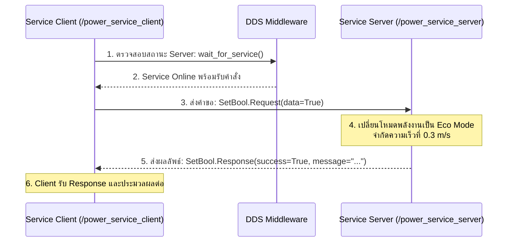
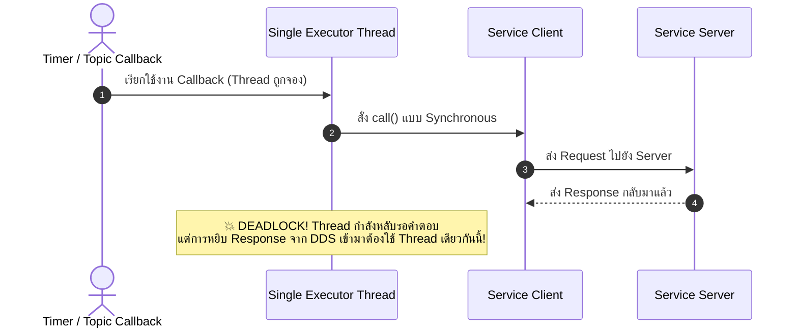

# 📖 Week 03: ระบบ Service-Client และการป้องกันสภาวะ Deadlock
**เวลาเรียน:** บรรยาย 2 ชั่วโมง | ปฏิบัติการ 3 ชั่วโมง | ศึกษาค้นคว้าด้วยตนเอง 4 ชั่วโมง  
**วิชาบังคับก่อน:** [สัปดาห์ที่ 2: โครงสร้างโหนด, Topics และการจัดการ QoS](../Week_02_Nodes_Topics_QoS/Readme.md)  
**เอกสารปฏิบัติการ:** [ใบงานแล็บสัปดาห์ที่ 3](Lab_Exercises.md)

---

## 🎯 วัตถุประสงค์การเรียนรู้ (Learning Objectives)
เมื่อจบบทเรียนนี้ ผู้เรียนจะสามารถ:
1. อธิบายสถาปัตยกรรมการสื่อสารแบบ Synchronous Remote Procedure Call (RPC) ด้วย ROS 2 Services
2. เปรียบเทียบความแตกต่างระหว่าง Topics (สตรีมข้อมูลทางเดียว) และ Services (ถาม-ตอบ Request/Response)
3. พัฒนา Service Server และ Service Client แบบ Asynchronous ด้วยภาษา Python (`rclpy`)
4. วิเคราะห์สาเหตุการเกิด **Deadlock ใน Single-Threaded Executor** เมื่อเรียก Service ภายใน Callback
5. แก้ไขปัญหา Deadlock ด้วยแนวทาง **ReentrantCallbackGroup** และ **MultiThreadedExecutor** หรือ Async/Await

---

## ⏱️ แผนการสอน 2 ชั่วโมง (Lecture Outline)
| ช่วงเวลา | หัวข้อ | กิจกรรมการเรียนรู้ |
| :---: | :--- | :--- |
| **00:00 - 00:30** | สถาปัตยกรรม Request-Response และโครงสร้างไฟล์ `.srv` | บรรยายเปรียบเทียบ Topics vs Services และโครงสร้าง 3 ขีด (`---`) |
| **00:30 - 01:00** | Service Server Implementation และสถานะความพร้อม (`wait_for_service`) | วิเคราะห์การจัดการ Request/Response ใน Python OOP |
| **01:00 - 01:30** | เจาะลึกสภาวะ Deadlock (The ROS 2 Single-Threaded Trap) | เขียนแผนภาพ Sequence แสดงการติดขัดของ Thread และวิธีแก้ไข |
| **01:30 - 02:00** | Callback Groups, Multi-Threaded Execution และสรุปเตรียมความพร้อม | สาธิตการใช้งาน `ReentrantCallbackGroup` และ CLI เครื่องมือทดสอบ |

---

## 🏛️ สถาปัตยกรรมระบบ (Architectural Deep Dive)

### 1. สถาปัตยกรรม Request-Response (RPC Pattern)
ไม่เหมือนกับ Topics ที่ส่งข้อมูลอย่างต่อเนื่องแบบ Fire-and-Forget การสื่อสารแบบ **Service** มีลักษณะเป็น **สองทาง (Two-Way)**:
1. **Client** ส่งข้อความ `Request` ไปยัง Service Server
2. **Server** รับคำสั่ง ประมวลผลตรรกะ และส่งข้อความ `Response` กลับมายัง Client



### 2. โครงสร้าง Service Definition (`.srv`)
ไฟล์ Service ใน ROS 2 จะถูกคั่นด้วยเครื่องหมายขีดสามขีด (`---`):
```text
# ด้านบนคือ Request (ข้อมูลที่ส่งไปถาม)
bool data
---
# ด้านล่างคือ Response (ข้อมูลที่ตอบกลับมา)
bool success
string message
```

---

### 3. กับดักทางวิศวกรรม: สภาวะ Deadlock ใน Single-Threaded Executor
ข้อผิดพลาดร้ายแรงที่สุดอันดับ 1 ที่วิศวกรมือใหม่มักพบใน ROS 2 คือ **การเรียก Service แบบ Synchronous ภายใน Callback ของโหนด**:



#### ทำไมจึงเกิด Deadlock?
ใน `SingleThreadedExecutor`:
- มีเพียง **1 Thread** ที่ทำหน้าที่หมุน Event Loop ทั้งหมด
- เมื่อ Callback ถูกเรียก Thread จะถูกจองเพื่อรันโค้ดนั้น
- หากในโค้ดมีคำสั่งรอผลลัพธ์แบบ Synchronous (เช่น `cli.call(req)`) Thread จะหยุดรอจนกว่าจะได้คำตอบ
- แต่เหตุการณ์ "ได้รับ Response แล้ว" จาก DDS จะต้องรอให้ Thread นี้ว่างเพื่อมาประมวลผล
- ผลลัพธ์: ทั้งสองฝ่ายต่างรอซึ่งกันและกัน โหนดจะค้างชั่วนิรันดร์ (Deadlock)

#### ทางออกที่ถูกต้อง:
1. **ใช้ Asynchronous Calling:** `cli.call_async(req)` พร้อมลงทะเบียน Callback ด้วย `future.add_done_callback(...)`
2. **ใช้ MultiThreadedExecutor ร่วมกับ ReentrantCallbackGroup:**
   ```python
   from rclpy.callback_groups import ReentrantCallbackGroup
   from rclpy.executors import MultiThreadedExecutor

   self.cb_group = ReentrantCallbackGroup()
   self.cli = self.create_client(SetBool, '/service_name', callback_group=self.cb_group)
   ```

---

## 🛠️ การวิเคราะห์โค้ดตัวอย่างในโมดูล (Code Walkthrough)

### 1. `power_service_server.py`
- โหนดนี้สร้าง Service Server รับอินเตอร์เฟซ `std_srvs/srv/SetBool` ที่ท็อปปิก `/robot/set_power_mode`:
  ```python
  self.srv = self.create_service(
      SetBool, '/robot/set_power_mode', self.handle_set_power_mode
  )
  ```
- ในฟังก์ชัน `handle_set_power_mode(self, request, response)`:
  - รับ `request.data` (บูลีน: `True` เพื่อเปิด Eco Mode, `False` เพื่อเปิดโหมดปกติ)
  - ตอบกลับ `response.success = True` และแนบข้อความยืนยันความปลอดภัยใน `response.message`

### 2. `power_service_client.py`
- ออกแบบโดยใช้การเรียกแบบ Asynchronous อย่างปลอดภัย:
  ```python
  future = self.cli.call_async(req)
  rclpy.spin_until_future_complete(client, future)
  ```
- มีการตรวจสอบความพร้อมของเซิร์ฟเวอร์ก่อนเสมอด้วย `wait_for_service(timeout_sec=1.0)` เพื่อป้องกันโปรแกรม Crash หากเซิร์ฟเวอร์ยังไม่เปิด

---

## ⌨️ ตารางคำสั่ง CLI สำคัญ
| คำสั่ง | วัตถุประสงค์ | ตัวอย่างการใช้งาน |
| :--- | :--- | :--- |
| `ros2 service list` | แสดงรายชื่อ Services ทั้งหมดที่กำลังเปิดใช้งานในระบบ | `ros2 service list` |
| `ros2 service type <service>` | แสดงประเภท Data Type ของ Service | `ros2 service type /robot/set_power_mode` |
| `ros2 service find <type>` | ค้นหา Service ทั้งหมดที่ใช้ Interface ชนิดนั้น | `ros2 service find std_srvs/srv/SetBool` |
| `ros2 interface show <type>` | ดูโครงสร้าง Request และ Response ของ Service | `ros2 interface show std_srvs/srv/SetBool` |
| `ros2 service call <srv> <type> <args>` | สั่งเรียกใช้งาน Service โดยตรงผ่าน CLI | `ros2 service call /robot/set_power_mode std_srvs/srv/SetBool "{data: true}"` |

---

## ⚠️ ปัญหาที่พบบ่อยและการแก้ไข (Troubleshooting)
| อาการ | สาเหตุที่เป็นไปได้ | วิธีแก้ไข |
| :--- | :--- | :--- |
| Client ค้างที่ `Waiting for service...` | ฝั่ง Server ยังไม่เปิดทำงาน หรือชื่อ Service ไม่ตรงกัน (เช่น ขาด `/`) | รัน `ros2 service list` เพื่อตรวจสอบว่ามีชื่อ Service ขึ้นในระบบหรือไม่ |
| โปรแกรมค้างและหยุดตอบสนอง (Freeze) | เกิดสภาวะ Deadlock จากการเรียก synchronous call ใน callback | เปลี่ยนไปใช้ `call_async()` หรือใช้ `MultiThreadedExecutor` |
| CLI แจ้งเตือน Service type not found | ไม่ได้ติดตั้งหรือไม่ได้ source แพ็กเกจ interface | ตรวจสอบว่ามีแพ็กเกจ `std_srvs` ติดตั้งอยู่ในระบบหรือไม่ |

---

## 📝 แบบทดสอบท้ายบท (Self-Assessment Quiz)
1. การสื่อสารแบบ Service มีจุดเด่นเหนือ Topics อย่างไรในการส่งคำสั่งควบคุมหุ่นยนต์?
2. เครื่องหมายใดที่ใช้แบ่งระหว่างส่วน Request และ Response ในไฟล์ `.srv`?
3. เพราะเหตุใดคำสั่ง `client.call(request)` ใน Callback ถึงทำให้เกิด Deadlock ใน `SingleThreadedExecutor`?
4. คลาสใดที่ต้องนำมาใช้งานร่วมกับ `MultiThreadedExecutor` เพื่อให้ Callback สามารถทำงานคู่ขนานกันได้?
5. คำสั่ง CLI ใดใช้สำหรับทดสอบเรียก `/robot/set_power_mode` ให้กลับสู่โหมดปกติ (`data: false`)?

<details>
<summary>🔍 ดูเฉลยคำตอบ</summary>

1. **ตอบ:** มีระบบตอบรับยืนยันผลการทำงานทันที (Acknowledge / Response) ทำให้ผู้สั่งการทราบแน่ชัดว่าคำสั่งสำเร็จหรือไม่
2. **ตอบ:** เครื่องหมายขีดสามขีด `---`
3. **ตอบ:** Thread ตัวเดียวของ Executor กำลังถูกจองเพื่อรอคำตอบ แต่เหตุการณ์รับ Response จากเครือข่ายต้องการ Thread เดียวกันนี้ไปประมวลผล ทำให้เกิดการบล็อกซึ่งกันและกัน
4. **ตอบ:** `ReentrantCallbackGroup`
5. **ตอบ:** `ros2 service call /robot/set_power_mode std_srvs/srv/SetBool "{data: false}"`
</details>

---

## 📚 แหล่งอ้างอิงและศึกษาเพิ่มเติม
- [Understanding ROS 2 Services](https://docs.ros.org/en/jazzy/Tutorials/Beginner-CLI-Tools/Understanding-ROS2-Services/Understanding-ROS2-Services.html)
- [Writing a Simple Service and Client (Python)](https://docs.ros.org/en/jazzy/Tutorials/Beginner-Client-Libraries/Writing-A-Simple-Py-Service-And-Client.html)
- [Using Callback Groups in rclpy](https://docs.ros.org/en/jazzy/How-To-Guides/Using-callback-groups.html)
