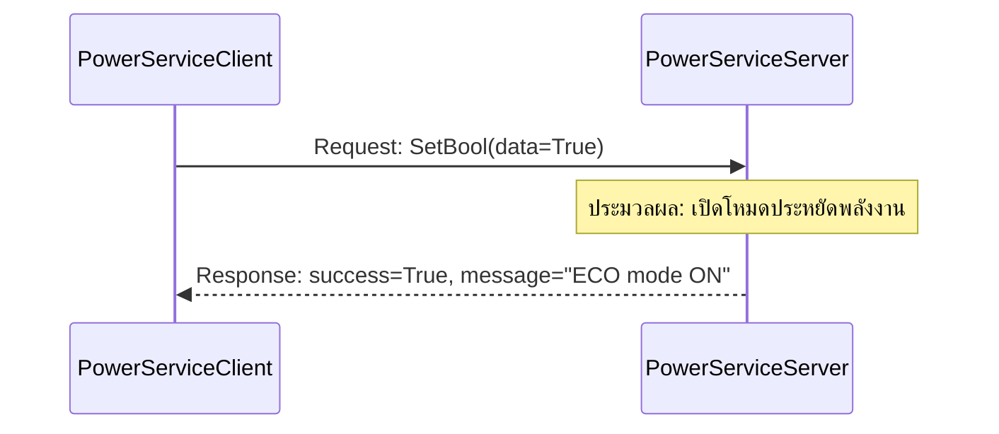

# 📖 Week 03: ระบบ Service-Client และการป้องกัน Deadlock

---

## 🎯 วัตถุประสงค์การเรียนรู้
1. เข้าใจกลไก Synchronous Request-Response (1-to-1 RPC)
2. การสร้าง Service Server และ Client ใน `rclpy`
3. การหลีกเลี่ยงสภาวะ Deadlock ใน Single-Threaded Executor

---

## 🏗️ สถาปัตยกรรม Service

