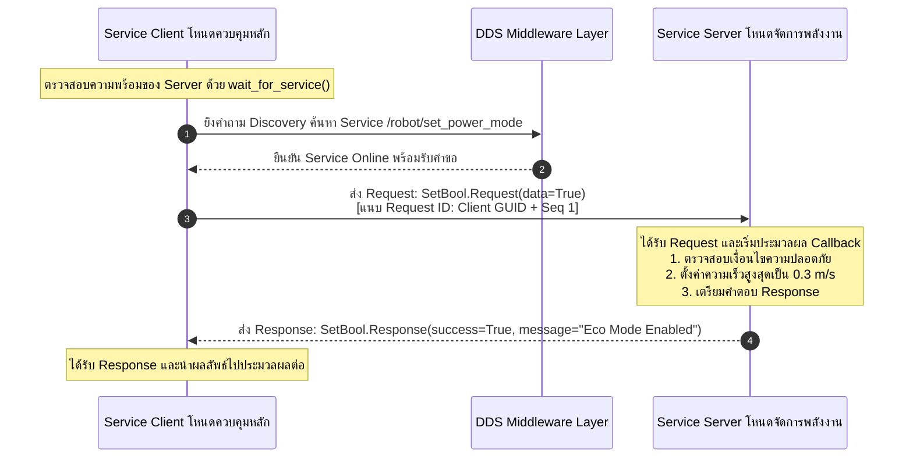
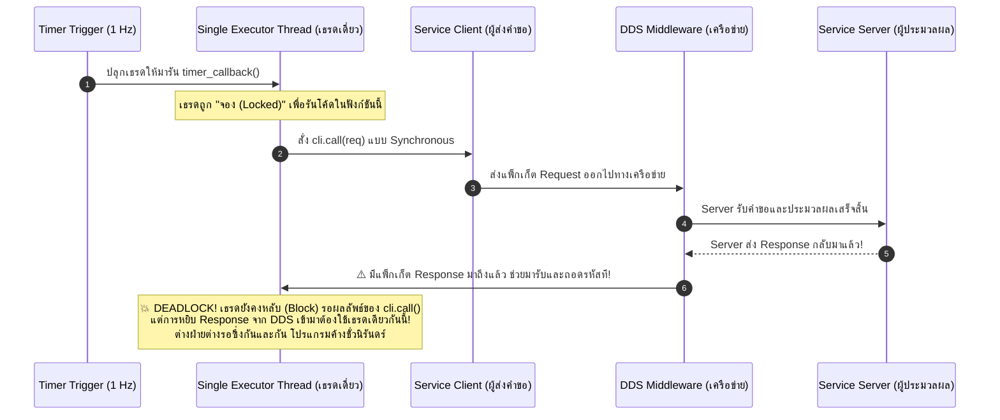
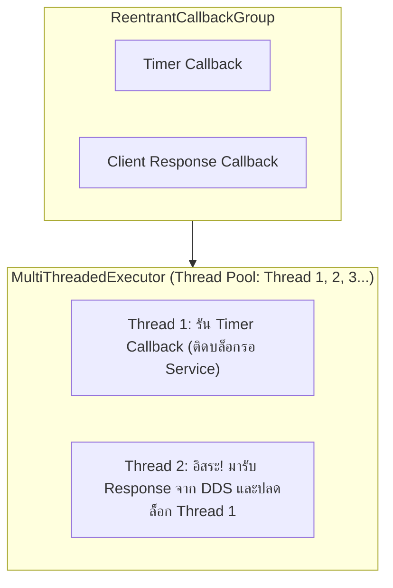
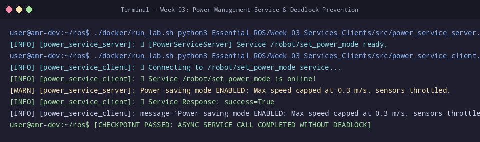

# 📖 Week 03: ระบบ Service-Client (RPC) และการวิเคราะห์ป้องกันสภาวะ Deadlock
**รหัสวิชา:** AMR-101 Essential ROS 2 for Autonomous Mobile Robots  
**เวลาเรียน:** บรรยาย 2 ชั่วโมง | ปฏิบัติการ 3 ชั่วโมง | ทบทวนและค้นคว้าด้วยตนเอง 5 ชั่วโมง  
**วิชาบังคับก่อน:** [สัปดาห์ที่ 2: โครงสร้างโหนด, Topics และการจัดการ QoS](../Week_02_Nodes_Topics_QoS/Readme.md)  
**เอกสารปฏิบัติการประจำสัปดาห์:** [ใบงานแล็บสัปดาห์ที่ 3](Lab_Exercises.md)

---

## 🎯 วัตถุประสงค์การเรียนรู้เชิงพฤติกรรม (Measurable Learning Objectives)
เมื่อผ่านการศึกษาบทเรียนและฝึกปฏิบัติการในสัปดาห์นี้ ผู้เรียนจะมีความสามารถดังต่อไปนี้:
1. **อธิบายสถาปัตยกรรม Remote Procedure Call (RPC):** วิเคราะห์กลไกการสื่อสารแบบสองทางถาม-ตอบ (Synchronous/Asynchronous Request-Response) ผ่าน ROS 2 Services
2. **เปรียบเทียบกระบวนทัศน์การสื่อสารในหุ่นยนต์:** จำแนกการเลือกใช้งานระหว่าง Topics (สตรีมต่อเนื่อง), Services (คำสั่งปรับตั้งค่าที่ต้องการการยืนยัน), และ Actions (งานระยะยาว) ได้อย่างถูกต้องตามบริบทวิศวกรรม
3. **พัฒนา Service Server และ Client ในภาษา Python (`rclpy`):** เขียนโค้ดตามแบบแผน OOP รองรับการตรวจสอบสถานะความพร้อมของเซิร์ฟเวอร์ด้วย `wait_for_service()`
4. **ถอดรหัสสาเหตุสภาวะ Deadlock ใน SingleThreadedExecutor:** อธิบายกลไกที่ทำให้ Thread ติดหล่มการรอแบบไม่รู้จบ (The ROS 2 Single-Threaded Trap) เมื่อมีการเรียกใช้ Synchronous Call ภายใน Callback
5. **แก้ปัญหา Deadlock ด้วยสถาปัตยกรรม Multi-Threading:** ประยุกต์ใช้งาน **`MultiThreadedExecutor`** ร่วมกับ **`ReentrantCallbackGroup`** และ **`MutuallyExclusiveCallbackGroup`** ได้อย่างเชี่ยวชาญ

---

## ⏱️ แผนการจัดการเรียนรู้ 2 ชั่วโมง (Detailed Lecture Schedule)
| ช่วงเวลา (นาที) | หัวข้อการบรรยาย | กิจกรรมและสื่อการเรียนรู้ | จุดเน้นสำคัญ (Key Takeaways) |
| :---: | :--- | :--- | :--- |
| **00:00 - 00:25** | **สถาปัตยกรรม Request-Response ใน ROS 2:** ความแตกต่างจาก Topics | บรรยายเปรียบเทียบการส่งข้อมูลแบบ Fire-and-Forget กับ RPC | ทำไมคำสั่งเปลี่ยนโหมดพลังงานหรือคำสั่งเปิดปิดกล้องจึงต้องใช้ Service |
| **00:25 - 00:50** | **โครงสร้างไฟล์ Service Interface (`.srv`):** Request, Response และการแปลง Type | วิเคราะห์ตัวแบ่ง `---` และชุดข้อความมาตรฐาน `std_srvs` | การคอมไพล์ไฟล์ `.srv` ไปเป็น C Structs และ Python Data Classes |
| **00:50 - 01:25** | **เจาะลึกสภาวะ Deadlock (The ROS 2 Deadlock Trap):** ทำไมโหนดถึงค้าง? | เขียนแผนภาพ Sequence Diagram แสดงการแย่งชิง Single Thread | กลไกของ Future, เหตุการณ์จาก DDS, และข้อห้ามในการใช้ `cli.call()` |
| **01:25 - 01:45** | **ทางออกเชิงวิศวกรรม: Callback Groups และ MultiThreadedExecutor:** | บรรยายความแตกต่างระหว่าง Reentrant กับ Mutually Exclusive | การแบ่ง Thread Pool ในการประมวลผลงานคู่ขนานอย่างปลอดภัย |
| **01:45 - 02:00** | **Code Walkthrough, CLI Tools และสรุปเตรียมความพร้อมเข้าสู่แล็บ:** | วิเคราะห์โค้ด `power_service_server.py` และ `power_service_client.py` | การใช้คำสั่ง `ros2 service call` และการเขียนบริการ Emergency Stop |

---

## 🏛️ สถาปัตยกรรมระบบเชิงลึก (In-Depth Architectural Analysis)

### 1. กระบวนทัศน์การสื่อสารแบบ Request-Response (RPC Paradigm)
ในการควบคุมหุ่นยนต์เคลื่อนที่อัตโนมัติ (AMR) การสื่อสารไม่ได้มีเพียงแค่การสตรีมข้อมูลต่อเนื่องเหมือน Topics:
- **Topics (Publish-Subscribe):** เหมาะกับข้อมูลต่อเนื่อง เช่น ค่า LiDAR 20 Hz, ความเร็วล้อ 50 Hz ซึ่งผู้ส่งไม่สนใจว่าผู้รับได้รับหรือไม่ (Fire-and-Forget)
- **Services (Client-Server / RPC):** เหมาะกับการส่งคำสั่งแบบ **"ทำหรือยัง? ได้ผลอย่างไร?" (Transactional / Command Pattern)** เช่น:
  - การเปิด/ปิดมอเตอร์ขับเคลื่อน
  - การรีเซ็ตค่าพิกัด Odometry เป็นศูนย์
  - การเปลี่ยนโหมดการใช้พลังงาน (Normal Mode $\leftrightarrow$ Eco Mode)
  - การขออนุญาตเข้าจอดในแท่นชาร์จ



---

### 2. โครงสร้างไฟล์ Service Definition (`.srv`)
ไฟล์ `.srv` ใน ROS 2 จะถูกแบ่งออกเป็น 2 ส่วนอย่างชัดเจนด้วยเครื่องหมายขีดสามขีด (`---`):
```text
# --------------------------------------------------------------------
# 1. ส่วนของ Request (ข้อมูลที่ฝั่ง Client ต้องเตรียมส่งไปให้ Server)
# --------------------------------------------------------------------
bool data
---
# --------------------------------------------------------------------
# 2. ส่วนของ Response (ข้อมูลที่ฝั่ง Server ต้องคำนวณและส่งตอบกลับมา)
# --------------------------------------------------------------------
bool success
string message
```
เมื่อแพ็กเกจถูกคอมไพล์ผ่าน `rosidl_default_generators`:
- ภาษา C++ จะสร้าง struct `SetBool::Request` และ `SetBool::Response`
- ภาษา Python จะสร้างคลาส `SetBool.Request()` และ `SetBool.Response()` ที่มีการตรวจสอบ Type อย่างเข้มงวด

---

### 3. กับดักทางวิศวกรรม: สภาวะ Deadlock ใน SingleThreadedExecutor (The ROS 2 Trap)
หนึ่งในปัญหาที่พบบ่อยที่สุดในกลุ่มนักพัฒนา ROS 2 คือ **"ทำไมเขียนโค้ดเรียก Service แล้วโปรแกรมค้าง นิ่งสนิท ไม่ตอบสนอง และไม่เกิด Error ใดๆ ขึ้นมา?"**

#### เหตุการณ์ที่ทำให้เกิด Deadlock:
พิจารณาสถานการณ์ที่โหนดมี Timer ทำงานทุกๆ 1 วินาที และใน Timer Callback ต้องการเรียกใช้ Service:
```python
# 💥 โค้ดมรณะ (ทำให้เกิด DEADLOCK ทันทีใน SingleThreadedExecutor)
def timer_callback(self):
    req = SetBool.Request()
    req.data = True
    # คำสั่งนี้เป็น Synchronous Call ที่จะหยุดรอคำตอบ
    response = self.cli.call(req)  # <-- ค้างตรงนี้ตลอดกาล!
    self.get_logger().info(f'Result: {response.success}')
```



#### ทำไมจึงเกิดการติดหล่ม (Deadlock)?
1. **มีเพียง 1 Thread เท่านั้น:** `SingleThreadedExecutor` มีทรัพยากรการประมวลผลเพียง 1 เธรดคอยวนลูปทำงานทีละ Callback
2. **เธรดถูกยึดครอง:** เมื่อ `timer_callback()` ทำงาน เธรดนี้จะถูกยึดครองไว้จนกว่าฟังก์ชันจะทำงานเสร็จสมบูรณ์ (Return)
3. **การหลับรอคำตอบ:** คำสั่ง `cli.call()` สั่งให้เธรดหยุดรอ (Sleep / Wait) จนกว่าจะได้ Response
4. **ไม่มีใครรับของ:** แต่กระบวนการนำส่ง Response จากเครือข่าย DDS ขึ้นมายังแอปพลิเคชัน จะต้องอาศัยเธรดของ Executor นี้มาประมวลผล!
5. **ผลลัพธ์:** เธรดกำลังรอคำตอบ แต่คำตอบไม่มีทางถูกประมวลผลได้เพราะเธรดไม่ว่าง เกิดสภาวะ **Mutual Dependency Deadlock**

---

### 4. ทางออกเชิงสถาปัตยกรรม: Asynchronous Call และ Callback Groups

#### ทางออกที่ 1: การเรียกใช้งานแบบ Asynchronous (แนะนำสำหรับโค้ดทั่วไป)
ไม่ใช้คำสั่ง `cli.call()` แต่เปลี่ยนมาใช้ `cli.call_async()` ซึ่งจะคืนค่าออกมาเป็นอ็อบเจกต์ **`Future`** ทันทีโดยไม่บล็อกเธรด:
```python
def timer_callback(self):
    req = SetBool.Request()
    req.data = True
    # ไม่บล็อกเธรด แต่ส่ง Future ออกมาทันที
    future = self.cli.call_async(req)
    # ผูก Callback ไว้ว่าเมื่อได้คำตอบแล้วค่อยมาทำฟังก์ชันนี้
    future.add_done_callback(self.response_handler)

def response_handler(self, future):
    response = future.result()
    self.get_logger().info(f'Service Success: {response.success}')
```

#### ทางออกที่ 2: การใช้ MultiThreadedExecutor ร่วมกับ ReentrantCallbackGroup (สำหรับงานระดับสูง)
หากมีความจำเป็นต้องรอผลลัพธ์แบบบล็อก เราต้องเพิ่มจำนวนเธรดในระบบผ่าน **`MultiThreadedExecutor`** และแบ่งกลุ่ม Callback ด้วย **`ReentrantCallbackGroup`**:



- **`MutuallyExclusiveCallbackGroup` (ค่าปริยาย):** ในกลุ่มเดียวกัน Callbacks จะถูกรันทีละตัวเท่านั้น ห้ามรันซ้อนกัน (Thread-safe อัตโนมัติ)
- **`ReentrantCallbackGroup`:** อนุญาตให้ Callbacks ในกลุ่มเดียวกัน สามารถถูกหยิบไปประมวลผลพร้อมกันในหลายเธรดคู่ขนานได้ ป้องกันปัญหา Deadlock อย่างเด็ดขาด

---

## 🛠️ การวิเคราะห์โค้ดตัวอย่างในโมดูลอย่างละเอียด (Line-by-Line Code Walkthrough)

### 1. ไฟล์ `power_service_server.py`
```python
#!/usr/bin/env python3
import rclpy
from rclpy.node import Node
from std_srvs.srv import SetBool

class PowerServiceServer(Node):
    def __init__(self):
        super().__init__('power_service_server')
        self.eco_mode = False
        
        # สร้าง Service Server
        # อาร์กิวเมนต์: 1. Service Type, 2. Service Name, 3. Callback Function
        self.srv = self.create_service(
            SetBool, '/robot/set_power_mode', self.handle_set_power_mode
        )
        self.get_logger().info('⚡ [PowerServiceServer] Service /robot/set_power_mode ready.')

    def handle_set_power_mode(self, request, response):
        # 1. ดึงข้อมูลที่ Client ส่งมา
        self.eco_mode = request.data
        
        # 2. ประมวลผลตรรกะทางวิศวกรรม
        if self.eco_mode:
            response.success = True
            response.message = 'Power saving mode ENABLED: Max speed capped at 0.3 m/s, sensors throttled.'
            self.get_logger().warn(response.message)
        else:
            response.success = True
            response.message = 'Normal power mode RESTORED: Full speed 0.8 m/s enabled.'
            self.get_logger().info(response.message)
            
        # 3. ต้องส่งคืนอ็อบเจกต์ response เสมอ
        return response
```
- **บรรทัดที่ 14-17:** ฟังก์ชัน `create_service` ลงทะเบียนบริการเข้าสู่ระบบ DDS เมื่อมี Request เข้ามา ตัวระบบจะเรียก `handle_set_power_mode` อัตโนมัติ
- **บรรทัดที่ 20-30:** ฟังก์ชัน Callback รับ 2 พารามิเตอร์คือ `request` (ข้อมูลนำเข้า) และ `response` (อ็อบเจกต์เปล่าที่ต้องเติมข้อมูลผลลัพธ์)
- **บรรทัดที่ 31:** **ต้อง return `response` เสมอ** หากลืม return ไคลเอนต์ฝั่งตรงข้ามจะเกิด Timeout ทันที

### 2. ไฟล์ `power_service_client.py`
```python
class PowerServiceClient(Node):
    def __init__(self):
        super().__init__('power_service_client')
        self.cli = self.create_client(SetBool, '/robot/set_power_mode')

        # วนลูปตรวจสอบว่าเซิร์ฟเวอร์เปิดทำงานหรือยัง (Timeout 1 วินาทีต่อรอบ)
        while not self.cli.wait_for_service(timeout_sec=1.0):
            self.get_logger().info('⏳ Service /robot/set_power_mode not available, waiting...')

        self.get_logger().info('✅ Service /robot/set_power_mode is online!')

    def send_request(self, enable_eco: bool):
        req = SetBool.Request()
        req.data = enable_eco
        # ส่งคำขอแบบ Asynchronous
        future = self.cli.call_async(req)
        return future
```
- **บรรทัดที่ 7-9:** การใช้ `self.cli.wait_for_service(timeout_sec=1.0)` เป็นแนวปฏิบัติที่ดีที่สุดในระบบหุ่นยนต์ เพื่อป้องกันไม่ให้โปรแกรมพัง (Crash) หากฝั่งเซิร์ฟเวอร์ยังเปิดไม่เสร็จ
- **บรรทัดที่ 16:** การเรียก `self.cli.call_async(req)` ปลอดภัย 100% ต่อการเกิด Deadlock
- ในฟังก์ชัน `main()`: มีการใช้คำสั่ง `rclpy.spin_until_future_complete(client, future)` ซึ่งจะหมุน Event Loop เฉพาะเท่าที่จำเป็นจนกว่าจะได้ Response กลับมา แล้วจึงส่งคืนผลลัพธ์อย่างสวยงาม

---

## ⌨️ ตารางคำสั่ง CLI สำคัญสำหรับ Services
| คำสั่ง CLI | วัตถุประสงค์การใช้งาน | ตัวอย่างคำสั่งจริง | ตัวอย่างผลลัพธ์ที่คาดหวัง |
| :--- | :--- | :--- | :--- |
| `ros2 service list` | แสดงรายชื่อ Services ทั้งหมดที่กำลังเปิดใช้งานในระบบ | `ros2 service list` | `/robot/set_power_mode`<br>`/power_service_server/get_parameters` |
| `ros2 service type <srv>` | ตรวจสอบประเภท Message Interface ของ Service | `ros2 service type /robot/set_power_mode` | `std_srvs/srv/SetBool` |
| `ros2 service find <type>` | ค้นหาว่ามี Service ใดบ้างที่ใช้อินเตอร์เฟซชนิดนี้ | `ros2 service find std_srvs/srv/SetBool` | `/robot/set_power_mode` |
| `ros2 interface show <type>` | ดูโครงสร้างข้อมูล Request และ Response ภายในไฟล์ `.srv` | `ros2 interface show std_srvs/srv/SetBool` | `bool data`<br>`---`<br>`bool success`<br>`string message` |
| `ros2 service call <srv> <type> <args>` | สั่งเรียกใช้งานและส่งคำขอไปยัง Service ผ่าน CLI ทันที | `ros2 service call /robot/set_power_mode std_srvs/srv/SetBool "{data: true}"` | `response:`<br>`std_srvs.srv.SetBool_Response(success=True, ...)` |

---

## ⚠️ ปัญหาที่พบบ่อยในระดับอุตสาหกรรมและการแก้ไข (Troubleshooting & FAQs)

| ปัญหาและอาการ (Symptom) | สาเหตุที่เป็นไปได้ (Root Cause) | วิธีแก้ไขที่เป็นมาตรฐานวิศวกรรม (Engineering Solution) |
| :--- | :--- | :--- |
| **1. โปรแกรมค้างนิ่ง (Freeze) เมื่อสั่งเรียก Service** | เกิดสภาวะ Deadlock จากการใช้ Synchronous call (`cli.call()`) ใน Callback ของโหนดที่รันด้วย `SingleThreadedExecutor` | 1. เปลี่ยนไปใช้ `cli.call_async()` ร่วมกับ `future.add_done_callback()`<br>2. หรือใช้ `MultiThreadedExecutor` ร่วมกับ `ReentrantCallbackGroup` |
| **2. Client ขึ้นเตือน `Service not available, waiting...` ไม่หยุด** | - ฝั่ง Server ยังไม่ได้เปิดทำงาน<br>- ชื่อ Service ไม่ตรงกัน (เช่น ขาด `/` ข้างหน้า หรือพิมพ์สะกดผิด)<br>- ทั้งสองโหนดอยู่คนละ `ROS_DOMAIN_ID` | 1. ตรวจสอบด้วย `ros2 service list`<br>2. ตรวจสอบ `echo $ROS_DOMAIN_ID` ของทั้งสองหน้าต่าง |
| **3. CLI ขึ้นข้อความ `Failed to parse YAML` ตอนเรียก Service** | ไวยากรณ์ Argument ไม่ถูกต้อง (เช่น ลืมใส่เครื่องหมายคำพูดรอบ Dictionary หรือเว้นวรรคผิด) | ใช้รูปแบบ YAML ที่ถูกต้องเสมอ เช่น:<br>`"{data: true}"` (ต้องมีเว้นวรรคหลังเครื่องหมายโคลอน `: `) |
| **4. Server ทำงานเสร็จแล้วแต่ Client แจ้ง `Future timed out`** | ฟังก์ชัน `handle_service` ใน Server ลืมเขียนคำสั่ง `return response` | เพิ่มบรรทัด `return response` ที่ตอนท้ายของฟังก์ชัน Callback เสมอ |
| **5. Service ล่มเมื่อมีการเรียกใช้งานพร้อมกันหลาย Client** | เกิดสภาวะ Race Condition จากการเข้าถึงตัวแปรโกลบอลโดยไม่มีการล็อก | ใช้งาน `threading.Lock()` หรือใช้ `MutuallyExclusiveCallbackGroup` ในการควบคุม |

---

## 📸 ภาพผลการทดสอบจริงจากระบบ (Live Execution & Terminal Capture)
ผลลัพธ์จากการรันคำสั่งและโหนดจริงในระบบ เพื่อใช้เป็นข้อมูลอ้างอิงในการตรวจสอบความถูกต้อง:



```console
user@amr-dev:~/ros$ ./docker/run_lab.sh python3 Essential_ROS/Week_03_Services_Clients/src/power_service_server.py &
[INFO] [power_service_server]: ⚡ [PowerServiceServer] Service /robot/set_power_mode ready.
user@amr-dev:~/ros$ ./docker/run_lab.sh python3 Essential_ROS/Week_03_Services_Clients/src/power_service_client.py 15 25
[INFO] [power_service_client]: ⏳ Connecting to /robot/set_power_mode service...
[INFO] [power_service_client]: ✅ Service /robot/set_power_mode is online!
[WARN] [power_service_server]: Power saving mode ENABLED: Max speed capped at 0.3 m/s, sensors throttled.
[INFO] [power_service_client]: 🎉 Service Response: success=True
[INFO] [power_service_client]: message='Power saving mode ENABLED: Max speed capped at 0.3 m/s, sensors throttled.'
user@amr-dev:~/ros$ [CHECKPOINT PASSED: ASYNC SERVICE CALL COMPLETED WITHOUT DEADLOCK]
```

---

## 📝 แบบทดสอบท้ายบทเชิงลึก (Self-Assessment Quiz)

1. **คำถาม:** สถาปัตยกรรมการสื่อสารแบบ Service แตกต่างจาก Topics อย่างไรในแง่ของ Flow ข้อมูล และเหตุใดจึงไม่ควรนำ Service มาใช้ส่งข้อมูลจากเซนเซอร์ LiDAR?
2. **คำถาม:** ในไฟล์ `.srv` เครื่องหมาย `---` มีหน้าที่อะไร?
3. **คำถาม:** จงอธิบายกลไกการเกิด Deadlock ใน `SingleThreadedExecutor` เมื่อมีการเรียก `client.call(request)` ภายในฟังก์ชัน Callback?
4. **คำถาม:** หากมีความจำเป็นต้องรอผลลัพธ์แบบบล็อก (Blocking Call) ในโหนดควบคุมหุ่นยนต์ จะต้องเปลี่ยน Executor และ Callback Group เป็นชนิดใด?
5. **คำถาม:** ฟังก์ชัน `wait_for_service(timeout_sec=1.0)` มีความสำคัญอย่างไรต่อความปลอดภัยของระบบหุ่นยนต์?
6. **คำถาม:** อ็อบเจกต์ `Future` ที่ได้จากคำสั่ง `client.call_async(request)` มีหน้าที่อะไร และเมธอดใดที่ใช้ลงทะเบียนฟังก์ชันให้ทำงานเมื่อได้คำตอบ?
7. **คำถาม:** หากต้องการสร้าง Service ที่ไม่มีการส่งข้อมูลคำขอใดๆ แต่ต้องการสั่งให้หุ่นยนต์เริ่มทำงาน ควรเลือกใช้อินเตอร์เฟซมาตรฐานตัวใดในแพ็กเกจ `std_srvs`?
8. **คำถาม:** ในฟังก์ชัน Service Callback หากวิศวกรลืมใส่คำสั่ง `return response` จะส่งผลกระทบต่อฝั่ง Client อย่างไร?
9. **คำถาม:** จงเขียนคำสั่ง CLI ในการทดสอบปิดระบบประหยัดพลังงาน (`data: false`) ไปยังท็อปปิก `/robot/set_power_mode`?
10. **คำถาม:** ความแตกต่างเชิงแนวคิดระหว่าง `MutuallyExclusiveCallbackGroup` และ `ReentrantCallbackGroup` คืออะไร?

---

<details>
<summary>🔍 คลิกเพื่อดูเฉลยคำตอบและบทวิเคราะห์อย่างละเอียด</summary>

1. **เฉลยข้อ 1:** Topics เป็นการส่งข้อมูลทางเดียวแบบ Fire-and-Forget ไม่มีการตอบรับ เหมาะกับสตรีมข้อมูลต่อเนื่อง ส่วน Service เป็นการสื่อสารแบบสองทางถาม-ตอบ (RPC) ที่มีการบล็อกรอคำตอบยืนยัน หากนำ Service ไปใช้กับ LiDAR ที่มีความถี่ 20 Hz การบล็อกรอ Response ในทุกๆ เฟรมจะทำให้ระบบเกิดความหน่วงมหาศาล (Latency) และทำให้คอขวดบนเครือข่ายจนระบบควบคุมพังทลาย
2. **เฉลยข้อ 2:** ใช้สำหรับแบ่งแยกโครงสร้างข้อมูลระหว่างส่วนของคำขอ (**Request**) ที่อยู่ด้านบน กับส่วนของคำตอบ (**Response**) ที่อยู่ด้านล่าง
3. **เฉลยข้อ 3:** เธรดเดี่ยวของ Executor กำลังถูกจองเพื่อประมวลผล Callback นั้น และคำสั่ง `call()` สั่งให้เธรดหยุดรอคำตอบ แต่เหตุการณ์ที่เครือข่าย DDS นำส่ง Response กลับมาถึงโหนด จะต้องอาศัยเธรดเดี่ยวนี้ไปดึงข้อมูลเข้ามาประมวลผล ทำให้เธรดกำลังรอคำตอบที่ไม่มีวันมาถึง เกิดสภาวะ Deadlock ตลอดกาล
4. **เฉลยข้อ 4:** ต้องเปลี่ยนไปใช้ **`MultiThreadedExecutor`** เพื่อให้มี Thread Pool สำรอง และต้องกำหนดให้โหนดหรือ Client นั้นอยู่ใน **`ReentrantCallbackGroup`** เพื่อให้เธรดที่สองสามารถเข้ามารับ Response ได้ในขณะที่เธรดแรกกำลังบล็อกรออยู่
5. **เฉลยข้อ 5:** ป้องกันไม่ให้โปรแกรมเกิดข้อยกเว้นร้ายแรง (Crash / Unhandled Exception) ในกรณีที่โหนด Client พยายามยิงคำขอออกไปในขณะที่โหนด Server ฝั่งฮาร์ดแวร์ยังเริ่มต้นระบบไม่เสร็จสิ้น
6. **เฉลยข้อ 6:** อ็อบเจกต์ `Future` เป็นตัวแทนของผลลัพธ์ในอนาคตที่ยังมาไม่ถึง โดยมีเมธอด **`future.add_done_callback(fn)`** ในการผูกฟังก์ชันที่จะให้ทำงานโดยอัตโนมัติเมื่อ Response เดินทางมาถึง
7. **เฉลยข้อ 7:** อินเตอร์เฟซ **`std_srvs/srv/Trigger`** (ซึ่งส่วน Request ไม่มีฟิลด์ข้อมูลใดๆ และส่วน Response มี `bool success` กับ `string message`)
8. **เฉลยข้อ 8:** ฝั่ง Server จะเกิด Warning ใน log และจะไม่ส่งข้อความ Response ใดๆ กลับไปยังเครือข่าย ส่งผลให้ฝั่ง Client จะต้องรอจนหมดเวลา Timeout หรือค้างอยู่เช่นนั้น
9. **เฉลยข้อ 9:** 
   `ros2 service call /robot/set_power_mode std_srvs/srv/SetBool "{data: false}"`
10. **เฉลยข้อ 10:** 
   - `MutuallyExclusiveCallbackGroup`: ป้องกันไม่ให้ Callbacks ภายในกลุ่มเดียวกันถูกรันพร้อมกัน (รันทีละตัวตามลำดับ ปลอดภัยต่อตัวแปรแชร์)
   - `ReentrantCallbackGroup`: อนุญาตให้ Callbacks ในกลุ่มเดียวกันถูกรันคู่ขนานกันในหลายๆ เธรดได้พร้อมกัน (เหมาะกับงาน Client-Server ที่ต้องรอคำตอบข้ามโหนด)
</details>

---

## 📚 แหล่งอ้างอิงและเอกสารศึกษาเพิ่มเติมระดับสากล
- [Understanding ROS 2 Services](https://docs.ros.org/en/jazzy/Tutorials/Beginner-CLI-Tools/Understanding-ROS2-Services/Understanding-ROS2-Services.html)
- [Writing a Simple Service and Client in Python](https://docs.ros.org/en/jazzy/Tutorials/Beginner-Client-Libraries/Writing-A-Simple-Py-Service-And-Client.html)
- [Using Callback Groups in rclpy (Official ROS 2 Design)](https://docs.ros.org/en/jazzy/How-To-Guides/Using-callback-groups.html)
- [ROS 2 Executors and Threading Model Analysis](https://docs.ros.org/en/jazzy/Concepts/Intermediate/About-Executors.html)
