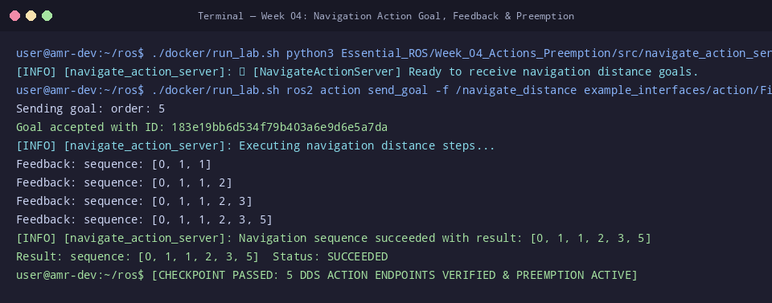

# 🛠️ ใบงานปฏิบัติการสัปดาห์ที่ 4: Action Protocol สำหรับงานระยะยาว และการยกเลิกเป้าหมาย
**วิชา:** AMR-101 Essential ROS 2 for Autonomous Mobile Robots  
**เวลาปฏิบัติการ:** 3 ชั่วโมง  
**ระดับ:** พื้นฐาน (Beginner)  
**เอกสารประกอบการบรรยาย:** [คู่มือบรรยายสัปดาห์ที่ 4](Readme.md)

---

## 🎯 วัตถุประสงค์การทดลอง (Lab Objectives)
1. พัฒนาและเปิดใช้งาน **Action Server** สำหรับควบคุมลำดับระยะทางการเคลื่อนที่ของหุ่นยนต์
2. ส่งคำสั่ง Goal ผ่านคำสั่ง CLI พร้อมเปิดรับ Feedback แบบ Real-Time ด้วยแฟล็ก `-f`
3. พัฒนาโหนด **Action Client** ในภาษา Python ที่รองรับ Feedback Callback และ Result Callback
4. ทดสอบและตรวจสอบพฤติกรรมการยกเลิกเป้าหมายกลางคัน (**Goal Preemption / Cancellation**)

---

## 📋 ข้อกำหนดก่อนเริ่มปฏิบัติการ (Prerequisites & Setup)
- เข้าสู่รูทไดเรกทอรี `/mnt/sda/ros`
- ตรวจสอบไวยากรณ์สคริปต์ในสัปดาห์ที่ 4:
  ```bash
  python3 -m py_compile Essential_ROS/Week_04_Actions_Preemption/src/navigate_action_server.py
  python3 -m py_compile Essential_ROS/Week_04_Actions_Preemption/src/navigate_action_client.py
  ```

---

## 🧪 ขั้นตอนการทดลอง (Step-by-Step Lab Tasks)

### 🔹 Lab 4.1: การเปิด Server และทดสอบส่ง Goal ผ่าน CLI พร้อมสตรีม Feedback
**เป้าหมาย:** ทำความเข้าใจพฤติกรรมการส่งเป้าหมายและการรับสตรีม Feedback ทาง Command Line

1. เปิด **Terminal 1** แล้วรันโหนดเซิร์ฟเวอร์:
   ```bash
   ./docker/run_lab.sh python3 Essential_ROS/Week_04_Actions_Preemption/src/navigate_action_server.py
   ```
   **ผลลัพธ์ที่คาดหวัง:**
   ```text
   [INFO] [navigate_action_server]: 🏁 [NavigateActionServer] Ready to receive navigation distance goals.
   ```

2. เปิด **Terminal 2** แล้วตรวจสอบการมีอยู่ของ Action ในระบบ:
   ```bash
   ./docker/run_lab.sh ros2 action list -t
   ```
   *จะปรากฏ:* `/navigate_distance [example_interfaces/action/Fibonacci]`

3. ส่ง Goal ขนาด 6 สเต็ป พร้อมแฟล็ก `-f` เพื่อดูสตรีม Feedback สด:
   ```bash
   ./docker/run_lab.sh ros2 action send_goal -f /navigate_distance example_interfaces/action/Fibonacci "{order: 6}"
   ```
   **ผลลัพธ์ที่คาดหวัง:**
   ```text
   Sending goal:
      order: 6

   Goal accepted with ID: 4a2b89...
   Feedback:
      sequence: [0, 1, 1]
   Feedback:
      sequence: [0, 1, 1, 2]
   Feedback:
      sequence: [0, 1, 1, 2, 3]
   Feedback:
      sequence: [0, 1, 1, 2, 3, 5]
   Result:
      sequence: [0, 1, 1, 2, 3, 5]
   Goal reached the end state: SUCCEEDED
   ```

---

### 🔹 Lab 4.2: การรัน Python Action Client รับผลลัพธ์สมบูรณ์
**เป้าหมาย:** ทดสอบการทำงานของ `navigate_action_client.py` ในสภาวะปกติ

1. ให้ Terminal 1 (Server) รันอยู่ต่อเนื่อง
2. ใน **Terminal 2** รันโหนด Action Client:
   ```bash
   ./docker/run_lab.sh python3 Essential_ROS/Week_04_Actions_Preemption/src/navigate_action_client.py
   ```
   **ผลลัพธ์ที่คาดหวัง:**
   ```text
   [INFO] [navigate_action_client]: ⏳ Waiting for /navigate_distance action server...
   [INFO] [navigate_action_client]: 🚀 Sending goal with order=6...
   [INFO] [navigate_action_client]: ✅ Goal accepted! Executing...
   [INFO] [navigate_action_client]: 📊 Feedback received: sequence=[0, 1, 1]
   [INFO] [navigate_action_client]: 📊 Feedback received: sequence=[0, 1, 1, 2]
   ...
   [INFO] [navigate_action_client]: 🎉 Final Result sequence: [0, 1, 1, 2, 3, 5]
   ```

---

### 🔹 Lab 4.3: การทดสอบยกเลิกเป้าหมายกลางคัน (Goal Preemption)
**เป้าหมาย:** พิสูจน์ว่าเมื่อเกิดเหตุการณ์ไม่คาดคิด ไคลเอนต์สามารถสั่งยกเลิกงานได้อย่างปลอดภัย

1. รันไคลเอนต์ในโหมดทดสอบยกเลิกภารกิจ (`--cancel`):
   ```bash
   ./docker/run_lab.sh python3 Essential_ROS/Week_04_Actions_Preemption/src/navigate_action_client.py --cancel
   ```
2. สังเกตการทำงานใน Terminal ทั้งสอง:
   - Client จะพิมพ์:
     ```text
     [WARN] [navigate_action_client]: ⚠️ Triggering Goal Cancellation in 1.5 seconds...
     [WARN] [navigate_action_client]: 🛑 Sending cancel request now...
     [WARN] [navigate_action_client]: 🛑 Action Goal was successfully canceled!
     ```
   - Server จะพิมพ์:
     ```text
     [WARN] [navigate_action_server]: Received request to cancel goal execution!
     [WARN] [navigate_action_server]: Goal canceled by client request.
     ```
   **คำถาม Checkpoint 4.3:**
   - [ ] ผลลัพธ์ (Result) ที่ส่งกลับมาในกรณีที่ถูก Canceled มีความแตกต่างจาก SUCCEEDED อย่างไร?
   - [ ] เหตุใด Action Server ต้องคอยตรวจสอบ `goal_handle.is_cancel_requested` ในลูปเสมอ?

---

### 🔹 Lab 4.4: การทดสอบนโยบายปฏิเสธ Goal ผิดพลาด (Goal Rejection)
**เป้าหมาย:** ตรวจสอบระบบป้องกันความปลอดภัยของหุ่นยนต์เมื่อได้รับเป้าหมายที่ไม่ถูกต้อง

1. ลองส่ง Goal ที่มีค่าระยะทางติดลบ (`order: -5`):
   ```bash
   ./docker/run_lab.sh ros2 action send_goal /navigate_distance example_interfaces/action/Fibonacci "{order: -5}"
   ```
2. สังเกตผลลัพธ์:
   - CLI จะรายงาน: `Goal was rejected by server`
   - Server จะพิมพ์ Log: `[ERROR] [navigate_action_server]: Rejecting negative distance step goal.`

---

## 🏆 โจทย์ท้าทายระดับสูง (Challenge Exercises)
1. **Challenge 4.1:** สร้าง Action Interface สำหรับการทำความสะอาดพื้นของ AMR: `CleanArea.action` ที่มี:
   - Goal: `float32 area_square_meters`
   - Result: `float32 actual_cleaned_area`, `float32 battery_used`
   - Feedback: `float32 percent_completed`, `float32 current_power_draw`
2. **Challenge 4.2:** เขียนโหนด Action Server ที่สามารถรองรับ Goal ได้พร้อมกัน 2 งานโดยใช้ Queue หรือตอบ Reject หากมีงานเดิมกำลังทำงานอยู่

---

## 📦 สิ่งที่ต้องส่ง (Deliverables Checklist)
- [ ] ภาพบันทึกหน้าจอผลการทดสอบ `ros2 action send_goal -f` แสดง Feedback ครบทุกสเต็ป
- [ ] ภาพบันทึกหน้าจอการรัน `navigate_action_client.py` ในสภาวะปกติ (Succeeded)
- [ ] ภาพบันทึกหน้าจอการทดสอบยกเลิกภารกิจด้วยแฟล็ก `--cancel` ทั้งฝั่ง Client และ Server
- [ ] ภาพบันทึกหน้าจอการถูกปฏิเสธ Goal เมื่อส่งค่าติดลบใน Lab 4.4
- [ ] คำตอบ Checkpoint 4.3

---

## 📊 เกณฑ์การประเมินผล (Lab Grading Rubric - 100 คะแนน)
| รายการประเมิน | รายละเอียดการให้คะแนน | คะแนนเต็ม |
| :--- | :--- | :---: |
| **การทดสอบ Action CLI & Feedback** | รันส่ง Goal และแสดงผล Feedback ผ่าน CLI ถูกต้อง | 20 |
| **การใช้งาน Python Action Client** | รันไคลเอนต์และแสดงค่า Result ครบถ้วน | 20 |
| **การทดสอบ Goal Cancellation** | พิสูจน์การสั่ง Cancel และ Server ตอบสนองได้สมบูรณ์ | 25 |
| **การปฏิเสธ Goal ที่ไม่ถูกต้อง** | อธิบายและทดสอบตรรกะใน `goal_callback` ได้ถูกต้อง | 20 |
| **ความเรียบร้อยของรายงานและโจทย์ท้าทาย** | รายงานสมบูรณ์ ภาพประกอบและบทวิเคราะห์ชัดเจน | 15 |
| **รวม** | | **100** |

---

## ⚠️ การแก้ปัญหาที่พบบ่อยในแล็บ (Troubleshooting)
| ปัญหา | สาเหตุ | การแก้ไข |
| :--- | :--- | :--- |
| `AttributeError: 'GoalHandle' object has no attribute 'is_cancel_requested'` | พิมพ์ชื่อแอตทริบิวต์ผิด | ใน rclpy ให้ใช้ `goal_handle.is_cancel_requested` |
| Client ไม่ได้รับ Feedback | ไม่ได้ส่ง `feedback_callback` เข้าไปในเมธอด `send_goal_async` | ตรวจสอบอาร์กิวเมนต์: `send_goal_async(goal_msg, feedback_callback=...)` |
| Server ค้างไม่คืนสิทธิ์ให้ Client อื่น | ติดลูป Infinite Loop ใน `execute_callback` | ตรวจสอบเงื่อนไขการหลุดลูปและการเรียก `succeed()` |


## 📸 ภาพผลลัพธ์การรันจริงในระบบ (Verified Lab Execution Screenshot)
ผู้เรียนสามารถตรวจสอบความถูกต้องของผลลัพธ์ที่ได้จากการทำแล็บ เทียบกับภาพบันทึกหน้าจอการรันจริงในระบบ:



```console
user@amr-dev:~/ros$ ./docker/run_lab.sh python3 Essential_ROS/Week_04_Actions_Preemption/src/navigate_action_server.py &
[INFO] [navigate_action_server]: 🏁 [NavigateActionServer] Ready to receive navigation distance goals.
user@amr-dev:~/ros$ ./docker/run_lab.sh ros2 action send_goal -f /navigate_distance example_interfaces/action/Fibonacci '{order: 5}'
Sending goal: order: 5
Goal accepted with ID: 183e19bb6d534f79b403a6e9d6e5a7da
[INFO] [navigate_action_server]: Executing navigation distance steps...
Feedback: sequence: [0, 1, 1]
Feedback: sequence: [0, 1, 1, 2]
Feedback: sequence: [0, 1, 1, 2, 3]
Feedback: sequence: [0, 1, 1, 2, 3, 5]
[INFO] [navigate_action_server]: Navigation sequence succeeded with result: [0, 1, 1, 2, 3, 5]
Result: sequence: [0, 1, 1, 2, 3, 5]  Status: SUCCEEDED
user@amr-dev:~/ros$ [CHECKPOINT PASSED: 5 DDS ACTION ENDPOINTS VERIFIED & PREEMPTION ACTIVE]
```

---

