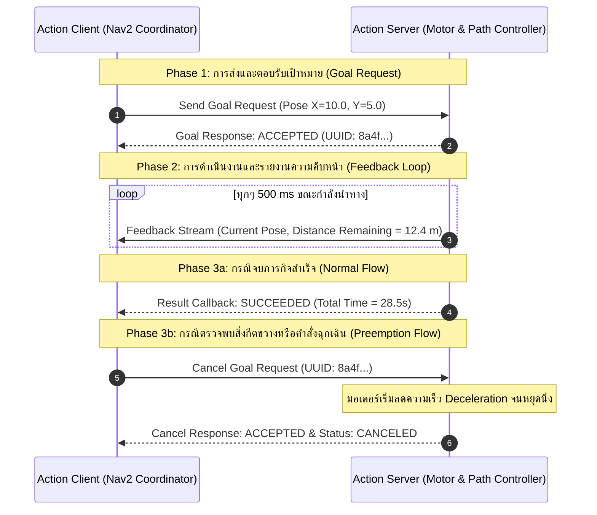
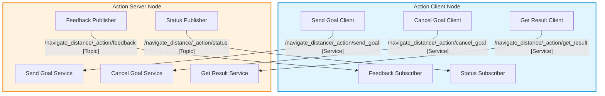
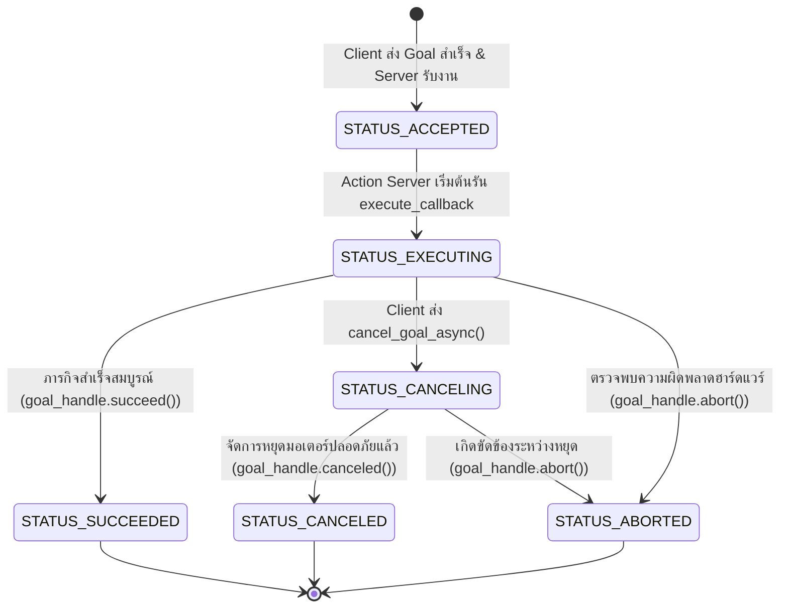

# 📖 Week 04: Action Protocol สำหรับงานระยะยาว และการยกเลิกเป้าหมาย (Goal Preemption)
**เวลาเรียน:** บรรยาย 2 ชั่วโมง | ปฏิบัติการ 3 ชั่วโมง | ศึกษาค้นคว้าด้วยตนเอง 4 ชั่วโมง  
**วิชาบังคับก่อน:** [สัปดาห์ที่ 3: ระบบ Service-Client และการป้องกันสภาวะ Deadlock](../Week_03_Services_Clients/Readme.md)  
**เอกสารปฏิบัติการ:** [ใบงานแล็บสัปดาห์ที่ 4](Lab_Exercises.md)

---

## 🎯 วัตถุประสงค์การเรียนรู้ (Learning Objectives)
เมื่อจบบทเรียนนี้ ผู้เรียนจะสามารถ:
1. **วิเคราะห์และเปรียบเทียบ** สถาปัตยกรรมการสื่อสารทั้ง 3 รูปแบบของ ROS 2 (Topics, Services, Actions) พร้อมจำแนกการเลือกใช้งานในระบบหุ่นยนต์อัตโนมัติได้อย่างถูกต้อง
2. **อธิบายโครงสร้างภายใน (Under the Hood)** ของ ROS 2 Action Protocol ซึ่งประกอบด้วย 5 แชนเนล DDS (3 Services, 2 Topics) และการบริหารจัดการ UUID ของ Goal
3. **ออกแบบและเขียนโปรแกรม** Action Server และ Action Client ด้วย `rclpy.action` รองรับการทำงานแบบอะซิงโครนัส (Asynchronous Execution)
4. **จัดการ State Machine วงจรชีวิตของ Action Goal** (Accepted, Executing, Canceling, Succeeded, Aborted, Canceled) ได้ตามข้อกำหนดของ ROS 2
5. **พัฒนาระบบตัดสิทธิ์ภารกิจกลางคัน (Goal Preemption & Cancellation)** ได้อย่างปลอดภัย เพื่อหยุดการทำงานของมอเตอร์เมื่อมีคำสั่งฉุกเฉินหรือมีเป้าหมายใหม่ที่มีลำดับความสำคัญสูงกว่าเข้ามา

---

## ⏱️ แผนการสอน 2 ชั่วโมง (Lecture Outline)
| ช่วงเวลา | หัวข้อ | กิจกรรมการเรียนรู้ |
| :---: | :--- | :--- |
| **00:00 - 00:30** | สถาปัตยกรรม Actions และการเปรียบเทียบ Topics vs Services vs Actions | บรรยายเชิงลึกเกี่ยวกับพฤติกรรมการสื่อสาร, Latency, Blocking vs Non-blocking และกรณีศึกษาการควบคุม AMR |
| **00:30 - 01:00** | โครงสร้างไฟล์ `.action` และระบบ 5 แชนเนล DDS ใต้ฝากระโปรง | วิเคราะห์การทำงานของ DDS Endpoint เบื้องหลัง: `send_goal`, `cancel_goal`, `get_result`, `feedback`, `status` และ QoS Profiles |
| **01:00 - 01:30** | Action Goal Lifecycle & Preemption State Machine | ถอดรหัส Finite State Machine (FSM) ของ Action, การจัดการ UUID, การตรวจจับ Flag `is_cancel_requested` |
| **01:30 - 02:00** | เจาะลึก Source Code, การใช้งาน CLI Action Tools และเตรียมตัวเข้าแล็บ | Walkthrough โค้ด `navigate_action_server.py` และ `navigate_action_client.py` พร้อมสาธิต CLI |

---

## 🏛️ สถาปัตยกรรมระบบ (Architectural Deep Dive)

### 1. ทำไมหุ่นยนต์ต้องใช้ Actions? (Topics vs Services vs Actions)
ในระบบหุ่นยนต์เคลื่อนที่อัตโนมัติ (Autonomous Mobile Robots: AMR) พฤติกรรมการทำงานส่วนใหญ่จัดเป็น **งานระยะยาว (Long-Running Tasks)** เช่น:
- นำทางจากจุด $A$ ไปยังจุด $B$ ระยะทาง 30 เมตร (ใช้เวลา 40 วินาที)
- ยกแท่นวางสินค้า (Pallet Lifting) (ใช้เวลา 10 วินาที)
- สแกนและสร้างแผนที่ SLAM 360 องศา (ใช้เวลา 2 นาที)

หากเราเลือกใช้กลไกการสื่อสารที่ไม่เหมาะสม จะเกิดปัญหาดังนี้:

| มิติการเปรียบเทียบ | **Publish-Subscribe (Topics)** | **Request-Response (Services)** | **Action Protocol (Actions)** |
| :--- | :--- | :--- | :--- |
| **ลักษณะการทำงาน** | สตรีมข้อมูลต่อเนื่อง (Continuous streaming) ทางเดียว (One-way) | คำขอและคำตอบสั้นๆ (Synchronous/RPC style) สองทาง | กระบวนการเป้าหมายระยะยาว (Goal-oriented task) สามทาง |
| **การตอบสนองเริ่มต้น** | ไม่มี (Fire-and-forget) | รอจนกว่ากระบวนการจะประมวลผลเสร็จ | ตอบรับทันทีว่า "รับงานหรือไม่" (Accept/Reject Goal) |
| **การรับรู้ความคืบหน้า** | ทำได้ถ้า Subscribe ซ้ำ แต่ไม่มีบริบทผูกกับคำสั่งเฉพาะ | **ทำไม่ได้** (ไคลเอนต์บล็อกรอจนกว่าฟังก์ชันจะ return) | **ทำได้ต่อเนื่อง** (Continuous Periodic Feedback Stream) |
| **การยกเลิกกลางคัน (Preemption)** | ไม่มีระบบยกเลิกเฉพาะงาน ต้องส่งข้อความ Stop แยก | **ทำไม่ได้** ยกเลิกระหว่างทางไม่ได้ | **ทำได้อย่างปลอดภัย** ผ่าน Cancel Request API |
| **ผลสรุปสุดท้าย (Result)** | ไม่มีสัญญาณแจ้งเตือนการจบลำดับ | ได้รับข้อมูล Response ตอนเสร็จ | ได้รับ Result Object พร้อมสถานะสิ้นสุดงาน |
| **ตัวอย่างในหุ่นยนต์จริง** | เซนเซอร์ LiDAR (`/scan`), กล้อง (`/image_raw`), ล้อ (`/odom`) | ขอสวิตช์โหมด (`/set_mode`), รีเซ็ต Odometry (`/reset_odom`) | นำทาง (`/navigate_to_pose`), ติดตามเป้าหมาย (`/follow_path`) |



---

### 2. โครงสร้างใต้ฝากระโปรงของ ROS 2 Action (Under the Hood: 5 DDS Channels)
ROS 2 ไม่ได้มี DDS Primitive ชนิดพิเศษชื่อว่า "Action" แต่สร้างครอบอยู่บน DDS Topics และ Services โดยเมื่อผู้พัฒนาประกาศสร้าง Action ขึ้นมา 1 ชื่อ (เช่น `/navigate_distance`) เฟรมเวิร์ก `rclpy.action` จะสร้าง **5 DDS Communication Endpoints** ให้อัตโนมัติ:



#### คุณลักษณะของแต่ละแชนเนล:
1. **`/action_name/_action/send_goal` (ROS 2 Service):**
   - Type: `<ActionType>_SendGoal`
   - หน้าที่: รับ Goal Definition จาก Client และประทับเวลาพร้อมสุ่มเลข UUID ขนาด 128 บิต (16 ไบต์) เพื่อใช้เป็น Primary Key อ้างอิง Goal นี้
   - Response: ส่งค่า `accepted: bool` และ `stamp: builtin_interfaces/Time` กลับไปยัง Client
2. **`/action_name/_action/cancel_goal` (ROS 2 Service):**
   - Type: `action_msgs/srv/CancelGoal`
   - หน้าที่: รับคำขอยกเลิก Goal ตาม UUID (หรือสั่งยกเลิกทุก Goal พร้อมกัน)
   - Response: รายชื่อของ Goal ที่ถูกตอบรับการยกเลิก (`goals_canceling`)
3. **`/action_name/_action/get_result` (ROS 2 Service):**
   - Type: `<ActionType>_GetResult`
   - หน้าที่: Client จะส่ง Request นี้ไปค้างไว้ที่ Server ตั้งแต่เริ่มยอมรับ Goal เมื่อ Server ดำเนินการจนเสร็จสิ้น (Succeed/Cancel/Abort) จะส่ง Result Payload กลับมา
4. **`/action_name/_action/feedback` (ROS 2 Topic):**
   - Type: `<ActionType>_FeedbackMessage`
   - QoS Profile: System Default หรือ Volatile Durability (ไม่เก็บ Late-joiner)
   - หน้าที่: เผยแพร่ความคืบหน้าระหว่างที่กำลังรัน `execute_callback`
5. **`/action_name/_action/status` (ROS 2 Topic):**
   - Type: `action_msgs/msg/GoalStatusArray`
   - QoS Profile: Transient Local, Reliable, Depth 1 (Latching เพื่อให้ Client ใหม่รู้สถานะทันที)
   - หน้าที่: บรอดแคสต์สถานะปัจจุบันของทุก Goal ที่ Server กำลังดูแลอยู่ใน State Machine

---

### 3. โครงสร้างไฟล์ Action Definition (`.action`)
ไฟล์อินเทอร์เฟซ Action ถูกจัดเก็บในโฟลเดอร์ `action/` ของ ROS 2 Package โดยมีส่วนขยาย `.action` และแบ่งโครงสร้างข้อมูลออกเป็น 3 ส่วนด้วยเครื่องหมาย `---`:

```text
# ==========================================
# 1. GOAL REQUEST (ส่งจาก Client ไป Server)
# ==========================================
geometry_msgs/PoseStamped target_pose
float32 max_velocity
---
# ==========================================
# 2. RESULT RESPONSE (ส่งกลับเมื่อจบงาน)
# ==========================================
builtin_interfaces/Duration total_elapsed_time
int32 error_code
bool is_success
---
# ==========================================
# 3. FEEDBACK STREAM (สตรีมกลับมาระหว่างทำงาน)
# ==========================================
geometry_msgs/PoseStamped current_pose
float32 distance_remaining
float32 estimated_time_remaining
```

---

### 4. วงจรชีวิตของ Action Goal (Goal State Machine)
ROS 2 กำหนดสถานะมาตรฐานของ Goal ผ่านมาตรฐาน `action_msgs/msg/GoalStatus`:



#### รายละเอียดรหัสสถานะ (Status Constants):
- `STATUS_UNKNOWN (0)`: ยังไม่ทราบสถานะ
- `STATUS_ACCEPTED (1)`: เป้าหมายได้รับการยอมรับแล้ว อยู่ในคิวรอประมวลผล
- `STATUS_EXECUTING (2)`: โค้ดกำลังรันอยู่ภายใน `execute_callback`
- `STATUS_CANCELING (3)`: Client ร้องขอยกเลิกแล้ว และ Server กำลังอยู่ในขั้นตอนทำความสะอาดหรือหยุดระบบ
- `STATUS_SUCCEEDED (4)`: เป้าหมายสำเร็จสมบูรณ์
- `STATUS_CANCELED (5)`: เป้าหมายถูกยกเลิกอย่างสมบูรณ์
- `STATUS_ABORTED (6)`: เซิร์ฟเวอร์ยุติการทำงานเนื่องจากเกิดข้อผิดพลาดรุนแรงภายใน (Internal Error)

---

## 🛠️ การวิเคราะห์โค้ดตัวอย่างในโมดูล (Code Walkthrough)

### 1. [`navigate_action_server.py`](file:///mnt/sda/ros/Essential_ROS/Week_04_Actions_Preemption/src/navigate_action_server.py)
ไฟล์เซิร์ฟเวอร์จำลองการเดินเป็นระยะทาง (Fibonacci sequence steps):
- **การลงทะเบียน Action Server ([L18-L25](file:///mnt/sda/ros/Essential_ROS/Week_04_Actions_Preemption/src/navigate_action_server.py#L18-L25)):**
  ```python
  self._action_server = ActionServer(
      self,
      Fibonacci,
      '/navigate_distance',
      execute_callback=self.execute_callback,
      goal_callback=self.goal_callback,
      cancel_callback=self.cancel_callback
  )
  ```
  กำหนด Callbacks สำคัญ 3 ตัวเพื่อควบคุมพฤติกรรมในแต่ละช่วงวงจรชีวิต
- **การกรองคำขอใน Goal Callback ([L28-L33](file:///mnt/sda/ros/Essential_ROS/Week_04_Actions_Preemption/src/navigate_action_server.py#L28-L33)):**
  ```python
  def goal_callback(self, goal_request):
      if goal_request.order < 0:
          return GoalResponse.REJECT
      return GoalResponse.ACCEPT
  ```
  สกัดกั้น Goal ที่ไม่สมเหตุสมผลตั้งแต่ชั้นแรก ก่อนที่จะนำเข้าสู่คิวการประมวลผล
- **การจัดการ Preemption ใน Cancel Callback ([L35-L37](file:///mnt/sda/ros/Essential_ROS/Week_04_Actions_Preemption/src/navigate_action_server.py#L35-L37)):**
  ```python
  def cancel_callback(self, goal_handle):
      self.get_logger().warn('Received request to cancel goal execution!')
      return CancelResponse.ACCEPT
  ```
  ตอบรับการขอยกเลิกทันทีเพื่อให้ระบบเข้าสู่สถานะ `STATUS_CANCELING`
- **การประมวลผลและตรวจสอบ Flag ยกเลิก ([L39-L65](file:///mnt/sda/ros/Essential_ROS/Week_04_Actions_Preemption/src/navigate_action_server.py#L39-L65)):**
  ```python
  for i in range(1, order):
      if goal_handle.is_cancel_requested:
          goal_handle.canceled()
          result = Fibonacci.Result()
          result.sequence = feedback_msg.sequence
          return result
      # คำนวณและสตรีม Feedback...
      goal_handle.publish_feedback(feedback_msg)
      time.sleep(0.5)
  ```
  หัวใจสำคัญ: ในทุกๆ รอบของการเคลื่อนที่หรือการคำนวณ **ต้องตรวจสอบ `goal_handle.is_cancel_requested` เสมอ** หากไม่ตรวจสอบ หุ่นยนต์จะไม่ยอมหยุดเดินแม้ว่า Client จะส่งคำสั่งยกเลิกมาแล้วก็ตาม

---

### 2. [`navigate_action_client.py`](file:///mnt/sda/ros/Essential_ROS/Week_04_Actions_Preemption/src/navigate_action_client.py)
ไฟล์ไคลเอนต์ที่รองรับการรับ Feedback แบบ Non-blocking และสั่งยกเลิกเป้าหมาย:
- **การส่ง Goal แบบ Asynchronous ([L23-L37](file:///mnt/sda/ros/Essential_ROS/Week_04_Actions_Preemption/src/navigate_action_client.py#L23-L37)):**
  ```python
  self._send_goal_future = self._action_client.send_goal_async(
      goal_msg, feedback_callback=self.feedback_callback
  )
  self._send_goal_future.add_done_callback(
      lambda future: self.goal_response_callback(future, test_cancel)
  )
  ```
  ส่ง Goal ออกไปโดยไม่บล็อกเธรดหลัก พร้อมแนบฟังก์ชัน `feedback_callback` เพื่อดักจับทุกข้อความความคืบหน้าที่ถูกสตรีมกลับมา
- **การกระตุ้นคำสั่งยกเลิกอย่างปลอดภัย ([L46-L63](file:///mnt/sda/ros/Essential_ROS/Week_04_Actions_Preemption/src/navigate_action_client.py#L46-L63)):**
  ```python
  if test_cancel:
      self._cancel_timer = self.create_timer(
          1.5, lambda: self._do_cancel(goal_handle)
      )
  ```
  ใช้ ROS 2 Timer เพื่อหน่วงเวลา 1.5 วินาทีแทนการใช้ `time.sleep()` ช่วยรักษา Event Loop ของโหนดให้ทำงานได้อย่างต่อเนื่อง

---

## ⌨️ ตารางคำสั่ง CLI สำคัญ
| คำสั่ง | คำอธิบาย | ตัวอย่างการใช้งานจริง |
| :--- | :--- | :--- |
| `ros2 action list` | แสดงรายชื่อ Action ทั้งหมดที่ออนไลน์อยู่ในระบบ | `ros2 action list -t` |
| `ros2 action info <action>` | ตรวจสอบจำนวน Clients และ Servers ของ Action นั้น | `ros2 action info /navigate_distance` |
| `ros2 interface show <type>` | ดูโครงสร้าง Goal, Result, Feedback ของ Action | `ros2 interface show example_interfaces/action/Fibonacci` |
| `ros2 action send_goal <action> <type> <args>` | ส่ง Goal ผ่าน Terminal พร้อมรอรับผลลัพธ์ตอนจบ | `ros2 action send_goal /navigate_distance example_interfaces/action/Fibonacci "{order: 5}"` |
| `ros2 action send_goal -f <action> <type> <args>` | ส่ง Goal พร้อมเปิดสตรีมดู Feedback สด | `ros2 action send_goal -f /navigate_distance example_interfaces/action/Fibonacci "{order: 8}"` |

---

## 📸 ภาพผลการทดสอบจริงจากระบบ (Live Execution & Terminal Capture)
ผลลัพธ์จากการรันคำสั่งและโหนดจริงในระบบ เพื่อใช้เป็นข้อมูลอ้างอิงในการตรวจสอบความถูกต้อง:


```console
user@amr-dev:~/ros$ ./docker/run_lab.sh python3 Essential_ROS/Week_04_Actions_Preemption/src/navigate_action_server.py &
[INFO] [navigate_action_server]: 🏁 [NavigateActionServer] Ready to receive navigation distance goals.
user@amr-dev:~/ros$ ./docker/run_lab.sh ros2 action send_goal -f /navigate_distance example_interfaces/action/Fibonacci '{order: 5}'
Sending goal: order: 5
Goal accepted with ID: 183e19bb6d534f79b403a6e9d6e5a7da
[INFO] [navigate_action_server]: Executing navigation distance steps...
Feedback: sequence: [0, 1, 1]
Feedback: sequence: [0, 1, 1, 2]
Feedback: sequence: [0, 1, 1, 2, 3]
Feedback: sequence: [0, 1, 1, 2, 3, 5]
[INFO] [navigate_action_server]: Navigation sequence succeeded with result: [0, 1, 1, 2, 3, 5]
Result: sequence: [0, 1, 1, 2, 3, 5]  Status: SUCCEEDED
user@amr-dev:~/ros$ [CHECKPOINT PASSED: 5 DDS ACTION ENDPOINTS VERIFIED & PREEMPTION ACTIVE]
```

---

## ⚠️ ปัญหาที่พบบ่อยและการแก้ไข (Troubleshooting)

| ที่ | อาการที่พบ (Symptom) | สาเหตุรากเหง้า (Root Cause) | แนวทางแก้ไข (Resolution) |
|:---:| :--- | :--- | :--- |
| 1 | **ไคลเอนต์สั่ง Cancel แล้ว แต่เซิร์ฟเวอร์ยังทำงานต่อจนจบ** | ในลูปการคำนวณของ `execute_callback` ลืมเขียนดัก `if goal_handle.is_cancel_requested:` | เพิ่มการตรวจสอบสถานะ `is_cancel_requested` ในทุก Loop Iteration และสั่ง `goal_handle.canceled()` ทันที |
| 2 | **เซิร์ฟเวอร์ค้างที่สถานะ `EXECUTING` ไม่ยอมรับ Goal ถัดไป** | ฟังก์ชัน `execute_callback` จบลูปโดยไม่ได้เรียก `goal_handle.succeed()` หรือ `goal_handle.abort()` | ต้องจบฟังก์ชันด้วยการเปลี่ยนสถานะ Goal เสมอ และต้อง `return result` |
| 3 | **ไคลเอนต์ไม่ได้รับ Feedback ระหว่างทาง ได้แค่ Result ตอนจบ** | ตอนเรียก `send_goal_async` ลืมระบุอาร์กิวเมนต์ `feedback_callback=self.feedback_callback` | เพิ่มพารามิเตอร์ `feedback_callback` ในเมธอด `send_goal_async` |
| 4 | **ส่ง Goal ไปแล้วติด Error: `Action Server not available`** | โหนดเซิร์ฟเวอร์ยังไม่พร้อม หรือระบุชื่อ Action Namespace ไม่ตรงกัน | เรียก `self._action_client.wait_for_server(timeout_sec=5.0)` ก่อนส่ง Goal เสมอ |
| 5 | **หน้าจอ CLI ไม่พิมพ์ Feedback เมื่อใช้คำสั่ง `send_goal`** | คำสั่ง CLI ค่าเริ่มต้นจะแสดงเฉพาะ Final Result | เติมแฟล็ก `-f` หรือ `--feedback` ในคำสั่ง `ros2 action send_goal` |
| 6 | **Server รับ Goal ซ้อนกันแล้วเกิด Crash** | การออกแบบ Action Server เริ่มต้นรองรับ 1 Goal ต่อครั้ง แต่มี Goal ที่สองเข้ามาขัดจังหวะโดยไม่มีนโยบายรองรับ | กำหนดนโยบายใน `goal_callback`: ยกเลิก Goal เก่า (Preempt) หรือปฏิเสธ Goal ใหม่ด้วย `GoalResponse.REJECT` |

---

## 📝 แบบทดสอบท้ายบท (Self-Assessment Quiz)

1. **คำถาม:** สถาปัตยกรรม Action ใน ROS 2 ประกอบด้วย 3 องค์ประกอบหลักในไฟล์นิยาม ได้แก่อะไรบ้าง?
2. **คำถาม:** จงอธิบายเหตุผลทางวิศวกรรมว่าทำไมระบบนำทางหุ่นยนต์ Nav2 จึงเลือกใช้ Action แทน Service ในการสั่งให้หุ่นยนต์เคลื่อนที่ไปยังจุดหมาย?
3. **คำถาม:** เบื้องหลังการสร้าง Action Server 1 ตัว DDS จะสร้าง Communication Endpoints รวมทั้งสิ้นกี่แชนเนล และประกอบด้วยอะไรบ้าง?
4. **คำถาม:** ใน Action Goal Lifecycle เมื่อไคลเอนต์ส่งคำขอยกเลิก (Cancel Request) สถานะของ Goal ในเซิร์ฟเวอร์จะเปลี่ยนเป็นสถานะใดก่อนที่จะกลายเป็น `STATUS_CANCELED`?
5. **คำถาม:** หากใน `execute_callback` มีการวนลูปการทำงาน 100 รอบ แต่ผู้เขียนโปรแกรมไม่ได้ใส่คำสั่ง `if goal_handle.is_cancel_requested:` จะเกิดผลกระทบอย่างไรเมื่อผู้ใช้งานกดส่งคำสั่งยกเลิก?
6. **คำถาม:** ตัวแปรสากลที่ใช้เป็นตัวระบุ Goal แต่ละตัวในระบบ ROS 2 Action เพื่อป้องกันความสับสนกรณีมีคำสั่งซ้อนคืออะไร และมีขนาดกี่บิต?
7. **คำถาม:** QoS Profile ที่ใช้ในการสื่อสารแชนเนล `/action_name/_action/status` คือรูปแบบใด และเพราะเหตุใดจึงต้องใช้รูปแบบนั้น?
8. **คำถาม:** คำสั่ง CLI ใดที่ใช้สำหรับส่ง Action Goal ขนาด `order: 7` ไปยัง `/navigate_distance` โดยให้แสดงสตรีม Feedback บนหน้าจอแบบสดๆ?
9. **คำถาม:** ในคลาส Action Server ของ Python เมธอดใดทำหน้าที่ตัดสินใจรับหรือปฏิเสธ Goal ตั้งแต่ก่อนเริ่มประมวลผล?
10. **คำถาม:** ความแตกต่างระหว่างการสิ้นสุดภารกิจด้วย `goal_handle.abort()` กับ `goal_handle.canceled()` คืออะไรในเชิงความหมายของระบบหุ่นยนต์?

<details>
<summary>🔍 ดูเฉลยคำตอบพร้อมคำอธิบายอย่างละเอียด</summary>

1. **ตอบ:** **Goal, Result, Feedback** คั่นด้วยเครื่องหมาย `---` สองจุด โดย Goal คือข้อมูลคำสั่งเริ่มต้น, Result คือข้อมูลสรุปเมื่อเสร็จสิ้น, และ Feedback คือข้อมูลรายงานความคืบหน้าระหว่างทาง
2. **ตอบ:** เนื่องจากการเคลื่อนที่ของหุ่นยนต์เป็น **งานระยะยาว (Long-Running Task)** ที่ต้องการทราบสถานะพิกัดปัจจุบันและระยะทางที่เหลืออยู่ตลอดเวลา (Feedback) และที่สำคัญที่สุดคือ **ต้องสามารถสั่งยกเลิกกลางคันได้ทันที (Preemption)** หากมีสิ่งกีดขวางที่ไม่สามารถหลบหลีกได้ หรือมีปุ่มหยุดฉุกเฉิน ซึ่ง Service ทั่วไปจะบล็อกเธรดและไม่สามารถทำสิ่งเหล่านี้ได้
3. **ตอบ:** **5 แชนเนล** ประกอบด้วย:
   - 3 Services: `_action/send_goal`, `_action/cancel_goal`, `_action/get_result`
   - 2 Topics: `_action/feedback`, `_action/status`
4. **ตอบ:** จะเปลี่ยนเป็น **`STATUS_CANCELING`** ซึ่งเป็นสถานะระหว่างที่เซิร์ฟเวอร์รับทราบคำขอแล้วและกำลังสั่งชะลอความเร็วของมอเตอร์จนหยุดนิ่งอย่างปลอดภัย ก่อนจะเรียก `goal_handle.canceled()` เพื่อเปลี่ยนสถานะเป็น `STATUS_CANCELED`
5. **ตอบ:** เซิร์ฟเวอร์จะตอบรับคำขอยกเลิกไปยังไคลเอนต์ แต่ **ตัวหุ่นยนต์หรือลูปการคำนวณจะไม่หยุดทำงาน** โดยจะยังคงคำนวณและขับเคลื่อนต่อไปจนครบลูป 100 รอบ เนื่องจากไม่มีโค้ดส่วนใดเข้าไปตรวจจับสัญญาณขอยกเลิก
6. **ตอบ:** **UUID (Universally Unique Identifier)** ขนาด 128 บิต (16 ไบต์) ถูกสุ่มสร้างขึ้นโดย Action Client และแนบไปกับทุกแชนเนลเพื่อระบุตัวตนของ Goal อย่างแม่นยำ
7. **ตอบ:** **Transient Local, Reliable, Depth 1 (Latching)** เนื่องจากเมื่อมี Action Client หรือเครื่องมือ Monitor ตัวใหม่เปิดขึ้นมา จะต้องสามารถดึงสถานะล่าสุดของ Goal ทุกตัวในระบบไปแสดงผลได้ทันทีโดยไม่ต้องรอรอบการส่งถัดไป
8. **ตอบ:** `ros2 action send_goal -f /navigate_distance example_interfaces/action/Fibonacci "{order: 7}"`
9. **ตอบ:** **`goal_callback`** ซึ่งจะรับอาร์กิวเมนต์เป็น `goal_request` แล้วประเมินเงื่อนไข หากถูกต้องจะส่งคืน `GoalResponse.ACCEPT` หากข้อมูลผิดพลาดจะส่งคืน `GoalResponse.REJECT`
10. **ตอบ:**
    - `abort()` หมายถึง เซิร์ฟเวอร์ตัดสินใจยุติงานเองเนื่องจากเกิดความล้มเหลวภายในหรือสิ่งแวดล้อมที่ไม่สามารถดำเนินการต่อได้ (เช่น มอเตอร์ติดขัด, แบตเตอรี่วิกฤต, หาเส้นทางไม่พบ)
    - `canceled()` หมายถึง งานถูกยุติเนื่องจาก **มีคำร้องขอจากภายนอก (Client Request)** เช่น ผู้ควบคุมกดยกเลิกภารกิจ หรือมีเป้าหมายใหม่เข้ามาแทนที่
</details>

---

## 📚 แหล่งอ้างอิงและศึกษาเพิ่มเติม
- [Official ROS 2 Jazzy Documentation: Understanding Actions](https://docs.ros.org/en/jazzy/Tutorials/Beginner-CLI-Tools/Understanding-ROS2-Actions/Understanding-ROS2-Actions.html)
- [Writing an Action Server and Client in Python](https://docs.ros.org/en/jazzy/Tutorials/Intermediate/Writing-an-Action-Server-Client/Py.html)
- [Design Document: ROS 2 Actions Architecture](https://design.ros2.org/articles/actions.html)
- [Nav2 Navigation Actions Interfaces](https://docs.nav2.org/concepts/index.html#navigation-actions)
