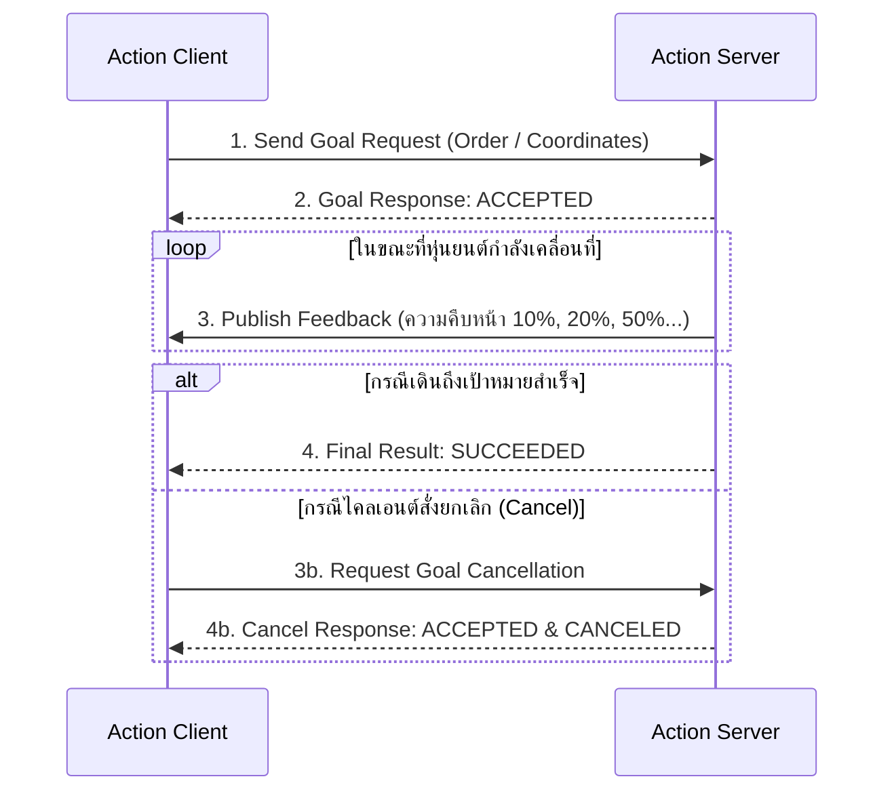
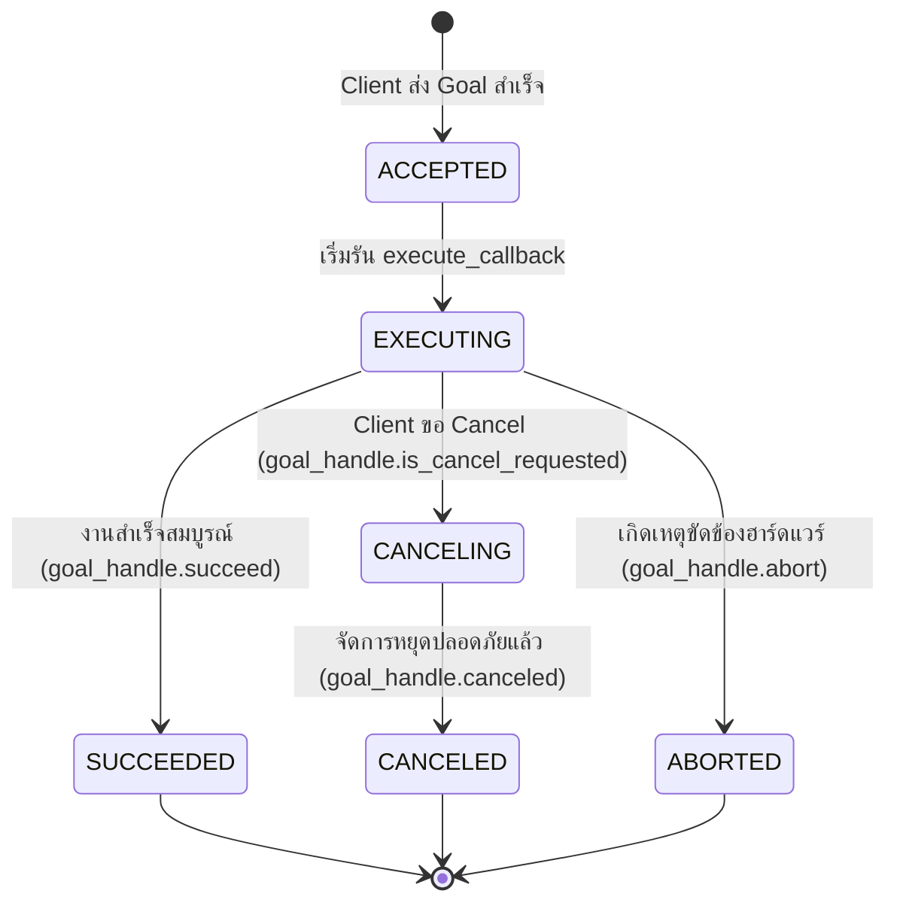

# 📖 Week 04: Action Protocol สำหรับงานระยะยาว และการยกเลิกเป้าหมาย (Goal Preemption)
**เวลาเรียน:** บรรยาย 2 ชั่วโมง | ปฏิบัติการ 3 ชั่วโมง | ศึกษาค้นคว้าด้วยตนเอง 4 ชั่วโมง  
**วิชาบังคับก่อน:** [สัปดาห์ที่ 3: ระบบ Service-Client และการป้องกันสภาวะ Deadlock](../Week_03_Services_Clients/Readme.md)  
**เอกสารปฏิบัติการ:** [ใบงานแล็บสัปดาห์ที่ 4](Lab_Exercises.md)

---

## 🎯 วัตถุประสงค์การเรียนรู้ (Learning Objectives)
เมื่อจบบทเรียนนี้ ผู้เรียนจะสามารถ:
1. อธิบายสถาปัตยกรรม **Action Protocol** และองค์ประกอบ 3 ส่วน (Goal, Feedback, Result)
2. วิเคราะห์ข้อจำกัดของ Services ในงานระยะยาว (Long-running Tasks) และเหตุผลที่ต้องใช้ Actions ในหุ่นยนต์
3. อธิบาย State Machine วงจรชีวิตของ Action Goal ตามมาตรฐาน ROS 2
4. พัฒนา Action Server และ Action Client ที่มีระบบรายงานความคืบหน้าระหว่างทาง (Continuous Feedback)
5. ออกแบบระบบยกเลิกเป้าหมายกลางคัน (**Goal Preemption / Cancellation**) อย่างปลอดภัย

---

## ⏱️ แผนการสอน 2 ชั่วโมง (Lecture Outline)
| ช่วงเวลา | หัวข้อ | กิจกรรมการเรียนรู้ |
| :---: | :--- | :--- |
| **00:00 - 00:30** | สถาปัตยกรรม Actions และเปรียบเทียบ Topics vs Services vs Actions | บรรยายพร้อมตารางเปรียบเทียบกลไกการสื่อสารทั้ง 3 รูปแบบใน ROS 2 |
| **00:30 - 01:00** | โครงสร้างไฟล์ `.action` และระบบ Service/Topic 5 แชนเนลภายใต้ Action | ถอดรหัสโครงสร้างใต้ฝากระโปรง (DDS Topics/Services ที่ซ่อนอยู่) |
| **01:00 - 01:30** | Action Goal Lifecycle & State Machine | วิเคราะห์สถานะ ACCEPTED, EXECUTING, CANCELING, SUCCEEDED, ABORTED |
| **01:30 - 02:00** | Code Walkthrough, CLI Action Commands และเตรียมตัวเข้าสู่ Lab | เจาะลึกโค้ด `navigate_action_server.py` และ `navigate_action_client.py` |

---

## 🏛️ สถาปัตยกรรมระบบ (Architectural Deep Dive)

### 1. ทำไมหุ่นยนต์ต้องใช้ Actions?
ในระบบหุ่นยนต์เคลื่อนที่ (AMR) ภารกิจส่วนใหญ่ต้องใช้เวลาในการทำงาน (Long-Running Tasks) เช่น การเดินข้ามโกดังระยะทาง 50 เมตร:
- **หากใช้ Topics:** ผู้ส่งไม่รู้ว่าหุ่นยนต์รับคำสั่งหรือไม่ และไม่รู้ว่างานเสร็จสิ้นเมื่อใด
- **หากใช้ Services:** ไคลเอนต์จะต้องรอคำตอบ (Blocking) นานหลายนาที และระหว่างนั้นไม่สามารถรู้เปอร์เซ็นต์ความคืบหน้า หรือสั่งหยุดกลางคันได้หากเจอสิ่งกีดขวาง
- **Actions คือคำตอบที่สมบูรณ์แบบ:** ผสมผสานคุณสมบัติเด่นของ Topics และ Services เข้าด้วยกัน:
  1. ส่งเป้าหมาย (Send Goal) และได้รับการตอบรับว่า Server รับหรือไม่รับทันที
  2. รายงานความคืบหน้าระหว่างทำงาน (Periodic Feedback Stream)
  3. สามารถขอยกเลิกภารกิจกลางคันได้ (Goal Preemption / Cancellation)
  4. สรุปผลลัพธ์สุดท้ายเมื่อภารกิจเสร็จสิ้น (Final Result)



---

### 2. โครงสร้างใต้ฝากระโปรงของ ROS 2 Action (Under the Hood)
เมื่อเราสร้าง Action Server ขึ้นมา 1 ตัว DDS จะสร้างช่องทางการสื่อสารเบื้องหลังให้ถึง **5 แชนเนล**:
1. `/action_name/_action/send_goal` (Service): ส่ง Goal และรับคำตอบยืนยันว่ารับงานหรือไม่
2. `/action_name/_action/cancel_goal` (Service): ส่งคำขอยกเลิกงาน
3. `/action_name/_action/get_result` (Service): ร้องขอผลลัพธ์สุดท้ายเมื่อภารกิจจบ
4. `/action_name/_action/feedback` (Topic): สตรีมข้อมูลความคืบหน้ากลับมายัง Client
5. `/action_name/_action/status` (Topic): แจกแจงสถานะของ Goal ปัจจุบันใน State Machine

---

### 3. โครงสร้างไฟล์ Action Definition (`.action`)
ไฟล์ `.action` จะแบ่งออกเป็น 3 ส่วน โดยคั่นด้วยเครื่องหมาย `---` สองจุด:
```text
# 1. Goal (ข้อมูลคำสั่งตั้งต้น)
int32 order
---
# 2. Result (ผลลัพธ์สรุปตอนจบงาน)
int32[] sequence
---
# 3. Feedback (ข้อมูลสตรีมรายงานความคืบหน้าระหว่างทาง)
int32[] sequence
```

---

### 4. วงจรชีวิตของ Action Goal (Goal State Machine)


---

## 🛠️ การวิเคราะห์โค้ดตัวอย่างในโมดูล (Code Walkthrough)

### 1. `navigate_action_server.py`
- โหนดนี้ลงทะเบียน 3 Callback สำคัญ:
  ```python
  self._action_server = ActionServer(
      self,
      Fibonacci,
      '/navigate_distance',
      execute_callback=self.execute_callback,
      goal_callback=self.goal_callback,
      cancel_callback=self.cancel_callback
  )
  ```
- ใน `goal_callback`: ตรวจสอบความถูกต้องของคำขอ หากติดลบจะตอบปฏิเสธด้วย `GoalResponse.REJECT`
- ใน `cancel_callback`: ตอบรับการขอยกเลิกด้วย `CancelResponse.ACCEPT`
- ใน `execute_callback`: ลูปประมวลผลระยะทาง โดยในแต่ละรอบจะตรวจสอบ `if goal_handle.is_cancel_requested:` เสมอ หากตรวจพบจะเรียก `goal_handle.canceled()` และออกจากฟังก์ชันทันที

### 2. `navigate_action_client.py`
- เชื่อมต่อกับ Action Server ผ่าน `ActionClient`
- รองรับโหมดทดสอบ Cancel ผ่าน CLI Argument:
  ```bash
  python3 navigate_action_client.py --cancel
  ```
- เมื่อสั่งโหมด Cancel ตัวนับเวลา (Timer) จะเริ่มนับถอยหลัง 1.5 วินาที แล้วส่งสัญญาณ `goal_handle.cancel_goal_async()` เพื่อทดสอบพฤติกรรม Preemption

---

## ⌨️ ตารางคำสั่ง CLI สำคัญ
| คำสั่ง | วัตถุประสงค์ | ตัวอย่างการใช้งาน |
| :--- | :--- | :--- |
| `ros2 action list -t` | แสดงรายชื่อ Actions ทั้งหมดในระบบพร้อม Action Type | `ros2 action list -t` |
| `ros2 action info <action>` | แสดงรายชื่อ Action Servers และ Clients ที่เชื่อมต่ออยู่ | `ros2 action info /navigate_distance` |
| `ros2 interface show <action>` | ดูโครงสร้าง Goal, Result, Feedback ของ Action | `ros2 interface show example_interfaces/action/Fibonacci` |
| `ros2 action send_goal <action> <type> <args>` | ส่ง Goal ผ่าน CLI พร้อมรอรับผลลัพธ์ | `ros2 action send_goal /navigate_distance example_interfaces/action/Fibonacci "{order: 5}"` |
| `ros2 action send_goal -f <action> ...` | ส่ง Goal พร้อมสั่งให้พิมพ์ Feedback ออกมาสดๆ | `ros2 action send_goal -f /navigate_distance example_interfaces/action/Fibonacci "{order: 7}"` |

---

## ⚠️ ปัญหาที่พบบ่อยและการแก้ไข (Troubleshooting)
| อาการ | สาเหตุที่เป็นไปได้ | วิธีแก้ไข |
| :--- | :--- | :--- |
| สั่ง Cancel แล้ว Server ไม่ยอมหยุด | ในลูปของ `execute_callback` ลืมเขียนเช็ค `goal_handle.is_cancel_requested` | เพิ่มเงื่อนไขตรวจสอบทุกๆ รอบการวนลูปการเคลื่อนที่ |
| Action Server ค้างไม่ยอมรับ Goal ใหม่ | `execute_callback` ไม่ได้เรียก `goal_handle.succeed()` หรือ `goal_handle.canceled()` ในตอนจบ | ต้องเรียกเมธอดเปลี่ยนสถานะปิดจ็อบเสมอ |
| Feedback ไม่แสดงผลใน CLI | ลืมใส่แฟล็ก `-f` หรือ `--feedback` ในคำสั่ง `ros2 action send_goal` | เติม `-f` ในคำสั่ง CLI |

---

## 📝 แบบทดสอบท้ายบท (Self-Assessment Quiz)
1. องค์ประกอบ 3 ส่วนของ Action Definition ได้แก่อะไรบ้าง?
2. เหตุใดระบบนำทาง Nav2 ของหุ่นยนต์ AMR จึงใช้ Action แทน Service ในการส่งเป้าหมายการเดิน?
3. เมื่อ Action Server ได้รับคำขอยกเลิกภารกิจ สถานะของ Goal จะเปลี่ยนเป็นอะไรก่อนจะกลายเป็น `CANCELED`?
4. เบื้องหลังของ ROS 2 Action มีการสร้าง Topic และ Service รวมกันทั้งหมดกี่แชนเนล?
5. คำสั่ง CLI ใดใช้สำหรับส่ง Goal ขนาด `order: 6` พร้อมสั่งให้แสดงผล Feedback ออกมาทางหน้าจอ?

<details>
<summary>🔍 ดูเฉลยคำตอบ</summary>

1. **ตอบ:** Goal (ข้อมูลเป้าหมาย), Result (ผลลัพธ์สุดท้ายเมื่อจบงาน), และ Feedback (ข้อมูลรายงานความคืบหน้าระหว่างทาง)
2. **ตอบ:** เพราะการนำทางเป็นงานระยะยาว ต้องการทราบความคืบหน้าและระยะทางที่เหลืออยู่ตลอดเวลา (Feedback) และต้องสามารถยกเลิกได้ทันทีหากมีสิ่งกีดขวางหรือคำสั่งฉุกเฉิน (Preemption)
3. **ตอบ:** สถานะจะเปลี่ยนเป็น `CANCELING` ในระหว่างที่เซิร์ฟเวอร์กำลังสั่งเบรกมอเตอร์อย่างปลอดภัย ก่อนจะเปลี่ยนเป็น `CANCELED` เมื่อหยุดสนิท
4. **ตอบ:** 5 แชนเนล (3 Services: send_goal, cancel_goal, get_result และ 2 Topics: feedback, status)
5. **ตอบ:** `ros2 action send_goal -f /navigate_distance example_interfaces/action/Fibonacci "{order: 6}"`
</details>

---

## 📚 แหล่งอ้างอิงและศึกษาเพิ่มเติม
- [About ROS 2 Actions Architecture](https://docs.ros.org/en/jazzy/Concepts/Intermediate/About-Actions.html)
- [Writing an Action Server and Client (Python)](https://docs.ros.org/en/jazzy/Tutorials/Intermediate/Writing-an-Action-Server-Client/Py.html)
- [Nav2 Action Interfaces Documentation](https://docs.nav2.org/)
