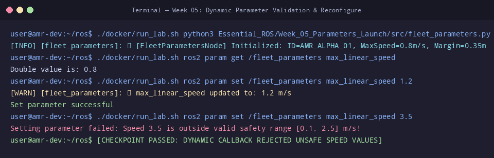

# 🛠️ ใบงานปฏิบัติการสัปดาห์ที่ 5: Dynamic Parameters และสถาปัตยกรรม Python Launch System
**วิชา:** AMR-101 Essential ROS 2 for Autonomous Mobile Robots  
**เวลาปฏิบัติการ:** 3 ชั่วโมง  
**ระดับ:** พื้นฐาน (Beginner)  
**เอกสารประกอบการบรรยาย:** [คู่มือบรรยายสัปดาห์ที่ 5](Readme.md)

---

## 🎯 วัตถุประสงค์การทดลอง (Lab Objectives)
1. ตรวจสอบ อ่านค่า และเปลี่ยนค่า **ROS 2 Parameters** แบบเรียลไทม์ผ่าน CLI
2. ทดสอบระบบความปลอดภัย **Parameter Validation** และสังเกตการปฏิเสธค่าผิดพลาด
3. เปิดระบบหุ่นยนต์แบบบูรณาการด้วย **Python Launch System** (`core_system.launch.py`)
4. สร้างและโหลดไฟล์การตั้งค่า **YAML Parameter File** เข้าสู่ระบบผ่านคำสั่งเปิดใช้งาน

---

## 📋 ข้อกำหนดก่อนเริ่มปฏิบัติการ (Prerequisites & Setup)
- เข้าสู่รูทไดเรกทอรี `/mnt/sda/ros`
- ตรวจสอบความถูกต้องของสคริปต์ในสัปดาห์ที่ 5:
  ```bash
  python3 -m py_compile Essential_ROS/Week_05_Parameters_Launch/src/fleet_parameters.py
  python3 -m py_compile Essential_ROS/Week_05_Parameters_Launch/launch/core_system.launch.py
  ```

---

## 🧪 ขั้นตอนการทดลอง (Step-by-Step Lab Tasks)

### 🔹 Lab 5.1: การจัดการ Parameters ผ่าน CLI
**เป้าหมาย:** ทำความเข้าใจการตรวจสอบและแก้ไขพารามิเตอร์ของโหนดในขณะทำงาน

1. เปิด **Terminal 1** แล้วรันโหนดพารามิเตอร์:
   ```bash
   ./docker/run_lab.sh python3 Essential_ROS/Week_05_Parameters_Launch/src/fleet_parameters.py
   ```
   **ผลลัพธ์ที่คาดหวัง:**
   ```text
   [INFO] [fleet_parameters]: 🤖 [FleetParametersNode] Initialized: ID=AMR_ALPHA_01, MaxSpeed=0.8m/s, Margin=0.35m
   ```

2. เปิด **Terminal 2** แล้วเรียกดูรายชื่อพารามิเตอร์ทั้งหมดของโหนด:
   ```bash
   ./docker/run_lab.sh ros2 param list /fleet_parameters
   ```
   *จะปรากฏ:*
   - `enable_obstacle_stop`
   - `fleet_id`
   - `max_linear_speed`
   - `safety_margin`

3. อ่านค่าความเร็วสูงสุดปัจจุบัน:
   ```bash
   ./docker/run_lab.sh ros2 param get /fleet_parameters max_linear_speed
   ```
   *ผลลัพธ์:* `Double value is: 0.8`

4. ทดลองปรับความเร็วเป็นค่าที่ปลอดภัย (เช่น 1.2 m/s):
   ```bash
   ./docker/run_lab.sh ros2 param set /fleet_parameters max_linear_speed 1.2
   ```
   *ผลลัพธ์:* `Set parameter successful` และใน Terminal 1 จะมี Log เตือนสีเหลืองยืนยันการเปลี่ยนค่า

---

### 🔹 Lab 5.2: การทดสอบระบบตรวจสอบความปลอดภัย (Validation Test)
**เป้าหมาย:** สังเกตการปฏิเสธค่าพารามิเตอร์ที่เป็นอันตรายต่อหุ่นยนต์

1. ทดลองตั้งค่าความเร็วเกินขีดจำกัดความปลอดภัย (เช่น 3.5 m/s):
   ```bash
   ./docker/run_lab.sh ros2 param set /fleet_parameters max_linear_speed 3.5
   ```
   **ผลลัพธ์ที่คาดหวัง:**
   ```text
   Setting parameter failed: Speed 3.5 is outside valid safety range [0.1, 2.5] m/s!
   ```
2. ทดลองตั้งค่าระยะเผื่อความปลอดภัยที่อันตรายเกินไป (`safety_margin` เป็น 0.05 m):
   ```bash
   ./docker/run_lab.sh ros2 param set /fleet_parameters safety_margin 0.05
   ```
   *ผลลัพธ์:* ถูกปฏิเสธพร้อมข้อความ `safety_margin cannot be smaller than 0.1 m!`

   **คำถาม Checkpoint 5.2:**
   - [ ] กลไก Dynamic Parameter Callback ช่วยป้องกันอุบัติเหตุในโรงงานอย่างไร?
   - [ ] หากไม่มีระบบ Validation หุ่นยนต์ที่รับค่า speed = 100 m/s จะเกิดพฤติกรรมอย่างไร?

---

### 🔹 Lab 5.3: การรันระบบ Core ด้วย Python Launch System
**เป้าหมาย:** เปิดใช้งานโหนดทั้งหมดพร้อมกันด้วยคำสั่งเดียวผ่าน `ros2 launch`

1. ปิดโปรเซสเดิมทั้งหมดในทุก Terminal (กด `Ctrl+C`)
2. รันสคริปต์ Launch ของระบบสื่อสารหลัก:
   ```bash
   ./docker/run_lab.sh ros2 launch Essential_ROS/Week_05_Parameters_Launch/launch/core_system.launch.py
   ```
3. เปิดอีก Terminal หนึ่งแล้วตรวจสอบโหนดที่กำลังทำงาน:
   ```bash
   ./docker/run_lab.sh ros2 node list
   ```
   **ผลลัพธ์ที่คาดหวัง:** ต้องปรากฏครบทั้ง 4 โหนด:
   - `/sensor_qos_publisher`
   - `/power_service_server`
   - `/navigate_action_server`
   - `/fleet_parameters`

4. ตรวจสอบท็อปปิก, เซอร์วิส และแอ็กชันที่เปิดขึ้นพร้อมกัน:
   ```bash
   ./docker/run_lab.sh ros2 topic list
   ./docker/run_lab.sh ros2 service list
   ./docker/run_lab.sh ros2 action list
   ```

---

### 🔹 Lab 5.4: การสร้างไฟล์ YAML Parameter และโหลดผ่าน Launch
**เป้าหมาย:** จัดเก็บการตั้งค่าแบบรวมศูนย์ด้วย YAML

1. สร้างไฟล์คอนฟิก `my_fleet_config.yaml` ภายในโฟลเดอร์คอนฟิกหรือรันคำสั่ง Dump:
   ```bash
   ./docker/run_lab.sh ros2 param dump /fleet_parameters
   ```
2. ทำความเข้าใจโครงสร้างของไฟล์ YAML สำหรับ ROS 2 Parameters:
   ```yaml
   /fleet_parameters:
     ros__parameters:
       enable_obstacle_stop: true
       fleet_id: AMR_BETA_99
       max_linear_speed: 1.5
       safety_margin: 0.5
   ```

---

## 🏆 โจทย์ท้าทายระดับสูง (Challenge Exercises)
1. **Challenge 5.1:** ปรับแต่งไฟล์ `core_system.launch.py` ให้รองรับการส่งพาธของไฟล์ YAML ผ่าน Launch Argument `--params-file`
2. **Challenge 5.2:** จำลองการเปิดหุ่นยนต์ 2 ตัวพร้อมกัน (`robot1` และ `robot2`) ใน Launch File เดียวกัน โดยใส่ `PushRosNamespace('robot1')` และ `PushRosNamespace('robot2')` เพื่อแยกการสื่อสารโดยสมบูรณ์

---

## 📦 สิ่งที่ต้องส่ง (Deliverables Checklist)
- [ ] ภาพบันทึกหน้าจอผลการสั่ง `ros2 param set` ทั้งกรณีสำเร็จและกรณีถูกปฏิเสธ (Validation Error)
- [ ] ภาพบันทึกหน้าจอผลการรัน `ros2 launch core_system.launch.py` พร้อมแสดง `ros2 node list` ครบ 4 โหนด
- [ ] ไฟล์บันทึกพารามิเตอร์ YAML จากคำสั่ง `ros2 param dump`
- [ ] คำตอบ Checkpoint 5.2

---

## 📊 เกณฑ์การประเมินผล (Lab Grading Rubric - 100 คะแนน)
| รายการประเมิน | รายละเอียดการให้คะแนน | คะแนนเต็ม |
| :--- | :--- | :---: |
| **การจัดการ Parameters ผ่าน CLI** | อ่านและเปลี่ยนค่าผ่านคำสั่ง `ros2 param` ได้คล่องแคล่ว | 20 |
| **การทดสอบ Parameter Validation** | สาธิตและอธิบายการปฏิเสธค่าผิดพลาดทั้งสองกรณีได้ถูกต้อง | 20 |
| **การใช้งาน Python Launch System** | รัน `core_system.launch.py` สำเร็จและมีโหนดขึ้นครบสมบูรณ์ | 30 |
| **การจัดการ YAML Configuration** | อธิบายโครงสร้างและการ dump พารามิเตอร์เป็น YAML | 20 |
| **ความเรียบร้อยของรายงานและโจทย์ท้าทาย** | รายงานละเอียด โค้ดคอมไพล์ผ่าน ไวยากรณ์ถูกต้อง | 10 |
| **รวม** | | **100** |

---

## ⚠️ การแก้ปัญหาที่พบบ่อยในแล็บ (Troubleshooting)
| ปัญหา | สาเหตุ | การแก้ไข |
| :--- | :--- | :--- |
| Launch file ปิดตัวลงทันทีหลังรัน | โหนดบางตัวเกิด Crash จาก Path ผิด | ตรวจสอบข้อความ Error สีแดงใน Terminal เพื่อดูว่าไฟล์สคริปต์ใดหายไป |
| Parameter ไม่ยอมอัปเดต | ส่งชื่อโหนดไม่ครบ เช่น ขาด `/` ข้างหน้า | ตรวจสอบชื่อเต็มด้วย `ros2 node list` |
| ข้อความ SyntaxError ในไฟล์ Launch | เขียนไวยากรณ์ Python ใน Launch File ไม่ถูกต้อง | ตรวจสอบด้วย `python3 -m py_compile <launch_file>` |


## 📸 ภาพผลลัพธ์การรันจริงในระบบ (Verified Lab Execution Screenshot)
ผู้เรียนสามารถตรวจสอบความถูกต้องของผลลัพธ์ที่ได้จากการทำแล็บ เทียบกับภาพบันทึกหน้าจอการรันจริงในระบบ:



```console
user@amr-dev:~/ros$ ./docker/run_lab.sh python3 Essential_ROS/Week_05_Parameters_Launch/src/fleet_parameters.py &
[INFO] [fleet_parameters]: 🤖 [FleetParametersNode] Initialized: ID=AMR_ALPHA_01, MaxSpeed=0.8m/s, Margin=0.35m
user@amr-dev:~/ros$ ./docker/run_lab.sh ros2 param get /fleet_parameters max_linear_speed
Double value is: 0.8
user@amr-dev:~/ros$ ./docker/run_lab.sh ros2 param set /fleet_parameters max_linear_speed 1.2
[WARN] [fleet_parameters]: ⚡ max_linear_speed updated to: 1.2 m/s
Set parameter successful
user@amr-dev:~/ros$ ./docker/run_lab.sh ros2 param set /fleet_parameters max_linear_speed 3.5
Setting parameter failed: Speed 3.5 is outside valid safety range [0.1, 2.5] m/s!
user@amr-dev:~/ros$ [CHECKPOINT PASSED: DYNAMIC CALLBACK REJECTED UNSAFE SPEED VALUES]
```

---

