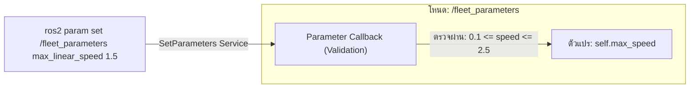
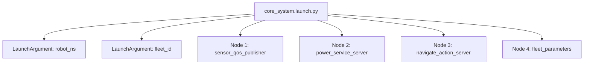

# 📖 Week 05: Dynamic Parameters และสถาปัตยกรรม Python Launch System
**เวลาเรียน:** บรรยาย 2 ชั่วโมง | ปฏิบัติการ 3 ชั่วโมง | ศึกษาค้นคว้าด้วยตนเอง 4 ชั่วโมง  
**วิชาบังคับก่อน:** [สัปดาห์ที่ 4: Action Protocol สำหรับงานระยะยาว และการยกเลิกเป้าหมาย](../Week_04_Actions_Preemption/Readme.md)  
**เอกสารปฏิบัติการ:** [ใบงานแล็บสัปดาห์ที่ 5](Lab_Exercises.md)

---

## 🎯 วัตถุประสงค์การเรียนรู้ (Learning Objectives)
เมื่อจบบทเรียนนี้ ผู้เรียนจะสามารถ:
1. ประกาศ อ่านค่า และปรับแต่ง **ROS 2 Parameters** ในภาษา Python (`rclpy`)
2. วางระบบตรวจสอบความปลอดภัยของค่าคอนฟิกแบบเรียลไทม์ผ่าน **Dynamic Parameter Callbacks**
3. ออกแบบและเขียนสคริปต์ **Python Launch Files** สำหรับเปิดระบบหุ่นยนต์อัตโนมัติหลายโหนดพร้อมกัน
4. จัดการอาร์กิวเมนต์ (`DeclareLaunchArgument`), สภาพแวดล้อม และเนมสเปซ (`robot_ns`) สำหรับฝูงหุ่นยนต์ (Multi-Robot Fleet)
5. สร้างไฟล์การตั้งค่าแบบรวมศูนย์ด้วยมาตรฐาน **YAML Parameter Files**

---

## ⏱️ แผนการสอน 2 ชั่วโมง (Lecture Outline)
| ช่วงเวลา | หัวข้อ | กิจกรรมการเรียนรู้ |
| :---: | :--- | :--- |
| **00:00 - 00:30** | พารามิเตอร์ใน ROS 2 (Node-Level Configuration) และประเภทข้อมูล | บรรยายเปรียบเทียบ Parameter Server ใน ROS 1 vs Individual Parameter ใน ROS 2 |
| **00:30 - 01:00** | Dynamic Parameter Callbacks & Validation Rules | เขียนตรรกะการดักจับค่าใหม่ด้วย `add_on_set_parameters_callback` |
| **01:00 - 01:30** | สถาปัตยกรรม Python Launch System และ Launch Actions | วิเคราะห์คลาส `LaunchDescription`, `Node`, `ExecuteProcess`, `IncludeLaunchDescription` |
| **01:30 - 02:00** | Multi-Robot Namespacing, YAML Loading และเตรียมตัวเข้าสู่ Lab | สาธิตการกำหนดเนมสเปซและการนำเข้าพารามิเตอร์จากไฟล์ YAML |

---

## 🏛️ สถาปัตยกรรมระบบ (Architectural Deep Dive)

### 1. วิวัฒนาการของระบบ Parameters: จาก ROS 1 สู่ ROS 2
- **ROS 1:** พารามิเตอร์ถูกเก็บไว้ที่ศูนย์กลางใน `roscore` (Parameter Server) หาก Master ล่ม ข้อมูลคอนฟิกทั้งหมดจะหาย และไม่สามารถแจ้งเตือนโหนดเมื่อค่าเปลี่ยนได้ง่าย
- **ROS 2:** พารามิเตอร์เป็นคุณสมบัติเฉพาะตัวของ **แต่ละโหนด (Node-Level)**:
  - แต่ละโหนดเป็นเจ้าของพารามิเตอร์ของตนเอง
  - มีประเภทข้อมูลที่ชัดเจน (Strongly Typed): `STRING`, `DOUBLE`, `INTEGER`, `BOOL`, `BYTE_ARRAY`
  - สามารถเปลี่ยนค่าได้แบบ Real-Time ขณะโหนดกำลังทำงานอยู่ (On-the-fly reconfigure)



---

### 2. การตรวจสอบความปลอดภัยด้วย Dynamic Parameter Callbacks
ในงานหุ่นยนต์อุตสาหกรรม การปล่อยให้ผู้ใช้งานหรือระบบอื่นเปลี่ยนค่าพารามิเตอร์โดยไม่มีการตรวจสอบ (Sanity Check) อาจทำให้หุ่นยนต์พุ่งชนคนหรือพลิกคว่ำได้:
- ใช้เมธอด `self.add_on_set_parameters_callback(self.parameters_callback)`
- ฟังก์ชัน Callback จะได้รับรายการพารามิเตอร์ที่ต้องการเปลี่ยน (`params`)
- ต้องส่งกลับอ็อบเจกต์ `SetParametersResult`:
  - `result.successful = True`: ยอมรับค่าใหม่
  - `result.successful = False` พร้อมระบุ `result.reason`: ปฏิเสธค่าใหม่และคงค่าเดิมไว้

---

### 3. สถาปัตยกรรม Python Launch System
Launch System ใน ROS 2 ถูกพัฒนาขึ้นใหม่ทั้งหมดด้วยภาษา Python บริสุทธิ์ (Pure Python):
- ยืดหยุ่นกว่า XML แบบเดิม: สามารถใช้เงื่อนไข `if-else`, ลูป `for`, และการคำนวณทางคณิตศาสตร์ได้
- อ็อบเจกต์สำคัญ:
  - `LaunchDescription`: คอนเทนเนอร์เก็บ Action ทั้งหมดที่จะถูกประมวลผล
  - `DeclareLaunchArgument`: ประกาศตัวแปรรับค่าผ่าน Command Line (เช่น `robot_ns:=AMR_01`)
  - `Node` / `ExecuteProcess`: คำสั่งเปิดโปรเซสโหนดพร้อมส่งพารามิเตอร์และแมปปิ้งท็อปปิก
  - `IncludeLaunchDescription`: รวมไฟล์ Launch อื่นเข้ามาต่อยอดแบบ Modular



---

## 🛠️ การวิเคราะห์โค้ดตัวอย่างในโมดูล (Code Walkthrough)

### 1. `fleet_parameters.py`
- ประกาศพารามิเตอร์เริ่มต้น:
  ```python
  self.declare_parameter('fleet_id', 'AMR_ALPHA_01')
  self.declare_parameter('max_linear_speed', 0.8)
  self.declare_parameter('safety_margin', 0.35)
  ```
- ใน `parameters_callback(self, params)`:
  - ตรวจสอบความถูกต้องของความเร็วสูงสุด: ต้องอยู่ในช่วง $[0.1, 2.5]$ เมตร/วินาที หากอยู่นอกช่วงจะปฏิเสธคำขอทันที
  - ตรวจสอบระยะเผื่อความปลอดภัย: ต้องมีค่าไม่ต่ำกว่า $0.1$ เมตร

### 2. `core_system.launch.py`
- จัดการเปิดโหนดสื่อสารพื้นฐานทั้งหมดของหุ่นยนต์ AMR ในคำสั่งเดียว
- รองรับการส่ง `fleet_id` และ `robot_ns` สำหรับระบบหลายตัว

---

## ⌨️ ตารางคำสั่ง CLI สำคัญ
| คำสั่ง | วัตถุประสงค์ | ตัวอย่างการใช้งาน |
| :--- | :--- | :--- |
| `ros2 param list` | แสดงรายชื่อพารามิเตอร์ของทุกโหนดในระบบ | `ros2 param list` |
| `ros2 param get <node> <param>` | อ่านค่าปัจจุบันของพารามิเตอร์ | `ros2 param get /fleet_parameters max_linear_speed` |
| `ros2 param set <node> <param> <val>` | เปลี่ยนค่าพารามิเตอร์แบบเรียลไทม์ | `ros2 param set /fleet_parameters max_linear_speed 1.2` |
| `ros2 param dump <node>` | บันทึกค่าพารามิเตอร์ปัจจุบันของโหนดออกมาเป็น YAML | `ros2 param dump /fleet_parameters` |
| `ros2 launch <pkg/file> [args]` | รันไฟล์ Launch System | `ros2 launch Essential_ROS/Week_05_Parameters_Launch/launch/core_system.launch.py` |

---

## ⚠️ ปัญหาที่พบบ่อยและการแก้ไข (Troubleshooting)
| อาการ | สาเหตุที่เป็นไปได้ | วิธีแก้ไข |
| :--- | :--- | :--- |
| `ros2 param set` ถูกปฏิเสธ (Parameter rejected) | ค่าที่ส่งเข้าไปอยู่นอกช่วงความปลอดภัยที่กำหนดไว้ใน Callback | ตรวจสอบข้อความเตือนใน log หรือใน parameter callback logic |
| ชนิดตัวแปรพารามิเตอร์ไม่ตรง (Wrong Type) | ส่งตัวเลขจำนวนเต็มเข้าพารามิเตอร์ชนิด double (เช่น ใส่ 1 แทน 1.0) | ใส่จุดทศนิยมเสมอ เช่น `1.0` สำหรับ Floating point |
| Launch file แจ้งหาไฟล์สคริปต์โหนดไม่พบ | เส้นทาง Path ใน Launch File ไม่ถูกต้อง | ใช้ `os.path.join(os.path.dirname(...))` เพื่อสร้าง Relative Path ที่ยืดหยุ่น |

---

## 📝 แบบทดสอบท้ายบท (Self-Assessment Quiz)
1. พารามิเตอร์ใน ROS 2 แตกต่างจาก ROS 1 ในเชิงสถาปัตยกรรมอย่างไร?
2. เมธอดใดที่ใช้สำหรับลงทะเบียนฟังก์ชันดักฟังและตรวจสอบการเปลี่ยนค่าพารามิเตอร์ใน `rclpy`?
3. หากผู้ใช้รัน `ros2 param set /fleet_parameters max_linear_speed 4.0` ผลลัพธ์จะเป็นอย่างไรตามโค้ดของโหนด?
4. คลาสใดใน ROS 2 Launch ทำหน้าที่ประกาศรับตัวแปร Argument จากภายนอก?
5. ทำไมการออกแบบระบบหุ่นยนต์จริงจึงควรแยกไฟล์คอนฟิกออกเป็น YAML แทนการฮาร์ดโค้ดลงในสคริปต์?

<details>
<summary>🔍 ดูเฉลยคำตอบ</summary>

1. **ตอบ:** ROS 1 ใช้ Parameter Server แบบรวมศูนย์ใน roscore ส่วน ROS 2 แต่ละโหนดเป็นเจ้าของพารามิเตอร์ตนเองแบบกระจายศูนย์ และรองรับ Dynamic Notifications
2. **ตอบ:** `self.add_on_set_parameters_callback(...)`
3. **ตอบ:** คำขอจะถูกปฏิเสธ (Rejected) เนื่องจากค่า 4.0 m/s เกินขอบเขตความปลอดภัย [0.1, 2.5] m/s ที่กำหนดไว้ใน Callback
4. **ตอบ:** `DeclareLaunchArgument`
5. **ตอบ:** เพื่อความสะดวกในการบำรุงรักษาและการเปลี่ยนฮาร์ดแวร์โดยไม่ต้องแก้ไขหรือคอมไพล์โค้ดใหม่ และสามารถแยกคอนฟิกตามรุ่นของหุ่นยนต์ได้ชัดเจน
</details>

---

## 📚 แหล่งอ้างอิงและศึกษาเพิ่มเติม
- [About ROS 2 Parameters](https://docs.ros.org/en/jazzy/Concepts/Intermediate/About-Parameters.html)
- [ROS 2 Launch Architecture Guide](https://docs.ros.org/en/jazzy/Tutorials/Intermediate/Launch/Launch-Main.html)
- [Using YAML Files for Parameters](https://docs.ros.org/en/jazzy/Tutorials/Intermediate/Launch/Using-ROS2-Launch-For-Large-Projects.html)
