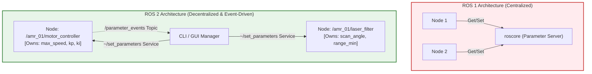
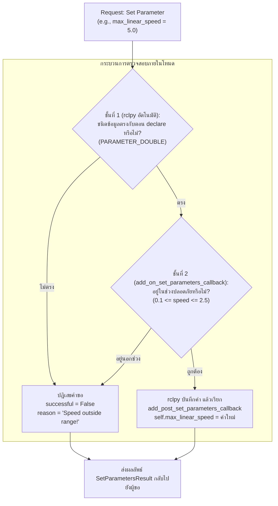
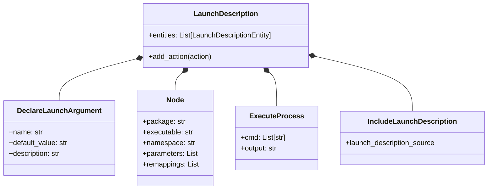

# 📖 Week 05: Dynamic Parameters และสถาปัตยกรรม Python Launch System
**เวลาเรียน:** บรรยาย 2 ชั่วโมง | ปฏิบัติการ 3 ชั่วโมง | ศึกษาค้นคว้าด้วยตนเอง 4 ชั่วโมง  
**วิชาบังคับก่อน:** [สัปดาห์ที่ 4: Action Protocol สำหรับงานระยะยาว และการยกเลิกเป้าหมาย](../Week_04_Actions_Preemption/Readme.md)  
**เอกสารปฏิบัติการ:** [ใบงานแล็บสัปดาห์ที่ 5](Lab_Exercises.md)

---

## 🎯 วัตถุประสงค์การเรียนรู้ (Learning Objectives)
เมื่อจบบทเรียนนี้ ผู้เรียนจะสามารถ:
1. **อธิบายสถาปัตยกรรมพารามิเตอร์ระดับโหนด (Node-Level Parameters)** ใน ROS 2 และเปรียบเทียบข้อแตกต่างเชิงลึกกับระบบ Parameter Server กลางใน ROS 1
2. **วิเคราะห์กลไกบริการเบื้องหลัง (Under-the-Hood Services)** 6 รายการที่ ROS 2 สร้างให้อัตโนมัติในทุกๆ โหนดสำหรับการจัดการพารามิเตอร์
3. **เขียนโปรแกรมตรวจสอบความถูกต้องแบบไดนามิก (Dynamic Parameter Callback)** ด้วย `add_on_set_parameters_callback` และกำหนดเงื่อนไขความปลอดภัย (Safety Boundaries)
4. **ออกแบบระบบเปิดทำงานอัตโนมัติ (Automation Bringup)** ด้วย Python Launch System โดยใช้ `LaunchDescription`, `DeclareLaunchArgument`, `ExecuteProcess`, และ `Node`
5. **จัดโครงสร้างคอนฟิกแบบรวมศูนย์ด้วย YAML Files** พร้อมจัดการระบบจัดกลุ่มเนมสเปซ (`PushRosNamespace`) สำหรับการควบคุมฝูงหุ่นยนต์หลายตัว (Multi-Robot Fleet)

---

## ⏱️ แผนการสอน 2 ชั่วโมง (Lecture Outline)
| ช่วงเวลา | หัวข้อ | กิจกรรมการเรียนรู้ |
| :---: | :--- | :--- |
| **00:00 - 00:30** | พารามิเตอร์ระดับโหนด (Node-Level) vs ROS 1 Parameter Server | บรรยายวิวัฒนาการ, Strongly-typed system, และ 6 DDS Services ภายใต้ Parameter Interface |
| **00:30 - 01:00** | Dynamic Parameter Callbacks & Safety Validation Rules | วิเคราะห์การทำงานของ `SetParametersResult`, การปฏิเสธค่าอันตราย และ Parameter Events Topic |
| **01:00 - 01:30** | สถาปัตยกรรม Python Launch System | ถอดรหัสโครงสร้างเชิงโปรแกรม (Programmatic Launch), การใช้ Substitutions, Launch Arguments, และ Event Handlers |
| **01:30 - 02:00** | Multi-Robot Namespacing, YAML Hierarchy และเตรียมตัวเข้าสู่ Lab | เจาะลึกโค้ด `fleet_parameters.py` และ `core_system.launch.py` พร้อมสาธิตคำสั่ง CLI |

---

## 🏛️ สถาปัตยกรรมระบบ (Architectural Deep Dive)

### 1. วิวัฒนาการของระบบ Parameters: จาก ROS 1 สู่ ROS 2
ใน ROS 1 พารามิเตอร์ทั้งหมดถูกบันทึกไว้ใน `roscore` (Centralized Parameter Server) ซึ่งมีข้อจำกัดอย่างมาก:
- หากโหนด Master มีปัญหา ข้อมูลคอนฟิกทั้งหมดจะสูญหายทันที
- โหนดไม่สามารถรับทราบได้ว่ามีผู้อื่นมาแอบแก้ไขค่าพารามิเตอร์ (ไม่มี Callback แจ้งเตือนแบบ native)
- ไม่มีระบบตรวจสอบชนิดข้อมูลที่เข้มงวด (Dynamically typed)

ใน ROS 2 แนวคิดได้รับการออกแบบใหม่ให้เป็น **การกระจายศูนย์ (Distributed Node-Level Parameters)**:
- แต่ละโหนดทำหน้าที่เป็นผู้ครอบครองและดูแลพารามิเตอร์ของตนเอง (Self-contained)
- ทุกพารามิเตอร์เป็น **Strongly Typed**: `PARAMETER_BOOL`, `PARAMETER_INTEGER`, `PARAMETER_DOUBLE`, `PARAMETER_STRING`, `PARAMETER_BYTE_ARRAY`, `PARAMETER_BOOL_ARRAY`, `PARAMETER_INTEGER_ARRAY`, `PARAMETER_DOUBLE_ARRAY`, `PARAMETER_STRING_ARRAY`
- รองรับการปรับแต่งค่าแบบเรียลไทม์ขณะที่หุ่นยนต์กำลังเคลื่อนที่ (On-the-fly Reconfiguration)



---

### 2. บริการเบื้องหลัง 6 รายการที่ซ่อนอยู่ (Under-the-Hood Parameter Services)
เมื่อใดก็ตามที่โหนด ROS 2 ถูกสร้างขึ้น ตัว Node Base จะลงทะเบียน **6 Services และ 1 Topic** สำหรับจัดการพารามิเตอร์ภายใต้เนมสเปซของโหนดนั้น (`~/`) โดยอัตโนมัติ:

1. **`~/describe_parameters` (`rcl_interfaces/srv/DescribeParameters`):**
   - ส่งคืนคำอธิบาย (Description), ขอบเขตค่าที่ยอมรับได้ (FloatingPointRange / IntegerRange), และสถานะ Read-only ของพารามิเตอร์
2. **`~/get_parameter_types` (`rcl_interfaces/srv/GetParameterTypes`):**
   - ขอตรวจสอบรหัสชนิดข้อมูล (`ParameterType`) ของแต่ละตัวแปร
3. **`~/get_parameters` (`rcl_interfaces/srv/GetParameters`):**
   - อ่านค่าพารามิเตอร์ตามรายชื่อตัวแปรที่ระบุ
4. **`~/list_parameters` (`rcl_interfaces/srv/ListParameters`):**
   - แสดงรายชื่อพารามิเตอร์ทั้งหมดที่โหนดนั้นได้ประกาศไว้
5. **`~/set_parameters` (`rcl_interfaces/srv/SetParameters`):**
   - ปรับเปลี่ยนค่าพารามิเตอร์ และส่งสัญญาณเรียก Callback ตรวจสอบความถูกต้อง
6. **`~/set_parameters_atomically` (`rcl_interfaces/srv/SetParametersAtomically`):**
   - ปรับเปลี่ยนพารามิเตอร์หลายตัวพร้อมกันแบบ Atomic (ถ้ามีตัวใดตัวหนึ่งไม่ผ่าน ทุกตัวจะถูก Rollback ยกเลิกทั้งหมด)
7. **`/parameter_events` (`rcl_interfaces/msg/ParameterEvent` [Topic]):**
   - บรอดแคสต์เหตุการณ์แจ้งเตือนทุกครั้งที่มีการ New, Changed, หรือ Deleted พารามิเตอร์ในเครือข่าย

---

### 3. Dynamic Validation & Parameter Descriptors
เพื่อป้องกันไม่ให้ผู้ใช้งานหรือสคริปต์ภายนอกใส่ค่าที่เป็นอันตราย เช่น ป้อนความเร็วหุ่นยนต์ $100\text{ m/s}$ หรือระยะเซฟตี้ติดลบ ROS 2 จัดเตรียมสองชั้นการป้องกัน:



- **ชั้นที่ 1 — Static Typing ของ rclpy:** ชนิดของพารามิเตอร์ถูกกำหนดจากค่า Default ตอน `declare_parameter()` (เช่น `0.8` → `PARAMETER_DOUBLE`) rclpy จะปฏิเสธค่าผิดชนิด **ก่อน** เรียก Callback ของเรา เช่น `ros2 param set ... max_linear_speed 1` ได้ `Wrong parameter type, expected 'Type.DOUBLE' got 'Type.INTEGER'` — โค้ดใน Callback จึงไม่ต้อง (และไม่สามารถ) ตรวจ/รับค่า Integer เอง (ถ้าต้องการรับหลายชนิดต้องประกาศ `ParameterDescriptor(dynamic_typing=True)`)
- **ชั้นที่ 2 — `add_on_set_parameters_callback`:** ตรวจกฎทางวิศวกรรม (ช่วงความเร็ว, ระยะเผื่อขั้นต่ำ) ของพารามิเตอร์ **ทุกตัวในคำขอ** ก่อนตัดสินใจ ถ้าตัวใดไม่ผ่านจะคืน `SetParametersResult(successful=False, reason=...)` และไม่มีค่าใดถูกเปลี่ยน
- **หลังผ่านแล้ว — `add_post_set_parameters_callback`:** ถูกเรียกเมื่อ rclpy บันทึกค่าเรียบร้อยแล้วเท่านั้น จึงเป็นจุดที่ปลอดภัยสำหรับนำค่าไปใช้จริง (อัปเดตตัวแปรภายในและ Publish `speed_limit`) — ถ้าไปอัปเดตตัวแปรในชั้นที่ 2 อาจได้ค่าครึ่งๆ กลางๆ เมื่อคำขอแบบ Atomic มีบางตัวไม่ผ่าน

---

### 4. สถาปัตยกรรม Python Launch System
ต่างจาก ROS 1 ที่ใช้ภาษา XML ใน ROS 2 การเขียน Launch File ใช้ **ภาษา Python บริสุทธิ์** ซึ่งมีข้อได้เปรียบมหาศาล:
- **Programmatic Control:** สามารถเขียน `if`, `for`, อ่าน Environment Variables, ตรวจจับไฟล์ในดิสก์ และคำนวณทางคณิตศาสตร์ได้
- **Event-Driven Architecture:** รองรับการดักจับเหตุการณ์ เช่น เมื่อโหนดเซนเซอร์ตาย ให้รันโหนดรีสตาร์ท (`OnProcessExit`)
- **Substitutions:** มีระบบแทนที่ค่าตัวแปรแบบ Lazy Evaluation เช่น `LaunchConfiguration`, `EnvironmentVariable`, `PathJoinSubstitution`



---

## 🛠️ การวิเคราะห์โค้ดตัวอย่างในโมดูล (Code Walkthrough)

โค้ดอยู่ในแพ็กเกจ `amr_week05` ซึ่งพึ่งพาแพ็กเกจ `amr_week02`–`amr_week04` (`<exec_depend>` ใน [`package.xml`](package.xml)):
```bash
./docker/run_lab.sh colcon build --base-paths Essential_ROS --packages-up-to amr_week05   # build week 02-05; หรือ make build PKG=amr_week05
./docker/run_lab.sh ros2 run amr_week05 fleet_parameters
./docker/run_lab.sh ros2 launch amr_week05 core_system.launch.py robot_ns:=amr_01 fleet_id:=AMR_01
```

### 1. [`fleet_parameters.py`](src/fleet_parameters.py)
โหนดจำลองการควบคุมพารามิเตอร์ความปลอดภัยของฝูงหุ่นยนต์:
- **การประกาศพารามิเตอร์พร้อม Descriptor:**
  ```python
  self.declare_parameter('fleet_id', 'AMR_ALPHA_01',
                         ParameterDescriptor(description='Robot identifier in the fleet'))
  self.declare_parameter('max_linear_speed', 0.8, ParameterDescriptor(
      description='Speed limit [m/s]',
      additional_constraints=f'{SPEED_RANGE[0]} <= value <= {SPEED_RANGE[1]}'))
  self.declare_parameter('safety_margin', 0.35, ...)
  self.declare_parameter('enable_obstacle_stop', True)
  ```
  ค่า Default กำหนดชนิดข้อมูล ส่วน `description`/`additional_constraints` แสดงใน `ros2 param describe` (เป็นเอกสารเท่านั้น การบังคับช่วงอยู่ใน Callback)
- **การลงทะเบียน Callback สองตัว:**
  ```python
  # validate (may reject) -> rclpy stores the values -> apply (only after success)
  self.add_on_set_parameters_callback(self.validate_parameters)
  self.add_post_set_parameters_callback(self.apply_parameters)
  ```
- **ตรรกะการตรวจสอบความปลอดภัย (Validation Logic):**
  ```python
  def validate_parameters(self, params):
      for param in params:
          if param.name == 'max_linear_speed':
              low, high = SPEED_RANGE
              if not (low <= param.value <= high):
                  return SetParametersResult(
                      successful=False,
                      reason=f'Speed {param.value} is outside valid safety range '
                             f'[{low}, {high}] m/s!')
          elif param.name == 'safety_margin':
              ...
      return SetParametersResult(successful=True)
  ```
  ไม่มีการตรวจชนิดข้อมูลในนี้ เพราะ rclpy ปฏิเสธค่าผิดชนิดไปแล้วตั้งแต่ชั้นที่ 1 (โค้ดเวอร์ชันเก่าที่เช็ค `Parameter.Type.INTEGER` ใน Callback จึงเป็น Dead Code ที่ไม่มีวันทำงาน)
- **การนำค่าไปใช้จริง:**
  ```python
  def apply_parameters(self, params):
      for param in params:
          if param.name == 'max_linear_speed':
              self.max_linear_speed = param.value
              self.publish_speed_limit()      # latched std_msgs/Float64 on 'speed_limit'
  ```
  โหนดอื่น (เช่น ตัวควบคุมความเร็ว) Subscribe `speed_limit` แบบ `TRANSIENT_LOCAL` เพื่อได้ค่าปัจจุบันทันที

### 2. [`core_system.launch.py`](launch/core_system.launch.py) และ [`config/fleet_params.yaml`](config/fleet_params.yaml)
ไฟล์ Launch ที่ทำหน้าที่เปิดระบบสื่อสารพื้นฐานของ AMR หนึ่งคันแบบครบวงจร:
- **การประกาศอาร์กิวเมนต์:**
  ```python
  DeclareLaunchArgument('robot_ns', default_value='',
                        description='Namespace for multi-robot isolation (empty = none)'),
  DeclareLaunchArgument('fleet_id', default_value='AMR_01', ...),
  DeclareLaunchArgument('params_file',
                        default_value=PathJoinSubstitution(
                            [FindPackageShare('amr_week05'), 'config', 'fleet_params.yaml']), ...),
  ```
  ระบุค่าผ่าน CLI ได้ เช่น `ros2 launch amr_week05 core_system.launch.py robot_ns:=amr_01`
- **การใช้ค่าอาร์กิวเมนต์จริงด้วย `PushRosNamespace` + `launch_ros.actions.Node`:**
  ```python
  robot = GroupAction([
      PushRosNamespace(robot_ns),
      Node(package='amr_week02', executable='sensor_qos_publisher', output='screen'),
      Node(package='amr_week03', executable='power_service_server', output='screen'),
      Node(package='amr_week04', executable='navigate_action_server', output='screen'),
      # YAML file first, launch argument overrides it
      Node(package='amr_week05', executable='fleet_parameters', output='screen',
           parameters=[params_file, {'fleet_id': fleet_id}]),
  ])
  ```
  ทุกโหนดในกลุ่มถูกใส่ Namespace `robot_ns` (เช่น `/amr_01/fleet_parameters`, `/amr_01/robot/set_power_mode`) — ใช้ได้เพราะโหนดของสัปดาห์ที่ 2–4 ใช้ชื่อแบบ Relative; `fleet_id` ถูกส่งเข้าเป็นพารามิเตอร์ และ YAML ใช้คีย์ `/**` จึงตรงกับโหนดในทุก Namespace
- **ทำไมไม่ใช้ `ExecuteProcess(cmd=['python3', '<path>.py'])` แบบเดิม:** `ExecuteProcess` รันโปรแกรมตามพาธไฟล์โดยไม่รู้จัก Namespace/Parameters ของ ROS อาร์กิวเมนต์ `robot_ns` และ `fleet_id` จึงถูกประกาศแต่ไม่เคยถูกใช้ และพาธที่คำนวณจาก `__file__` จะเสียเมื่อไฟล์ถูกติดตั้งไปที่ `install/` — `Node(package=..., executable=...)` หาโปรแกรมผ่าน ament index ของแพ็กเกจที่ build แล้ว
- [`test/test_core_system_launch.py`](test/test_core_system_launch.py) Launch ด้วย `robot_ns:=amr_01` แล้วตรวจว่าทุกโหนด/Service/Topic อยู่ใต้ `/amr_01`, `fleet_id` ตรงกับ Launch Argument, SetParameters 3.0 ถูกปฏิเสธ, 1.0 ผ่านและถูก Publish ที่ `/amr_01/speed_limit`, ค่า Integer ถูก rclpy ปฏิเสธ และการตั้งแบบ Atomic เป็น All-or-Nothing

---

## ⌨️ ตารางคำสั่ง CLI สำคัญ
| คำสั่ง | คำอธิบาย | ตัวอย่างการใช้งาน |
| :--- | :--- | :--- |
| `ros2 param list` | แสดงรายชื่อพารามิเตอร์ทั้งหมดของทุกโหนดในระบบ | `ros2 param list` |
| `ros2 param get <node> <param>` | อ่านค่าพารามิเตอร์ปัจจุบันของโหนด | `ros2 param get /fleet_parameters max_linear_speed` |
| `ros2 param set <node> <param> <val>` | ปรับเปลี่ยนค่าพารามิเตอร์แบบ On-the-fly | `ros2 param set /fleet_parameters max_linear_speed 1.5` |
| `ros2 param dump <node>` | บันทึกค่าพารามิเตอร์ปัจจุบันของโหนดลงไฟล์ YAML | `ros2 param dump /fleet_parameters > my_params.yaml` |
| `ros2 param load <node> <yaml_file>` | โหลดค่าพารามิเตอร์จากไฟล์ YAML เข้าสู่โหนดที่กำลังรัน | `ros2 param load /fleet_parameters my_params.yaml` |
| `ros2 param describe <node> <param>` | ดูชนิด คำอธิบาย และข้อจำกัดของพารามิเตอร์ | `ros2 param describe /amr_01/fleet_parameters max_linear_speed` |
| `ros2 launch <pkg> <file> [arg:=value]` | รันระบบผ่านสคริปต์ Python Launch ของแพ็กเกจที่ build แล้ว | `ros2 launch amr_week05 core_system.launch.py robot_ns:=amr_01` |

---

## 📟 ผลการรันจริง (Real Run Output)
บันทึกจากการรันจริงใน ros:lab-runner (ROS 2 Jazzy, Gazebo Sim 8.15.0) บน Linux 7.0 เมื่อ 2026-10-29 — ไฟล์เต็ม: [`results/launch_and_params_run.txt`](results/launch_and_params_run.txt)

```console
$ ros2 launch amr_week05 core_system.launch.py robot_ns:=amr_01 fleet_id:=AMR_01     # terminal 1

$ ros2 node list
/amr_01/fleet_parameters
/amr_01/navigate_action_server
/amr_01/power_service_server
/amr_01/sensor_qos_publisher

$ ros2 param get /amr_01/fleet_parameters fleet_id
String value is: AMR_01

$ ros2 param set /amr_01/fleet_parameters max_linear_speed 1.2
Set parameter successful

$ ros2 topic echo --once /amr_01/speed_limit
data: 1.2
---

$ ros2 param set /amr_01/fleet_parameters max_linear_speed 3.5
Setting parameter failed: Speed 3.5 is outside valid safety range [0.1, 2.5] m/s!

$ ros2 param set /amr_01/fleet_parameters max_linear_speed 1     # integer, not 1.0
Setting parameter failed: Wrong parameter type, expected 'Type.DOUBLE' got 'Type.INTEGER'
```

---

## ⚠️ ปัญหาที่พบบ่อยและการแก้ไข (Troubleshooting)

| ที่ | อาการที่พบ (Symptom) | สาเหตุรากเหง้า (Root Cause) | แนวทางแก้ไข (Resolution) |
|:---:| :--- | :--- | :--- |
| 1 | **เรียก `get_parameter()` แล้วโปรแกรม Crash: `ParameterNotDeclaredException`** | พยายามอ่านค่าพารามิเตอร์ที่ยังไม่ได้เรียก `self.declare_parameter()` | ต้องประกาศพารามิเตอร์พร้อมค่า Default เสมอในส่วน `__init__` ของโหนด |
| 2 | **สั่ง `ros2 param set` ผ่าน CLI แล้วติด Error ปฏิเสธค่า** | ค่าที่ส่งเข้าไปไม่ผ่านเงื่อนไขใน `add_on_set_parameters_callback` (เช่น ป้อนค่าความเร็วเกินช่วงปลอดภัย) | ตรวจสอบข้อความ `reason` ในเทอร์มินัล และปรับค่าให้อยู่ในช่วงที่กำหนด |
| 3 | **Launch file ไม่พบไฟล์สคริปต์/คอนฟิกปลายทาง (`FileNotFoundError` หรือ `package not found`)** | อ้างอิงพาธจาก `__file__` หรือ Working Directory ซึ่งเปลี่ยนไปเมื่อไฟล์ถูกติดตั้งลง `install/` หรือยังไม่ได้ build แพ็กเกจที่อ้างถึง | ใช้ `Node(package=..., executable=...)` และ `FindPackageShare()`/`get_package_share_directory()` พร้อมเพิ่ม `<exec_depend>` แล้ว `colcon build --packages-up-to <pkg>` |
| 4 | **ส่ง Argument ผ่าน CLI แล้ว Launch File ไม่นำค่าไปใช้** | ดึงค่าตัวแปรผ่าน Python ธรรมดาแทนที่จะใช้ `LaunchConfiguration` | ใช้ `LaunchConfiguration('arg_name')` ในการส่งต่อค่าไปยังโหนด |
| 5 | **ไฟล์ YAML โหลดไม่เข้าโหนด (`Invalid parameter file`)** | โครงสร้าง Indentation ของ YAML ไม่ตรง หรือลืมระบุ Node Name และ Namespace ให้ตรงกับโหนดจริง | ตรวจสอบโครงสร้าง: บรรทัดแรกต้องเป็น `/**:` หรือ `/<node_name>:` ตามด้วย `ros__parameters:` (ขีดล่าง 2 ตัว) |
| 6 | **`Setting parameter failed: Wrong parameter type, expected 'Type.DOUBLE' got 'Type.INTEGER'`** | ส่งค่าจำนวนเต็ม (Integer) ให้กับพารามิเตอร์ประเภท Double เช่น ใส่ `1` แทนที่จะเป็น `1.0` — rclpy ปฏิเสธก่อนถึง Callback ของเรา | ระบุทศนิยมให้ชัดเจน เช่น `ros2 param set /node speed 1.0` |
| 7 | **ใส่ `robot_ns:=amr_01` แล้วท็อปปิก/เซอร์วิสบางตัวยังอยู่ที่ `/`** | โหนดใช้ชื่อแบบ Absolute (ขึ้นต้นด้วย `/`) ซึ่งไม่ถูกใส่ Namespace | ใช้ชื่อแบบ Relative เช่น `'robot/set_power_mode'` |

---

## 📝 แบบทดสอบท้ายบท (Self-Assessment Quiz)

1. **คำถาม:** สถาปัตยกรรมพารามิเตอร์ของ ROS 2 แตกต่างจาก Parameter Server ของ ROS 1 ในมิติของการกระจายข้อมูล (Distribution) อย่างไร?
2. **คำถาม:** จงระบุชื่อ ROS 2 Service 2 รายการที่ถูกสร้างขึ้นอัตโนมัติภายในโหนดเพื่อใช้สำหรับตรวจสอบและปรับแต่งค่าพารามิเตอร์?
3. **คำถาม:** ในการสร้าง Dynamic Parameter Callback ด้วย `add_on_set_parameters_callback` ฟังก์ชันจะต้อง Return อ็อบเจกต์ชนิดใดกลับคืนมา?
4. **คำถาม:** ข้อใดคือผลลัพธ์ที่จะเกิดขึ้นเมื่อฟังก์ชัน Callback ส่งคืนค่า `result.successful = False` พร้อมระบุ `result.reason`?
5. **คำถาม:** เหตุใด ROS 2 จึงเปลี่ยนจากการเขียน Launch File ด้วย XML (แบบ ROS 1) มาใช้ภาษา Python บริสุทธิ์?
6. **คำถาม:** อ็อบเจกต์ใดใน `launch.actions` ที่ใช้สำหรับประกาศรับค่าตัวแปรเสริมจากหน้าต่างเทอร์มินัล (CLI Arguments)?
7. **คำถาม:** ในโครงสร้างไฟล์ YAML สำหรับคอนฟิกพารามิเตอร์ของ ROS 2 คีย์เวิร์ดที่ใช้เปิดบล็อกพารามิเตอร์ต้องมีเครื่องหมายขีดล่างกี่ตัว?
8. **คำถาม:** หากต้องการตั้งค่าพารามิเตอร์ให้มีผลกับทุกโหนดในระบบโดยไม่เจาะจงชื่อโหนด ในไฟล์ YAML จะต้องใช้สัญลักษณ์ใดแทนชื่อโหนด?
9. **คำถาม:** คำสั่ง CLI ใดที่ใช้ในการ Export ค่าพารามิเตอร์ปัจจุบันทั้งหมดของโหนดออกมาเป็นไฟล์ YAML?
10. **คำถาม:** ความแตกต่างระหว่างการใช้ `Node` action กับ `ExecuteProcess` action ใน ROS 2 Launch File คืออะไร?

<details>
<summary>🔍 ดูเฉลยคำตอบพร้อมคำอธิบายอย่างละเอียด</summary>

1. **ตอบ:** ใน ROS 1 พารามิเตอร์ทั้งหมดจะถูกจัดเก็บรวมกันที่ศูนย์กลางในโหนด `roscore` (Centralized) หาก Master ดับ ข้อมูลทั้งหมดจะหาย แต่ใน ROS 2 พารามิเตอร์จะถูกกระจายไปเป็น **คุณสมบัติเฉพาะตัวของแต่ละโหนด (Decentralized & Node-Level)** แต่ละโหนดดูแลและจัดการพารามิเตอร์ของตนเองโดยตรง
2. **ตอบ:** ตัวอย่างบริการเช่น `~/get_parameters` (สำหรับอ่านค่า), `~/set_parameters` (สำหรับเขียนค่า), `~/describe_parameters` (สำหรับดูรายละเอียด), และ `~/list_parameters` (สำหรับดูรายชื่อ)
3. **ตอบ:** อ็อบเจกต์ชนิด **`rcl_interfaces.msg.SetParametersResult`** ซึ่งมีฟิลด์หลักคือ `successful` (bool) และ `reason` (string)
4. **ตอบ:** คำขอปรับเปลี่ยนค่าจะถูกปฏิเสธทันที (Rejected), พารามิเตอร์ของโหนดจะคงค่าเดิมไว้ไม่เปลี่ยนแปลง, และข้อความเหตุผลใน `result.reason` จะถูกส่งกลับไปแสดงผลทางหน้าจอของผู้สั่ง
5. **ตอบ:** เพื่อให้ผู้พัฒนาสามารถ **ควบคุมตรรกะเชิงโปรแกรม (Programmatic Flexibility)** ได้อย่างเต็มรูปแบบ เช่น การใช้เงื่อนไข `if-else`, ลูป `for`, การตรวจสอบสภาพแวดล้อมระบบปฏิบัติการ, และการจัดการ Event Handlers เมื่อมีโหนดปิดตัวลง ซึ่งไม่สามารถทำได้คล่องตัวในไฟล์ XML
6. **ตอบ:** **`launch.actions.DeclareLaunchArgument`** โดยทำงานร่วมกับ `launch.substitutions.LaunchConfiguration` ในการดึงค่าไปใช้งาน
7. **ตอบ:** ต้องมีเครื่องหมายขีดล่าง 2 ตัว คือ **`ros__parameters:`** (ดับเบิลอันเดอร์สกอร์)
8. **ตอบ:** ใช้สัญลักษณ์ Wildcard คือ **`/**:`**
9. **ตอบ:** `ros2 param dump <node_name>` เช่น `ros2 param dump /fleet_parameters > params.yaml`
10. **ตอบ:** 
    - `Node` action (จาก `launch_ros.actions`) ถูกออกแบบมาสำหรับรัน ROS 2 C++/Python Nodes โดยเฉพาะ รองรับการใส่เนมสเปซ, พารามิเตอร์, และการ Remap ท็อปปิกได้อย่างสะดวก
    - `ExecuteProcess` action (จาก `launch.actions`) เป็นคำสั่งระดับต่ำสำหรับรันโพรเซสหรือโปรแกรมใดๆ บนระบบปฏิบัติการ (รวมถึงสคริปต์ Python เดี่ยวๆ คำสั่ง Bash หรือโปรแกรมภายนอกที่ไม่ใช่แพ็กเกจ ROS 2)
</details>

---

## 📚 แหล่งอ้างอิงและศึกษาเพิ่มเติม
- [About ROS 2 Parameters](https://docs.ros.org/en/jazzy/Concepts/Basic/About-Parameters.html)
- [ROS 2 Launch System Architecture](https://docs.ros.org/en/jazzy/Tutorials/Intermediate/Launch/Launch-Main.html)
- [Using YAML Files for Parameters](https://docs.ros.org/en/jazzy/Tutorials/Beginner-Client-Libraries/Using-Parameters-In-A-Class-Python.html)
- [Design Architecture: ROS 2 Launch Design](https://design.ros2.org/articles/roslaunch.html)
