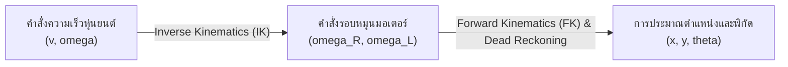
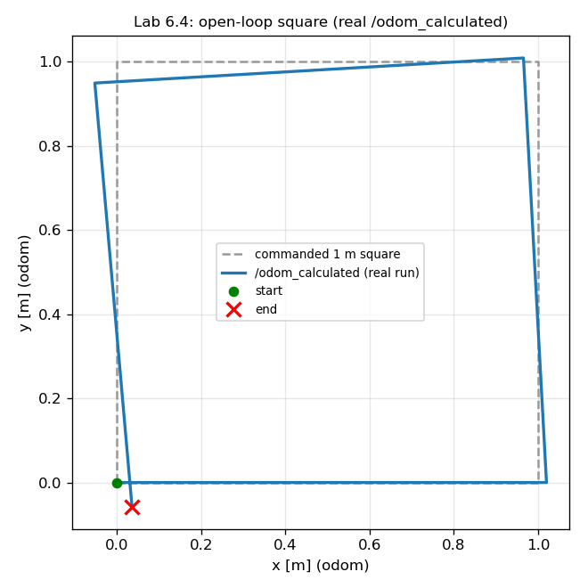

# 📖 Week 06: มาตรฐานวิศวกรรมพิกัด (REP 103/105) และจลนศาสตร์หุ่นยนต์ขับเคลื่อนสองล้อ (Differential Drive Kinematics)
**เวลาเรียน:** บรรยาย 2 ชั่วโมง | ปฏิบัติการ 3 ชั่วโมง | ศึกษาค้นคว้าด้วยตนเอง 4 ชั่วโมง  
**วิชาบังคับก่อน:** [สัปดาห์ที่ 5: Dynamic Parameters และสถาปัตยกรรม Python Launch System](../Week_05_Parameters_Launch/Readme.md)  
**เอกสารปฏิบัติการ:** [ใบงานแล็บสัปดาห์ที่ 6](Lab_Exercises.md)

---

## 🎯 วัตถุประสงค์การเรียนรู้ (Learning Objectives)
เมื่อจบบทเรียนนี้ ผู้เรียนจะสามารถ:
1. **ประยุกต์ใช้มาตรฐานวิศวกรรมหุ่นยนต์ REP 103** สำหรับหน่วยวัดทางกายภาพและระบบพิกัดคาร์ทีเซียนแบบมือขวา (Right-Handed Rule) ได้อย่างถูกต้อง
2. **วิเคราะห์ลำดับชั้นโครงสร้างต้นไม้พิกัด (TF Tree Architecture) ตามมาตรฐาน REP 105** (`earth` $\rightarrow$ `map` $\rightarrow$ `odom` $\rightarrow$ `base_link`) และเฟรม `base_footprint` จาก **REP 120** ที่หุ่นยนต์ล้อนิยมแทรกระหว่าง `odom` กับ `base_link` พร้อมอธิบายเหตุผลในการแยกความรับผิดชอบระหว่าง `map` และ `odom`
3. **พิสูจน์สมการจลนศาสตร์เดินหน้าและย้อนกลับ (Forward and Inverse Kinematics)** ของหุ่นยนต์ขับเคลื่อนสองล้อแบบดิฟเฟอเรนเชียล (Differential Drive) ในรูปสมการเมทริกซ์
4. **คำนวณตำแหน่งและทิศทางสะสม (Dead Reckoning & Odometry Integration)** ด้วยวิธี Runge-Kutta / Midpoint Integration และแปลงมุม Yaw เข้าสู่ Quaternion
5. **เข้าใจโครงสร้างข้อมูลและการกำหนดค่าความคลาดเคลื่อน (Covariance Matrix)** ในข้อความมาตรฐาน `nav_msgs/msg/Odometry` สำหรับส่งต่อให้ระบบฟิวชันเซนเซอร์ (Extended Kalman Filter: EKF)

---

## ⏱️ แผนการสอน 2 ชั่วโมง (Lecture Outline)
| ช่วงเวลา | หัวข้อ | กิจกรรมการเรียนรู้ |
| :---: | :--- | :--- |
| **00:00 - 00:30** | มาตรฐาน REP 103: พิกัดมือขวา กฎมือขวา และหน่วย SI | บรรยายหลักการแกน X (หน้า), Y (ซ้าย), Z (บน) และทิศทางการหมุน Roll-Pitch-Yaw |
| **00:30 - 01:00** | มาตรฐาน REP 105: สถาปัตยกรรม Coordinate Frames สำหรับ AMR | วิเคราะห์ลึก: ความต่อเนื่องของ `odom` vs การแก้ไขพิกัดแบบกระโดดของ `map` |
| **01:00 - 01:40** | การพิสูจน์คณิตศาสตร์จลนศาสตร์ (Kinematics & Matrix Derivations) | พิสูจน์สมการ Forward/Inverse Kinematics, ICC, และการอินทิเกรต Odometry |
| **01:40 - 02:00** | Code Walkthrough `diff_drive_kinematics.py` และสรุปก่อนเข้าสู่ Lab | วิเคราะห์การแปลงสมการลงโค้ด Python, โครงสร้าง Odometry Message และ Covariance |

---

## 🏛️ สถาปัตยกรรมระบบ (Architectural Deep Dive)

### 1. มาตรฐาน REP 103: Standard Units of Measure & Coordinate Conventions
ระบบนิเวศ ROS ทั้งหมดปฏิบัติตามข้อกำหนด **REP 103** เพื่อให้แน่ใจว่าแพ็กเกจจากผู้พัฒนาทั่วโลกสามารถทำงานร่วมกันได้อย่างราบรื่น:

- **หน่วยวัดทางกายภาพ (Standard SI Units):**
  - ระยะทาง / ตำแหน่ง (Length / Position): เมตร ($m$)
  - มุม / ทิศทาง (Angle / Rotation): เรเดียน ($rad$) โดยที่ $\pi\text{ rad} = 180^\circ$
  - มวล (Mass): กิโลกรัม ($kg$)
  - เวลา (Time): วินาที ($s$)
  - ความเร็วเชิงเส้น (Linear Velocity): เมตรต่อวินาที ($m/s$)
  - ความเร็วเชิงมุม (Angular Velocity): เรเดียนต่อวินาที ($rad/s$)
- **ระบบพิกัดคาร์ทีเซียนแบบมือขวา (Right-Handed Coordinate System):**
  - **แกน +X:** ชี้ไปข้างหน้าของหุ่นยนต์ (**Forward**)
  - **แกน +Y:** ชี้ไปทางซ้ายของหุ่นยนต์ (**Left**)
  - **แกน +Z:** ชี้ขึ้นด้านบนสู่ท้องฟ้า (**Up / Sky**)
- **การหมุนตามกฎมือขวา (Right-Hand Grip Rule):**
  - **Roll (หมุนรอบแกน X):** เอียงตัวไปทางขวาเป็นบวก
  - **Pitch (หมุนรอบแกน Y):** ก้มหน้าลงเป็นบวก
  - **Yaw (หมุนรอบแกน Z):** หมุนทวนเข็มนาฬิกา (CCW) เมื่อมองจากด้านบนลงมาเป็นบวก

---

### 2. มาตรฐาน REP 105: Coordinate Frames for Mobile Platforms
ในระบบนำทางหุ่นยนต์เคลื่อนที่อัตโนมัติ (AMR) พิกัดตำแหน่งถูกแบ่งออกเป็นลำดับชั้นอย่างเคร่งครัด:

```mermaid
flowchart TD
    Earth["earth<br/>(พิกัดละติจูด/ลองจิจูด สากล WGS-84 / UTM)"]
    Map["map<br/>(พิกัดแผนที่โลก: World-fixed, ปลอด Drift, อาจมีการกระโดด)"]
    Odom["odom<br/>(พิกัดการเคลื่อนที่สะสม: ต่อเนื่อง ไม่มีทางกระโดด แต่มี Drift สะสม)"]
    BaseFootprint["base_footprint (REP 120)<br/>(เงาของหุ่นยนต์ฉายลงบนพื้นระนาบ 2D: Z=0)"]
    BaseLink["base_link<br/>(จุดศูนย์กลางทางกายภาพของหุ่นยนต์ 3D)"]
    Lidar["laser_frame<br/>(พิกัดของเซนเซอร์ LiDAR)"]
    IMU["imu_link<br/>(พิกัดของเซนเซอร์ IMU)"]

    Earth -.-> Map
    Map -->|Global Localization / AMCL Correction| Odom
    Odom -->|Wheel Encoders + IMU Integration| BaseFootprint
    BaseFootprint -->|คงที่ตามความสูงแชสซี| BaseLink
    BaseLink -->|ตำแหน่งติดตั้งเซนเซอร์ (Static TF)| Lidar
    BaseLink -->|ตำแหน่งติดตั้งเซนเซอร์ (Static TF)| IMU

    style Map fill:#e1f5fe,stroke:#0288d1,stroke-width:2px
    style Odom fill:#fff3e0,stroke:#f57c00,stroke-width:2px
    style BaseLink fill:#e8f5e9,stroke:#2e7d32,stroke-width:2px
```

> [!NOTE]
> REP 105 นิยามเฉพาะ `earth`, `map`, `odom` และ `base_link` ส่วน **`base_footprint`** (จุดใต้หุ่นยนต์บนพื้น, $Z = 0$) นิยามไว้ใน **REP 120** (Coordinate Frames for Humanoid Robots) แต่ถูกนำมาใช้อย่างแพร่หลายกับ AMR ล้อ (เช่น TurtleBot, Nav2 ใช้เป็น `robot_base_frame` ได้) เพื่อให้ Planner 2D ไม่ต้องสนใจความสูงของแชสซี

#### การวิเคราะห์เปรียบเทียบเชิงวิศวกรรม: `odom` vs `map`
หนึ่งในหัวใจสำคัญของการออกแบบระบบขับขี่อัตโนมัติคือการทำความเข้าใจความขัดแย้งระหว่าง **ความต่อเนื่อง (Continuity)** และ **ความแม่นยำระดับโลก (Global Accuracy)**:

| คุณลักษณะ | **เฟรม `odom` (Odometry Frame)** | **เฟรม `map` (Map Frame)** |
| :--- | :--- | :--- |
| **แหล่งที่มาข้อมูล** | ตัวถอดรหัสรอบหมุนของล้อ (Wheel Encoders) และ IMU | เซนเซอร์ระบุตำแหน่งระดับโลก เช่น LiDAR Scan Matching, กล้อง SLAM หรือ GPS |
| **พฤติกรรมทางคณิตศาสตร์** | **ต่อเนื่องและราบเรียบอย่างสมบูรณ์ (Smooth & Continuous)** ไม่มีการกระโดดของพิกัด | **อาจไม่ต่อเนื่อง (Discontinuous / Jumps)** เมื่ออัลกอริทึมคำนวณแก้ตำแหน่งใหม่ |
| **พฤติกรรมระยะยาว** | **เกิด Drift สะสมตลอดเวลา** จากการลื่นไถลของล้อ (Wheel Slip) หรือพื้นผิวขรุขระ | **ไม่มี Drift สะสม** ตำแหน่งถูกตรึงไว้กับสิ่งแวดล้อมทางกายภาพที่แท้จริง |
| **ผู้ใช้งานหลักในระบบ** | **Local Motion Controller** (การควบคุมล้อ, การหลบหลีกสิ่งกีดขวางระยะประชิด) | **Global Path Planner** (การวางแผนโครงข่ายเส้นทางข้ามอาคาร) |

---

### 3. การพิสูจน์คณิตศาสตร์จลนศาสตร์ Differential Drive (Mathematical Derivation)

กำหนดให้:
- $r$: รัศมีของล้อขับเคลื่อน (Wheel Radius) ในหน่วยเมตร
- $L$: ระยะห่างระหว่างกึ่งกลางล้อขับเคลื่อนซ้ายและขวา (Wheel Separation / Track Base) ในหน่วยเมตร
- $v$: ความเร็วเชิงเส้นของหุ่นยนต์ในแนวแกน X ($m/s$)
- $\omega$: ความเร็วเชิงมุมของหุ่นยนต์รอบแกน Z ($rad/s$)
- $v_R, v_L$: ความเร็วเชิงเส้นสัมผัสพื้นของล้อขวาและล้อซ้าย ($m/s$)
- $\omega_R, \omega_L$: ความเร็วเชิงมุมในการหมุนของมอเตอร์ล้อขวาและล้อซ้าย ($rad/s$)



#### ก. จุดศูนย์กลางการหมุนชั่วขณะ (Instantaneous Center of Curvature: ICC)
เมื่อหุ่นยนต์เคลื่อนที่เป็นแนวโค้ง ทั้งล้อซ้ายและล้อขวาจะหมุนรอบจุดร่วมเดียวกันคือ ICC ด้วยรัศมีความโค้ง $R$:
$$v = \omega R$$
$$v_R = \omega \left(R + \frac{L}{2}\right)$$
$$v_L = \omega \left(R - \frac{L}{2}\right)$$

> **นิยามที่ใช้ในวงการหุ่นยนต์เคลื่อนที่:** **Forward Kinematics (FK)** = ความเร็วล้อ → ความเร็วตัวหุ่นยนต์ $(v, \omega)$ (ทิศทางที่ "ฟิสิกส์" เกิดขึ้นจริง: ล้อหมุนแล้วตัวรถจึงเคลื่อนที่) และ **Inverse Kinematics (IK)** = $(v, \omega)$ ที่ต้องการ → ความเร็วล้อที่ต้องสั่ง (เช่นเดียวกับแขนกล: FK = ข้อต่อ → ปลายแขน, IK = ปลายแขน → ข้อต่อ) [Siegwart et al., Ch. 3]

#### ข. จลนศาสตร์ผกผัน (Inverse Kinematics: แปลงคำสั่ง Twist สู่ความเร็วรอบล้อ)
จากสมการความสัมพันธ์ข้างต้น เราสามารถคำนวณความเร็วเชิงเส้นของล้อแต่ละข้าง:
$$v_R = v + \frac{\omega L}{2}$$
$$v_L = v - \frac{\omega L}{2}$$

เนื่องจาก $v = \omega_{wheel} \cdot r$ ดังนั้นความเร็วเชิงมุมของมอเตอร์แต่ละข้างคือ:
$$\omega_R = \frac{v + \frac{\omega L}{2}}{r} = \frac{1}{r} v + \frac{L}{2r} \omega$$
$$\omega_L = \frac{v - \frac{\omega L}{2}}{r} = \frac{1}{r} v - \frac{L}{2r} \omega$$

เขียนในรูปสมการเมทริกซ์ (Inverse Kinematics Matrix):
$$\begin{bmatrix} \omega_R \\ \omega_L \end{bmatrix} = \begin{bmatrix} \frac{1}{r} & \frac{L}{2r} \\ \frac{1}{r} & -\frac{L}{2r} \end{bmatrix} \begin{bmatrix} v \\ \omega \end{bmatrix}$$

#### ค. จลนศาสตร์เดินหน้า (Forward Kinematics: จาก Encoder สู่ความเร็วหุ่นยนต์)
เมื่อตัวเข้ารหัสสัญญาณ (Encoders) วัดความเร็วเชิงมุมของล้อทั้งสองข้างได้ $(\omega_R, \omega_L)$ เราสามารถถอดรหัสความเร็วรวมของหุ่นยนต์ได้:
$$v_R = \omega_R \cdot r, \quad v_L = \omega_L \cdot r$$
$$v = \frac{v_R + v_L}{2} = \frac{r}{2} (\omega_R + \omega_L)$$
$$\omega = \frac{v_R - v_L}{L} = \frac{r}{L} (\omega_R - \omega_L)$$

เขียนในรูปสมการเมทริกซ์ (Forward Kinematics Matrix):
$$\begin{bmatrix} v \\ \omega \end{bmatrix} = \begin{bmatrix} \frac{r}{2} & \frac{r}{2} \\ \frac{r}{L} & -\frac{r}{L} \end{bmatrix} \begin{bmatrix} \omega_R \\ \omega_L \end{bmatrix}$$

---

### 4. การอินทิเกรตตำแหน่งและการประมาณค่า (Odometry Dead Reckoning)
ในช่วงคาบเวลาสุ่มตัวอย่าง $\Delta t = t_{k+1} - t_k$:
การหมุนเชิงมุมที่เปลี่ยนไป:
$$\Delta \theta = \omega \cdot \Delta t$$

เพื่อความแม่นยำสูง เราใช้ **Midpoint Integration (Runge-Kutta อันดับ 2)** ซึ่งใช้มุมกึ่งกลางช่วงเวลาในการฉายเวกเตอร์ความเร็ว:
$$\theta_{mid} = \theta_k + \frac{\Delta \theta}{2}$$
$$\Delta x = v \cdot \cos(\theta_{mid}) \cdot \Delta t$$
$$\Delta y = v \cdot \sin(\theta_{mid}) \cdot \Delta t$$

อัปเดตสถานะของหุ่นยนต์:
$$x_{k+1} = x_k + \Delta x$$
$$y_{k+1} = y_k + \Delta y$$
$$\theta_{k+1} = \text{atan2}\left(\sin(\theta_k + \Delta \theta), \cos(\theta_k + \Delta \theta)\right)$$

**เปรียบเทียบกับคำตอบแบบ Exact Arc:** ถ้า $(v, \omega)$ คงที่ตลอดช่วง $\Delta t$ หุ่นยนต์วิ่งบนส่วนโค้งของวงกลมรัศมี $R = v/\omega$ (ICC) ได้คำตอบแม่นตรง:
$$x_{k+1} = x_k + R\left[\sin(\theta_k + \Delta\theta) - \sin\theta_k\right], \quad y_{k+1} = y_k - R\left[\cos(\theta_k + \Delta\theta) - \cos\theta_k\right]$$
(เมื่อ $\omega \to 0$ ให้ใช้สูตรเส้นตรง) Midpoint ชี้ไปตามทิศของคอร์ดพอดี ต่างจาก Exact เพียงความยาวคอร์ด ($v\Delta t$ เทียบกับ $2R\sin(\Delta\theta/2)$) จึงมี Error ต่อสเต็ป $O(\Delta t^3)$ ส่วน Euler ใช้ทิศ ณ ต้นช่วงทำให้เบี่ยงออกด้านข้าง Error ต่อสเต็ป $O(\Delta t^2)$ — จากการคำนวณใน [`test/test_kinematics.py`](test/test_kinematics.py) ที่ $v = 0.4$ m/s, $\omega = 0.8$ rad/s วิ่ง 270° ด้วย 120 สเต็ป ตำแหน่งสุดท้ายของ Midpoint ห่างจาก Exact ประมาณ $4.5 \times 10^{-5}$ m ขณะที่ Euler ห่าง $1.4 \times 10^{-2}$ m (โหนดใช้ Midpoint เป็นค่าปริยาย เลือก `exact`/`euler` ได้ด้วยพารามิเตอร์ `integration`)

#### การแปลงมุมระนาบ 2D (Yaw) สู่ Quaternion ในพิกัด 3D
ใน ROS 2 การแสดงการวางแนวทิศทาง (Orientation) ต้องใช้ควอเทอร์เนียน $q = (x, y, z, w)$ เสมอ สำหรับหุ่นยนต์เคลื่อนที่บนระนาบ 2D ($Roll = 0, Pitch = 0, Yaw = \theta$):
$$q_x = 0.0$$
$$q_y = 0.0$$
$$q_z = \sin\left(\frac{\theta}{2}\right)$$
$$q_w = \cos\left(\frac{\theta}{2}\right)$$

---

## 🛠️ การวิเคราะห์โค้ดตัวอย่างในโมดูล (Code Walkthrough)

โค้ดอยู่ในแพ็กเกจ `amr_week06` (ament_python):
```bash
./docker/run_lab.sh colcon build --base-paths Essential_ROS --packages-select amr_week06   # หรือ make build PKG=amr_week06
./docker/run_lab.sh ros2 run amr_week06 diff_drive_kinematics
./docker/run_lab.sh ros2 run amr_week06 square_driver            # Lab 6.4
```

### 1. [`kinematics.py`](src/kinematics.py) — คณิตศาสตร์ล้วน (ไม่มี ROS ทดสอบได้ด้วย pytest)
```python
def inverse_kinematics(v, omega, wheel_separation, wheel_radius):
    """(v [m/s], omega [rad/s]) -> (w_left, w_right) [rad/s]."""
    v_right = v + omega * wheel_separation / 2.0
    v_left = v - omega * wheel_separation / 2.0
    return v_left / wheel_radius, v_right / wheel_radius


def forward_kinematics(w_left, w_right, wheel_separation, wheel_radius):
    """(w_left, w_right) [rad/s] -> (v [m/s], omega [rad/s])."""
    ...
    v = (v_right + v_left) / 2.0
    omega = (v_right - v_left) / wheel_separation


def integrate_midpoint(x, y, theta, v, omega, dt):
    """Midpoint (2nd-order Runge-Kutta): use the heading halfway through the interval."""
    theta_mid = theta + omega * dt / 2.0
    return (x + v * math.cos(theta_mid) * dt,
            y + v * math.sin(theta_mid) * dt,
            normalize_angle(theta + omega * dt))
```
- แยกสมการออกจากโหนดเป็น **Pure Functions** ทำให้ทดสอบได้โดยไม่ต้องเปิด ROS: [`test/test_kinematics.py`](test/test_kinematics.py) ตรวจวิ่งตรง, หมุนอยู่กับที่, `forward_kinematics(inverse_kinematics(v, ω)) == (v, ω)`, ส่วนโค้งเสี้ยววงกลมแบบ Exact และอัตราการลดลงของ Error แบบ Midpoint ($\propto \Delta t^2$)
- มี `integrate_euler`, `integrate_midpoint` และ `integrate_exact` ให้เปรียบเทียบ (เลือกในโหนดด้วยพารามิเตอร์ `integration`)

### 2. [`diff_drive_kinematics.py`](src/diff_drive_kinematics.py) — โหนด Odometry
- **พารามิเตอร์:** `wheel_separation` (0.24 m), `wheel_radius` (0.08 m), `cmd_vel_timeout` (0.5 s), `integration` (`midpoint`), `publish_tf` (`true`), `odom_frame`/`base_frame`
- **Inverse Kinematics ใน `cmd_vel_callback`:**
  ```python
  def cmd_vel_callback(self, msg: Twist):
      # Inverse kinematics: body twist (v, omega) -> wheel angular speeds (rad/s)
      self.w_left, self.w_right = inverse_kinematics(msg.linear.x, msg.angular.z, self.L, self.r)
      self.last_cmd_time = self.get_clock().now()
  ```
- **Watchdog + Forward Kinematics + Dead Reckoning ใน `update_odometry` (20 Hz):**
  ```python
  if self.last_cmd_time is not None and self.cmd_timeout > 0.0:
      silent = (current_time - self.last_cmd_time).nanoseconds / 1e9
      if silent > self.cmd_timeout:
          self.w_left = self.w_right = 0.0      # stop the wheels
  v, omega = forward_kinematics(self.w_left, self.w_right, self.L, self.r)
  self.x, self.y, self.theta = self.integrate(self.x, self.y, self.theta, v, omega, dt)
  ```
  ถ้า Teleop หรือ Planner ตาย/หยุดส่ง `cmd_vel` เกิน 0.5 วินาที ล้อจะถูกสั่งหยุด — หากไม่มี Watchdog หุ่นยนต์ (และ Odometry) จะวิ่งด้วยคำสั่งสุดท้ายไปตลอดกาล ไดรเวอร์มอเตอร์จริงทุกตัวควรมีกลไกนี้
- **ข้อความ `nav_msgs/Odometry` และ TF `odom → base_footprint`:**
  ```python
  odom_msg.header.frame_id = self.odom_frame       # 'odom'
  odom_msg.child_frame_id = self.base_frame        # 'base_footprint'
  ...
  tf.header.frame_id = self.odom_frame
  tf.child_frame_id = self.base_frame
  tf.transform.rotation = odom_msg.pose.pose.orientation
  self.tf_broadcaster.sendTransform(tf)
  ```
  ทั้ง Topic และ TF ใช้เวลาประทับเดียวกัน ตามหลัก REP 105 ว่าผู้ประมาณ Odometry เป็นผู้ Broadcast `odom → base` เอง (Nav2/RViz ใช้ TF นี้) ส่วน Twist ใน Odometry อยู่ในเฟรมของ `child_frame_id`
- [`test/test_odom_launch.py`](test/test_odom_launch.py) (launch_testing) ป้อน `/cmd_vel` แล้วตรวจ `/odom_calculated` (ระยะทาง = $v \cdot t$ จาก Timestamp), TF `odom → base_footprint` ตรงกับข้อความ Odometry และ Watchdog หยุดการอินทิเกรตเมื่อไม่มีคำสั่ง

---

## ⌨️ ตารางคำสั่ง CLI สำคัญ
| คำสั่ง | คำอธิบาย | ตัวอย่างการใช้งาน |
| :--- | :--- | :--- |
| `ros2 topic pub /cmd_vel ...` | สั่งให้หุ่นยนต์เคลื่อนที่ด้วยความเร็วที่กำหนด | `ros2 topic pub -r 10 /cmd_vel geometry_msgs/msg/Twist "{linear: {x: 0.2}, angular: {z: 0.1}}"` |
| `ros2 topic echo /odom_calculated` | ดูข้อมูลตำแหน่ง พิกัด และความเร็วแบบเรียลไทม์ | `ros2 topic echo /odom_calculated` |
| `ros2 topic hz /odom_calculated` | วัดความถี่ของการอัปเดต Odometry (เป้าหมาย 20 Hz) | `ros2 topic hz /odom_calculated` |
| `ros2 topic info /odom_calculated -v` | ตรวจสอบ QoS Profile และจำนวนผู้รับส่งข้อมูล | `ros2 topic info /odom_calculated -v` |
| `ros2 run tf2_ros tf2_echo odom base_footprint` | ดู Transform ที่โหนด Broadcast (Translation, Quaternion, RPY) | `ros2 run tf2_ros tf2_echo odom base_footprint` |

---

## 📟 ผลการรันจริง (Real Run Output)
บันทึกจากการรันจริงใน ros:lab-runner (ROS 2 Jazzy, Gazebo Sim 8.15.0) บน Linux 7.0 เมื่อ 2026-10-29 — ไฟล์เต็ม: [`results/kinematics_lab_run.txt`](results/kinematics_lab_run.txt), [`results/square_run.txt`](results/square_run.txt), [`results/square_odom.csv`](results/square_odom.csv)

```console
$ ros2 topic hz /odom_calculated   (5 s)
average rate: 19.995
	min: 0.048s max: 0.052s std dev: 0.00076s window: 61

$ ros2 topic pub -r 10 -t 50 /cmd_vel geometry_msgs/msg/Twist "{linear: {x: 0.2}}"   # 50 msgs = 5 s
Waiting for at least 1 matching subscription(s)...
publisher: beginning loop
publishing #1: geometry_msgs.msg.Twist(linear=geometry_msgs.msg.Vector3(x=0.2, y=0.0, z=0.0), angular=geometry_msgs.msg.
...
publishing #50: geometry_msgs.msg.Twist(linear=geometry_msgs.msg.Vector3(x=0.2, y=0.0, z=0.0), angular=geometry_msgs.msg

$ ros2 topic echo /odom_calculated --field pose.pose --once     # 1 s after the last command
position:
  x: 1.0800343727999997
  y: 0.0
  z: 0.0
orientation:
  x: 0.0
  y: 0.0
  z: 0.0
  w: 1.0
---

$ ros2 run tf2_ros tf2_echo odom base_footprint   (stopped after 5 s)
At time 1793242933.846810339
- Translation: [1.080, 0.000, 0.000]
- Rotation: in Quaternion (xyzw) [0.000, 0.000, 0.768, 0.641]
- Rotation: in RPY (radian) [0.000, -0.000, 1.750]
- Rotation: in RPY (degree) [0.000, -0.000, 100.268]
- Matrix:
 -0.178 -0.984  0.000  1.080
  0.984 -0.178  0.000  0.000
  0.000  0.000  1.000  0.000
```
- วิ่งตรง 50 คำสั่ง × 0.1 s = 5 s ที่ 0.2 m/s ควรได้ 1.0 m แต่ได้ $x = 1.080$ m: ส่วนเกิน 0.08 m คือช่วงที่ล้อยังทำตามคำสั่งสุดท้ายจนกว่า Watchdog (0.5 s) จะหยุดล้อ ($0.2 \times 0.4 \approx 0.08$ m) — ในทำนองเดียวกันการหมุน 31 คำสั่งได้ Yaw 1.750 rad (100.3°) แทน 90°
- Lab 6.4 (สี่เหลี่ยม 1 m แบบ Open-loop ตามเวลา): `loop closure error sqrt(dx^2+dy^2) = 0.0672 m`, Yaw คลาด +5.26° ทั้งที่สมการจลนศาสตร์ไม่มี Error เลย — ความคลาดเคลื่อนมาจาก **จังหวะเวลาของคำสั่ง** (คำสั่งส่งทุก 0.1 s, Odometry อินทิเกรตทุก 0.05 s และความหน่วงในการส่งข้อความ) นี่คือเหตุผลที่การนำทางจริงต้องใช้ Feedback (Closed-loop) จาก Odometry/Localization



*ภาพ: เส้นทางจาก `/odom_calculated` ของการรันจริงข้างต้น (บันทึกโดย `square_driver --csv` เป็น [`results/square_odom.csv`](results/square_odom.csv) แล้วพล็อตด้วย matplotlib) เทียบกับสี่เหลี่ยม 1 m ที่สั่ง*

---

## ⚠️ ปัญหาที่พบบ่อยและการแก้ไข (Troubleshooting)

| ที่ | อาการที่พบ (Symptom) | สาเหตุรากเหง้า (Root Cause) | แนวทางแก้ไข (Resolution) |
|:---:| :--- | :--- | :--- |
| 1 | **สั่งเลี้ยวซ้ายแต่หุ่นยนต์เลี้ยวขวา** | สลับเครื่องหมายของ $\omega$ หรือสลับความเร็วล้อซ้ายและขวา ($v_L, v_R$) | ตรวจสอบสมการ: การเลี้ยวทวนเข็มนาฬิกา (ซ้าย) ล้อขวาต้องหมุนเร็วกว่าล้อซ้าย ($v_R > v_L$) |
| 2 | **พิกัด Odometry คลาดเคลื่อนสะสมมหาศาล (Severe Drift)** | ค่ารัศมีล้อ $r$ หรือระยะฐานล้อ $L$ ที่ระบุในพารามิเตอร์ไม่ตรงกับขนาดฮาร์ดแวร์จริง | ทำการสอบเทียบ (Calibration): วัดขนาดจริงด้วยเวอร์เนียร์ และปรับชดเชยค่าสัมประสิทธิ์ล้อ |
| 3 | **มุม Yaw ทะลุเกิน $3.14$ แล้วไม่ยอมวนกลับเป็น $-3.14$** | ไม่ได้ใช้ฟังก์ชัน Normalization ทำให้มุมสะสมไปเรื่อยๆ | ใช้ `math.atan2(math.sin(theta), math.cos(theta))` หลังบวก $\Delta \theta$ ทุกครั้ง |
| 4 | **ความคลาดเคลื่อนสูงเมื่อหุ่นยนต์เลี้ยวด้วยความเร็วสูง** | ใช้วิธี Forward Euler Integration ธรรมดา ซึ่งมี Error สะสมสูงในการคำนวณแนวโค้ง | เปลี่ยนมาใช้ Midpoint Integration หรือคำนวณผ่านรัศมีความโค้ง ICC |
| 5 | **ข้อความ Odometry สั่นหรือไม่สม่ำเสมอ** | การคำนวณ $\Delta t$ ใช้ค่าคงที่แทนที่จะวัดจริงจากนาฬิการะบบ | ใช้ `current_time - last_time` วัดค่า $\Delta t$ จริงในทุก Loop Iteration |
| 6 | **Quaternion Normalization Error** | ผลรวมกำลังสองของควอเทอร์เนียน $x^2 + y^2 + z^2 + w^2 \neq 1.0$ จากความคลาดเคลื่อนทศนิยม | ใช้สูตร $\sin(\theta/2)$ และ $\cos(\theta/2)$ หรือฟังก์ชัน Normalize เวกเตอร์ก่อนบรรจุลงข้อความ |
| 7 | **หุ่นยนต์ยังวิ่งต่อหลังปิด Teleop / Planner ค้าง** | ไม่มี Watchdog ล้อทำตามคำสั่งสุดท้ายตลอดไป | ตั้ง `cmd_vel_timeout` (โหนดนี้ 0.5 s) ให้หยุดล้อเมื่อไม่มีคำสั่งใหม่ |

---

## 📝 แบบทดสอบท้ายบท (Self-Assessment Quiz)

1. **คำถาม:** ตามมาตรฐาน REP 103 หากผู้สังเกตการณ์ยืนอยู่ด้านหลังหุ่นยนต์แล้วมองตรงไปข้างหน้า ทิศทางของแกน +X, +Y, และ +Z ชี้ไปทางทิศใดตามลำดับ?
2. **คำถาม:** การหมุนแบบทวนเข็มนาฬิกา (CCW) รอบแกน Z เมื่อมองจากด้านบนลงมา มีค่ามุม Yaw เป็นบวกหรือลบ?
3. **คำถาม:** จงอธิบายเหตุผลหลักตามมาตรฐาน REP 105 ว่าทำไมระบบนำทางจึงไม่สามารถต่อยอดการควบคุมการเคลื่อนที่เฉพาะที่ (Local Control) โดยตรงจากเฟรม `map` ได้?
4. **คำถาม:** กำหนดให้หุ่นยนต์มีระยะห่างระหว่างล้อ $L = 0.30\text{ m}$ และรัศมีล้อ $r = 0.10\text{ m}$ หากสั่งให้หุ่นยนต์วิ่งเป็นเส้นตรงด้วยความเร็ว $v = 0.5\text{ m/s}$ ความเร็วเชิงมุมของมอเตอร์ล้อแต่ละข้าง ($\omega_R, \omega_L$) จะมีค่าเท่าใด?
5. **คำถาม:** จากข้อมูลในข้อ 4 หากหุ่นยนต์ต้องการหมุนตัวอยู่กับที่ (In-place Rotation) ด้วยความเร็ว $\omega = 2.0\text{ rad/s}$ ล้อขวาและล้อซ้ายต้องหมุนด้วยความเร็วเชิงเส้น ($v_R, v_L$) เท่าใด?
6. **คำถาม:** รัศมีความโค้งชั่วขณะ (ICC Radius: $R$) ของหุ่นยนต์ Differential Drive มีค่าเป็นเท่าใดเมื่อหุ่นยนต์เคลื่อนที่เป็นเส้นตรงอย่างสมบูรณ์?
7. **คำถาม:** ในการแปลงมุมทิศทาง Yaw ($\theta = \pi\text{ rad} = 180^\circ$) เข้าสู่ Quaternion ค่าขององค์ประกอบ $(z, w)$ จะมีค่าเท่ากับเท่าใด?
8. **คำถาม:** ทำไมการอินทิเกรต Odometry ด้วยวิธี Midpoint Integration จึงให้ผลลัพธ์ที่แม่นยำกว่า Forward Euler Integration ในการเลี้ยวโค้ง?
9. **คำถาม:** ฟิลด์ `pose.covariance` ในข้อความ `nav_msgs/msg/Odometry` มีขนาดกี่มิติ และตัวเลขบนเส้นทแยงมุมหลัก (Diagonal) แสดงถึงค่าทางสถิติใด?
10. **คำถาม:** เฟรม `base_footprint` นิยามไว้ใน REP ฉบับใด และมีความแตกต่างทางความสูงจากเฟรม `base_link` อย่างไร?

<details>
<summary>🔍 ดูเฉลยคำตอบพร้อมคำอธิบายอย่างละเอียด</summary>

1. **ตอบ:** **+X ชี้ไปข้างหน้า (Forward), +Y ชี้ไปทางซ้าย (Left), และ +Z ชี้ขึ้นด้านบน (Upward)** ตามกฎมือขวา
2. **ตอบ:** มีค่า **เป็นบวก (+)** เสมอตามกฎมือกำขวา (Right-Hand Grip Rule) รอบแกน +Z
3. **ตอบ:** เนื่องจากเฟรม `map` เกิดจากการประมวลผลเซนเซอร์สากล (เช่น SLAM หรือ AMCL) ซึ่ง **อาจเกิดการกระโดดของพิกัดอย่างฉับพลัน (Discontinuous Position Jumps)** เมื่อระบบแก้ตำแหน่งหลงทาง หากนำพิกัดนี้ไปป้อนตัวควบคุมมอเตอร์โดยตรง จะทำให้ตัวควบคุมสั่งเร่งหรือเบรกมอเตอร์อย่างรุนแรงจนหุ่นยนต์กระตุกหรือล้มคว่ำ ระบบจึงต้องใช้เฟรม `odom` ซึ่งมีความต่อเนื่องและราบเรียบเสมอใน Local Control Loop
4. **ตอบ:**
   - จากสูตร $v_R = v_L = v = 0.5\text{ m/s}$
   - $\omega_R = \omega_L = \frac{v}{r} = \frac{0.5}{0.10} = \mathbf{5.0\text{ rad/s}}$
5. **ตอบ:**
   - หมุนตัวอยู่กับที่แปลว่า $v = 0$
   - $v_R = 0 + \frac{\omega L}{2} = \frac{2.0 \times 0.30}{2} = \mathbf{+0.30\text{ m/s}}$
   - $v_L = 0 - \frac{\omega L}{2} = -\frac{2.0 \times 0.30}{2} = \mathbf{-0.30\text{ m/s}}$ (ล้อสองข้างหมุนสวนทางกัน)
6. **ตอบ:** รัศมีความโค้ง $R \rightarrow \boldsymbol{\infty}$ (เข้าสู่อินฟินิตี้ เนื่องจาก $\omega = 0$ จากสูตร $R = \frac{v}{\omega}$)
7. **ตอบ:**
   - $q_z = \sin\left(\frac{\pi}{2}\right) = \mathbf{1.0}$
   - $q_w = \cos\left(\frac{\pi}{2}\right) = \mathbf{0.0}$
   - (โดยที่ $q_x = 0.0$ และ $q_y = 0.0$)
8. **ตอบ:** เพราะ Forward Euler นำมุมทิศทาง ณ จุดเริ่มต้นคาบเวลา ($\theta_k$) มาฉายเวกเตอร์ตลอดช่วงเวลา $\Delta t$ ทำให้เกิดการประเมินส่วนโค้งตัดตรง (Underestimation of turning) ในขณะที่ Midpoint นำมุมกึ่งกลางช่วงเวลา ($\theta_k + \frac{\Delta \theta}{2}$) มาใช้ ซึ่งเฉลี่ยเวกเตอร์สัมผัสความโค้งได้ใกล้เคียงกับส่วนโค้งจริงทางคณิตศาสตร์มากกว่า
9. **ตอบ:** มีขนาด **$6 \times 6$ (อาเรย์ 36 ช่อง)** สำหรับ $(x, y, z, \text{roll}, \text{pitch}, \text{yaw})$ โดยค่าบนเส้นทแยงมุมหลักแสดงค่า **ความแปรปรวน (Variance: $\sigma^2$)** ของตัวแปรแต่ละมิติ ซึ่งบ่งบอกระดับความไม่แน่นอนของข้อมูล
10. **ตอบ:** `base_footprint` นิยามใน **REP 120** (ไม่ใช่ REP 105 ซึ่งกำหนดเพียง `earth`/`map`/`odom`/`base_link`) โดยจะถูกฉายระนาบลงบนผิวสัมผัสพื้นดินพอดี ($Z = 0$) เพื่อการวางแผนเส้นทางแบบ 2 มิติ ในขณะที่ `base_link` จะมีระยะยกสูงตามแกน Z เท่ากับระดับความสูงของจุดศูนย์กลางการหมุนหรือแชสซีจริงของหุ่นยนต์
</details>

---

## 📚 แหล่งอ้างอิงและศึกษาเพิ่มเติม
- [REP 103: Standard Units of Measure & Coordinate Conventions](https://www.ros.org/reps/rep-0103.html)
- [REP 105: Coordinate Frames for Mobile Platforms](https://www.ros.org/reps/rep-0105.html)
- [REP 120: Coordinate Frames for Humanoid Robots (นิยาม `base_footprint`)](https://www.ros.org/reps/rep-0120.html)
- [Siegwart, Nourbakhsh, Scaramuzza: Introduction to Autonomous Mobile Robots (MIT Press)](https://mitpress.mit.edu/9780262015356/introduction-to-autonomous-mobile-robots/)
- [ROS 2 nav_msgs/msg/Odometry Documentation](https://docs.ros2.org/latest/api/nav_msgs/msg/Odometry.html)
