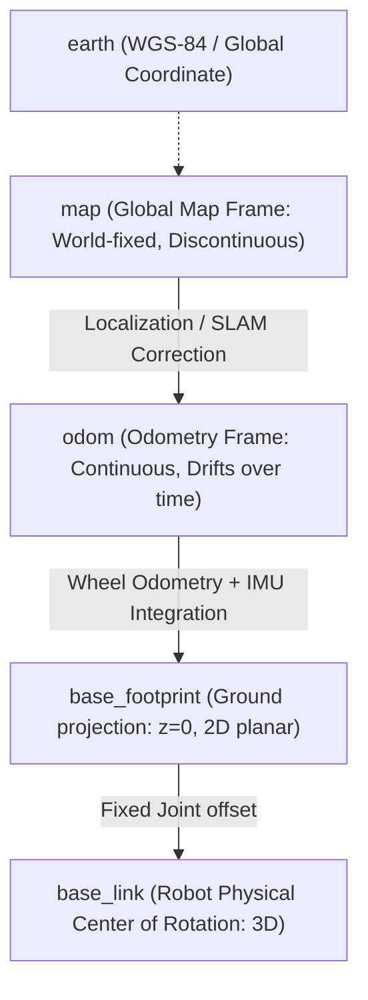

# 📖 Week 06: มาตรฐานวิศวกรรมพิกัด (REP 103/105) และจลนศาสตร์หุ่นยนต์ขับเคลื่อนสองล้อ (Differential Drive Kinematics)
**เวลาเรียน:** บรรยาย 2 ชั่วโมง | ปฏิบัติการ 3 ชั่วโมง | ศึกษาค้นคว้าด้วยตนเอง 4 ชั่วโมง  
**วิชาบังคับก่อน:** [สัปดาห์ที่ 5: Dynamic Parameters และสถาปัตยกรรม Python Launch System](../Week_05_Parameters_Launch/Readme.md)  
**เอกสารปฏิบัติการ:** [ใบงานแล็บสัปดาห์ที่ 6](Lab_Exercises.md)

---

## 🎯 วัตถุประสงค์การเรียนรู้ (Learning Objectives)
เมื่อจบบทเรียนนี้ ผู้เรียนจะสามารถ:
1. ประยุกต์ใช้มาตรฐาน **ROS Enhancement Proposal (REP 103)** สำหรับหน่วยวัดและระบบพิกัดมือขวา (Right-Handed Coordinate System)
2. วิเคราะห์ลำดับชั้นระบบพิกัดหุ่นยนต์เคลื่อนที่ตามมาตรฐาน **REP 105** (`map` -> `odom` -> `base_footprint` -> `base_link`)
3. พิสูจน์สมการจลนศาสตร์เดินหน้า (Forward Kinematics) จากความเร็วหุ่นยนต์ $(v, \omega)$ สู่ความเร็วเชิงมุมของล้อ $(\omega_L, \omega_R)$
4. พิสูจน์สมการจลนศาสตร์ย้อนกลับ (Inverse Kinematics / Dead Reckoning) จากตัวถอดรหัสล้อ (Encoders) สู่การประมาณตำแหน่ง (Odometry)
5. คำนวณการอินทิเกรตพิกัดเชิงตัวเลข (Euler vs Midpoint Integration) และแปลงมุมเอียง (Yaw) เป็นควอเทอร์เนียน (Quaternion)

---

## ⏱️ แผนการสอน 2 ชั่วโมง (Lecture Outline)
| ช่วงเวลา | หัวข้อ | กิจกรรมการเรียนรู้ |
| :---: | :--- | :--- |
| **00:00 - 00:30** | มาตรฐาน REP 103: พิกัดมือขวา กฎมือขวา และหน่วย SI | บรรยายพร้อมยกตัวอย่างแกน X (หน้า), Y (ซ้าย), Z (บน) และทิศทางมุมหมุน |
| **00:30 - 01:00** | มาตรฐาน REP 105: สถาปัตยกรรม Coordinate Frames สำหรับ AMR | วิเคราะห์เหตุผลทางวิศวกรรมในการแยกเฟรม `map` ออกจาก `odom` |
| **01:00 - 01:40** | คณิตศาสตร์จลนศาสตร์ Differential Drive (FK & IK) และ Odometry | แสดงการพิสูจน์สมการทีละขั้นตอน พร้อมตัวอย่างการคำนวณเชิงตัวเลข |
| **01:40 - 02:00** | Code Walkthrough `diff_drive_kinematics.py` และสรุปก่อนเข้าสู่ Lab | วิเคราะห์การประยุกต์สมการลงในโค้ด ROS 2 และโครงสร้างข้อความ `nav_msgs/Odometry` |

---

## 🏛️ สถาปัตยกรรมระบบ (Architectural Deep Dive)

### 1. มาตรฐาน REP 103: Standard Units of Measure & Coordinate Conventions
ระบบ ROS ทั้งหมดปฏิบัติตามมาตรฐาน REP 103 เพื่อให้ซอฟต์แวร์จากนักพัฒนาทั่วโลกสามารถทำงานร่วมกันได้โดยไม่ต้องแปลงหน่วย:
- **หน่วยวัดพื้นฐาน (SI Units):**
  - ระยะทาง: เมตร ($m$)
  - มุม: เรเดียน ($rad$)
  - เวลา: วินาที ($s$)
  - มวล: กิโลกรัม ($kg$)
  - ความเร็ว: เมตรต่อวินาที ($m/s$) และเรเดียนต่อวินาที ($rad/s$)
- **ระบบพิกัดคาร์ทีเซียนแบบมือขวา (Right-Hand Rule):**
  - แกน **+X**: ชี้ไปทาง **ด้านหน้า (Forward)** ของหุ่นยนต์
  - แกน **+Y**: ชี้ไปทาง **ด้านซ้าย (Left)** ของหุ่นยนต์
  - แกน **+Z**: ชี้ขึ้นสู่ **ด้านบน (Upward / Sky)**
  - มุมหมุนรอบแกน Z (**Yaw / $\theta$**): หมุนทวนเข็มนาฬิกา (Counter-Clockwise) เป็นค่าบวก

---

### 2. มาตรฐาน REP 105: Coordinate Frames for Mobile Platforms
ในหุ่นยนต์ AMR การระบุตำแหน่งจะต้องใช้ระบบพิกัดสัมพัทธ์หลายระดับเชื่อมต่อกันเป็นต้นไม้ทรานส์ฟอร์ม (TF Tree):



#### ทำไมต้องแยกเฟรม `map` ออกจาก `odom`?
นี่คือหนึ่งในคำถามสัมภาษณ์วิศวกร Autonomous Mobile Robot ที่พบบ่อยที่สุด:
1. **เฟรม `odom` (Odometry Frame):**
   - คำนวณจากการหมุนของล้อ (Wheel Encoders) และ IMU
   - **จุดเด่น:** มีความต่อเนื่องสูงมาก (Smooth and Continuous) ไม่มีทางกระโดดกะทันหัน
   - **ข้อจำกัด:** เกิดการสะสมความผิดพลาด (Drift) ตลอดเวลาเนื่องจากการลื่นไถลของล้อ (Wheel Slip)
   - **หน้าที่:** ใช้สำหรับ Local Control Loop (เช่น Obstacle Avoidance, Path Following) ที่ต้องการความต่อเนื่องของความเร็ว
2. **เฟรม `map` (Global Map Frame):**
   - คำนวณจากอัลกอริทึม SLAM หรือ AMCL โดยเทียบข้อมูล LaserScan กับแผนที่โลก
   - **จุดเด่น:** ไม่เกิด Drift สะสมในระยะยาว เพราะยึดกับสิ่งแวดล้อมจริง
   - **ข้อจำกัด:** อาจเกิดการ **กระโดด (Discontinuous Jump)** เมื่อระบบ Localization ปรับแก้ตำแหน่งใหม่ (Pose Correction)
   - **หน้าที่:** ใช้สำหรับ Global Path Planning (การวางแผนเส้นทางระยะไกล)

---

### 3. คณิตศาสตร์จลนศาสตร์ Differential Drive (Kinematics Derivation)

กำหนดให้:
- $r$: รัศมีของล้อขับเคลื่อน (Wheel Radius) ในหน่วยเมตร
- $L$: ระยะห่างระหว่างกึ่งกลางล้อซ้ายและขวา (Wheel Separation / Track Gauge) ในหน่วยเมตร
- $v$: ความเร็วเชิงเส้นของหุ่นยนต์ในแนวแกน X ($m/s$)
- $\omega$: ความเร็วเชิงมุมของการหมุนรอบแกน Z ($rad/s$)
- $v_R, v_L$: ความเร็วเชิงเส้นของล้อขวาและล้อซ้าย ($m/s$)
- $\omega_R, \omega_L$: ความเร็วเชิงมุมของล้อขวาและล้อซ้าย ($rad/s$)

#### ก. จลนศาสตร์เดินหน้า (Forward Kinematics: จากคำสั่งความเร็วหุ่นยนต์สู่ความเร็วล้อ)
เมื่อตัวควบคุมส่งคำสั่งความเร็ว $v$ และ $\omega$ ผ่านท็อปปิก `/cmd_vel` ความเร็วเชิงเส้นของแต่ละล้อคำนวณได้จาก:
$$v_R = v + \frac{\omega \cdot L}{2}$$
$$v_L = v - \frac{\omega \cdot L}{2}$$

แปลงเป็นความเร็วเชิงมุมของมอเตอร์ที่ต้องสั่งงาน:
$$\omega_R = \frac{v_R}{r} = \frac{v + \frac{\omega \cdot L}{2}}{r}$$
$$\omega_L = \frac{v_L}{r} = \frac{v - \frac{\omega \cdot L}{2}}{r}$$

#### ข. จลนศาสตร์ย้อนกลับ (Inverse Kinematics / Dead Reckoning: จากความเร็วล้อสู่ความเร็วหุ่นยนต์)
เมื่อเซนเซอร์ Encoders อ่านความเร็วเชิงมุมของล้อทั้งสองข้างได้ $(\omega_L, \omega_R)$ เราสามารถคำนวณความเร็วหุ่นยนต์กลับคืนมาได้:
$$v_R = \omega_R \cdot r$$
$$v_L = \omega_L \cdot r$$
$$v = \frac{v_R + v_L}{2}$$
$$\omega = \frac{v_R - v_L}{L}$$

#### ค. การอินทิเกรตตำแหน่ง Odometry (Numerical Integration)
ในช่วงเวลาสั้นๆ $\Delta t$:
$$\Delta \theta = \omega \cdot \Delta t$$
$$\Delta x = v \cdot \cos\left(\theta + \frac{\Delta \theta}{2}\right) \cdot \Delta t \quad \text{(Midpoint Integration)}$$
$$\Delta y = v \cdot \sin\left(\theta + \frac{\Delta \theta}{2}\right) \cdot \Delta t$$
$$x_{k+1} = x_k + \Delta x$$
$$y_{k+1} = y_k + \Delta y$$
$$\theta_{k+1} = \theta_k + \Delta \theta$$

---

## 🛠️ การวิเคราะห์โค้ดตัวอย่างในโมดูล (Code Walkthrough)

ในไฟล์ `diff_drive_kinematics.py`:
1. **การรับพารามิเตอร์หุ่นยนต์:**
   ```python
   self.declare_parameter('wheel_separation', 0.24)  # L = 0.24 m
   self.declare_parameter('wheel_radius', 0.08)       # r = 0.08 m
   ```
2. **`cmd_vel_callback(self, msg)`:**
   - แปลงข้อความ `geometry_msgs/msg/Twist` เป็นความเร็วล้อ $(\omega_L, \omega_R)$ ตามสมการจลนศาสตร์
3. **`update_odometry(self)` (20 Hz Timer Loop):**
   - คำนวณ $\Delta t$ จากสัญญาณนาฬิการะบบ
   - อินทิเกรตตำแหน่ง $(x, y, \theta)$
   - แปลงมุม $\theta$ (Yaw) สู่ Quaternion ในระนาบ 2D:
     $$q_z = \sin(\theta / 2), \quad q_w = \cos(\theta / 2)$$
   - เผยแพร่ข้อความมาตรฐาน `nav_msgs/msg/Odometry` ที่ท็อปปิก `/odom_calculated`

---

## ⌨️ ตารางคำสั่ง CLI สำคัญ
| คำสั่ง | วัตถุประสงค์ | ตัวอย่างการใช้งาน |
| :--- | :--- | :--- |
| `ros2 topic pub /cmd_vel ...` | ส่งคำสั่งความเร็วจำลองให้หุ่นยนต์เคลื่อนที่ | `ros2 topic pub -r 10 /cmd_vel geometry_msgs/msg/Twist "{linear: {x: 0.2}, angular: {z: 0.1}}"` |
| `ros2 topic echo /odom_calculated` | ตรวจสอบพิกัด $(x, y)$ และความเร็วที่คำนวณได้ | `ros2 topic echo /odom_calculated` |
| `ros2 topic hz /odom_calculated` | วัดอัตราความถี่ของ Odometry Loop (เป้าหมาย 20 Hz) | `ros2 topic hz /odom_calculated` |

---

## ⚠️ ปัญหาที่พบบ่อยและการแก้ไข (Troubleshooting)
| อาการ | สาเหตุที่เป็นไปได้ | วิธีแก้ไข |
| :--- | :--- | :--- |
| หุ่นยนต์เลี้ยวกลับทิศทาง (สั่งเลี้ยวซ้ายแต่เลี้ยวขวา) | สลับเครื่องหมายบวกลบระหว่างล้อซ้ายและขวา หรือต่อสายมอเตอร์กลับขั้ว | ตรวจสอบสมการ: ล้อขวาต้องมีค่าความเร็วเพิ่มขึ้นเมื่อ $\omega > 0$ |
| พิกัด Odometry คลาดเคลื่อนสะสมอย่างรวดเร็ว (Severe Drift) | วัดรัศมีล้อ ($r$) หรือระยะห่างล้อ ($L$) ผิดพลาด | สอบเทียบ (Calibrate) ค่า $r$ และ $L$ ด้วยการให้หุ่นยนต์วิ่งเป็นเส้นตรง 1 เมตร และหมุน 360 องศา |
| ทิศทางมุมหมุนสะสมเกิน $360^\circ$ | ไม่ได้ Normalize มุม $\theta$ ให้อยู่ในช่วง $[-\pi, \pi]$ | ใช้สูตร `math.atan2(math.sin(theta), math.cos(theta))` |

---

## 📝 แบบทดสอบท้ายบท (Self-Assessment Quiz)
1. ตามมาตรฐาน REP 103 หากหุ่นยนต์หันหน้าตรงไปข้างหน้า แกนใดชี้ไปทางซ้ายของตัวหุ่นยนต์?
2. เหตุใดระบบนำทางของ AMR จึงต้องมีทั้งเฟรม `odom` และเฟรม `map` แยกจากกัน?
3. กำหนดให้หุ่นยนต์มี $L = 0.24$ เมตร และ $r = 0.08$ เมตร หากส่งคำสั่ง $v = 0.4$ m/s และ $\omega = 0.0$ rad/s ล้อทั้งสองข้างจะต้องหมุนด้วยความเร็วเชิงมุมเท่าใด?
4. หากส่งคำสั่งหมุนตัวอยู่กับที่ด้วยความเร็ว $\omega = 1.0$ rad/s โดยที่ $v = 0$ ความเร็วของล้อซ้ายและล้อขวาจะเป็นอย่างไร?
5. การแปลงมุมหมุน Yaw ($\theta$) ในระนาบ 2D สู่ Quaternion มีสมการสำหรับค่า $z$ และ $w$ อย่างไร?

<details>
<summary>🔍 ดูเฉลยคำตอบ</summary>

1. **ตอบ:** แกน +Y
2. **ตอบ:** เพื่อแยกความต้องการระหว่าง Local Control ที่ต้องการข้อมูลตำแหน่งที่ราบเรียบต่อเนื่องไม่มีการกระโดด (`odom`) ออกจาก Global Planning ที่ต้องการพิกัดอิงโลกแท้จริงที่ไม่มี Drift สะสม (`map`)
3. **ตอบ:** ล้อทั้งสองข้างหมุนเท่ากัน: $\omega_R = \omega_L = \frac{0.4}{0.08} = 5.0$ rad/s
4. **ตอบ:** ล้อทั้งสองจะหมุนสวนทางกันด้วยความเร็ว: $v_R = 0 + (1.0 \times 0.24 / 2) = 0.12$ m/s และ $v_L = -0.12$ m/s
5. **ตอบ:** $z = \sin(\theta / 2)$ และ $w = \cos(\theta / 2)$ โดยที่ $x = 0$ และ $y = 0$
</details>

---

## 📚 แหล่งอ้างอิงและศึกษาเพิ่มเติม
- [REP 103: Standard Units of Measure & Coordinate Conventions](https://www.ros.org/reps/rep-0103.html)
- [REP 105: Coordinate Frames for Mobile Platforms](https://www.ros.org/reps/rep-0105.html)
- [Differential Drive Kinematics & Dead Reckoning Theory](https://modernrobotics.northwestern.edu/)
