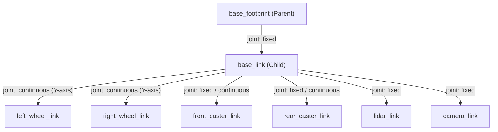
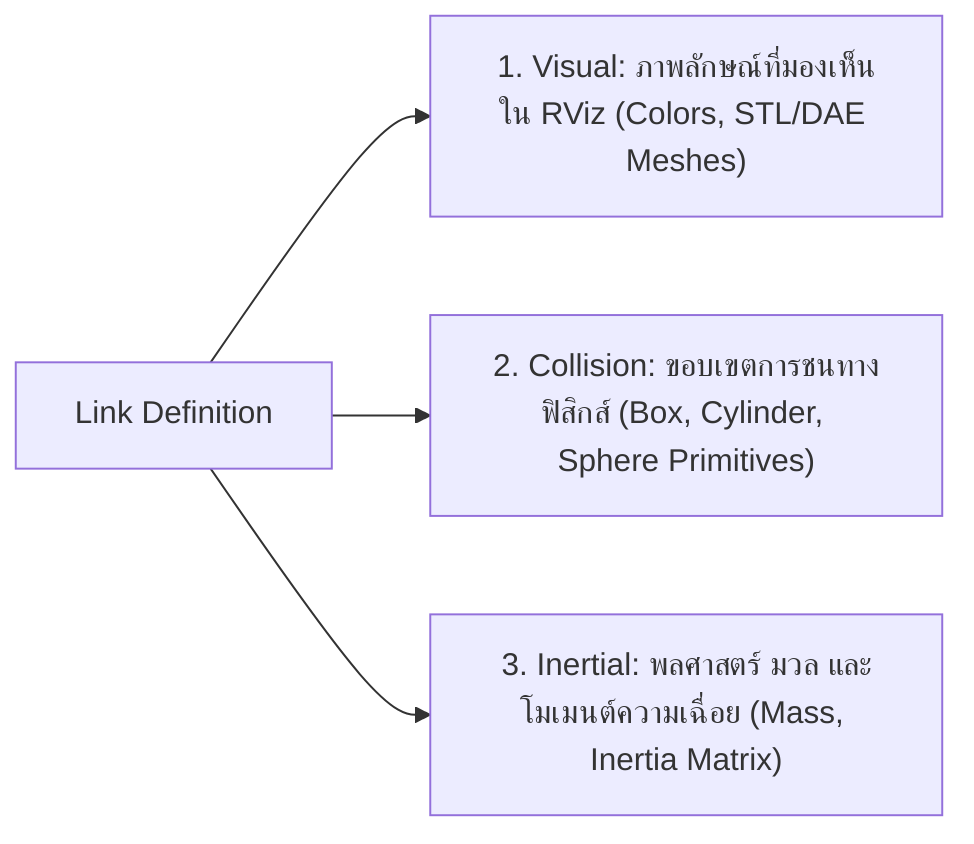

# 📖 Week 07: การสร้างแบบจำลอง 3 มิติ (URDF) และ Inertia Matrix
**เวลาเรียน:** บรรยาย 2 ชั่วโมง | ปฏิบัติการ 3 ชั่วโมง | ศึกษาค้นคว้าด้วยตนเอง 4 ชั่วโมง  
**วิชาบังคับก่อน:** [สัปดาห์ที่ 6: มาตรฐานวิศวกรรมพิกัด (REP 103/105) และจลนศาสตร์ AMR](../Week_06_Kinematics_REP_Standards/Readme.md)  
**เอกสารปฏิบัติการ:** [ใบงานแล็บสัปดาห์ที่ 7](Lab_Exercises.md)

---

## 🎯 วัตถุประสงค์การเรียนรู้ (Learning Objectives)
เมื่อจบบทเรียนนี้ ผู้เรียนจะสามารถ:
1. ออกแบบและสร้างไฟล์ **Unified Robot Description Format (URDF)** สำหรับหุ่นยนต์ AMR ได้อย่างถูกต้อง
2. วิเคราะห์ความแตกต่างและบทบาทของแท็ก `<visual>`, `<collision>`, และ `<inertial>`
3. เลือกใช้ประเภทข้อต่อ (**Joint Types**: `fixed`, `continuous`, `revolute`, `prismatic`) ได้ตรงตามกายภาพหุ่นยนต์
4. คำนวณเมทริกซ์ความเฉื่อย (**Inertia Tensor**) ของวัตถุรูปทรงเรขาคณิตมาตรฐาน (กล่อง ทรงกระบอก ทรงกลม) ตามหลักฟิสิกส์
5. ตรวจสอบโครงสร้างความถูกต้องของโมเดลผ่านคำสั่ง `check_urdf` และจำลองมุมมองใน **RViz2**

---

## ⏱️ แผนการสอน 2 ชั่วโมง (Lecture Outline)
| ช่วงเวลา | หัวข้อ | กิจกรรมการเรียนรู้ |
| :---: | :--- | :--- |
| **00:00 - 00:30** | โครงสร้างไวยากรณ์ URDF และข้อต่อหุ่นยนต์ (Links & Joints) | บรรยายพร้อมผัง Link-Joint Tree และประเภทข้อต่อ 4 รูปแบบ |
| **00:30 - 01:00** | Visual vs Collision Geometry และการปรับแต่งประสิทธิภาพ | อธิบายเหตุผลที่ Collision ต้องใช้รูปทรงเรขาคณิตพื้นฐาน (Primitives) |
| **01:00 - 01:40** | คณิตศาสตร์คำนวณเมทริกซ์ความเฉื่อย (Inertia Tensor Calculation) | แสดงการพิสูจน์และคำนวณ $I_{xx}, I_{yy}, I_{zz}$ ของหุ่นยนต์จริง |
| **01:40 - 02:00** | การใช้ `check_urdf`, Robot State Publisher และเตรียมเข้าสู่ Lab | สาธิตการตรวจสอบไวยากรณ์ XML และการ Visualize ใน RViz2 |

---

## 🏛️ สถาปัตยกรรมระบบ (Architectural Deep Dive)

### 1. โครงสร้างพื้นฐานของ URDF (Links and Joints)
URDF เป็นไฟล์ภาษา XML ที่ใช้นิยามโครงสร้างทางกายภาพ จลนศาสตร์ และพลศาสตร์ของหุ่นยนต์:
- **`<link>`**: ตัวแทนของชิ้นส่วนแข็ง (Rigid Body) เช่น โครงตัวถัง (Chassis), ล้อ (Wheel), ขายึดเซนเซอร์
- **`<joint>`**: ตัวแทนนัยน์ความสัมพันธ์และจุดหมุนระหว่าง Link สองชิ้น (Parent Link และ Child Link)

#### ประเภทของข้อต่อ (Joint Types):
1. `fixed`: เชื่อมติดตายตัว ไม่มีการขยับ เช่น ยึด LiDAR เข้ากับโครงหุ่นยนต์
2. `continuous`: หมุนได้อย่างต่อเนื่องไม่มีขีดจำกัดมุม เช่น ล้อรถ AMR
3. `revolute`: หมุนได้โดยมีขีดจำกัดมุม (Limit Angle เช่น $-90^\circ$ ถึง $+90^\circ$) เช่น ข้อต่อแขนกล
4. `prismatic`: เคลื่อนที่แบบเลื่อนแนวเส้นตรง เช่น กระบอกสูบ หรือรางสไลด์

---

### 2. องค์ประกอบ 3 เสาหลักของ `<link>`

> [!TIP]
> ในงานจำลองฟิสิกส์ ไม่ควรนำ 3D Mesh ที่มีความละเอียดหลายแสนโพลีกอนมาใส่ในแท็ก `<collision>` เพราะจะทำให้การคำนวณ Ray-casting และ Contact Solver ช้าลงอย่างรุนแรง ควรใช้รูปทรงพื้นฐาน (Primitives: Box, Cylinder, Sphere) ห่อหุ้มวัตถุแทน

---

### 3. การคำนวณโมเมนต์ความเฉื่อย (Inertia Matrix Derivation)
เมทริกซ์ความเฉื่อย (Inertia Tensor) ใน 3 มิติ มีโครงสร้างเป็นสมมาตร $3 \times 3$:
$$\mathbf{I} = \begin{bmatrix} I_{xx} & I_{xy} & I_{xz} \\ I_{yx} & I_{yy} & I_{yz} \\ I_{zx} & I_{zy} & I_{zz} \end{bmatrix}$$
สำหรับวัตถุที่มีแกนสมมาตรผ่านจุดศูนย์ถ่วง (Principal Axes) ค่า Cross-products $I_{xy} = I_{xz} = I_{yz} = 0$

#### ก. ตัวถังหุ่นยนต์ (Solid Box): ขนาดความกว้าง $w$, ยาว $d$, สูง $h$, มวล $m$
$$I_{xx} = \frac{1}{12} m (w^2 + h^2)$$
$$I_{yy} = \frac{1}{12} m (d^2 + h^2)$$
$$I_{zz} = \frac{1}{12} m (d^2 + w^2)$$

**ตัวอย่างการคำนวณหุ่นยนต์ในแล็บ:**  
ตัวถังมีขนาด ยาว $d = 0.40$ m, กว้าง $w = 0.20$ m, สูง $h = 0.10$ m, มวล $m = 5.0$ kg
$$I_{xx} = \frac{1}{12} (5.0) (0.20^2 + 0.10^2) = \frac{5.0 \times 0.05}{12} \approx \mathbf{0.020833} \text{ kg}\cdot\text{m}^2$$
$$I_{yy} = \frac{1}{12} (5.0) (0.40^2 + 0.10^2) = \frac{5.0 \times 0.17}{12} \approx \mathbf{0.070833} \text{ kg}\cdot\text{m}^2$$
$$I_{zz} = \frac{1}{12} (5.0) (0.40^2 + 0.20^2) = \frac{5.0 \times 0.20}{12} \approx \mathbf{0.083333} \text{ kg}\cdot\text{m}^2$$

#### ข. ล้อขับเคลื่อน (Solid Cylinder): รัศมี $r$, ความหนา $h$, มวล $m$ (แกนหมุนคือแกนความยาว $Y$)
$$I_{\text{axial}} = I_{yy} = \frac{1}{2} m r^2$$
$$I_{\text{transverse}} = I_{xx} = I_{zz} = \frac{1}{12} m (3r^2 + h^2)$$

**ตัวอย่างการคำนวณล้อในแล็บ:**  
ล้อมีรัศมี $r = 0.08$ m, ความหนา $h = 0.04$ m, มวล $m = 0.75$ kg
$$I_{yy} = \frac{1}{2} (0.75) (0.08^2) = 0.375 \times 0.0064 = \mathbf{0.00240} \text{ kg}\cdot\text{m}^2$$
$$I_{xx} = I_{zz} = \frac{1}{12} (0.75) (3(0.08^2) + 0.04^2) = \frac{0.75 \times 0.0208}{12} \approx \mathbf{0.00130} \text{ kg}\cdot\text{m}^2$$

---

## 🛠️ การวิเคราะห์โค้ดตัวอย่างในโมดูล (Code Walkthrough)

### 1. `diff_drive_robot.urdf`
- นิยามโครงสร้างตาม REP 105:
  - `base_footprint`: ลิงก์เสมือนที่ระนาบพื้น ($z=0$)
  - `base_footprint_joint`: ยกแกนลอยขึ้น $z = 0.08$ m เพื่อให้จุดศูนย์กลางล้อสัมผัสพื้นพอดี
- นิยามล้อซ้าย-ขวา:
  - ใช้ `type="continuous"`
  - แกนหมุนกำหนดผ่าน `<axis xyz="0 1 0"/>` (หมุนรอบแกน Y)
- นิยามเซนเซอร์:
  - `lidar_link`: ติดตั้งบนหลังคาที่พิกัด $(x=0.08, z=0.095)$
  - `camera_link`: ติดตั้งหน้ารถที่พิกัด $(x=0.20, z=0.02)$

### 2. `display_urdf.launch.py`
- นำไฟล์ URDF ไปอ่านผ่านคำสั่ง `Command(['cat ', LaunchConfiguration('model')])`
- ส่งค่าเข้าสู่โหนด `robot_state_publisher` เพื่อกระจายข้อมูล Transform ไปยัง TF Tree
- เปิด `joint_state_publisher_gui` สำหรับให้นักศึกษาปรับสไลเดอร์หมุนล้อได้แบบอินเทอร์แอ็กทิฟ

---

## ⌨️ ตารางคำสั่ง CLI สำคัญ
| คำสั่ง | วัตถุประสงค์ | ตัวอย่างการใช้งาน |
| :--- | :--- | :--- |
| `check_urdf <file.urdf>` | ตรวจสอบไวยากรณ์ XML และแสดงแผนผัง Link-Joint Tree | `check_urdf Essential_ROS/Week_07_URDF_Robot_Modeling/urdf/diff_drive_robot.urdf` |
| `urdf_to_graphiz <file.urdf>` | แปลงโครงสร้าง URDF ออกมาเป็นไฟล์ภาพ PDF Graphviz | `urdf_to_graphiz Essential_ROS/Week_07_URDF_Robot_Modeling/urdf/diff_drive_robot.urdf` |
| `ros2 launch display_urdf.launch.py` | เปิดแสดงผลหุ่นยนต์ใน RViz2 พร้อม GUI ควบคุมข้อต่อ | `ros2 launch Essential_ROS/Week_07_URDF_Robot_Modeling/launch/display_urdf.launch.py` |

---

## ⚠️ ปัญหาที่พบบ่อยและการแก้ไข (Troubleshooting)
| อาการ | สาเหตุที่เป็นไปได้ | วิธีแก้ไข |
| :--- | :--- | :--- |
| `check_urdf` ขึ้น Error: `XML parsing error` | ลืมปิดแท็ก XML (เช่น ขาด `</link>`) หรือพิมพ์ชื่อแอตทริบิวต์ผิด | เปิดดูบรรทัดที่แจ้งเตือนในผลลัพธ์ของ `check_urdf` และปิดแท็กให้ถูกต้อง |
| หุ่นยนต์สีขาวล้วนและขึ้น Status Error ใน RViz2 | ลืมตั้ง Fixed Frame เป็น `base_footprint` หรือ `base_link` | ปรับค่า Global Options -> Fixed Frame ในแถบซ้ายของ RViz2 |
| โมเดลล้อหลุดหรือจมลงไปใต้พื้น | กำหนด origin xyz ของล้อเทียบกับ base_link ไม่สัมพันธ์กับรัศมีล้อ | ตรวจสอบความสูง joint origin ของ base_footprint ให้เท่ากับรัศมีล้อ |

---

## 📝 แบบทดสอบท้ายบท (Self-Assessment Quiz)
1. ข้อต่อแบบ `continuous` แตกต่างจาก `revolute` อย่างไร?
2. เหตุใดการระบุค่าในแท็ก `<inertial>` จึงจำเป็นอย่างยิ่งเมื่อนำหุ่นยนต์ไปรันใน Gazebo Physics Simulation?
3. ลิงก์ `base_footprint` มีความสำคัญอย่างไรในการทำแบบจำลองหุ่นยนต์ AMR ตามมาตรฐาน REP 105?
4. หากกล่องตัวถังหุ่นยนต์มีขนาด $0.5 \times 0.3 \times 0.2$ เมตร และมวล $10$ กิโลกรัม ค่า $I_{zz}$ จะมีค่าเท่าใด?
5. คำสั่ง CLI ใดที่ใช้วิเคราะห์ความถูกต้องของไฟล์ URDF ได้อย่างรวดเร็วโดยไม่ต้องเปิดหน้าต่าง GUI?

🔍 ดูเฉลยคำตอบ

1. **ตอบ:** `continuous` หมุนได้อิสระไม่จำกัดรอบ (เหมาะกับล้อ) ส่วน `revolute` มีการจำกัดมุมการหมุนต่ำสุดและสูงสุดผ่านแท็ก `<limit>` (เหมาะกับข้อต่อแขนกล)
2. **ตอบ:** เพราะ Physics Engine (เช่น DART, Bullet, ODE) ต้องใช้มวลและเมทริกซ์ความเฉื่อยในการคำนวณแรงเฉื่อย, ทอร์ก, แรงเหวี่ยง และความเร่ง หากไม่มีค่าเหล่านี้ หุ่นยนต์จะลอย เด้ง หรือเกิดข้อผิดพลาดทางฟิสิกส์
3. **ตอบ:** เป็นจุดอ้างอิงระนาบสัมผัสพื้น 2 มิติที่ $z=0$ ทำให้ระบบ SLAM และ Navigation สามารถคำนวณระยะการเคลื่อนที่บนพื้นผิวได้อย่างแม่นยำ
4. **ตอบ:** $I_{zz} = \frac{1}{12} m (d^2 + w^2) = \frac{1}{12} \times 10 \times (0.5^2 + 0.3^2) = \frac{10 \times 0.34}{12} \approx 0.2833 \text{ kg}\cdot\text{m}^2$
5. **ตอบ:** `check_urdf <path_to_urdf_file>`

---

## 📚 แหล่งอ้างอิงและศึกษาเพิ่มเติม
- [ROS 2 URDF Tutorials](https://docs.ros.org/en/jazzy/Tutorials/Intermediate/URDF/URDF-Main.html)
- [URDF XML Specifications (Official ROS Wiki)](https://wiki.ros.org/urdf/XML)
- [Rigid Body Dynamics and Inertia Tensor Formulations](https://en.wikipedia.org/wiki/List_of_moments_of_inertia)
