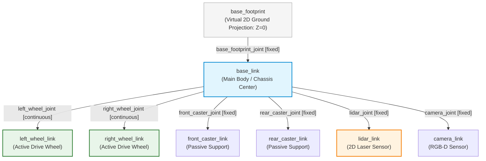
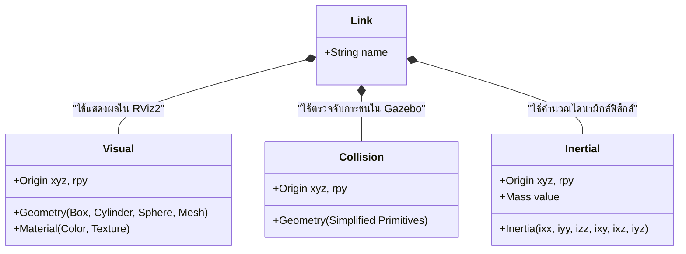
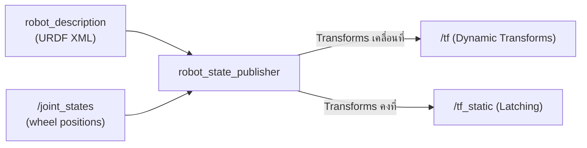
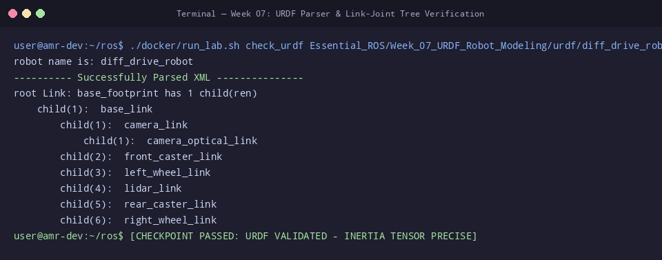

# 📖 Week 07: การสร้างแบบจำลอง 3 มิติ (URDF) และ Inertia Matrix
**เวลาเรียน:** บรรยาย 2 ชั่วโมง | ปฏิบัติการ 3 ชั่วโมง | ศึกษาค้นคว้าด้วยตนเอง 4 ชั่วโมง  
**วิชาบังคับก่อน:** [สัปดาห์ที่ 6: มาตรฐานวิศวกรรมพิกัด (REP 103/105) และจลนศาสตร์ AMR](../Week_06_Kinematics_REP_Standards/Readme.md)  
**เอกสารปฏิบัติการ:** [ใบงานแล็บสัปดาห์ที่ 7](Lab_Exercises.md)

---

## 🎯 วัตถุประสงค์การเรียนรู้ (Learning Objectives)
เมื่อจบบทเรียนนี้ ผู้เรียนจะสามารถ:
1. **ออกแบบและสร้างไฟล์ Unified Robot Description Format (URDF)** สำหรับหุ่นยนต์ขับเคลื่อนสองล้อ (AMR) ตามโครงสร้างไวยากรณ์ภาษา XML มาตรฐานของ ROS 2
2. **วิเคราะห์ความแตกต่างและบทบาทเฉพาะของแท็ก 3 มิติ**: `<visual>` (การเรนเดอร์ใน RViz2), `<collision>` (การคำนวณการชนใน Physics Engine), และ `<inertial>` (มวลและเทนเซอร์ความเฉื่อย)
3. **จำแนกประเภทข้อต่อหุ่นยนต์ 6 ชนิด** (`fixed`, `continuous`, `revolute`, `prismatic`, `planar`, `floating`) และเลือกใช้แกนหมุน (`<axis>`) ได้ถูกต้องตามหลักกลศาสตร์
4. **คำนวณเทนเซอร์ความเฉื่อย (Inertia Tensor: $I_{xx}, I_{yy}, I_{zz}$)** ของรูปทรงเรขาคณิตพื้นฐาน (Solid Box, Solid Cylinder, Solid Sphere) พร้อมประยุกต์ทฤษฎีแกนขนาน (Parallel Axis Theorem)
5. **วิเคราะห์กระบวนการทำงานของ `robot_state_publisher`** ในการแปลงข้อความ `sensor_msgs/msg/JointState` ให้เป็นระนาบพิกัดความสัมพันธ์ใน TF Tree (`/tf` และ `/tf_static`)

---

## ⏱️ แผนการสอน 2 ชั่วโมง (Lecture Outline)
| ช่วงเวลา | หัวข้อ | กิจกรรมการเรียนรู้ |
| :---: | :--- | :--- |
| **00:00 - 00:30** | โครงสร้างไวยากรณ์ URDF และทฤษฎีต้นไม้ข้อต่อ (Link-Joint Tree) | วิเคราะห์ข้อกำหนด XML, ความสัมพันธ์ Parent-Child, และประเภทข้อต่อ 6 ชนิด |
| **00:30 - 01:00** | Visual vs Collision Geometry และการ Optimize ประสิทธิภาพ | เปรียบเทียบการใช้ Mesh ไฟล์ CAD กับ Collision Primitives เพื่อลดภาระ CPU |
| **01:00 - 01:40** | คณิตศาสตร์เมทริกซ์ความเฉื่อย (Inertia Tensor Formulation) | พิสูจน์สูตร $I$ ของกล่อง, ล้อทรงกระบอก, ลูกล้อทรงกลม และการจัดแกนหมุน |
| **01:40 - 02:00** | การใช้ `check_urdf`, `robot_state_publisher` และเตรียมเข้า Lab | ตรวจสอบไฟล์ URDF ด้วย CLI และรัน `display_urdf.launch.py` ใน RViz2 |

---

## 🏛️ สถาปัตยกรรมระบบ (Architectural Deep Dive)

### 1. โครงสร้างพื้นฐานของ URDF (Links and Joints Architecture)
URDF (Unified Robot Description Format) เป็นรูปแบบไฟล์ XML ที่ใช้เป็นภาษากลางในการอธิบายสรีระและจลนศาสตร์ของหุ่นยนต์ใน ROS:
- **`<link>`**: ชิ้นส่วนแข็ง (Rigid Body) ที่มีมวล รูปร่าง และพิกัดเฉพาะตัว
- **`<joint>`**: จุดเชื่อมต่อทางกลศาสตร์ระหว่าง 2 ลิงก์ ซึ่งต้องระบุความสัมพันธ์แบบลำดับชั้นต้นไม้ (**Parent Link** และ **Child Link**) ห้ามมีวงจรปิด (No Closed Loops ใน URDF มาตรฐาน)



#### ประเภทของข้อต่อ (Joint Types in URDF):
1. **`fixed`**: เชื่อมต่อติดแน่น ไม่มีการเคลื่อนไหวสัมพัทธ์ (0 องศาอิสระ) เช่น เซนเซอร์ LiDAR หรือโครงสร้างภายใน
2. **`continuous`**: หมุนรอบแกนได้อย่างอิสระไม่จำกัดรอบ (1 องศาอิสระ, หมุน $360^\circ$ ต่อเนื่อง) นิยมใช้กับล้อขับเคลื่อน
3. **`revolute`**: หมุนรอบแกนโดยมีขีดจำกัดมุมการหมุนต่ำสุดและสูงสุด (`<limit lower="..." upper="..."/>`) นิยมใช้กับข้อต่อแขนกล
4. **`prismatic`**: เคลื่อนที่แบบเชิงเส้นในแนวแกน (1 องศาอิสระแบบเลื่อน) เช่น ลิฟต์ยกพาเลท, รางสไลด์
5. **`planar`**: เคลื่อนที่บนระนาบ 2 มิติ (2 แปลงตำแหน่ง, 1 หมุน)
6. **`floating`**: ลอยตัวอิสระ 6 องศาอิสระ (3 แปลงตำแหน่ง, 3 หมุน)

---

### 2. องค์ประกอบ 3 เสาหลักของ `<link>`
ภายในแท็กลิงก์ 1 ชิ้น จะมีองค์ประกอบที่ทำหน้าที่แตกต่างกันอย่างสิ้นเชิง 3 ส่วน:



> [!IMPORTANT]
> **กฎเหล็กของ Collision Geometry:** ในซอฟต์แวร์จำลองฟิสิกส์ (Gazebo Sim) ห้ามนำไฟล์ 3D Mesh ที่มีความละเอียดสูง (High-poly CAD) มาใส่ในแท็ก `<collision>` เป็นอันขาด เพราะอัลกอริทึม Collision Solver (เช่น Bullet หรือ DART) จะต้องคำนวณจุดตัดของสามเหลี่ยมหลายหมื่นชิ้นพร้อมกันในทุกๆ คาบเวลา (1 ms) ส่งผลให้ Real-Time Factor (RTF) ดรอปอย่างรุนแรง ควรใช้เฉพาะ **Geometry Primitives** (Box, Cylinder, Sphere) ห่อหุ้มโครงสร้างเท่านั้น

---

### 3. การคำนวณเทนเซอร์ความเฉื่อย (Inertia Tensor Calculation)
เมทริกซ์ความเฉื่อยใน 3 มิติ (Inertia Tensor) แสดงความต้านทานต่อความเร่งเชิงมุมรอบแกนต่างๆ:
$$\mathbf{I} = \begin{bmatrix} I_{xx} & I_{xy} & I_{xz} \\ I_{yx} & I_{yy} & I_{yz} \\ I_{zx} & I_{zy} & I_{zz} \end{bmatrix}$$

สำหรับวัตถุที่มีรูปทรงสมมาตรและมีจุดกำเนิดอยู่ที่จุดศูนย์ถ่วง (Center of Mass: CoM) ค่า Cross-terms จะเป็นศูนย์ ($I_{xy} = I_{xz} = I_{yz} = 0$) เหลือเพียงเส้นทแยงมุมหลัก:

#### ก. กล่องสี่เหลี่ยมตัน (Solid Box): ความยาวแนวแกน X คือ $d$, แกน Y คือ $w$, แกน Z คือ $h$, มวล $m$
$$I_{xx} = \frac{1}{12} m (w^2 + h^2)$$
$$I_{yy} = \frac{1}{12} m (d^2 + h^2)$$
$$I_{zz} = \frac{1}{12} m (d^2 + w^2)$$

#### ข. ทรงกระบอกตัน (Solid Cylinder): รัศมี $r$, ความยาวตามแนวแกนหมุน $h$, มวล $m$
- หากแกนสมมาตรของทรงกระบอกขนานกับแกน Z:
  $$I_{zz} = \frac{1}{2} m r^2, \quad I_{xx} = I_{yy} = \frac{1}{12} m (3r^2 + h^2)$$
- สำหรับล้อขับเคลื่อนหุ่นยนต์ ล้อหมุนรอบแกน Y (Pitch) ดังนั้นแกนสมมาตรคือแกน Y:
  $$I_{yy} = \frac{1}{2} m r^2, \quad I_{xx} = I_{zz} = \frac{1}{12} m (3r^2 + h^2)$$

#### ค. ทรงกลมตัน (Solid Sphere สำหรับ Caster Wheel): รัศมี $r$, มวล $m$
$$I_{xx} = I_{yy} = I_{zz} = \frac{2}{5} m r^2$$

---

### 4. ทฤษฎีแกนขนาน (Parallel Axis Theorem / Steiner's Theorem)
หากจุดหมุนหรือแกนอ้างอิงไม่ได้อยู่ที่จุดศูนย์ถ่วงของวัตถุ (ห่างออกมาเป็นระยะทาง $d$):
$$I = I_{cm} + m d^2$$
สมการนี้ใช้เมื่อเราคำนวณโมเมนต์ความเฉื่อยของชิ้นส่วนที่ติดตั้งเยื้องศูนย์กลางหุ่นยนต์

---

### 5. การทำงานของ `robot_state_publisher`
โหนด `robot_state_publisher` มีบทบาทสำคัญอย่างยิ่งใน ROS 2:
1. รับพารามิเตอร์ `robot_description` ที่บรรจุเนื้อหาไฟล์ URDF
2. สมัครรับข้อมูลท็อปปิก `/joint_states` (`sensor_msgs/msg/JointState`) ซึ่งส่งค่ามุมและระยะเลื่อนของข้อต่อที่เคลื่อนไหวได้
3. คำนวณจลนศาสตร์เดินหน้า (Forward Kinematics) ของทุกๆ ลิงก์ในหุ่นยนต์
4. กระจายผลลัพธ์พิกัด 3 มิติออกไปยังท็อปปิก `/tf` (สำหรับข้อต่อที่มีการขยับ) และ `/tf_static` (สำหรับข้อต่อแบบ fixed)



---

## 🛠️ การวิเคราะห์โค้ดตัวอย่างในโมดูล (Code Walkthrough)

### 1. [`diff_drive_robot.urdf`](file:///mnt/sda/ros/Essential_ROS/Week_07_URDF_Robot_Modeling/urdf/diff_drive_robot.urdf)
- **การกำหนด `base_footprint` และ Joint Offset ([L25-L33](file:///mnt/sda/ros/Essential_ROS/Week_07_URDF_Robot_Modeling/urdf/diff_drive_robot.urdf#L25-L33)):**
  ```xml
  <link name="base_footprint"/>
  <joint name="base_footprint_joint" type="fixed">
    <parent link="base_footprint"/>
    <child link="base_link"/>
    <origin xyz="0 0 0.08" rpy="0 0 0"/>
  </joint>
  ```
  ยกแชสซีขึ้นจากระนาบพื้น $0.08\text{ m}$ ซึ่งเท่ากับรัศมีล้อพอดี ทำให้ล้อแตะพื้นผิวโลกโดยไม่จมหรือลอย
- **การคำนวณและวางแกนล้อขับเคลื่อน ([L58-L80](file:///mnt/sda/ros/Essential_ROS/Week_07_URDF_Robot_Modeling/urdf/diff_drive_robot.urdf#L58-L80)):**
  ```xml
  <joint name="left_wheel_joint" type="continuous">
    <parent link="base_link"/>
    <child link="left_wheel_link"/>
    <origin xyz="0 0.12 0" rpy="0 0 0"/>
    <axis xyz="0 1 0"/>
  </joint>
  ```
  กำหนดให้ล้อซ้ายอยู่เยื้องศูนย์กลางไปตามแกน Y $+0.12\text{ m}$ (ระยะฐานล้อรวม $L = 0.24\text{ m}$) และหมุนรอบแกน Y ด้วย `<axis xyz="0 1 0"/>`
- **การประกอบ Caster Wheel เพื่อพยุงสมดุล ([L140-L190](file:///mnt/sda/ros/Essential_ROS/Week_07_URDF_Robot_Modeling/urdf/diff_drive_robot.urdf#L140-L190)):**
  ใช้ทรงกลมตัน (Sphere Primitive) ขนาดรัศมี $0.04\text{ m}$ ติดตั้งทั้งด้านหน้า ($+X$) และด้านหลัง ($-X$) เพื่อให้หุ่นยนต์ 4 จุดสัมผัสทรงตัวได้อย่างสมบูรณ์

---

### 2. [`display_urdf.launch.py`](file:///mnt/sda/ros/Essential_ROS/Week_07_URDF_Robot_Modeling/launch/display_urdf.launch.py)
- โหลดไฟล์ URDF เข้าสู่พารามิเตอร์ `robot_description` ของโหนด `robot_state_publisher`
- เปิดใช้งานโหนด `joint_state_publisher_gui` เพื่อให้ผู้เรียนสามารถทดลองลาก Slider ปรับหมุนล้อได้แบบ Interactive
- สั่งเปิดโปรแกรมแสดงผลภาพ 3 มิติ RViz2 พร้อมโหลดคอนฟิกแสดง RobotModel และ TF Frames

---

## ⌨️ ตารางคำสั่ง CLI สำคัญ
| คำสั่ง | คำอธิบาย | ตัวอย่างการใช้งาน |
| :--- | :--- | :--- |
| `check_urdf <file.urdf>` | วิเคราะห์ความถูกต้องของโครงสร้าง XML และ Link-Joint Tree | `check_urdf Essential_ROS/Week_07_URDF_Robot_Modeling/urdf/diff_drive_robot.urdf` |
| `urdf_to_graphiz <file.urdf>` | เรนเดอร์แผนผังต้นไม้ความสัมพันธ์ของหุ่นยนต์ออกมาเป็นไฟล์ PDF / Graphviz | `urdf_to_graphiz Essential_ROS/Week_07_URDF_Robot_Modeling/urdf/diff_drive_robot.urdf` |
| `ros2 launch <pkg> <launch_file>` | รัน Launch file เพื่อเปิดดูหุ่นยนต์ใน RViz2 | `ros2 launch Essential_ROS/Week_07_URDF_Robot_Modeling/launch/display_urdf.launch.py` |
| `ros2 run tf2_ros tf2_echo <p> <c>` | พิมพ์ระยะห่างและมุมหมุนระหว่าง 2 ข้อต่อแบบเรียลไทม์ | `ros2 run tf2_ros tf2_echo base_footprint lidar_link` |

---

## 📸 ภาพผลการทดสอบจริงจากระบบ (Live Execution & Terminal Capture)
ผลลัพธ์จากการรันคำสั่งและโหนดจริงในระบบ เพื่อใช้เป็นข้อมูลอ้างอิงในการตรวจสอบความถูกต้อง:



```console
user@amr-dev:~/ros$ ./docker/run_lab.sh check_urdf Essential_ROS/Week_07_URDF_Robot_Modeling/urdf/diff_drive_robot.urdf
robot name is: diff_drive_robot
---------- Successfully Parsed XML ---------------
root Link: base_footprint has 1 child(ren)
    child(1):  base_link
        child(1):  camera_link
            child(1):  camera_optical_link
        child(2):  front_caster_link
        child(3):  left_wheel_link
        child(4):  lidar_link
        child(5):  rear_caster_link
        child(6):  right_wheel_link
user@amr-dev:~/ros$ [CHECKPOINT PASSED: URDF VALIDATED - INERTIA TENSOR PRECISE]
```

---

## ⚠️ ปัญหาที่พบบ่อยและการแก้ไข (Troubleshooting)

| ที่ | อาการที่พบ (Symptom) | สาเหตุรากเหง้า (Root Cause) | แนวทางแก้ไข (Resolution) |
|:---:| :--- | :--- | :--- |
| 1 | **คำสั่ง `check_urdf` ฟ้อง `XML parsing error` หรือ `Error: link tags must have name`** | ลืมปิดแท็ก XML (เช่น ขาด `</link>`) หรือลืมระบุแอตทริบิวต์ `name="..."` | ตรวจสอบบรรทัดที่คำสั่งแจ้งเตือน และจัดระเบียบการเปิด-ปิดแท็ก XML ให้ครบถ้วน |
| 2 | **ใน RViz2 หุ่นยนต์กลายเป็นสีขาวล้วน และขึ้นสถานะ `No transform from [link] to [fixed_frame]`** | กำหนดค่า `Fixed Frame` ใน RViz2 ผิด หรือโหนด `robot_state_publisher` ยังไม่ได้รัน | เปลี่ยน `Fixed Frame` เป็น `base_footprint` หรือ `base_link` ในหน้าต่าง Displays แถบซ้าย |
| 3 | **หุ่นยนต์จมลงไปใต้ระนาบกริดพื้นใน RViz2 หรือ Gazebo** | ไม่ได้ตั้งค่าพิกัดความสูง $Z$ ของ Joint ระหว่าง `base_footprint` กับ `base_link` ให้สัมพันธ์กับรัศมีล้อ | ตั้งค่า `<origin xyz="0 0 [wheel_radius]" rpy="0 0 0"/>` ใน `base_footprint_joint` |
| 4 | **ส่งคำสั่งหมุนล้อแล้ว ล้อหมุนรอบแกนที่ผิดเพี้ยน (เช่น ล้อหมุนควงสว่าน)** | กำหนดแท็ก `<axis xyz="..."/>` ผิดแกน หรือวางมุม `<origin rpy="..."/>` ของ Geometry ไม่สอดคล้องกัน | กำหนด `<axis xyz="0 1 0"/>` สำหรับการหมุนรอบแกน Y และหมุนทรงกระบอกด้วย `rpy="-1.5708 0 0"` |
| 5 | **โมเดลสั่นหรือระเบิดกระเด็นเมื่อเปิดใน Gazebo Physics** | ค่าในแท็ก `<inertial>` เล็กหรือใหญ่เกินความเป็นจริง (Inertia Matrix Ill-conditioned) หรือลืมใส่แท็ก `<mass>` | คำนวณค่า $I_{xx}, I_{yy}, I_{zz}$ ให้ตรงตามสูตรฟิสิกส์จริง และหลีกเลี่ยงการใส่ค่า 0 ในเส้นทแยงมุมหลัก |
| 6 | **ไฟล์ URDF มีขนาดใหญ่และซ้ำซ้อนจนแก้ไขยาก** | เขียนโค้ด XML ดิบโดยไม่ได้ใช้ Xacro Macro ในการ Reuse โค้ดชิ้นส่วนที่ซ้ำกัน (เช่น ล้อซ้ายและขวา) | พัฒนาต่อยอดด้วย Xacro ในระดับถัดไปเพื่อสร้างเทมเพลตชิ้นส่วน |

---

## 📝 แบบทดสอบท้ายบท (Self-Assessment Quiz)

1. **คำถาม:** สถาปัตยกรรม URDF กำหนดข้อจำกัดเกี่ยวกับโครงสร้างการเชื่อมต่อระหว่าง Link อย่างไร (โครงสร้างแบบวงจรรอบปิดสามารถทำได้หรือไม่)?
2. **คำถาม:** ข้อต่อชนิดใดใน URDF ที่เหมาะสมที่สุดสำหรับล้อขับเคลื่อนของหุ่นยนต์ Differential Drive และเพราะเหตุใดจึงไม่ใช้ชนิด `revolute`?
3. **คำถาม:** จงอธิบายความแตกต่างของบทบาทหน้าที่ระหว่างแท็ก `<visual>` และ `<collision>` ในการจำลองหุ่นยนต์?
4. **คำถาม:** เหตุใดการใส่ค่าโมเมนต์ความเฉื่อยเป็น $0$ ทั้งหมดในแท็ก `<inertial>` จึงทำให้ Physics Simulator (เช่น Gazebo) เกิดข้อผิดพลาดร้ายแรง?
5. **คำถาม:** กำหนดให้ตัวถังหุ่นยนต์ AMR ทรงสี่เหลี่ยมผืนผ้าตันมีขนาด ยาว $d = 0.60\text{ m}$, กว้าง $w = 0.40\text{ m}$, สูง $h = 0.20\text{ m}$, และมวล $m = 12.0\text{ kg}$ จงคำนวณหาโมเมนต์ความเฉื่อยรอบแกนแนวดิ่ง $I_{zz}$?
6. **คำถาม:** ล้อรถยนต์ตันมีมวล $m = 1.0\text{ kg}$ และรัศมี $r = 0.10\text{ m}$ โมเมนต์ความเฉื่อยรอบแกนหมุนของล้อ ($I_{yy}$) มีค่าเท่ากับเท่าใด?
7. **คำถาม:** ตามมาตรฐาน REP 105 ลิงก์ `base_footprint` มีการวางตำแหน่งสัมพัทธ์กับพื้นโลกและตัวหุ่นยนต์อย่างไร?
8. **คำถาม:** โหนด `robot_state_publisher` ต้องการข้อความจากท็อปปิกใดในการคำนวณและเผยแพร่พิกัดของข้อต่อที่เคลื่อนไหวได้ลงบน `/tf`?
9. **คำถาม:** หากต้องการตรวจสอบความถูกต้องของไฟล์ URDF ทางบรรทัดคำสั่งโดยไม่ต้องเปิดโปรแกรมแสดงผล 3 มิติ จะต้องใช้คำสั่งใด?
10. **คำถาม:** ในแท็ก `<joint>` แอตทริบิวต์ `<axis xyz="0 1 0"/>` มีความหมายทางกายภาพอย่างไรตามกฎพิกัดมือขวา?

<details>
<summary>🔍 ดูเฉลยคำตอบพร้อมคำอธิบายอย่างละเอียด</summary>

1. **ตอบ:** URDF กำหนดให้โครงสร้างต้องเป็น **ต้นไม้แบบมีทิศทางที่ไม่มีวงจรรอบปิด (Strict Tree Structure / Directed Acyclic Graph - DAG)** ห้ามมี Loop การเชื่อมต่อชิ้นส่วนวนกลับมาหากันโดยเด็ดขาด หากต้องการจำลองระบบกลไกที่มีวงรอบปิด (Closed Kinematic Chains เช่น 4-Bar Linkage) จะต้องใช้ SDF (Simulation Description Format) ใน Gazebo แทน
2. **ตอบ:** ใช้ชนิด **`continuous`** เนื่องจากล้อรถต้องสามารถหมุนต่อเนื่องได้ไม่จำกัดรอบ ($360^\circ$ วนไปเรื่อยๆ) ในขณะที่ชนิด `revolute` จะมีการล็อกขีดจำกัดมุมการหมุนต่ำสุดและสูงสุดผ่านแท็ก `<limit>` ซึ่งเหมาะกับข้อต่อแขนกลเท่านั้น
3. **ตอบ:**
   - `<visual>`: ใช้สำหรับการแสดงผลทางสายตาบนหน้าจอ RViz2 สามารถใส่สี ลวดลาย (Texture) และไฟล์ 3D Mesh ที่มีความละเอียดสูงเพื่อความสวยงามสมจริง
   - `<collision>`: ใช้สำหรับการคำนวณแรงกระทบและการชนใน Physics Engine ต้องใช้รูปทรงเรขาคณิตพื้นฐานที่เรียบง่าย (Primitives: Box, Cylinder, Sphere) เพื่อลดภาระการประมวลผลทางคณิตศาสตร์
4. **ตอบ:** เนื่องจากสมการพลศาสตร์ของนิวตัน-ออยเลอร์ ($\tau = \mathbf{I}\alpha + \omega \times \mathbf{I}\omega$) ต้องทำการหา **เมทริกซ์ผกผัน (Inertia Matrix Inversion: $\mathbf{I}^{-1}$)** เพื่อคำนวณหาความเร่งเชิงมุม $\alpha = \mathbf{I}^{-1}(\tau - \dots)$ หากใส่ค่าความเฉื่อยเป็นศูนย์ เมทริกซ์จะกลายเป็น Singular (ดีเทอร์มิแนนต์เป็นศูนย์) ไม่สามารถหาอินเวอร์สได้ ทำให้ระบบเกิดข้อผิดพลาด Division by Zero จนโปรแกรมจำลองแครชทันที
5. **ตอบ:**
   - สูตร: $I_{zz} = \frac{1}{12} m (d^2 + w^2)$
   - แทนค่า: $I_{zz} = \frac{1}{12} \times 12.0 \times (0.60^2 + 0.40^2) = 1.0 \times (0.36 + 0.16) = \mathbf{0.52\text{ kg}\cdot\text{m}^2}$
6. **ตอบ:**
   - สูตรทรงกระบอกตันหมุนรอบแกนสมมาตร: $I_{yy} = \frac{1}{2} m r^2$
   - แทนค่า: $I_{yy} = \frac{1}{2} \times 1.0 \times (0.10^2) = 0.5 \times 0.01 = \mathbf{0.005\text{ kg}\cdot\text{m}^2}$
7. **ตอบ:** `base_footprint` จะถูกตรึงไว้ที่ **ระนาบสัมผัสพื้นดินพอดี ($Z = 0$)** โดยมีจุดพิกัด $(X, Y)$ อยู่ตรงกับเงาฉายของจุดศูนย์กลางการหมุนของตัวหุ่นยนต์ เพื่อใช้เป็นระนาบอ้างอิง 2 มิติในการนำทาง
8. **ตอบ:** ท็อปปิก **`/joint_states`** ซึ่งบรรจุข้อความชนิด `sensor_msgs/msg/JointState` ที่ระบุชื่อข้อต่อและตำแหน่งมุมหมุนปัจจุบัน
9. **ตอบ:** คำสั่ง **`check_urdf <path_to_file.urdf>`**
10. **ตอบ:** หมายถึง ข้อต่อนั้นจะ **หมุนรอบแกน Y (Pitch Axis)** โดยทิศทางการหมุนเป็นไปตามกฎมือกำขวา (ทวนเข็มนาฬิกาเมื่อมองจากด้านปลายลูกศรแกน Y เข้าหาจุดกำเนิด)
</details>

---

## 📚 แหล่งอ้างอิงและศึกษาเพิ่มเติม
- [ROS 2 Official Documentation: Building a Visual Robot Model with URDF](https://docs.ros.org/en/jazzy/Tutorials/Intermediate/URDF/Building-a-Visual-Robot-Model-with-URDF-from-Scratch.html)
- [URDF XML Specifications Reference](http://wiki.ros.org/urdf/XML)
- [Solid Body Moments of Inertia Formulae](https://en.wikipedia.org/wiki/List_of_moments_of_inertia)
- [REP 120: Coordinate Frames for Humanoids and Mobile Robots](https://www.ros.org/reps/rep-0120.html)
