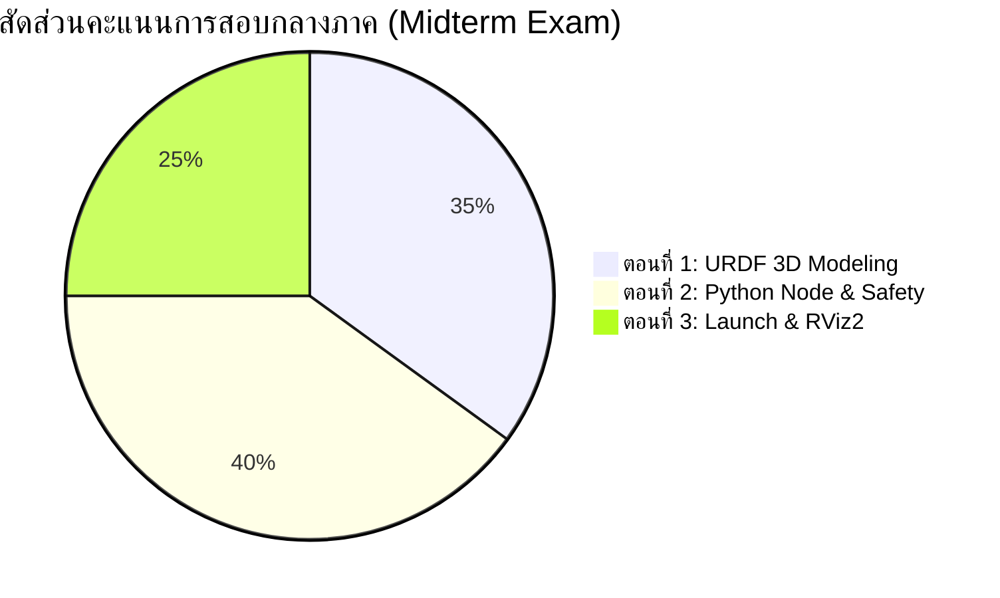

# 🔴 Week 08: การสอบปฏิบัติการกลางภาค (Midterm Practical Examination)
**วิชา:** AMR-101 Essential ROS 2 for Autonomous Mobile Robots  
**เวลาสอบ:** 3 ชั่วโมงเต็ม (180 นาที)  
**สัดส่วนคะแนน:** 20% ของคะแนนรวมทั้งภาคการศึกษา (100 คะแนนเต็ม)  
**เอกสารข้อสอบฉบับเต็ม:** [ใบสั่งงานข้อสอบกลางภาค (Exam Task Specification)](Exam_Task.md)  
**ไฟล์เฉลยอ้างอิง:** [โฟลเดอร์แนวทางเฉลย (Official Solution)](solution/)  
**ชุดตรวจอัตโนมัติ (Autograder):** [โฟลเดอร์ `test/`](test/) — วิธีใช้ดูหัวข้อ "คำสั่งทดสอบและตรวจให้คะแนน" ใน [Exam_Task.md](Exam_Task.md)

---

## 🎯 วัตถุประสงค์การวัดผล (Assessment Objectives)
การสอบกลางภาคเป็นการประเมินทักษะเชิงวิศวกรรมแบบบูรณาการ (Integrated Engineering Competencies) ที่ผู้เรียนได้ฝึกฝนตลอด 7 สัปดาห์แรก โดยครอบคลุม 4 มิติหลัก:
1. **DDS & Node Communication Infrastructure (Weeks 01–03):** ความสามารถในการจัดโครงสร้างโหนด OOP ในภาษา Python, การเลือกใช้ QoS Profile, และการบริหารจัดการ Topics/Services
2. **Action Protocol & Long-Running Tasks (Week 04):** ความเข้าใจในการบริหารจัดการสถานะ Goal และกระบวนการยกเลิกงานอย่างปลอดภัย
3. **Dynamic Parameters & Modular Launch (Week 05):** การป้องกันระบบด้วย Parameter Callbacks และการสร้าง Automation Script ด้วย Python Launch System
4. **Kinematics & 3D URDF Modeling (Weeks 06–07):** การคำนวณจลนศาสตร์ Forward/Inverse Kinematics ตาม REP 103/105, การคำนวณเมทริกซ์ความเฉื่อย (Inertia Tensor), และการสร้างโมเดลหุ่นยนต์ 3 มิติ

---

## ⏱️ กำหนดการและตารางเวลาสอบ 3 ชั่วโมง (Exam Timeline)
| ช่วงเวลา | กิจกรรม | รายละเอียดและคำแนะนำในการบริหารเวลา |
| :---: | :--- | :--- |
| **00:00 - 00:15** | ตรวจสอบสภาพแวดล้อมและชี้แจงโจทย์ | นักศึกษารัน `domain_check.sh`, ตรวจสอบพอร์ต DDS, และอ่านทำความเข้าใจความต้องการของโจทย์ |
| **00:15 - 01:15** | ตอนที่ 1: การสร้างโมเดลหุ่นยนต์ 3 มิติ (URDF) | เขียนไฟล์ URDF, คำนวณ Inertia Matrix ของกล่องและล้อ, ทดสอบผ่าน `check_urdf` |
| **01:15 - 02:15** | ตอนที่ 2: การพัฒนาโหนดควบคุมและความปลอดภัย | เขียนโหนด Python ควบคุม `/cmd_vel` พร้อม Dynamic Callback กรองพารามิเตอร์ และระบบตัดความเร็วเมื่ออุณหภูมิเกิน |
| **02:15 - 02:45** | ตอนที่ 3: การสร้างระบบ Launch และ Visualize | รวมระบบด้วย Python Launch File, ตรวจสอบพิกัด TF และเรนเดอร์โมเดลใน RViz2 |
| **02:45 - 03:00** | บันทึกหลักฐานและส่งมอบงาน (Submission) | แคปเจอร์หน้าจอผลการทดสอบ รวบรวมโค้ด และส่งมอบเข้าสู่ระบบตรวจ |

---

## 📜 กฎระเบียบและข้อกำหนดการสอบ (Rules & Allowed Resources)

### สิ่งที่อนุญาต (Permitted):
- เอกสารคู่มือบรรยายและใบงานปฏิบัติการในโฟลเดอร์ `Essential_ROS/Week_01` ถึง `Week_07`
- เว็บไซต์ทางการ [ROS 2 Documentation (docs.ros.org)](https://docs.ros.org/en/jazzy/)
- เอกสารคู่มือ [Python 3 Standard Library](https://docs.python.org/3/)
- เครื่องคิดเลขวิทยาศาสตร์หรือโปรแกรมคำนวณตัวเลขสำหรับหาค่าความเฉื่อย

### สิ่งต้องห้าม (Strictly Forbidden):
- การสื่อสารระหว่างผู้สอบทุกรูปแบบ (ห้ามแชท, โทรศัพท์, Discord, Line, อีเมล)
- การคัดลอกไฟล์ระหว่างเครื่องคอมพิวเตอร์หรือใช้อุปกรณ์เก็บข้อมูลภายนอก (USB)
- การใช้งาน AI Assistants / Code Generation Tools ภายนอกที่ไม่ได้รับอนุญาต
- การดัดแปลงตัวแปร `ROS_DOMAIN_ID` นอกเหนือจากหมายเลขประจำตัวเครื่องสอบที่กำหนดไว้

---

## 📊 เกณฑ์การประเมินและการตัดคะแนนอย่างละเอียด (Grading Rubric - 100 คะแนน)



### 🔹 ตอนที่ 1: แบบจำลองหุ่นยนต์ 3 มิติ URDF (35 คะแนน)
| ตัวชี้วัด | เกณฑ์คะแนนเต็ม | หักคะแนนกรณีมีข้อบกพร่อง |
| :--- | :---: | :--- |
| **Link-Joint Tree Hierarchy (10 คะแนน)** | มี `base_footprint`, `base_link`, ล้อขับ 2 ข้าง, Caster wheels, และเซนเซอร์ LiDAR ครบตามสเปก | ขาดชิ้นส่วนใดชิ้นส่วนหนึ่ง (-3 คะแนนต่อชิ้น), ตั้งชื่อ parent/child joint สลับกัน (-4 คะแนน) |
| **Inertia Tensor Calculation (15 คะแนน)** | คำนวณค่า $I_{xx}, I_{yy}, I_{zz}$ ของตัวถังและล้อได้ตรงตามสูตรฟิสิกส์ พร้อมแสดงวิธีคำนวณ | ใส่ค่าสุ่มหรือไม่ตรงตามสูตร (-10 คะแนน), สลับแกนหมุนของล้อ (-5 คะแนน) |
| **ความถูกต้องทางไวยากรณ์ (10 คะแนน)** | รันคำสั่ง `check_urdf` ผ่าน 100% โดยไม่มี Warning หรือ Error | มี XML Syntax Error (-10 คะแนน), มีโครงสร้าง Joint ผิดประเภท (-5 คะแนน) |

### 🔹 ตอนที่ 2: โหนดควบคุมและความปลอดภัยใน Python (40 คะแนน)
| ตัวชี้วัด | เกณฑ์คะแนนเต็ม | หักคะแนนกรณีมีข้อบกพร่อง |
| :--- | :---: | :--- |
| **Velocity Publisher `/cmd_vel` (10 คะแนน)** | ส่งข้อความ `geometry_msgs/msg/Twist` ที่ความถี่ 5 Hz อย่างสม่ำเสมอ | ความถี่ไม่สม่ำเสมอหรือช้ากว่า 2 Hz (-4 คะแนน), ข้อมูลฟิลด์ความเร็วผิด (-5 คะแนน) |
| **Dynamic Parameter Validation (15 คะแนน)** | ประกาศ `max_speed` และเขียน Callback ดักจับค่าที่อยู่นอกช่วง $[0.1, 1.5]\text{ m/s}$ ได้ถูกต้อง | ปล่อยให้ป้อนค่าเกินช่วงได้โดยไม่ปฏิเสธ (-15 คะแนน), ข้อความเหตุผลใน `reason` ว่างเปล่า (-3 คะแนน) |
| **Temperature Monitor & Safety Throttling (15 คะแนน)** | ดักฟัง `/sensor/temperature` และลดความเร็วที่ส่งออก `/cmd_vel` เหลือ 50% พร้อมพ่น Log สีเหลืองเมื่ออุณหภูมิ $> 65.0^\circ\text{C}$ (และกลับมาปกติเมื่อ $\le 65.0^\circ\text{C}$) — การพิมพ์ Log อย่างเดียวโดยไม่ลดความเร็วถือว่าไม่ผ่าน | ไม่ตอบสนองต่ออุณหภูมิสูง (-15 คะแนน), ตรรกะการเปรียบเทียบค่าอุณหภูมิผิด (-5 คะแนน) |

### 🔹 ตอนที่ 3: การรวมระบบและการแสดงผล Launch/RViz2 (25 คะแนน)
| ตัวชี้วัด | เกณฑ์คะแนนเต็ม | หักคะแนนกรณีมีข้อบกพร่อง |
| :--- | :---: | :--- |
| **ระบบ Launch System (15 คะแนน)** | เปิด `robot_state_publisher`, `joint_state_publisher` และโหนดควบคุมพร้อมกันได้ด้วยคำสั่งเดียว (รองรับ `rviz:=false`) | เปิดโหนดใดโหนดหนึ่งไม่ขึ้น (-7 คะแนน), พาธไฟล์ Hardcoded จนรันในเครื่องอื่นไม่ผ่าน (-5 คะแนน) |
| **การแสดงผลใน RViz2 (10 คะแนน)** | โมเดลเรนเดอร์สีสันถูกต้อง ชิ้นส่วนไม่จมพื้น แกน TF ตรงตามข้อกำหนด | ล้อจมพื้นหรือลอยเหนือพื้น (-4 คะแนน), Fixed frame ไม่ตรงทำให้โมเดลเป็นสีขาว (-4 คะแนน) |

---

## 🛠️ แนะนำขั้นตอนการแก้ปัญหาฉุกเฉินในห้องสอบ (Exam Debugging Cheat Sheet)

1. **กรณี `check_urdf` ฟ้อง XML Syntax Error:**
   - ใช้คำสั่งตรวจหมายเลขบรรทัด:
     ```bash
     xmllint --noout hospital_amr.urdf
     ```
   - สังเกตแท็กปิด เช่น `</geometry>`, `</visual>`, `</link>` ว่าสะกดถูกต้องหรือไม่
2. **กรณีรันโหนด Python แล้วติด Error `ModuleNotFoundError` หรือลืม Syntax:**
   - ทดสอบคอมไพล์โค้ดอย่างรวดเร็ว:
     ```bash
     python3 -m py_compile hospital_robot_node.py
     ```
3. **กรณีส่งข้อความท็อปปิกแล้วโหนดไม่ตอบสนอง:**
   - ตรวจสอบ `ROS_DOMAIN_ID` ว่าตรงกับที่โหนดใช้งานหรือไม่:
     ```bash
     echo $ROS_DOMAIN_ID
     ros2 topic list
     ros2 node info /midterm_robot_controller
     ```
4. **กรณี RViz2 ไม่แสดงผลโมเดล:**
   - เช็คในช่อง Displays -> RobotModel -> Status หากขึ้น Error ให้ตรวจสอบว่าโหนด `robot_state_publisher` กำลังออนไลน์อยู่หรือไม่ และตรวจสอบว่าตั้ง `Fixed Frame` เป็น `base_footprint` แล้วหรือไม่

---

## 📝 ข้อสอบทบทวนเชิงทฤษฎีก่อนสอบ (Comprehensive Mock Quiz)

1. **คำถาม:** ในการคำนวณโมเมนต์ความเฉื่อยของล้อทรงกระบอกที่มีรัศมี $r$ และมวล $m$ เหตุใดค่า $I_{yy}$ จึงมีค่าเท่ากับ $\frac{1}{2}mr^2$ ในขณะที่ $I_{xx}$ และ $I_{zz}$ มีค่าเท่ากับ $\frac{1}{12}m(3r^2+h^2)$?
2. **คำถาม:** จงอธิบายความแตกต่างระหว่างการใช้ `SetParametersResult.successful = True` และ `False` ในฟังก์ชัน Dynamic Parameter Callback?
3. **คำถาม:** หากต้องการจำลองระบบฉุกเฉิน เมื่อเซนเซอร์ตรวจจับความร้อนเกินค่าวิกฤต เหตุใดการใช้ Subscriber ดักฟังค่าอุณหภูมิจึงเหมาะสมกว่าการใช้ Service?
4. **คำถาม:** ตามมาตรฐาน REP 105 ข้อต่อระหว่าง `base_footprint` กับ `base_link` ต้องเป็น Joint ชนิดใด และมีค่า Origin อย่างไร?
5. **คำถาม:** เหตุใดการสร้างโหนดใน ROS 2 จึงแนะนำให้ใช้รูปแบบ Object-Oriented Programming (สืบทอดจาก `Node`) แทนการเขียนแบบ Procedural?
6. **คำถาม:** หาก Action Client ส่งคำขอยกเลิก Goal และ Server ตอบรับ การทำงานภายในลูปของ `execute_callback` จะต้องดำเนินการอย่างไรบ้างเพื่อจบงานอย่างถูกต้อง?
7. **คำถาม:** คำสั่ง CLI ใดที่ใช้ในการทดสอบส่งค่าพารามิเตอร์ `max_speed` เท่ากับ $2.0$ ไปยังโหนด `/midterm_robot_controller`?
8. **คำถาม:** ในไฟล์ Python Launch การส่งต่อข้อความเอาต์พุตของโหนดให้ออกมาแสดงผลบน Terminal ทำได้อย่างไรในคลาส `Node` หรือ `ExecuteProcess`?
9. **คำถาม:** ในข้อความ `geometry_msgs/msg/Twist` ตัวแปรใดที่ใช้ควบคุมความเร็วเดินหน้า-ถอยหลังของหุ่นยนต์ Differential Drive และตัวแปรใดควบคุมการหมุนเลี้ยว?
10. **คำถาม:** ในการประเมินคะแนน หากผู้สอบส่งไฟล์ URDF ที่แสดงผลล้อจมลงไปใต้พื้นดินใน RViz2 จะต้องแก้ไขจุดใดในไฟล์ URDF?

<details>
<summary>🔍 ดูเฉลยคำตอบพร้อมคำอธิบายอย่างละเอียด</summary>

1. **ตอบ:** เนื่องจากแกนสมมาตรของทรงกระบอกที่ล้อหมุนรอบตัวเองคือแกนความยาว (ในที่นี้คือแกน Y) โมเมนต์ความเฉื่อยรอบแกนหมุนหลักจึงเป็นแบบ Axial Inertia ($I_{yy} = \frac{1}{2}mr^2$) ในขณะที่แกน X และ Z เป็นแกนตั้งฉากขวางกับความยาว (Transverse Inertia) ซึ่งขึ้นอยู่กับทั้งรัศมีและความหนาของล้อ ($I_{xx} = I_{zz} = \frac{1}{12}m(3r^2+h^2)$)
2. **ตอบ:**
   - `successful = True`: หมายถึง ค่าพารามิเตอร์ใหม่ผ่านการตรวจสอบความปลอดภัย โหนดจะบันทึกค่านั้นและอัปเดตตัวแปรภายใน
   - `successful = False`: หมายถึง ค่าพารามิเตอร์ไม่ปลอดภัย โหนดจะปฏิเสธคำขอ คงค่าเดิมไว้ และส่งข้อความใน `reason` กลับไปแจ้งเตือนผู้ใช้งาน
3. **ตอบ:** เนื่องจากข้อมูลอุณหภูมิเซนเซอร์เป็น **สตรีมข้อมูลทางกายภาพที่เกิดขึ้นต่อเนื่องตามเวลา (Continuous Real-time Data Stream)** การใช้ Subscriber จึงตอบสนองต่อทุกเหตุการณ์ผิดปกติได้ทันทีโดยไม่ต้องคอยส่ง Request ถามซ้ำๆ ซึ่งจะทำให้สูญเสียแบนด์วิธและหน่วงเวลา
4. **ตอบ:** ต้องเป็น **`fixed` joint** โดยมีค่า Origin ยกสูงตามแกน Z เท่ากับระยะรัศมีของล้อขับเคลื่อน ($z = r$) เพื่อยกแชสซีขึ้นจากพื้นและทำให้จุดสัมผัสล้อแตะระนาบ $z=0$ พอดี
5. **ตอบ:** เพราะการเขียนแบบ OOP ช่วยจัดการวงจรชีวิตของ Timer, Publisher, Subscriber, Callback Groups, และ State Variables ได้อย่างเป็นระเบียบ ปลอดภัยจากการชนกันของตัวแปร Global และรองรับการจัดการ Multi-threading ได้มีประสิทธิภาพ
6. **ตอบ:** ต้องตรวจจับ Flag `goal_handle.is_cancel_requested` หากเป็นจริงให้สั่งเบรกมอเตอร์ เรียกเมธอด `goal_handle.canceled()` และส่งคืนอ็อบเจกต์ Result เพื่อปิดจ็อบใน State Machine
7. **ตอบ:** `ros2 param set /midterm_robot_controller max_speed 2.0`
8. **ตอบ:** ระบุพารามิเตอร์ `output='screen'`
9. **ตอบ:**
   - ความเร็วเดินหน้า-ถอยหลัง: **`linear.x`**
   - ความเร็วการหมุนเลี้ยว: **`angular.z`**
10. **ตอบ:** แก้ไขพิกัดความสูง $Z$ ในแท็ก `<origin xyz="0 0 Z" rpy="0 0 0"/>` ของ `base_footprint_joint` โดยตั้งค่าให้เท่ากับรัศมีของล้อขับเคลื่อน
</details>

---

## 📚 แหล่งอ้างอิงและศึกษาเพิ่มเติม
- [ROS 2 Quality of Service Policies](https://docs.ros.org/en/jazzy/Concepts/Intermediate/About-Quality-of-Service-Settings.html)
- [REP 105: Coordinate Frames for Mobile Platforms](https://www.ros.org/reps/rep-0105.html)
- [URDF Verification Tools and Tutorials](https://docs.ros.org/en/jazzy/Tutorials/Intermediate/URDF/URDF-Main.html)


## 📦 แพ็กเกจ `amr_week08` (เฉลย + ระบบตรวจ)
โฟลเดอร์นี้เป็นแพ็กเกจ `ament_python` ชื่อ `amr_week08` โดยโค้ดเฉลยอยู่ใน `solution/` (จัดวางเหมือนโฟลเดอร์ส่งงานของนักศึกษา) และติดตั้ง URDF/launch ไปที่ `share/amr_week08/`:
```bash
./docker/run_lab.sh bash
colcon build --base-paths Essential_ROS --packages-up-to amr_week08
source install/setup.bash
ros2 launch amr_week08 hospital_bringup.launch.py            # rviz:=false เมื่อไม่มีจอ
colcon test --base-paths Essential_ROS --packages-select amr_week08 && colcon test-result --verbose
```
ระบบตรวจอ่านโฟลเดอร์จากตัวแปร `EXAM_SUBMISSION_DIR` (ค่าเริ่มต้น = `solution/`) จึงใช้ชุดทดสอบเดียวกันตรวจทั้งเฉลยและงานนักศึกษา:
```bash
./docker/run_lab.sh bash -c 'EXAM_SUBMISSION_DIR=/workspace/submissions/6501234 \
    python3 -m pytest -v Essential_ROS/Week_08_Midterm_Practical_Exam/test/'
```

---

## 📟 ผลการรันจริง (Real Run Output)
บันทึกจากการรันจริงใน ros:lab-runner (ROS 2 Jazzy, Gazebo Sim 8.15.0) บน Linux 7.0 เมื่อ 2026-10-29

ระบบตรวจอัตโนมัติกับเฉลย ([`results/autograder_solution.txt`](results/autograder_solution.txt), ตัดบางบรรทัด):
```console
$ python3 -m pytest -v Essential_ROS/Week_08_Midterm_Practical_Exam/test/
...
Essential_ROS/Week_08_Midterm_Practical_Exam/test/test_grade_part1_urdf.py::test_diff_drive_plugin_consistent_if_present PASSED [ 90%]
Essential_ROS/Week_08_Midterm_Practical_Exam/test/test_grade_part2_node.py::test_grade_part2_node PASSED [ 95%]
Essential_ROS/Week_08_Midterm_Practical_Exam/test/test_grade_part3_launch.py::test_grade_part3_launch PASSED [100%]

============================= 21 passed in 26.22s ==============================
```

การตรวจแบบ Manual ([`results/grading_session.txt`](results/grading_session.txt), ตัดบางบรรทัด):
```console
$ ros2 param set /midterm_robot_controller max_speed 2.0
Setting parameter failed: max_speed 2.0 out of safe limit [0.1, 1.5] m/s
$ ros2 topic pub -w 1 --once /sensor/temperature std_msgs/msg/Float32 "{data: 72.5}"
...
publishing #1: std_msgs.msg.Float32(data=72.5)

$ ros2 topic echo --once /cmd_vel geometry_msgs/msg/Twist --field linear.x
0.15
---
...
[WARN] [1793242469.933094960] [midterm_robot_controller]: High temperature 72.5 C > 65.0 C: throttling speed to 0.15 m/s
```
เมื่อนำชุดตรวจเดียวกันไปรันกับเฉลยฉบับเก่า (ก่อนแก้ไข) ตอนที่ 1 ตก 7 ข้อ (ล้อ $y=\pm0.12$, caster 0.2 kg ที่ $\pm0.15$, LiDAR ผิดตำแหน่ง) และตอนที่ 2 ตก 2 ข้อ (`speed not reduced at 70 C`) แสดงว่าชุดตรวจจับข้อบกพร่องที่ "พิมพ์ Log อย่างเดียว" ได้จริง
