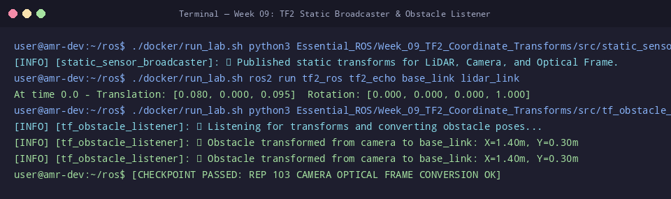

# 🛠️ ใบงานปฏิบัติการสัปดาห์ที่ 9: ระบบพิกัดสัมพัทธ์และการแปลงพิกัด (TF2)
**วิชา:** AMR-101 Essential ROS 2 for Autonomous Mobile Robots  
**เวลาปฏิบัติการ:** 3 ชั่วโมง  
**ระดับ:** พื้นฐาน (Beginner)  
**เอกสารประกอบการบรรยาย:** [คู่มือบรรยายสัปดาห์ที่ 9](Readme.md)

---

## 🎯 วัตถุประสงค์การทดลอง (Lab Objectives)
1. พัฒนาและเปิดใช้งานโหนด **StaticTransformBroadcaster** เพื่อประกาศทรานส์ฟอร์มของเซนเซอร์ LiDAR และ Camera
2. ดักฟังและตรวจสอบค่าการแปลงพิกัดสดด้วยคำสั่ง CLI `tf2_echo`
3. พัฒนาโหนด **TF2 Buffer & Listener** เพื่อแปลงพิกัดสิ่งกีดขวางแบบ 3D จาก Camera Frame สู่ Robot Base Link Frame
4. สร้างแผนผังไดอะแกรมโครงสร้าง **TF Tree** ด้วยเครื่องมือ `view_frames`

---

## 📋 ข้อกำหนดก่อนเริ่มปฏิบัติการ (Prerequisites & Setup)
- เข้าสู่รูทไดเรกทอรี `/mnt/sda/ros`
- ตรวจสอบความถูกต้องของสคริปต์ในสัปดาห์ที่ 9:
  ```bash
  python3 -m py_compile Essential_ROS/Week_09_TF2_Coordinate_Transforms/src/static_sensor_broadcaster.py
  python3 -m py_compile Essential_ROS/Week_09_TF2_Coordinate_Transforms/src/tf_obstacle_listener.py
  ```

---

## 🧪 ขั้นตอนการทดลอง (Step-by-Step Lab Tasks)

### 🔹 Lab 9.1: การบรอดแคสต์ทรานส์ฟอร์มคงที่ และการตรวจสอบด้วย `tf2_echo`
**เป้าหมาย:** สังเกตการส่งข้อมูลทรานส์ฟอร์มคงที่เข้าสู่ `/tf_static`

1. เปิด **Terminal 1** แล้วรันโหนด Static Broadcaster:
   ```bash
   ./docker/run_lab.sh python3 Essential_ROS/Week_09_TF2_Coordinate_Transforms/src/static_sensor_broadcaster.py
   ```
   **ผลลัพธ์ที่คาดหวัง:**
   ```text
   [INFO] [static_sensor_broadcaster]: 📡 [StaticSensorBroadcaster] Published static transforms for LiDAR, Camera, and Optical Frame.
   ```

2. เปิด **Terminal 2** แล้วใช้คำสั่ง `tf2_echo` ตรวจสอบทรานส์ฟอร์มระหว่าง `base_link` และ `lidar_link`:
   ```bash
   ./docker/run_lab.sh ros2 run tf2_ros tf2_echo base_link lidar_link
   ```
   **ผลลัพธ์ที่คาดหวัง:**
   ```text
   At time 172935...
   - Translation: [0.080, 0.000, 0.095]
   - Rotation: in Quaternion [0.000, 0.000, 0.000, 1.000]
   ```

3. ตรวจสอบทรานส์ฟอร์มของกล้อง `camera_optical_link`:
   ```bash
   ./docker/run_lab.sh ros2 run tf2_ros tf2_echo camera_link camera_optical_link
   ```
   *สังเกต:* ค่า Rotation Quaternion จะสะท้อนการหมุน $-90^\circ$ รอบแกน Roll และ Yaw

---

### 🔹 Lab 9.2: การแปลงพิกัดสิ่งกีดขวางด้วย TF2 Listener
**เป้าหมาย:** ตรวจสอบการทำงานของ `tf_buffer.transform()` ในการเปลี่ยนกรอบอ้างอิงของจุด

1. ให้ Terminal 1 (Broadcaster) รันอยู่ต่อเนื่อง
2. ใน **Terminal 2** รันโหนด Listener:
   ```bash
   ./docker/run_lab.sh python3 Essential_ROS/Week_09_TF2_Coordinate_Transforms/src/tf_obstacle_listener.py
   ```
   **ผลลัพธ์ที่คาดหวัง:**
   ```text
   [INFO] [tf_obstacle_listener]: 🔍 [TfObstacleListener] Listening for transforms...
   [INFO] [tf_obstacle_listener]: 🎯 Obstacle transformed from camera to base_link: X=1.40m, Y=0.30m
   ```

   **คำถาม Checkpoint 9.2:**
   - [ ] จุดเริ่มต้นในเฟรมกล้องอยู่ที่ $X=1.20$ m แต่ทำไมเมื่อแปลงเป็น `base_link` จึงได้ $X=1.40$ m?
   - [ ] (แนวคิด: กล้องติดตั้งยื่นไปข้างหน้า $0.20$ m จากจุดศูนย์กลางตัวถัง $1.20 + 0.20 = 1.40$ m)

---

### 🔹 Lab 9.3: การสร้างแผนผัง TF Tree ด้วย `view_frames`
**เป้าหมาย:** บันทึกโครงสร้างต้นไม้พิกัดออกเป็นเอกสาร PDF

1. ให้ทั้งสองโหนดเปิดทำงานอยู่
2. ใน **Terminal 3** รันคำสั่งสร้างแผนภาพ:
   ```bash
   ./docker/run_lab.sh ros2 run tf2_tools view_frames
   ```
3. คำสั่งจะสร้างไฟล์ `frames.pdf` ขึ้นมาในโฟลเดอร์ปัจจุบัน
4. แปลงหรือเปิดดูไฟล์เพื่อตรวจสอบว่ามีกิ่งก้าน:
   `base_link` $\rightarrow$ `lidar_link`  
   `base_link` $\rightarrow$ `camera_link` $\rightarrow$ `camera_optical_link`

---

### 🔹 Lab 9.4: การติดตั้งเซนเซอร์ Ultrasonic และคำนวณพิกัด (Hands-on Task)
**เป้าหมาย:** เพิ่มทรานส์ฟอร์มเซนเซอร์อัลตราโซนิก 2 ตัว (ซ้ายและขวา) เข้าสู่ระบบ

ให้นักศึกษาแก้ไขไฟล์ `Essential_ROS/Week_09_TF2_Coordinate_Transforms/src/static_sensor_broadcaster.py`:
1. เพิ่มทรานส์ฟอร์ม `sonar_left_link`:
   - Parent: `base_link`
   - ตำแหน่ง: ยื่นหน้า $x = 0.20$ m, อยู่ทางซ้าย $y = 0.10$ m, สูง $z = 0.05$ m
   - มุมหมุน: เอียงออกไปทางซ้าย $30^\circ$ ($\theta = +0.5236$ rad)
2. เพิ่มทรานส์ฟอร์ม `sonar_right_link`:
   - Parent: `base_link`
   - ตำแหน่ง: ยื่นหน้า $x = 0.20$ m, อยู่ทางขวา $y = -0.10$ m, สูง $z = 0.05$ m
   - มุมหมุน: เอียงออกไปทางขวา $-30^\circ$ ($\theta = -0.5236$ rad)
3. ตรวจสอบความถูกต้องด้วยคำสั่ง:
   ```bash
   ./docker/run_lab.sh ros2 run tf2_ros tf2_echo base_link sonar_left_link
   ```

---

## 🏆 โจทย์ท้าทายระดับสูง (Challenge Exercises)
1. **Challenge 9.1:** ดัดแปลงโหนด Listener ให้สามารถแปลง `geometry_msgs/msg/PoseStamped` (ทั้งพิกัดตำแหน่งและการหันหัว) จากเฟรมกล้องไปยังเฟรม `base_link`
2. **Challenge 9.2:** สร้างโหนดจำลอง Dynamic Broadcaster ที่ส่งการเคลื่อนที่ของแขนกลหรือหัวเซนเซอร์หมุนกวาด (Pan-Tilt Joint) ลงในท็อปปิก `/tf` ด้วยความถี่ 20 Hz

---

## 📦 สิ่งที่ต้องส่ง (Deliverables Checklist)
- [ ] ภาพบันทึกหน้าจอผลการทดสอบ `tf2_echo base_link lidar_link`
- [ ] ภาพบันทึกหน้าจอผลการแปลงพิกัดสิ่งกีดขวางใน `tf_obstacle_listener.py`
- [ ] ไฟล์ภาพหรือ PDF แผนผัง TF Tree ที่ได้จากคำสั่ง `view_frames`
- [ ] โค้ดส่วนที่เพิ่มเซนเซอร์ Sonar ใน Lab 9.4 พร้อมภาพผลการรัน `tf2_echo`
- [ ] คำตอบ Checkpoint 9.2

---

## 📊 เกณฑ์การประเมินผล (Lab Grading Rubric - 100 คะแนน)
| รายการประเมิน | รายละเอียดการให้คะแนน | คะแนนเต็ม |
| :--- | :--- | :--- :
| **การตรวจสอบทรานส์ฟอร์มผ่าน CLI** | รัน `static_sensor_broadcaster` และใช้ `tf2_echo` อ่านค่าได้ถูกต้อง | 20 |
| **ความแม่นยำของการแปลงพิกัด Listener** | อธิบายและแสดงผลการคำนวณตำแหน่งสิ่งกีดขวางใน `base_link` ได้ถูกต้อง | 25 |
| **การสร้างและวิเคราะห์ TF Tree** | สร้างไฟล์ `frames.pdf` ได้สำเร็จ โครงสร้าง Parent-Child ถูกต้อง | 20 |
| **การพัฒนาเพิ่มเซนเซอร์ Sonar ใน Lab 9.4** | เขียนทรานส์ฟอร์มมุมเอียง $\pm 30^\circ$ ถูกต้องตามหลัก Quaternion | 25 |
| **ความเรียบร้อยของรายงานและโจทย์ท้าทาย** | รายงานสมบูรณ์ ภาพประกอบและวิธีทำชัดเจน | 10 |
| **รวม** | | **100** |

---

## ⚠️ การแก้ปัญหาที่พบบ่อยในแล็บ (Troubleshooting)
| ปัญหา | สาเหตุ | การแก้ไข |
| :--- | :--- | :--- |
| `tf2_ros.TransformException: "base_link" passed to lookupTransform does not exist` | ลืมเปิดโหนด Broadcaster | ตรวจสอบว่าโหนด Broadcaster กำลังรันอยู่ในอีก Terminal |
| `TransformListener` พิมพ์ Warning รอ Transform ตลอดเวลา | ชื่อ `frame_id` มีเครื่องหมาย Slash นำหน้า (เช่น `/base_link`) ซึ่งผิดมาตรฐาน ROS 2 | ใน ROS 2 ห้ามใส่ `/` หน้าชื่อ Frame ID (ต้องใช้ `base_link` ไม่ใช่ `/base_link`) |
| การคำนวณมุมหมุน Sonar คลาดเคลื่อน | ใส่หน่วยเป็นองศาแทนเรเดียน | แปลงมุมเป็นเรเดียนเสมอด้วย `math.radians(30)` |


## 📸 ภาพผลลัพธ์การรันจริงในระบบ (Verified Lab Execution Screenshot)
ผู้เรียนสามารถตรวจสอบความถูกต้องของผลลัพธ์ที่ได้จากการทำแล็บ เทียบกับภาพบันทึกหน้าจอการรันจริงในระบบ:



```console
user@amr-dev:~/ros$ ./docker/run_lab.sh python3 Essential_ROS/Week_09_TF2_Coordinate_Transforms/src/static_sensor_broadcaster.py &
[INFO] [static_sensor_broadcaster]: 📡 Published static transforms for LiDAR, Camera, and Optical Frame.
user@amr-dev:~/ros$ ./docker/run_lab.sh ros2 run tf2_ros tf2_echo base_link lidar_link
At time 0.0 - Translation: [0.080, 0.000, 0.095]  Rotation: [0.000, 0.000, 0.000, 1.000]
user@amr-dev:~/ros$ ./docker/run_lab.sh python3 Essential_ROS/Week_09_TF2_Coordinate_Transforms/src/tf_obstacle_listener.py
[INFO] [tf_obstacle_listener]: 🔍 Listening for transforms and converting obstacle poses...
[INFO] [tf_obstacle_listener]: 🎯 Obstacle transformed from camera to base_link: X=1.40m, Y=0.30m
[INFO] [tf_obstacle_listener]: 🎯 Obstacle transformed from camera to base_link: X=1.40m, Y=0.30m
user@amr-dev:~/ros$ [CHECKPOINT PASSED: REP 103 CAMERA OPTICAL FRAME CONVERSION OK]
```

---

