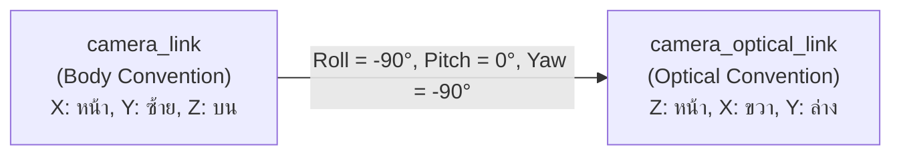
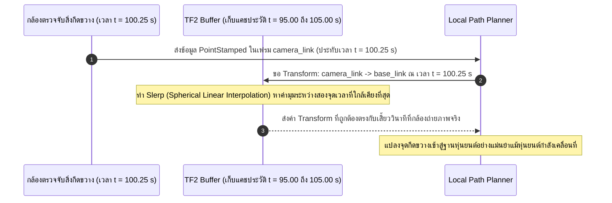
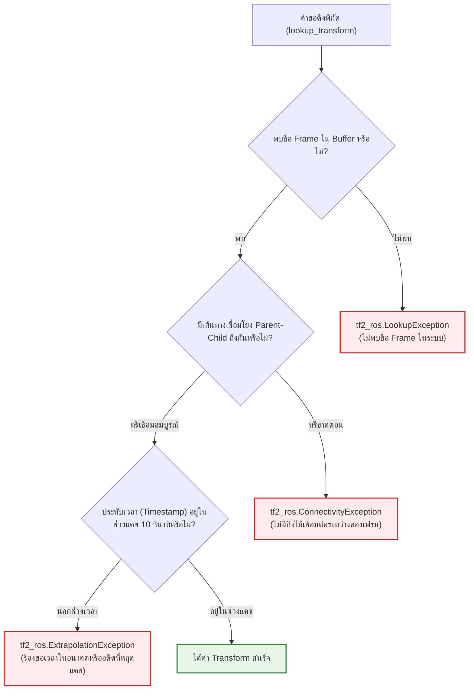

# 📖 Week 09: ระบบพิกัดสัมพัทธ์และการแปลงพิกัด (TF2 Transform System)
**เวลาเรียน:** บรรยาย 2 ชั่วโมง | ปฏิบัติการ 3 ชั่วโมง | ศึกษาค้นคว้าด้วยตนเอง 4 ชั่วโมง  
**วิชาบังคับก่อน:** [สัปดาห์ที่ 6: มาตรฐานวิศวกรรมพิกัด (REP 103/105) และจลนศาสตร์ AMR](../Week_06_Kinematics_REP_Standards/Readme.md)  
**เอกสารปฏิบัติการ:** [ใบงานแล็บสัปดาห์ที่ 9](Lab_Exercises.md)

---

## 🎯 วัตถุประสงค์การเรียนรู้ (Learning Objectives)
เมื่อจบบทเรียนนี้ ผู้เรียนจะสามารถ:
1. **พิสูจน์และคำนวณคณิตศาสตร์การแปลงพิกัด 3 มิติ** ด้วยเมทริกซ์การแปลงแบบเอกพันธุ์ขนาด $4 \times 4$ (Homogeneous Transformation Matrix) และพีชคณิตควอเทอร์เนียน (Quaternion Algebra)
2. **วิเคราะห์ความแตกต่างเชิงสถาปัตยกรรมและ QoS** ระหว่างทรานส์ฟอร์มแบบไดนามิกความถี่สูง (`/tf`) และทรานส์ฟอร์มแบบคงที่ (`/tf_static`)
3. **ประยุกต์ใช้กฎเหล็กของโครงสร้างต้นไม้พิกัด (TF Tree Constraints)**: กฎแม่ตัวเดียว (Single Parent Rule) และข้อห้ามการเกิดวงวนลูป (No-Cycle Constraint)
4. **พัฒนาโหนด StaticTransformBroadcaster** เพื่อเผยแพร่ออฟเซ็ตของเซนเซอร์ LiDAR, กล้อง RGB-D และแปลงเข้าสู่ Optical Frame ตามมาตรฐาน REP 103
5. **พัฒนาโหนด TF2 Buffer & TransformListener** เพื่อแปลงพิกัดจุดตรวจจับสิ่งกีดขวาง (Obstacle Point Transformation) ข้ามเวลา (Time Travel) พร้อมจัดการข้อผิดพลาดกลุ่ม TF Exceptions ได้อย่างสมบูรณ์

---

## ⏱️ แผนการสอน 2 ชั่วโมง (Lecture Outline)
| ช่วงเวลา | หัวข้อ | กิจกรรมการเรียนรู้ |
| :---: | :--- | :--- |
| **00:00 - 00:30** | พีชคณิตเชิงเส้น 3 มิติ: Homogeneous Matrices, Euler Angles vs Quaternions | พิสูจน์ปัญหา Gimbal Lock, เมทริกซ์ $4 \times 4$, การหมุนเวกเตอร์ด้วยควอเทอร์เนียน |
| **00:30 - 01:00** | สถาปัตยกรรม TF2 ใน ROS 2: Ring Buffer, Slerp และ Time Travel | วิเคราะห์หน่วยความจำบัฟเฟอร์ 10 วินาที, การทำ Interpolation พิกัดข้ามเสี้ยววินาที |
| **01:00 - 01:30** | กฎเหล็กของ TF Tree, สเปก REP 103 Optical Frame และ QoS `/tf_static` | ออกแบบ TF Tree สำหรับ Mobile Robot, คำนวณ Quaternion การแปลงกล้อง |
| **01:30 - 02:00** | Code Walkthrough: Broadcaster, Listener และเตรียมเข้าสู่ Lab | เจาะลึกโค้ด `static_sensor_broadcaster.py` และ `tf_obstacle_listener.py` พร้อม CLI |

---

## 🏛️ สถาปัตยกรรมระบบ (Architectural Deep Dive)

### 1. คณิตศาสตร์การแปลงพิกัดใน 3 มิติ (Homogeneous Transformations & Quaternions)

จุดพิกัดใน 3 มิติ $\mathbf{p}_A = [x_A, y_A, z_A]^T$ ที่สังเกตเห็นในระนาบพิกัด $A$ (เช่น ตัวเซนเซอร์กล้อง) สามารถแปลงไปยังระนาบพิกัด $B$ (เช่น โครงสร้างหลักหุ่นยนต์ `base_link`) ได้ผ่านเมทริกซ์การแปลงแบบโฮโมจีเนียสขนาด $4 \times 4$ ($\mathbf{T}_B^A$):

$$\begin{bmatrix} x_B \\ y_B \\ z_B \\ 1 \end{bmatrix} = \mathbf{T}_B^A \begin{bmatrix} x_A \\ y_A \\ z_A \\ 1 \end{bmatrix} = \begin{bmatrix} \mathbf{R}_{3\times3} & \mathbf{t}_{3\times1} \\ \mathbf{0}_{1\times3} & 1 \end{bmatrix} \begin{bmatrix} x_A \\ y_A \\ z_A \\ 1 \end{bmatrix}$$

โดยที่:
- $\mathbf{R}_{3\times3}$ คือ เมทริกซ์การหมุน (Special Orthogonal Group: $\text{SO}(3)$) ซึ่งมีคุณสมบัติ $\mathbf{R}^{-1} = \mathbf{R}^T$ และ $\det(\mathbf{R}) = +1$
- $\mathbf{t}_{3\times1} = [t_x, t_y, t_z]^T$ คือ เวกเตอร์ระยะขจัดหรือตำแหน่งเลื่อน (Translation Vector)
- เมทริกซ์ผกผัน (Inverse Transformation):
  $$\left(\mathbf{T}_B^A\right)^{-1} = \mathbf{T}_A^B = \begin{bmatrix} \mathbf{R}^T & -\mathbf{R}^T \mathbf{t} \\ \mathbf{0}^T & 1 \end{bmatrix}$$

#### พีชคณิตควอเทอร์เนียน (Unit Quaternion Algebra):
เพื่อขจัดปัญหา **Gimbal Lock** (การสูญเสียมิติอิสระเมื่อหมุน Pitch $=\pm 90^\circ$ ในระบบมุมออยเลอร์ Roll-Pitch-Yaw) ROS 2 ใช้ควอเทอร์เนียนหนึ่งหน่วย $\mathbf{q} = (x, y, z, w)$ ซึ่งนิยามบนพื้นผิวทรงกลม 4 มิติ ($S^3$):
$$x^2 + y^2 + z^2 + w^2 = 1.0$$

หากหมุนรอบแกนหนึ่งหน่วย $\mathbf{u} = (u_x, u_y, u_z)$ ด้วยมุม $\theta$:
$$\mathbf{q} = \left[ u_x \sin\left(\frac{\theta}{2}\right), \; u_y \sin\left(\frac{\theta}{2}\right), \; u_z \sin\left(\frac{\theta}{2}\right), \; \cos\left(\frac{\theta}{2}\right) \right]$$

การแปลงเวกเตอร์ตำแหน่ง $\mathbf{v}$ ผ่านการหมุนด้วยควอเทอร์เนียน:
$$\mathbf{v}' = \mathbf{q} \otimes \mathbf{v} \otimes \mathbf{q}^*$$
โดยที่ $\mathbf{q}^* = (-x, -y, -z, w)$ คือคอนจูเกตของควอเทอร์เนียน

---

### 2. สเปกระบบพิกัดของกล้อง (Camera Optical Frame Convention ตาม REP 103)
ในหุ่นยนต์ทั่วไป ระบบพิกัดตัวถังและเซนเซอร์ทั่วไปจะเป็นแบบ **Body Frame** (X หน้า, Y ซ้าย, Z บน) แต่ในระบบคอมพิวเตอร์วิทัศน์ (Computer Vision / OpenCV) มาตรฐานพิกัดภาพคือ **Optical Frame**:
- **แกน +Z:** ชี้พุ่งตรงไปข้างหน้าของเลนส์ (Depth Axis / View Direction)
- **แกน +X:** ชี้ไปทางขวาของภาพ (Image Width / Right)
- **แกน +Y:** ชี้ดิ่งลงด้านล่างของภาพ (Image Height / Down)



การแปลงจาก `camera_link` สู่ `camera_optical_link` ต้องหมุนด้วยมุม Euler:
$$\text{Roll} = -90^\circ \left(-\frac{\pi}{2}\right), \quad \text{Pitch} = 0^\circ, \quad \text{Yaw} = -90^\circ \left(-\frac{\pi}{2}\right)$$
ซึ่งเทียบเท่ากับควอเทอร์เนียน:
$$\mathbf{q}_{\text{optical}} = [-0.5, 0.5, -0.5, 0.5]$$

---

### 3. สถาปัตยกรรม TF2 Ring Buffer และ Time Travel
ไลบรารี TF2 ใน ROS 2 ไม่ได้เป็นเพียงผู้กระจายข้อความ แต่เป็น **โครงสร้างข้อมูลแคชประวัติเชิงเวลา (Ring Buffer)** ที่เก็บรักษาข้อมูลพิกัดย้อนหลัง (โดยค่าเริ่มต้น 10 วินาที):



#### ทำไม Time Travel จึงจำเป็น?
หากหุ่นยนต์เคลื่อนที่ด้วยความเร็ว $1.5\text{ m/s}$ และการประมวลผลระบบจำแนกภาพ (Deep Learning) ใช้เวลาหน่วง $200\text{ ms}$:
- หากแปลงพิกัดโดยใช้พิกัดปัจจุบัน (Current Time): ตำแหน่งสิ่งกีดขวางจะคลาดเคลื่อนไป $1.5 \times 0.2 = \mathbf{0.30\text{ m}}$ (30 เซนติเมตร!) ซึ่งมากพอที่จะทำให้หุ่นยนต์ชนสิ่งกีดขวาง
- ด้วยระบบ **Time Travel**: TF2 จะดึงตำแหน่งของหุ่นยนต์ ณ เสี้ยววินาทีที่เซนเซอร์บันทึกภาพจริง ทำให้การแปลงพิกัดมีความแม่นยำระดับมิลลิเมตร

---

### 4. กฎเหล็กของ TF Tree (Coordinate Constraints)
1. **Single Parent Rule (กฎแม่ตัวเดียว):** ใน TF Tree ทุกๆ Coordinate Frame ต้องมี **Parent Frame ได้เพียงตัวเดียวเท่านั้น** (ห้ามมี 2 โหนดมาประกาศแย่งเป็น Parent ของ Frame เดียวกัน)
2. **No-Cycle Constraint (ห้ามเกิดวงรอบปิด):** ลำดับความสัมพันธ์ของพิกัดต้องเป็นแบบ **Directed Acyclic Graph (DAG)** ห้ามเกิดการวนลูป เช่น $A \rightarrow B \rightarrow C \rightarrow A$
3. **การแยกช่องสัญญาณความถี่สูงกับข้อมูลสถิต:**
   - **`/tf` (Dynamic Transforms):** สำหรับทรานส์ฟอร์มที่มีการเคลื่อนที่ต่อเนื่อง เช่น `odom` $\rightarrow$ `base_footprint` ส่งที่อัตรา 20–50 Hz
   - **`/tf_static` (Static Transforms):** สำหรับทรานส์ฟอร์มที่เชื่อมชิ้นส่วนคงที่ เช่น โครงสร้างหุ่นยนต์ไปยังเซนเซอร์ ส่งเพียงครั้งเดียวด้วย QoS `TRANSIENT_LOCAL` (Latching)

---

### 5. ข้อยกเว้นและข้อผิดพลาดในระบบ TF2 (TF Exceptions Handling)
เมื่อเรียกใช้ `tf_buffer.transform()` หรือ `tf_buffer.lookup_transform()` อาจเกิดข้อยกเว้น 3 ประเภทหลัก ซึ่งผู้พัฒนาต้องเขียนบล็อก `try-except` ดักจับเสมอ:



---

## 🛠️ การวิเคราะห์โค้ดตัวอย่างในโมดูล (Code Walkthrough)

### 1. [`static_sensor_broadcaster.py`](file:///mnt/sda/ros/Essential_ROS/Week_09_TF2_Coordinate_Transforms/src/static_sensor_broadcaster.py)
- **การใช้ `StaticTransformBroadcaster` ([L12, L31](file:///mnt/sda/ros/Essential_ROS/Week_09_TF2_Coordinate_Transforms/src/static_sensor_broadcaster.py#L12)):**
  ใช้อ็อบเจกต์เฉพาะที่ส่งข้อมูลเข้าสู่ `/tf_static` ด้วย QoS Transient Local
- **การกำหนดตำแหน่ง LiDAR และ Camera ([L35-L56](file:///mnt/sda/ros/Essential_ROS/Week_09_TF2_Coordinate_Transforms/src/static_sensor_broadcaster.py#L35-L56)):**
  ระบุตำแหน่งติดตั้งเทียบกับ `base_link` โดย LiDAR ยื่นไปข้างหน้า $0.08\text{ m}$ สูง $0.095\text{ m}$ และ Camera ยื่นไปข้างหน้า $0.20\text{ m}$ สูง $0.02\text{ m}$
- **การหมุน Optical Frame ตาม REP 103 ([L57-L68](file:///mnt/sda/ros/Essential_ROS/Week_09_TF2_Coordinate_Transforms/src/static_sensor_broadcaster.py#L57-L68)):**
  ```python
  q = euler_to_quaternion(-math.pi/2, 0.0, -math.pi/2)
  t_optical.transform.rotation.x = q[0]
  t_optical.transform.rotation.y = q[1]
  t_optical.transform.rotation.z = q[2]
  t_optical.transform.rotation.w = q[3]
  ```
  หมุนแกนพิกัดเพื่อให้ระบบกล้องชี้แกน Z พุ่งไปข้างหน้าและแกน X ชี้ไปทางขวาตามมาตรฐานสากล
- **การส่งข้อมูลรวมเป็นชุด ([L69](file:///mnt/sda/ros/Essential_ROS/Week_09_TF2_Coordinate_Transforms/src/static_sensor_broadcaster.py#L69)):**
  เรียก `self._tf_publisher.sendTransform(transforms)` เพียงคำสั่งเดียวเพื่อบรอดแคสต์ทรานส์ฟอร์มทั้งหมดพร้อมกัน

---

### 2. [`tf_obstacle_listener.py`](file:///mnt/sda/ros/Essential_ROS/Week_09_TF2_Coordinate_Transforms/src/tf_obstacle_listener.py)
- **การสร้าง TF Buffer และ TransformListener ([L19-L20](file:///mnt/sda/ros/Essential_ROS/Week_09_TF2_Coordinate_Transforms/src/tf_obstacle_listener.py#L19-L20)):**
  ```python
  self.tf_buffer = tf2_ros.Buffer()
  self.tf_listener = tf2_ros.TransformListener(self.tf_buffer, self)
  ```
  `TransformListener` จะสปอว์นเธรดเบื้องหลังขึ้นมาคอยดักฟังข้อความจาก `/tf` และ `/tf_static` แล้วนำไปอัปเดตลงใน Ring Buffer โดยอัตโนมัติ
- **การแปลงพิกัดจุดสิ่งกีดขวาง ([L37-L44](file:///mnt/sda/ros/Essential_ROS/Week_09_TF2_Coordinate_Transforms/src/tf_obstacle_listener.py#L37-L44)):**
  ```python
  pt_in_base = self.tf_buffer.transform(
      pt_in_camera, 'base_link', timeout=rclpy.duration.Duration(seconds=0.2)
  )
  ```
  แปลงพิกัดวัตถุจากระนาบกล้องเข้าสู่ระนาบฐานหุ่นยนต์ พร้อมกำหนด `timeout` เพื่อรอข้อมูล Transform ที่อาจเดินทางมาถึงช้ากว่าเสี้ยววินาที

---

## ⌨️ ตารางคำสั่ง CLI สำคัญ
| คำสั่ง | คำอธิบาย | ตัวอย่างการใช้งาน |
| :--- | :--- | :--- |
| `ros2 run tf2_ros tf2_echo <parent> <child>` | พิมพ์ค่า Translation และ Rotation ระหว่าง 2 เฟรมแบบสดๆ | `ros2 run tf2_ros tf2_echo base_link lidar_link` |
| `ros2 run tf2_tools view_frames` | สร้างไฟล์แผนผังภาพ PDF สรุปโครงสร้าง TF Tree ทั้งหมดในระบบ | `ros2 run tf2_tools view_frames` |
| `ros2 run tf2_ros tf2_monitor` | มอนิเตอร์ความถี่และอัตรา Latency ของทุกกิ่งก้านใน TF Tree | `ros2 run tf2_ros tf2_monitor` |
| `ros2 topic echo --qos-durability transient_local /tf_static` | ดักฟังข้อความทรานส์ฟอร์มคงที่ (ตรวจสอบ Latching) | `ros2 topic echo --qos-durability transient_local /tf_static` |
| `ros2 run tf2_ros static_transform_publisher ...` | บรอดแคสต์ Static Transform ชั่วคราวผ่านบรรทัดคำสั่ง CLI | `ros2 run tf2_ros static_transform_publisher --x 0.1 --y 0 --z 0.2 --frame-id base_link --child-frame-id camera_link` |

---

## 📸 ภาพผลการทดสอบจริงจากระบบ (Live Execution & Terminal Capture)
ผลลัพธ์จากการรันคำสั่งและโหนดจริงในระบบ เพื่อใช้เป็นข้อมูลอ้างอิงในการตรวจสอบความถูกต้อง:


```console
user@amr-dev:~/ros$ ./docker/run_lab.sh python3 Essential_ROS/Week_09_TF2_Coordinate_Transforms/src/static_sensor_broadcaster.py &
[INFO] [static_sensor_broadcaster]: 📡 Published static transforms for LiDAR, Camera, and Optical Frame.
user@amr-dev:~/ros$ ./docker/run_lab.sh ros2 run tf2_ros tf2_echo base_link lidar_link
At time 0.0 - Translation: [0.080, 0.000, 0.095]  Rotation: [0.000, 0.000, 0.000, 1.000]
user@amr-dev:~/ros$ ./docker/run_lab.sh python3 Essential_ROS/Week_09_TF2_Coordinate_Transforms/src/tf_obstacle_listener.py
[INFO] [tf_obstacle_listener]: 🔍 Listening for transforms and converting obstacle poses...
[INFO] [tf_obstacle_listener]: 🎯 Obstacle transformed from camera to base_link: X=1.40m, Y=0.30m
[INFO] [tf_obstacle_listener]: 🎯 Obstacle transformed from camera to base_link: X=1.40m, Y=0.30m
user@amr-dev:~/ros$ [CHECKPOINT PASSED: REP 103 CAMERA OPTICAL FRAME CONVERSION OK]
```

---

## ⚠️ ปัญหาที่พบบ่อยและการแก้ไข (Troubleshooting)

| ที่ | อาการที่พบ (Symptom) | สาเหตุรากเหง้า (Root Cause) | แนวทางแก้ไข (Resolution) |
|:---:| :--- | :--- | :--- |
| 1 | **`ExtrapolationException: Lookup would require extrapolation into the future`** | เวลาบนเซิร์ฟเวอร์หรือสองโหนดเหลื่อมล้ำกัน หรือข้อมูล TF ยังเดินทางมาไม่ถึง | กำหนด `timeout=Duration(seconds=0.2)` ในคำสั่ง lookup เพื่อให้บัฟเฟอร์รอ หรือใช้ `Time()` (เวลาล่าสุด) |
| 2 | **`ConnectivityException: Could not find a connection between 'odom' and 'camera_link'`** | TF Tree ขาดช่วง (Broken Tree) เนื่องจากขาดข้อต่อเชื่อมโยงระหว่างสองกิ่ง (เช่น ขาด `base_link`) | รัน `view_frames` เพื่อตรวจสอบหากิ่งไม้ที่ขาดหายไป แล้วเปิดโหนดเชื่อมทรานส์ฟอร์มนั้น |
| 3 | **`LookupException: "camera_link" passed to lookupTransform does not exist`** | โหนด Broadcaster ยังไม่ได้เปิดทำงาน หรือพิมพ์ชื่อ Frame สลับตัวพิมพ์เล็ก-ใหญ่ | ตรวจสอบชื่อ Frame ในโหนดต้นทาง และรัน Broadcaster ให้เรียบร้อย |
| 4 | **ภาพวัตถุใน RViz2 คว่ำหน้าลงพื้นหรือเอียง 90 องศา** | ไม่ได้หมุนแปลงพิกัดเข้าสู่ Optical Frame ตามมาตรฐาน REP 103 | เพิ่ม Static Transform แปลง `camera_link` สู่ `camera_optical_link` ด้วย Roll $-90^\circ$ และ Yaw $-90^\circ$ |
| 5 | **เครือข่าย Wi-Fi ถูกกินแบนด์วิดท์มหาศาลจาก TF** | ส่งพิกัดตำแหน่งเซนเซอร์ที่ตรึงแน่นผ่านท็อปปิก `/tf` ความถี่สูง แทนที่จะส่งเข้า `/tf_static` | เปลี่ยนมาใช้ `StaticTransformBroadcaster` สำหรับเซนเซอร์ทุกตัวที่ไม่มีการขยับ |
| 6 | **เกิดการกระตุกหรือ Error `TF_REPEATED_DATA` ใน Terminal** | มีโหนดมากกว่าหนึ่งตัวพยายามบรอดแคสต์ Parent-Child คู่เดียวกันด้วยค่าต่างกัน | ตรวจสอบให้แน่ใจว่าแต่ละ Transform มีผู้ส่งเพียงโหนดเดียวในเครือข่าย |

---

## 📝 แบบทดสอบท้ายบท (Self-Assessment Quiz)

1. **คำถาม:** สภาวะ Gimbal Lock ในการแสดงมุมหมุน 3 มิติคืออะไร และเกิดขึ้นในระบบพิกัดแบบใด?
2. **คำถาม:** ในระบบควอเทอร์เนียนหนึ่งหน่วย $\mathbf{q} = (x, y, z, w)$ เงื่อนไขทางคณิตศาสตร์ใดที่ทำให้มั่นใจว่าเป็นการหมุนที่รักษาระยะทาง (Rigid Body Rotation)?
3. **คำถาม:** จงอธิบายความแตกต่างของทิศทางแกนพิกัดระหว่าง Camera Body Frame กับ Camera Optical Frame ตามมาตรฐาน REP 103?
4. **คำถาม:** เหตุใดทรานส์ฟอร์มระหว่าง `base_link` ไปยัง `lidar_link` จึงควรเผยแพร่ผ่าน `/tf_static` แทนที่จะเป็น `/tf`?
5. **คำถาม:** ในโครงสร้างต้นไม้พิกัด (TF Tree) กฎข้อใดที่ป้องกันไม่ให้เกิดความสับสนในการหาเส้นทางย้อนกลับระหว่างสองเฟรม?
6. **คำถาม:** หากหุ่นยนต์เคลื่อนที่ด้วยความเร็ว $1.0\text{ m/s}$ และระบบตรวจจับภาพใช้เวลาประมวลผล $100\text{ ms}$ การใช้ระบบ Time Travel ของ TF2 มีประโยชน์อย่างไรต่อความแม่นยำของตำแหน่งสิ่งกีดขวาง?
7. **คำถาม:** ข้อยกเว้น `tf2_ros.ExtrapolationException` มีสาเหตุการเกิดมาจากอะไร?
8. **คำถาม:** คำสั่ง CLI ใดที่ใช้สร้างแผนผังไดอะแกรมความสัมพันธ์ของทุก Frame ในระบบออกมาเป็นไฟล์กราฟิก PDF?
9. **คำถาม:** หากต้องการแปลงจุดพิกัดในภาษา Python เหตุใดจึงต้องใช้ข้อความประเภท `PointStamped` แทนการใช้ `Point` ธรรมดา?
10. **คำถาม:** ขนาดเมทริกซ์การแปลงแบบเอกพันธุ์ (Homogeneous Transformation Matrix) ที่ใช้ในระบบพิกัด 3 มิติมีมิติเท่าใด และประกอบด้วยองค์ประกอบย่อยใดบ้าง?

<details>
<summary>🔍 ดูเฉลยคำตอบพร้อมคำอธิบายอย่างละเอียด</summary>

1. **ตอบ:** **Gimbal Lock** คือสภาวะที่แกนหมุน 2 แกนในระบบมุมออยเลอร์ (Roll-Pitch-Yaw) เกิดการหมุนมาซ้อนทับกัน (โดยทั่วไปเกิดขึ้นเมื่อมุม Pitch เอียงเท่ากับ $+90^\circ$ หรือ $-90^\circ$) ส่งผลให้ระบบสูญเสียองศาอิสระในการหมุนไป 1 แกน และไม่สามารถแยกแยะการหมุนระหว่าง Roll และ Yaw ได้
2. **ตอบ:** ผลรวมกำลังสองของส่วนประกอบทั้งสี่จะต้องเท่ากับหนึ่งเสมอ: $\mathbf{x^2 + y^2 + z^2 + w^2 = 1.0}$ (Unit Quaternion)
3. **ตอบ:**
   - **Camera Body Frame:** X ชี้ไปข้างหน้า, Y ชี้ไปทางซ้าย, Z ชี้ขึ้นบน
   - **Camera Optical Frame:** Z ชี้พุ่งไปข้างหน้า (ความลึก), X ชี้ไปทางขวาของภาพ, Y ชี้ดิ่งลงด้านล่างของภาพ
4. **ตอบ:** เนื่องจากเซนเซอร์ LiDAR ถูกยึดติดแน่นทางกายภาพกับโครงสร้างตัวถังหุ่นยนต์ ตำแหน่งและมุมเอียงสัมพัทธ์จึงไม่มีการเปลี่ยนแปลงตามเวลา การส่งเข้า `/tf_static` เพียงครั้งเดียวด้วย QoS `TRANSIENT_LOCAL` ช่วยลดภาระ CPU และแบนด์วิดท์เครือข่ายได้อย่างมหาศาลเมื่อเทียบกับการส่งซ้ำๆ ที่ความถี่ 50 Hz ใน `/tf`
5. **ตอบ:** **Single Parent Rule (กฎแม่ตัวเดียว)** ทุกๆ Frame ต้องมี Parent ได้เพียงตัวเดียวเท่านั้น ทำให้การค้นหาเส้นทางย้อนกลับ (Path Traversal) จาก Child ขึ้นสู่บรรพบุรุษร่วมเป็นเส้นทางตรงที่ชัดเจนเพียงเส้นทางเดียวเสมอ
6. **ตอบ:** Time Travel ช่วยให้ระบบสามารถดึงข้อมูลพิกัดของหุ่นยนต์ **ณ เสี้ยววินาทีที่กล้องถ่ายภาพจริง (ย้อนหลัง 100 ms)** มาใช้ในการแปลงพิกัด ทำให้ขจัดความคลาดเคลื่อนเชิงตำแหน่งขนาด $1.0\text{ m/s} \times 0.1\text{ s} = \mathbf{0.10\text{ m}}$ (10 เซนติเมตร) ออกไปได้อย่างสมบูรณ์
7. **ตอบ:** เกิดจากการที่ผู้เรียก lookup ข้อมูลพิกัด ณ ช่วงเวลาที่อยู่นอกเหนือจากประวัติที่แคชไว้ใน Buffer (เช่น ร้องขอเวลาในอนาคตที่ยังมาไม่ถึง หรือร้องขอเวลาย้อนหลังเกินขีดจำกัดของบัฟเฟอร์ 10 วินาที)
8. **ตอบ:** คำสั่ง **`ros2 run tf2_tools view_frames`** ซึ่งจะสร้างไฟล์ `frames.pdf` ขึ้นมาแสดงความสัมพันธ์และอัตราความถี่ของทุก Frame
9. **ตอบ:** เนื่องจาก `PointStamped` มีส่วนหัวข้อความ (**`std_msgs/Header`**) ซึ่งระบุทั้งชื่อเฟรมพิกัดตั้งต้น (`frame_id`) และเวลาที่เกิดจุดนั้น (`stamp`) ทำให้ TF Buffer ทราบว่าต้องแปลงจากจุดอ้างอิงใดและ ณ เสี้ยววินาทีใด ในขณะที่ `Point` ธรรมดามีเพียงตัวเลข $(x, y, z)$ ลอยๆ โดยไม่มีบริบททางพิกัดและเวลา
10. **ตอบ:** มีขนาด **$4 \times 4$** ประกอบด้วย:
    - เมทริกซ์การหมุนขนาด $3 \times 3$ ($\mathbf{R}$)
    - เวกเตอร์การเลื่อนตำแหน่งขนาด $3 \times 1$ ($\mathbf{t}$)
    - เวกเตอร์แถวล่างขนาด $1 \times 4$ คือ $[0, 0, 0, 1]$
</details>

---

## 📚 แหล่งอ้างอิงและศึกษาเพิ่มเติม
- [About TF2 and Time Travel (ROS 2 Docs)](https://docs.ros.org/en/jazzy/Concepts/Intermediate/About-Tf2.html)
- [REP 103: Standard Units of Measure & Coordinate Conventions](https://www.ros.org/reps/rep-0103.html)
- [Writing a TF2 Static Broadcaster (Python)](https://docs.ros.org/en/jazzy/Tutorials/Intermediate/Tf2/Writing-A-Tf2-Static-Broadcaster-Py.html)
- [Writing a TF2 Listener (Python)](https://docs.ros.org/en/jazzy/Tutorials/Intermediate/Tf2/Writing-A-Tf2-Listener-Py.html)
