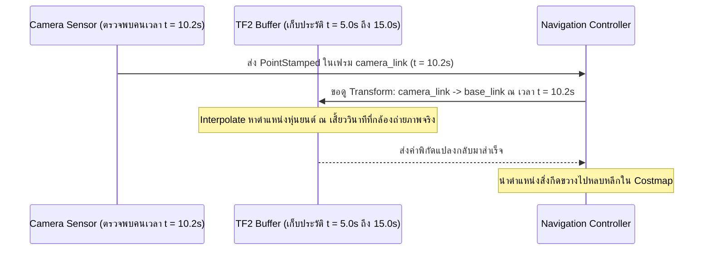

# 📖 Week 09: ระบบพิกัดสัมพัทธ์และการแปลงพิกัด (TF2 Transform System)
**เวลาเรียน:** บรรยาย 2 ชั่วโมง | ปฏิบัติการ 3 ชั่วโมง | ศึกษาค้นคว้าด้วยตนเอง 4 ชั่วโมง  
**วิชาบังคับก่อน:** [สัปดาห์ที่ 6: มาตรฐานวิศวกรรมพิกัด (REP 103/105) และจลนศาสตร์ AMR](../Week_06_Kinematics_REP_Standards/Readme.md)  
**เอกสารปฏิบัติการ:** [ใบงานแล็บสัปดาห์ที่ 9](Lab_Exercises.md)

---

## 🎯 วัตถุประสงค์การเรียนรู้ (Learning Objectives)
เมื่อจบบทเรียนนี้ ผู้เรียนจะสามารถ:
1. อธิบายทฤษฎีการแปลงพิกัดแบบโฮโมจีเนียส (4x4 Homogeneous Transformation Matrix) และควอเทอร์เนียน (Quaternions)
2. วิเคราะห์ความแตกต่างระหว่างทรานส์ฟอร์มแบบไดนามิก (`/tf`) และทรานส์ฟอร์มแบบคงที่ (`/tf_static`)
3. ประยุกต์ใช้กฎเหล็กของ **TF Tree** (Single Parent Rule และ No-Cycle Constraint) ในการออกแบบหุ่นยนต์
4. พัฒนาโหนด **StaticTransformBroadcaster** เพื่อประกาศตำแหน่งเซนเซอร์ (LiDAR, Camera, Optical Frame)
5. พัฒนาโหนด **TF2 Buffer & Listener** เพื่อแปลงพิกัดสิ่งกีดขวางจาก Sensor Frame สู่ Robot Base Frame พร้อมจัดการข้อผิดพลาด (TF Exceptions)

---

## ⏱️ แผนการสอน 2 ชั่วโมง (Lecture Outline)
| ช่วงเวลา | หัวข้อ | กิจกรรมการเรียนรู้ |
| :---: | :--- | :--- |
| **00:00 - 00:30** | ทฤษฎีการแปลงพิกัด 3D: Rotation Matrices vs Quaternions vs Euler | บรรยายปัญหา Gimbal Lock และสมการเมทริกซ์การแปลง $4 \times 4$ |
| **00:30 - 01:00** | สถาปัตยกรรม TF2 ใน ROS 2: Ring Buffer และ Time Travel | วิเคราะห์บทบาทของ `BufferCore`, การ Interpolate ข้อมูลข้ามเวลา |
| **01:00 - 01:30** | กฎเหล็กของ TF Tree และการเปรียบเทียบ `/tf` vs `/tf_static` QoS | เขียนแผนผังทรีและจำแนกอัตราการส่งข้อมูล (High Rate vs Latched) |
| **01:30 - 02:00** | Code Walkthrough: Broadcaster, Listener และเตรียมเข้าสู่ Lab | วิเคราะห์โค้ด `static_sensor_broadcaster.py` และ `tf_obstacle_listener.py` |

---

## 🏛️ สถาปัตยกรรมระบบ (Architectural Deep Dive)

### 1. คณิตศาสตร์การแปลงพิกัดใน 3 มิติ (Homogeneous Transformations)
จุดพิกัดใน 3 มิติ $\mathbf{p} = [x, y, z]^T$ สามารถแปลงจากพิกัดของเซนเซอร์กล้อง ($A$) ไปยังพิกัดตัวถังหุ่นยนต์ ($B$) ได้ผ่านเมทริกซ์ขนาด $4 \times 4$:

$$\begin{bmatrix} x_B \\ y_B \\ z_B \\ 1 \end{bmatrix} = \mathbf{T}_{B}^{A} \begin{bmatrix} x_A \\ y_A \\ z_A \\ 1 \end{bmatrix} = \begin{bmatrix} \mathbf{R}_{3\times3} & \mathbf{t}_{3\times1} \\ \mathbf{0}_{1\times3} & 1 \end{bmatrix} \begin{bmatrix} x_A \\ y_A \\ z_A \\ 1 \end{bmatrix}$$

โดยที่:
- $\mathbf{R}_{3\times3}$: เมทริกซ์การหมุน (Rotation Matrix)
- $\mathbf{t}_{3\times1} = [t_x, t_y, t_z]^T$: เวกเตอร์ระยะเลื่อนตำแหน่ง (Translation Vector)

#### ควอเทอร์เนียน (Quaternions) ปะทะ มุมออยเลอร์ (Euler Angles):
ในหุ่นยนต์จริง เราหลีกเลี่ยงการใช้มุมออยเลอร์ (Roll, Pitch, Yaw) ในการเก็บข้อมูลการหมุน เนื่องจากปัญหา **Gimbal Lock** (สภาวะที่แกนหมุน 2 แกนซ้อนทับกัน ทำให้สูญเสีย 1 องศาอิสระเมื่อ Pitch $= \pm 90^\circ$):
- ROS 2 ใช้ **Unit Quaternion** $\mathbf{q} = (x, y, z, w)$ เสมอ โดยที่:
  $$x^2 + y^2 + z^2 + w^2 = 1$$
- หากเป็นการหมุนมุม $\theta$ รอบแกนหมุนหนึ่งหน่วย $\mathbf{u} = (u_x, u_y, u_z)$:
  $$x = u_x \sin(\theta / 2), \quad y = u_y \sin(\theta / 2), \quad z = u_z \sin(\theta / 2), \quad w = \cos(\theta / 2)$$

---

### 2. สถาปัตยกรรม TF2 Ring Buffer และ Time Travel
ไลบรารี TF2 ไม่ใช่แค่ท็อปปิกธรรมดา แต่เป็นระบบแคชประวัติพิกัดย้อนหลัง (**Ring Buffer** โดยปกติเก็บข้อมูลย้อนหลัง 10 วินาที):



> [!NOTE]
> ระบบสามารถทำ **Time Travel** ได้ โดยขอพิกัดในอดีต ณ เสี้ยววินาทีที่เซนเซอร์บันทึกภาพจริง ซึ่งจำเป็นอย่างยิ่งสำหรับหุ่นยนต์ที่กำลังเคลื่อนที่ด้วยความเร็วสูง เพื่อป้องกันไม่ให้ข้อมูลเซนเซอร์ถูกแปลงด้วยตำแหน่งปัจจุบันที่คลาดเคลื่อนไปแล้ว

---

### 3. กฎเหล็กของ TF Tree (Coordinate Tree Rules)
1. **Single Parent Rule:** ทุก Frame ในระบบต้องมี **แม่ (Parent) ได้เพียงตัวเดียวเท่านั้น** (แต่แม่สามารถมีลูกได้หลายตัว)
2. **No-Cycle Constraint:** ห้ามเกิดวงวนลูปเด็ดขาด เช่น $A \rightarrow B \rightarrow C \rightarrow A$
3. **การแยกช่องสัญญาณ `/tf` vs `/tf_static`:**
   - `/tf`: สำหรับทรานส์ฟอร์มที่มีการเคลื่อนไหวตลอดเวลา (Dynamic) เช่น `odom` $\rightarrow$ `base_footprint` ส่งที่ความถี่สูง (20 - 50 Hz)
   - `/tf_static`: สำหรับทรานส์ฟอร์มที่ตำแหน่งติดตั้งคงที่ (Static) เช่น `base_link` $\rightarrow$ `lidar_link` ส่งเพียงครั้งเดียวด้วย QoS `TRANSIENT_LOCAL` เพื่อประหยัดแบนด์วิดท์เครือข่าย

---

### 4. ข้อยกเว้นและข้อผิดพลาดใน TF2 (TF Exceptions)
1. `tf2.LookupException`: ไม่พบชื่อ Frame ที่ร้องขอในระบบ (เช่น ลืมเปิด Broadcaster หรือพิมพ์ชื่อผิด)
2. `tf2.ConnectivityException`: มี Frame ทั้งสองตัวอยู่ในระบบ แต่ไม่มีเส้นทางเชื่อมต่อถึงกันใน Tree (Broken Chain)
3. `tf2.ExtrapolationException`: ร้องขอทรานส์ฟอร์ม ณ เวลาที่อยู่นอกช่วงข้อมูลใน Buffer (เช่น เวลาในอนาคต หรืออดีตเกิน 10 วินาที)

---

## 🛠️ การวิเคราะห์โค้ดตัวอย่างในโมดูล (Code Walkthrough)

### 1. `static_sensor_broadcaster.py`
- ใช้คลาส `StaticTransformBroadcaster(self)`
- ประกาศพิกัดติดตั้ง 3 จุดสำคัญ:
  1. `lidar_link`: ยื่นไปข้างหน้า 0.08 m, สูง 0.095 m
  2. `camera_link`: ยื่นไปข้างหน้า 0.20 m, สูง 0.02 m
  3. `camera_optical_link`: หมุน Roll $-90^\circ$ และ Yaw $-90^\circ$ ตามมาตรฐาน REP 103 (แกน Z ชี้ไปข้างหน้าสู่ภาพ, แกน X ชี้ไปทางขวาของภาพ)
- ส่งแบบแพ็กรวมด้วยคำสั่ง `self._tf_publisher.sendTransform(transforms)`

### 2. `tf_obstacle_listener.py`
- สร้าง `Buffer()` และ `TransformListener(self.tf_buffer, self)`
- ในฟังก์ชันลูป (2 Hz):
  - สร้างจุดจำลองสิ่งกีดขวาง `PointStamped` ที่กล้องตรวจพบ $(x = 1.2, y = 0.3)$ ในเฟรม `camera_link`
  - สั่งแปลงพิกัดเข้าหา `base_link`:
    ```python
    pt_in_base = self.tf_buffer.transform(
        pt_in_camera, 'base_link', timeout=rclpy.duration.Duration(seconds=0.2)
    )
    ```
  - ห่อหุ้มด้วยบล็อก `try-except` ดักจับ `LookupException`, `ConnectivityException`, `ExtrapolationException` อย่างปลอดภัย

---

## ⌨️ ตารางคำสั่ง CLI สำคัญ
| คำสั่ง | วัตถุประสงค์ | ตัวอย่างการใช้งาน |
| :--- | :--- | :--- |
| `ros2 run tf2_ros tf2_echo <parent> <child>` | ดักฟังทรานส์ฟอร์มสดระหว่างสองเฟรม | `ros2 run tf2_ros tf2_echo base_link lidar_link` |
| `ros2 run tf2_tools view_frames` | สร้างแผนผัง PDF ของ TF Tree ทั้งหมดในระบบ | `ros2 run tf2_tools view_frames` |
| `ros2 run tf2_ros tf2_monitor` | วัดความถี่และ Latency ของทุกทรานส์ฟอร์ม | `ros2 run tf2_ros tf2_monitor` |
| `ros2 topic echo --qos-durability transient_local /tf_static` | ดักฟังข้อมูลทรานส์ฟอร์มคงที่ | `ros2 topic echo --qos-durability transient_local /tf_static` |

---

## ⚠️ ปัญหาที่พบบ่อยและการแก้ไข (Troubleshooting)
| อาการ | สาเหตุที่เป็นไปได้ | วิธีแก้ไข |
| :--- | :--- | :--- |
| `ExtrapolationException: Lookup would require extrapolation into the future` | สัญญาณนาฬิการะหว่างสองโหนดไม่ตรงกัน หรือยังไม่มีข้อมูล TF เข้ามาถึงเสี้ยววินาทีนั้น | ใช้ `timeout=Duration(seconds=0.1)` ในคำสั่ง lookup หรือใช้ `Time()` (เวลาล่าสุด) |
| `view_frames` ได้ไฟล์ PDF โดดเดี่ยวสองกลุ่ม (Disconnected Tree) | ไม่มีโหนดบรอดแคสต์ทรานส์ฟอร์มเชื่อมระหว่างเฟรมหลัก (เช่น ขาด `odom -> base_link`) | ตรวจสอบว่าโหนด Odometry หรือ Localization กำลังทำงานอยู่หรือไม่ |
| ภาพกล้องใน RViz2 คว่ำหน้าลงหรือหมุนข้าง | ไม่ได้ประกาศเฟรม `camera_optical_link` ตามมาตรฐาน REP 103 | เพิ่ม Static Transform แปลงจาก `camera_link` สู่ `camera_optical_link` |

---

## 📝 แบบทดสอบท้ายบท (Self-Assessment Quiz)
1. ปัญหา Gimbal Lock เกิดขึ้นได้อย่างไรเมื่อใช้มุมออยเลอร์ และควอเทอร์เนียนแก้ปัญหานี้ได้อย่างไร?
2. กฎเกณฑ์ที่สำคัญที่สุดของโครงสร้างต้นไม้พิกัด (TF Tree) คืออะไร?
3. ทำไมเซนเซอร์ที่ยึดติดแน่นกับโครงหุ่นยนต์จึงควรบรอดแคสต์ลงใน `/tf_static` แทนที่จะเป็น `/tf`?
4. หากต้องการแปลงพิกัดของจุดสิ่งกีดขวางที่กล้องตรวจพบ ต้องใช้วัตถุชนิดใดใน ROS 2 (`Point` หรือ `PointStamped`) เพราะเหตุใด?
5. คำสั่ง CLI ใดที่ใช้วาดแผนผังความสัมพันธ์ของทุก Frame ในระบบออกมาเป็นไฟล์ PDF ได้ทันที?

<details>
<summary>🔍 ดูเฉลยคำตอบ</summary>

1. **ตอบ:** เกิดจากการที่มุม Pitch เอียงขึ้นหรือลง $90^\circ$ ทำให้แกน Roll และ Yaw ซ้อนทับกันจนสูญเสีย 1 มิติอิสระ ส่วนควอเทอร์เนียนแก้ปัญหานี้โดยใช้ตัวเลข 4 มิติบนผิวทรงกลม 4D ซึ่งไม่มีจุด Singularity ทางคณิตศาสตร์
2. **ตอบ:** แต่ละ Frame ต้องมี Parent Link ได้เพียงตัวเดียวเท่านั้น และห้ามเกิดวงวนลูป (No Cyclic Dependency)
3. **ตอบ:** เพื่อลดปริมาณทราฟฟิกบนเครือข่าย เพราะทรานส์ฟอร์มคงที่ไม่จำเป็นต้องส่งซ้ำๆ 50 ครั้งต่อวินาที แต่ส่งครั้งเดียวด้วย QoS `TRANSIENT_LOCAL` ให้แคชไว้
4. **ตอบ:** ต้องใช้ `PointStamped` เพราะมีส่วนของ Header ที่ระบุทั้ง `frame_id` (ว่าจุดนี้อ้างอิงกับพิกัดใด) และ `stamp` (ว่าจุดนี้เกิดขึ้น ณ เสี้ยววินาทีใด) ซึ่งจำเป็นต่อการ lookup ใน TF Buffer
5. **ตอบ:** `ros2 run tf2_tools view_frames`
</details>

---

## 📚 แหล่งอ้างอิงและศึกษาเพิ่มเติม
- [About TF2 and Time Travel](https://docs.ros.org/en/jazzy/Concepts/Intermediate/About-Tf2.html)
- [Writing a TF2 Static Broadcaster (Python)](https://docs.ros.org/en/jazzy/Tutorials/Intermediate/Tf2/Writing-A-Tf2-Static-Broadcaster-Py.html)
- [Writing a TF2 Listener (Python)](https://docs.ros.org/en/jazzy/Tutorials/Intermediate/Tf2/Writing-A-Tf2-Listener-Py.html)
