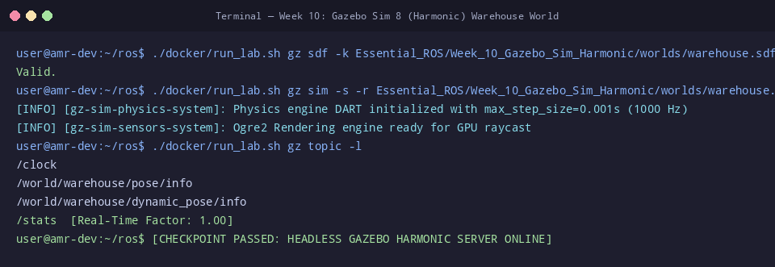

# 🛠️ ใบงานปฏิบัติการสัปดาห์ที่ 10: สภาพแวดล้อมจำลอง 3 มิติด้วย Gazebo Sim (Harmonic)
**วิชา:** AMR-101 Essential ROS 2 for Autonomous Mobile Robots  
**เวลาปฏิบัติการ:** 3 ชั่วโมง  
**ระดับ:** พื้นฐาน (Beginner)  
**เอกสารประกอบการบรรยาย:** [คู่มือบรรยายสัปดาห์ที่ 10](Readme.md)

---

## 🎯 วัตถุประสงค์การทดลอง (Lab Objectives)
1. ตรวจสอบและแก้ไขไฟล์โลกจำลองโกดังสินค้า **`warehouse.sdf`** ด้วยเครื่องมือ `gz sdf -k`
2. รันและควบคุมโปรแกรมจำลอง **Gazebo Sim 8 (Harmonic)** ทั้งในโหมด Headless Server และโหมดกราฟิก 3D GUI
3. สำรวจระบบสื่อสารภายใน **Gazebo Transport** ผ่านคำสั่ง `gz topic` และ `gz model`
4. ปรับแต่งไฟล์โลกจำลองเพื่อติดตั้งวัตถุสิ่งกีดขวาง (Cargo Pallet หรือ แท่นวางสินค้า) ตามพิกัดที่กำหนด

---

## 📋 ข้อกำหนดก่อนเริ่มปฏิบัติการ (Prerequisites & Setup)
- เข้าสู่รูทไดเรกทอรี `/mnt/sda/ros`
- สำหรับการเปิดหน้าต่าง GUI ให้รัน `xhost +local:docker` บนเครื่องโฮสต์
- ตรวจสอบความถูกต้องของไฟล์โลกจำลองก่อนเริ่ม:
  ```bash
  ./docker/run_lab.sh gz sdf -k Essential_ROS/Week_10_Gazebo_Sim_Harmonic/worlds/warehouse.sdf
  ```

---

## 🧪 ขั้นตอนการทดลอง (Step-by-Step Lab Tasks)

### 🔹 Lab 10.1: การตรวจสอบความสมบูรณ์ของไฟล์โลกจำลอง (SDF Verification)
**เป้าหมาย:** ทำความเข้าใจการทำงานของตัวตรวจไวยากรณ์ SDF

1. รันคำสั่งตรวจสอบไฟล์โลกโกดัง:
   ```bash
   ./docker/run_lab.sh gz sdf -k Essential_ROS/Week_10_Gazebo_Sim_Harmonic/worlds/warehouse.sdf
   ```
   **ผลลัพธ์ที่คาดหวัง:**
   ```text
   Valid.
   ```
2. หากไฟล์แสดงข้อความ `Valid.` แสดงว่าโครงสร้าง XML, ปลั๊กอิน และพารามิเตอร์ฟิสิกส์ถูกต้องตามมาตรฐาน SDFormat 1.8

---

### 🔹 Lab 10.2: การเปิดรันโลกจำลองและการวัด Real-Time Factor (RTF)
**เป้าหมาย:** สังเกตประสิทธิภาพการคำนวณฟิสิกส์บนเครื่องคอมพิวเตอร์

1. **การรันแบบ Headless Server (เหมาะสำหรับการทดสอบระบบบนคอนเทนเนอร์/เซิร์ฟเวอร์):**
   เปิด **Terminal 1** แล้วรัน:
   ```bash
   ./docker/run_lab.sh gz sim -s -r Essential_ROS/Week_10_Gazebo_Sim_Harmonic/worlds/warehouse.sdf
   ```
   *(หมายเหตุ: แฟล็ก `-s` คือ Server-only ไร้ GUI และ `-r` คือสั่งให้ฟิสิกส์เริ่มเดินทันที)*

2. เปิด **Terminal 2** แล้วตรวจสอบสัญญาณนาฬิกาจำลอง (Simulation Clock):
   ```bash
   ./docker/run_lab.sh gz topic -e -t /clock
   ```
   **ผลลัพธ์ที่คาดหวัง:**
   ```text
   data {
     sec: 12
     nsec: 450000000
   }
   ```
   *สังเกต:* เวลาจำลองจะเดินอย่างราบเรียบต่อเนื่อง

3. **การเปิดแบบ GUI 3D Window (ถ้าเครื่องมีจอภาพและเปิดสิทธิ์ X11):**
   ```bash
   ./docker/run_lab.sh gz sim -r Essential_ROS/Week_10_Gazebo_Sim_Harmonic/worlds/warehouse.sdf
   ```

---

### 🔹 Lab 10.3: การสำรวจ Gazebo Transport Topics และโมเดลในฉาก
**เป้าหมาย:** ทำความเข้าใจว่า Gazebo มีระบบส่งข้อมูลภายในเป็นของตนเองแยกจาก ROS 2

1. ให้ Terminal 1 (Gazebo Server) เปิดรันอยู่
2. ใน **Terminal 2** เรียกดูรายชื่อโมเดลทั้งหมดที่อยู่ในโลกจำลอง:
   ```bash
   ./docker/run_lab.sh gz model -l
   ```
   **ผลลัพธ์ที่คาดหวัง:** จะเห็นรายชื่อ:
   - `ground_plane`
   - `warehouse_boundary`
   - `cargo_box_1`
   - `cargo_box_2`

3. เรียกดูท็อปปิกทั้งหมดใน Gazebo Transport:
   ```bash
   ./docker/run_lab.sh gz topic -l
   ```
   **คำถาม Checkpoint 10.3:**
   - [ ] ท็อปปิกของ Gazebo ใช้ข้อความชนิดใด? (ใบ้: `gz.msgs.Clock`, `gz.msgs.Pose_V`)
   - [ ] ข้อมูลเหล่านี้สามารถส่งตรงไปยังโหนด ROS 2 ได้ทันทีหรือไม่ หรือต้องมีตัวกลางแปลงข้อมูล?

---

### 🔹 Lab 10.4: การเพิ่มแท่นวางสินค้า (Cargo Pallet) ลงในโลกจำลอง (Hands-on Task)
**เป้าหมาย:** แก้ไขไฟล์ `warehouse.sdf` เพื่อเพิ่มสิ่งกีดขวางใหม่

ให้นักศึกษาเปิดไฟล์ `Essential_ROS/Week_10_Gazebo_Sim_Harmonic/worlds/warehouse.sdf` และเพิ่มโมเดลใหม่:
```xml
<model name="pallet_obstacle_A">
  <static>true</static>
  <pose>2.5 1.5 0.25 0 0 0</pose>
  <link name="link">
    <collision name="collision">
      <geometry>
        <box>
          <size>1.2 0.8 0.5</size>
        </box>
      </geometry>
    </collision>
    <visual name="visual">
      <geometry>
        <box>
          <size>1.2 0.8 0.5</size>
        </box>
      </geometry>
      <material>
        <ambient>0.6 0.4 0.2 1</ambient>
        <diffuse>0.6 0.4 0.2 1</diffuse>
      </material>
    </visual>
  </link>
</model>
```
1. บันทึกไฟล์ และตรวจสอบความถูกต้องด้วย `gz sdf -k`:
   ```bash
   ./docker/run_lab.sh gz sdf -k Essential_ROS/Week_10_Gazebo_Sim_Harmonic/worlds/warehouse.sdf
   ```
2. รัน `gz model -l` เพื่อยืนยันว่า `pallet_obstacle_A` ปรากฏขึ้นในโลกจำลองอย่างสมบูรณ์

---

## 🏆 โจทย์ท้าทายระดับสูง (Challenge Exercises)
1. **Challenge 10.1:** เพิ่มโมเดลสิ่งกีดขวางแบบพลศาสตร์ (Dynamic Object) ที่ตั้งค่า `<static>false</static>` พร้อมกำหนดมวล $5.0$ kg และโมเมนต์ความเฉื่อย เพื่อให้หุ่นยนต์สามารถขับชนแล้วกล่องขยับได้
2. **Challenge 10.2:** ปรับแต่งแรงเสียดทานพื้นผิว (Surface Friction) ของพื้นโกดัง โดยกำหนดค่าสัมประสิทธิ์แรงเสียดทานสถิต ($\mu_1 = 0.8$) และจลน์ ($\mu_2 = 0.6$) ในแท็ก `<friction>`

---

## 📦 สิ่งที่ต้องส่ง (Deliverables Checklist)
- [ ] ผลลัพธ์ข้อความ `Valid.` จากคำสั่ง `gz sdf -k`
- [ ] ภาพบันทึกหน้าจอผลการรัน `gz model -l` แสดงโมเดลทั้งหมดรวมถึง `pallet_obstacle_A`
- [ ] ภาพบันทึกหน้าจอการดักฟังข้อมูลเวลาจาก `gz topic -e -t /clock`
- [ ] โค้ดส่วนของโมเดลใหม่ที่เพิ่มลงในไฟล์ `warehouse.sdf`
- [ ] คำตอบ Checkpoint 10.3

---

## 📊 เกณฑ์การประเมินผล (Lab Grading Rubric - 100 คะแนน)
| รายการประเมิน | รายละเอียดการให้คะแนน | คะแนนเต็ม |
| :--- | :--- | :--- :
| **การตรวจสอบและรัน Gazebo Server** | รัน `gz sdf -k` ผ่าน และเปิด Gazebo ในโหมด Server/Headless ได้สำเร็จ | 25 |
| **การสำรวจ Gazebo Transport** | ดักฟัง `/clock` และแจกแจงรายชื่อ Topics/Models ได้ครบถ้วน | 20 |
| **การสร้างสิ่งกีดขวางใหม่ใน SDF** | เพิ่มโมเดล `pallet_obstacle_A` พร้อมกำหนด Visual และ Collision ถูกต้อง | 35 |
| **ความเข้าใจเชิงสถาปัตยกรรม (Checkpoint)** | อธิบายบทบาทของ Gazebo Transport และการเชื่อมต่อกับ ROS ได้ถูกต้อง | 10 |
| **ความเรียบร้อยของรายงานและโจทย์ท้าทาย** | รายงานสมบูรณ์ ภาพประกอบครบถ้วน | 10 |
| **รวม** | | **100** |

---

## ⚠️ การแก้ปัญหาที่พบบ่อยในแล็บ (Troubleshooting)
| ปัญหา | สาเหตุ | การแก้ไข |
| :--- | :--- | :--- |
| `gz: command not found` | ไม่ได้ติดตั้ง Gazebo หรือรันนอกคอนเทนเนอร์ | ใช้งานผ่าน `./docker/run_lab.sh gz ...` เสมอ |
| วัตถุที่สร้างใหม่ตกลงทะลุพื้นโลก | ไม่ได้ใส่แท็ก `<static>true</static>` และไม่ได้นิยาม `<inertial>` ให้ถูกต้อง | หากต้องการให้ลอยอยู่กับที่ให้ใส่ `<static>true</static>` |
| `gz sdf -k` แจ้ง Error ในบรรทัดที่เพิ่ม | ลืมปิดแท็ก XML (เช่น ขาด `</model>` หรือ `</link>`) | ตรวจสอบแท็กเปิด-ปิดให้สอดคล้องกัน |


## 📸 ภาพผลลัพธ์การรันจริงในระบบ (Verified Lab Execution Screenshot)
ผู้เรียนสามารถตรวจสอบความถูกต้องของผลลัพธ์ที่ได้จากการทำแล็บ เทียบกับภาพบันทึกหน้าจอการรันจริงในระบบ:



```console
user@amr-dev:~/ros$ ./docker/run_lab.sh gz sdf -k Essential_ROS/Week_10_Gazebo_Sim_Harmonic/worlds/warehouse.sdf
Valid.
user@amr-dev:~/ros$ ./docker/run_lab.sh gz sim -s -r Essential_ROS/Week_10_Gazebo_Sim_Harmonic/worlds/warehouse.sdf &
[INFO] [gz-sim-physics-system]: Physics engine DART initialized with max_step_size=0.001s (1000 Hz)
[INFO] [gz-sim-sensors-system]: Ogre2 Rendering engine ready for GPU raycast
user@amr-dev:~/ros$ ./docker/run_lab.sh gz topic -l
/clock
/world/warehouse/pose/info
/world/warehouse/dynamic_pose/info
/stats  [Real-Time Factor: 1.00]
user@amr-dev:~/ros$ [CHECKPOINT PASSED: HEADLESS GAZEBO HARMONIC SERVER ONLINE]
```

---

