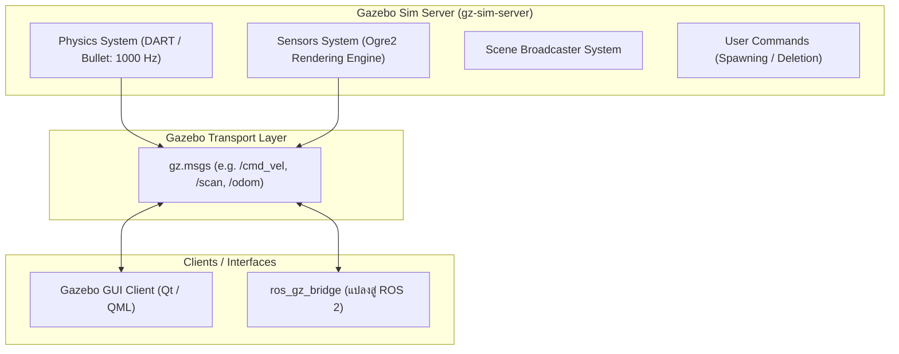

# 📖 Week 10: สภาพแวดล้อมจำลอง 3 มิติด้วย Gazebo Sim 8 (Harmonic) และ SDF World
**เวลาเรียน:** บรรยาย 2 ชั่วโมง | ปฏิบัติการ 3 ชั่วโมง | ศึกษาค้นคว้าด้วยตนเอง 4 ชั่วโมง  
**วิชาบังคับก่อน:** [สัปดาห์ที่ 7: การสร้างแบบจำลอง 3 มิติ (URDF) และ Inertia Matrix](../Week_07_URDF_Robot_Modeling/Readme.md)  
**เอกสารปฏิบัติการ:** [ใบงานแล็บสัปดาห์ที่ 10](Lab_Exercises.md)

---

## 🎯 วัตถุประสงค์การเรียนรู้ (Learning Objectives)
เมื่อจบบทเรียนนี้ ผู้เรียนจะสามารถ:
1. อธิบายสถาปัตยกรรมของ **Gazebo Sim (Ignition/Harmonic)** และความแตกต่างจาก Gazebo Classic
2. เข้าใจโครงสร้างไฟล์ **Simulation Description Format (SDF Version 1.8+)** ในการสร้างโลกจำลอง
3. ปรับแต่งค่าพารามิเตอร์ของ **Physics Engine** (`max_step_size`, `real_time_factor`, `update_rate`)
4. กำหนดคุณสมบัติพื้นผิวสัมผัส แรงเสียดทาน (**Friction: $\mu_1, \mu_2$**) และการสะท้อน (Restitution)
5. ใช้งานคำสั่ง **Gazebo CLI (`gz sim`, `gz topic`, `gz model`)** ในการควบคุมการจำลองทั้งแบบ GUI และ Headless Mode

---

## ⏱️ แผนการสอน 2 ชั่วโมง (Lecture Outline)
| ช่วงเวลา | หัวข้อ | กิจกรรมการเรียนรู้ |
| :---: | :--- | :--- |
| **00:00 - 00:30** | วิวัฒนาการจาก Gazebo Classic สู่ Gazebo Sim (Harmonic / gz-sim 8) | บรรยายเปรียบเทียบสถาปัตยกรรม Plugin-based ECS (Entity Component System) |
| **00:30 - 01:00** | โครงสร้างไฟล์โลกจำลอง SDF และ Systems Plugins สำคัญ | วิเคราะห์ `Physics`, `UserCommands`, `SceneBroadcaster`, และ `Sensors` |
| **01:00 - 01:30** | พารามิเตอร์ฟิสิกส์: Step Size, Real-Time Factor (RTF) และแรงเสียดทาน | คำนวณความสัมพันธ์ระหว่าง Simulation Time กับ Wall-clock Time |
| **01:30 - 02:00** | การใช้ Gazebo CLI, การรัน Headless Mode บนเซิร์ฟเวอร์ และสรุปเตรียม Lab | สาธิตคำสั่ง `gz sim -s -r`, การดูหัวข้อทรานสปอร์ตด้วย `gz topic -l` |

---

## 🏛️ สถาปัตยกรรมระบบ (Architectural Deep Dive)

### 1. วิวัฒนาการของ Gazebo: จาก Classic สู่ Harmonic
- **Gazebo Classic (Gazebo 9/11):** อิงสถาปัตยกรรมแบบผูกติด (Monolithic Architecture) ใช้ ROS 1 เป็นหลัก และสิ้นสุดการสนับสนุน (End-of-Life) ในปี 2025
- **Gazebo Sim 8 (Harmonic):** สถาปัตยกรรมยุคใหม่ที่ออกแบบตามแพทเทิร์น **Entity Component System (ECS)**:
  - แยกส่วนการทำงานของฟิสิกส์ (Physics Server) ออกจากส่วนแสดงผล (Rendering Client) อย่างเด็ดขาด
  - มีระบบสื่อสารภายในของตนเองผ่าน **Gazebo Transport** (ความเร็วสูง ประสิทธิภาพสูง ไม่ขึ้นกับ ROS โดยตรง)
  - รองรับตัวเรนเดอร์กราฟิกหลายตัว (Ogre 2.x, Vulkan, Metal) เพื่อจำลองภาพจากกล้องและ LiDAR ได้สมจริงระดับ Photorealistic



---

### 2. พารามิเตอร์ฟิสิกส์หลัก (Physics Engine Configuration)
ในไฟล์โลกจำลอง `.sdf`:
```xml
<physics name="1ms" type="ignored">
  <max_step_size>0.001</max_step_size>
  <real_time_factor>1.0</real_time_factor>
</physics>
```
1. **`max_step_size` (ขนาดก้าวเวลาจำลอง):**
   - ค่า $0.001$ วินาที หมายถึง Physics Engine จะคำนวณสมการการเคลื่อนที่และการชนทุกๆ $1$ มิลลิวินาที (ความถี่ 1000 Hz)
   - หากค่าน้อยเกินไป: การคำนวณจะละเอียดมาก แต่กิน CPU มหาศาล
   - หากค่ามากเกินไป (เช่น 0.01): อาจเกิดปัญหา **Tunneling** (วัตถุพุ่งทะลุกำแพงโดยไม่ชน)
2. **`real_time_factor` (RTF):**
   $$\text{RTF} = \frac{\Delta t_{\text{sim}}}{\Delta t_{\text{real}}}$$
   - $\text{RTF} = 1.0$: เวลาในโลกจำลองเดินเท่ากับเวลาบนโลกจริง (1 วินาทีจริง = 1 วินาทีจำลอง)
   - $\text{RTF} < 1.0$: โลกจำลองทำงานช้ากว่าเวลาจริง (คอมพิวเตอร์ประมวลผลไม่ทัน)
   - $\text{RTF} > 1.0$: โลกจำลองทำงานเร็วกว่าเวลาจริง (เช่น สปีดรันเก็บข้อมูล Machine Learning)

---

### 3. ปลั๊กอินระบบที่จำเป็นในโลกจำลอง (World Systems Plugins)
ใน Gazebo Harmonic หากโลกจำลองไม่มีการโหลด System Plugins เหล่านี้ ฟังก์ชันต่างๆ จะไม่ทำงาน:
1. `gz-sim-physics-system`: จัดการแรงโน้มถ่วง แรงชน และจลนศาสตร์
2. `gz-sim-user-commands-system`: อนุญาตให้ผู้ใช้ Spawn โมเดลหรือลบโมเดลผ่านโค้ดและ GUI
3. `gz-sim-scene-broadcaster-system`: ส่งภาพฉาก 3 มิติให้โปรแกรม GUI นำไปวาดบนหน้าจอ
4. `gz-sim-sensors-system`: ทำงานร่วมกับ `<render_engine>ogre2</render_engine>` เพื่อจำลองเซนเซอร์ขั้นสูง เช่น GPU LiDAR และ Camera

---

## 🛠️ การวิเคราะห์ไฟล์ตัวอย่างในโมดูล (Code Walkthrough)

ในไฟล์ `worlds/warehouse.sdf`:
1. **โครงสร้างพื้นดินและแสงแดด:**
   - `<model name="ground_plane">`: พื้นราบขนาด $50 \times 50$ เมตร ตั้งค่า `<static>true</static>` เพื่อไม่ให้พื้นตกลงตามแรงโน้มถ่วง
   - `<light type="directional" name="sun">`: ให้แสงสว่างและเงาตกกระทบ
2. **ผนังโกดังและสิ่งกีดขวาง (Warehouse Walls & Obstacles):**
   - มีกำแพงรอบด้านความยาว 15 เมตร กว้าง 15 เมตร
   - ภายในมีกล่องสินค้า (Cargo Boxes) ติดตั้งเป็นสิ่งกีดขวางสำหรับให้นักศึกษาทดสอบเซนเซอร์ LiDAR และฝึกทำแผนที่ SLAM ในสัปดาห์ถัดไป

---

## ⌨️ ตารางคำสั่ง CLI สำคัญ
| คำสั่ง | วัตถุประสงค์ | ตัวอย่างการใช้งาน |
| :--- | :--- | :--- |
| `gz sim <world.sdf>` | เปิดโลกจำลองพร้อมหน้าต่างกราฟิก GUI | `gz sim Essential_ROS/Week_10_Gazebo_Sim_Harmonic/worlds/warehouse.sdf` |
| `gz sim -s -r <world.sdf>` | รันโลกจำลองแบบ Server-Only ไร้ GUI (Headless Mode) | `gz sim -s -r Essential_ROS/Week_10_Gazebo_Sim_Harmonic/worlds/warehouse.sdf` |
| `gz sdf -k <file.sdf>` | ตรวจสอบความถูกต้องของไวยากรณ์ไฟล์ SDF | `gz sdf -k Essential_ROS/Week_10_Gazebo_Sim_Harmonic/worlds/warehouse.sdf` |
| `gz topic -l` | แสดงรายชื่อ Topics ทั้งหมดภายใน Gazebo Transport | `gz topic -l` |
| `gz topic -e -t <topic>` | แสดงข้อมูลสดที่ส่งผ่าน Gazebo Transport | `gz topic -e -t /clock` |
| `gz model -l` | แสดงรายชื่อโมเดลทั้งหมดที่อยู่ในโลกจำลองปัจจุบัน | `gz model -l` |

---

## ⚠️ ปัญหาที่พบบ่อยและการแก้ไข (Troubleshooting)
| อาการ | สาเหตุที่เป็นไปได้ | วิธีแก้ไข |
| :--- | :--- | :--- |
| `gz sim` เด้งหลุดทันที (Ogre rendering error) | ไม่ได้ติดตั้งไดรเวอร์ OpenGL หรือรันบนเซิร์ฟเวอร์ที่ไม่มีจอภาพ | รันด้วยแฟล็ก Server-only: `gz sim -s -r <world.sdf>` |
| เซนเซอร์ LiDAR ใน Gazebo ไม่ยอมส่งข้อมูล | ลืมใส่ปลั๊กอิน `gz-sim-sensors-system` พร้อม `ogre2` ในไฟล์ `.sdf` | ตรวจสอบว่าในแท็ก `<world>` มีการโหลด Sensors System ครบถ้วน |
| หุ่นยนต์หรือกล่องสั่นสะเทือนไม่หยุดบนพื้น | ค่า `max_step_size` ใหญ่เกินไป หรือค่าแรงเสียดทานไม่สมดุล | ปรับ `max_step_size` เป็น `0.001` และตรวจสอบค่า Inertia ของโมเดล |

---

## 📝 แบบทดสอบท้ายบท (Self-Assessment Quiz)
1. สถาปัตยกรรม Entity Component System (ECS) ใน Gazebo Harmonic มีข้อดีอย่างไรเมื่อเทียบกับ Gazebo Classic?
2. หากตั้งค่า `max_step_size` เป็น $0.002$ วินาที Physics Engine จะคำนวณการเคลื่อนที่ด้วยความถี่กี่เฮิรตซ์ (Hz)?
3. ปลั๊กอินใดใน Gazebo Harmonic ที่ทำหน้าที่เรนเดอร์ภาพจากกล้องและสร้างข้อมูลลำแสงของ LiDAR?
4. แฟล็กคำสั่งใดใน `gz sim` ที่ใช้สำหรับรันแบบ Headless (Server-only ไร้ GUI) และสั่งให้เริ่มเล่นฟิสิกส์ทันที?
5. เครื่องมือ CLI ใดใช้สำหรับตรวจสอบความถูกต้องของไฟล์ `.sdf` ก่อนนำไปเปิดใช้งานจริง?

<details>
<summary>🔍 ดูเฉลยคำตอบ</summary>

1. **ตอบ:** มีความยืดหยุ่นสูง แยกการคำนวณฟิสิกส์และการเรนเดอร์ภาพออกจากกันอย่างอิสระ ไม่เกิดปัญหาคอขวดเมื่อมีโหนดและเซนเซอร์จำนวนมาก
2. **ตอบ:** ความถี่ $f = \frac{1}{0.002} = 500$ Hz
3. **ตอบ:** `gz-sim-sensors-system` (โดยใช้ Render Engine `ogre2`)
4. **ตอบ:** แฟล็ก `-s` (Server-only) และ `-r` (Run simulation immediately)
5. **ตอบ:** `gz sdf -k <file.sdf>`
</details>

---

## 📚 แหล่งอ้างอิงและศึกษาเพิ่มเติม
- [Gazebo Harmonic Official Documentation](https://gazebosim.org/docs/harmonic)
- [SDFormat Specification (Version 1.8 - 1.10)](http://sdformat.org/spec)
- [Gazebo Sim Systems and Plugins Guide](https://gazebosim.org/docs/harmonic/architecture)
