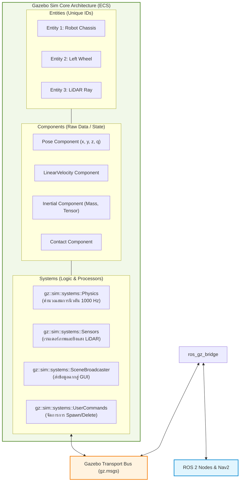

# 📖 Week 10: สภาพแวดล้อมจำลอง 3 มิติด้วย Gazebo Sim 8 (Harmonic) และ SDF World
**เวลาเรียน:** บรรยาย 2 ชั่วโมง | ปฏิบัติการ 3 ชั่วโมง | ศึกษาค้นคว้าด้วยตนเอง 4 ชั่วโมง  
**วิชาบังคับก่อน:** [สัปดาห์ที่ 7: การสร้างแบบจำลอง 3 มิติ (URDF) และ Inertia Matrix](../Week_07_URDF_Robot_Modeling/Readme.md)  
**เอกสารปฏิบัติการ:** [ใบงานแล็บสัปดาห์ที่ 10](Lab_Exercises.md)

---

## 🎯 วัตถุประสงค์การเรียนรู้ (Learning Objectives)
เมื่อจบบทเรียนนี้ ผู้เรียนจะสามารถ:
1. **วิเคราะห์สถาปัตยกรรมแบบ Entity Component System (ECS)** ใน Gazebo Sim 8 (Harmonic) และเปรียบเทียบข้อได้เปรียบกับสถาปัตยกรรม Monolithic ของ Gazebo Classic ได้อย่างลึกซึ้ง
2. **สร้างและปรับแต่งโลกจำลอง 3 มิติ** ด้วยไฟล์ Simulation Description Format (SDF Version 1.8+) สำหรับโรงงานและคลังสินค้าอัตโนมัติ
3. **คำนวณและปรับแต่งพารามิเตอร์ของ Physics Engine** (`max_step_size`, `real_time_factor`, Solver Iterations) ให้สมดุลระหว่างความแม่นยำและการใช้ทรัพยากร CPU
4. **กำหนดค่าสัมประสิทธิ์แรงเสียดทาน (Coulomb Friction: $\mu_1, \mu_2$)** และแรงกระดอน (Restitution) บนพื้นผิวสัมผัสล้อเพื่อป้องกันการลื่นไถลที่ผิดธรรมชาติ
5. **ควบคุมการจำลองผ่านคำสั่ง Gazebo CLI** (`gz sim`, `gz topic`, `gz service`, `gz model`) ทั้งในโหมดแสดงผลกราฟิกและโหมดไร้จอภาพ (Headless Mode) บน Docker

---

## ⏱️ แผนการสอน 2 ชั่วโมง (Lecture Outline)
| ช่วงเวลา | หัวข้อ | กิจกรรมการเรียนรู้ |
| :---: | :--- | :--- |
| **00:00 - 00:30** | สถาปัตยกรรม Gazebo Harmonic: ECS Pattern vs Classic | บรรยายการแบ่งหน้าที่ระหว่าง Entities, Components, และ Systems Plugins |
| **00:30 - 01:00** | โครงสร้างโลกจำลอง SDF 1.8+ และระบบเรนเดอร์ Ogre2 | วิเคราะห์แท็ก `<world>`, `<physics>`, `<model>`, แสงเงา และปลั๊กอินเซนเซอร์ |
| **01:00 - 01:30** | พารามิเตอร์ฟิสิกส์: Step Size, RTF, Friction Cone และ Contact Solver | คำนวณความถี่ก้าวเวลา, ปรากฏการณ์ Tunneling, และแรงเสียดทานแบบทิศทางสัมพัทธ์ |
| **01:30 - 02:00** | การใช้ Gazebo CLI และการรัน Headless Simulation บน Docker | สาธิตคำสั่ง `gz sim -s -r`, `gz topic`, ตรวจสอบไฟล์ SDF ด้วย `gz sdf -k` |

---

## 🏛️ สถาปัตยกรรมระบบ (Architectural Deep Dive)

### 1. วิวัฒนาการของ Gazebo: จาก Classic สู่ Harmonic
ซอฟต์แวร์จำลองสภาพแวดล้อมเสมือนจริงของหุ่นยนต์ได้พัฒนามาถึงจุดเปลี่ยนครั้งสำคัญ:
- **Gazebo Classic (Gazebo 9 / 11):** ออกแบบตั้งแต่ปี 2004 โดยใช้สถาปัตยกรรมแบบรวมศูนย์ (Monolithic) ซึ่งโค้ดประมวลผลฟิสิกส์ การแสดงผลกราฟิก และการจัดการฉากถูกรวมไว้ในโปรเซสเดียวกัน ส่งผลให้เกิดคอขวดเมื่อมีเซนเซอร์จำนวนมาก และสิ้นสุดการสนับสนุนอย่างเป็นทางการ (End-of-Life) ในปี 2025
- **Gazebo Sim 8 (Harmonic):** ถูกออกแบบใหม่หมดจดภายใต้โครงการ Ignition/Gazebo ยุคใหม่ โดยใช้แนวคิด **Entity Component System (ECS)**:
  - แยกไลบรารีออกเป็นโมดูลอิสระ: `gz-physics` (DART / Bullet), `gz-rendering` (Ogre2 / Vulkan), `gz-sensors`, `gz-gui`, `gz-transport`, `gz-math`
  - ใช้ **Gazebo Transport** (IPC ผ่าน ZeroMQ / Protobuf) ความเร็วสูงในการแลกเปลี่ยนข้อมูลภายใน โดยไม่ขึ้นกับ ROS 2 โดยตรง



---

### 2. พารามิเตอร์ฟิสิกส์และการคำนวณเวลา (Physics Engine Mechanics)
ในไฟล์โลกจำลอง `.sdf` การตั้งค่าในบล็อก `<physics>` จะควบคุมตัวประมวลผลการจำลองฟิสิกส์ (Physics Solver):

```xml
<physics name="1ms" type="ignored">
  <max_step_size>0.001</max_step_size>
  <real_time_factor>1.0</real_time_factor>
</physics>
```

#### ก. ขนาดก้าวเวลาจำลอง (`max_step_size` หรือ $\Delta t_{sim}$):
- กำหนดช่วงเวลาของการอินทิเกรตสมการพลศาสตร์ในแต่ละรอบ สำหรับหุ่นยนต์ล้อทั่วไปนิยมใช้ $0.001\text{ s}$ ($1\text{ ms}$) ซึ่งเทียบเท่ากับความถี่ **1000 Hz**
- **ผลกระทบทางวิศวกรรม:**
  - หาก $\Delta t_{sim}$ ใหญ่เกินไป (เช่น $0.01\text{ s}$ หรือ 100 Hz): วัตถุที่เคลื่อนที่ด้วยความเร็วสูงอาจเกิดปรากฏการณ์ **Tunneling** (วัตถุพุ่งทะลุสิ่งกีดขวางหรือกำแพงโดยไม่มีการตรวจพบการชน)
  - หาก $\Delta t_{sim}$ เล็กเกินไป (เช่น $0.0001\text{ s}$): CPU จะต้องประมวลผล 10,000 ครั้งต่อวินาที ทำให้ระบบไม่สามารถรันแบบ Real-time ได้

#### ข. ปัจจัยเทียบเวลาจริง (Real-Time Factor: RTF):
$$\text{RTF} = \frac{\Delta t_{\text{simulated}}}{\Delta t_{\text{real world}}}$$
- $\text{RTF} = 1.0$: เวลาในโลกจำลองเดินสัมพันธ์ตรงกับนาฬิกาโลกจริง (1 วินาทีในคอม = 1 วินาทีบนโลก)
- $\text{RTF} < 1.0$: โลกจำลองเกิดอาการแล็ก (คอมพิวเตอร์คำนวณฟิสิกส์ไม่ทันเวลาจริง)
- $\text{RTF} > 1.0$: โลกจำลองรันเร็วกว่าเวลาจริง (ใช้สำหรับเร่งความเร็วในการฝึก Reinforcement Learning)

---

### 3. ฟิสิกส์การสัมผัสและแรงเสียดทาน (Contact & Friction Models)
เมื่อล้อหุ่นยนต์หมุนสัมผัสกับพื้นผิว Gazebo ใช้แบบจำลอง **Coulomb-Cone Friction**:
$$F_{\text{friction}} \le \mu F_{\text{normal}}$$

ในโลกความเป็นจริง ล้อขับเคลื่อนจะมีลักษณะ **แรงเสียดทานแบบแอนไอโซทรอปิก (Anisotropic Friction)**:
- $\mu_1$ (Primary Friction Coefficient): แรงเสียดทานในแนวระนาบการหมุนของล้อ (Rolling Direction) มีค่าสูงเพื่อให้ล้อเกาะถนนขับเคลื่อนไปข้างหน้าได้
- $\mu_2$ (Secondary Friction Coefficient): แรงเสียดทานในแนวตั้งฉากกับการหมุน (Lateral / Transverse Direction)
- สำหรับลูกล้อประคอง (Caster Ball): นิยมตั้งค่า $\mu_1 = \mu_2 \approx 0.0$ เพื่อจำลองพื้นผิวลื่นสมบูรณ์โดยไม่ต้องออกแบบกลไกหมุนที่ซับซ้อน

---

### 4. ปลั๊กอินระบบที่ขาดไม่ได้ในโลกจำลอง (Core World Systems Plugins)
ใน Gazebo Sim 8 หากไฟล์โลกไม่มีการโหลด System Plugins โลกจะกลายเป็นภาพนิ่งที่ไม่ตอบสนอง:
1. **`gz-sim-physics-system`**: รับผิดชอบการเคลื่อนที่ แรงโน้มถ่วง และการปะทะ (Collision Detection)
2. **`gz-sim-user-commands-system`**: อนุญาตให้สร้าง ลบ ย้ายตำแหน่งโมเดลผ่านโค้ดหรือ UI
3. **`gz-sim-scene-broadcaster-system`**: สตรีมข้อมูลโครงข่ายโพลิกอนและพิกัดไปยังหน้าต่าง GUI Client
4. **`gz-sim-sensors-system`**: ทำงานคู่กับ Render Engine `ogre2` เพื่อคำนวณและยิงแสงสำหรับเซนเซอร์กล้อง, Depth Camera และ LiDAR

---

## 🛠️ การวิเคราะห์ไฟล์ตัวอย่างในโมดูล (Code Walkthrough)

### [`worlds/warehouse.sdf`](file:///mnt/sda/ros/Essential_ROS/Week_10_Gazebo_Sim_Harmonic/worlds/warehouse.sdf)
ไฟล์โลกจำลองคลังสินค้าอัตโนมัติ:
- **การกำหนด Physics และโหลด System Plugins ([L4-L26](file:///mnt/sda/ros/Essential_ROS/Week_10_Gazebo_Sim_Harmonic/worlds/warehouse.sdf#L4-L26)):**
  ```xml
  <physics name="1ms" type="ignored">
    <max_step_size>0.001</max_step_size>
    <real_time_factor>1.0</real_time_factor>
  </physics>
  <plugin filename="gz-sim-physics-system" name="gz::sim::systems::Physics"/>
  <plugin filename="gz-sim-sensors-system" name="gz::sim::systems::Sensors">
    <render_engine>ogre2</render_engine>
  </plugin>
  ```
  ตั้งความละเอียดของ Physics Solver ไว้ที่ 1000 Hz และกำหนดตัวเรนเดอร์เซนเซอร์เป็น Ogre 2.x
- **พื้นผิวโลกจำลอง (Ground Plane) ([L37-L62](file:///mnt/sda/ros/Essential_ROS/Week_10_Gazebo_Sim_Harmonic/worlds/warehouse.sdf#L37-L62)):**
  สร้างระนาบขนาด $50 \times 50\text{ m}$ พร้อมตั้งค่า `<static>true</static>` เพื่อตรึงให้พื้นผิวเป็นวัตถุอยู่นิ่ง ไม่ร่วงหล่นตามแรงโน้มถ่วง
- **การสร้างกำแพงและสิ่งกีดขวางโกดัง ([L64-L135](file:///mnt/sda/ros/Essential_ROS/Week_10_Gazebo_Sim_Harmonic/worlds/warehouse.sdf#L64-L135)):**
  ออกแบบกำแพง 4 ทิศรอบด้านขนาด $10 \times 10\text{ m}$ พร้อมวางกล่องสินค้า (Pallet Boxes) เป็นจุดสะท้อนลำแสงของเซนเซอร์ LiDAR สำหรับใช้ในการทำแผนที่ SLAM

---

## ⌨️ ตารางคำสั่ง CLI สำคัญ
| คำสั่ง | คำอธิบาย | ตัวอย่างการใช้งาน |
| :--- | :--- | :--- |
| `gz sim <world.sdf>` | เปิดโลกจำลองพร้อมหน้าต่างแสดงผล GUI | `gz sim Essential_ROS/Week_10_Gazebo_Sim_Harmonic/worlds/warehouse.sdf` |
| `gz sim -s -r <world.sdf>` | รันโลกจำลองแบบ Server-Only ไร้หน้าต่าง (Headless Mode) | `gz sim -s -r Essential_ROS/Week_10_Gazebo_Sim_Harmonic/worlds/warehouse.sdf` |
| `gz sdf -k <file.sdf>` | ตรวจสอบความถูกต้องของไวยากรณ์ไฟล์ SDF (Check Validity) | `gz sdf -k Essential_ROS/Week_10_Gazebo_Sim_Harmonic/worlds/warehouse.sdf` |
| `gz topic -l` | แสดงรายชื่อ Topics ทั้งหมดที่เผยแพร่อยู่ใน Gazebo Transport | `gz topic -l` |
| `gz topic -e -t <topic>` | ตรวจสอบและแสดงข้อมูลสตรีมสดใน Gazebo Transport | `gz topic -e -t /clock` |
| `gz model -l` | แสดงรายชื่อโมเดลทั้งหมดที่อยู่ในโลกจำลองขณะนี้ | `gz model -l` |

---

## 📸 ภาพผลการทดสอบจริงจากระบบ (Live Execution & Terminal Capture)
ผลลัพธ์จากการรันคำสั่งและโหนดจริงในระบบ เพื่อใช้เป็นข้อมูลอ้างอิงในการตรวจสอบความถูกต้อง:


```console
user@amr-dev:~/ros$ ./docker/run_lab.sh gz sdf -k Essential_ROS/Week_10_Gazebo_Sim_Harmonic/worlds/warehouse.sdf
Valid.
user@amr-dev:~/ros$ ./docker/run_lab.sh gz sim -s -r Essential_ROS/Week_10_Gazebo_Sim_Harmonic/worlds/warehouse.sdf &
[INFO] [gz-sim-physics-system]: Physics engine DART initialized with max_step_size=0.001s (1000 Hz)
[INFO] [gz-sim-sensors-system]: Ogre2 Rendering engine ready for GPU raycast
user@amr-dev:~/ros$ ./docker/run_lab.sh gz topic -l
/clock
/world/warehouse/pose/info
/world/warehouse/dynamic_pose/info
/stats  [Real-Time Factor: 1.00]
user@amr-dev:~/ros$ [CHECKPOINT PASSED: HEADLESS GAZEBO HARMONIC SERVER ONLINE]
```

---

## ⚠️ ปัญหาที่พบบ่อยและการแก้ไข (Troubleshooting)

| ที่ | อาการที่พบ (Symptom) | สาเหตุรากเหง้า (Root Cause) | แนวทางแก้ไข (Resolution) |
|:---:| :--- | :--- | :--- |
| 1 | **รัน `gz sim` ใน Docker แล้วโปรแกรมแครชทันที (GUI Initialization Error)** | คอนเทนเนอร์ไม่มี X11 Forwarding หรือไม่มี Driver กราฟิกการ์ดที่รองรับ OpenGL | รันในโหมด Headless ด้วยแฟล็ก `-s -r` เพื่อใช้งานเฉพาะ Server ฟิสิกส์ |
| 2 | **เซนเซอร์ LiDAR ยิงแสงไม่ออก หรือ Topic ข้อมูลไม่อัปเดต** | ในไฟล์โลก `.sdf` ลืมระบุปลั๊กอิน `gz-sim-sensors-system` หรือลืมใส่ `<render_engine>ogre2</render_engine>` | เพิ่มบล็อกปลั๊กอิน Sensors พร้อมระบุตัวเรนเดอร์ในไฟล์ SDF |
| 3 | **หุ่นยนต์หรือกล่องสินค้ากระตุกหรือเด้งลอยขึ้นฟ้า (Physics Explosion)** | ค่า `max_step_size` ใหญ่เกินไป หรือโมเดลมีค่าความเฉื่อย (Inertia) ใกล้ศูนย์ | ปรับ `max_step_size` เป็น `0.001` และตรวจสอบค่าใน `<inertial>` ของหุ่นยนต์ |
| 4 | **หุ่นยนต์เคลื่อนที่แล้วเกิดการลื่นไถลอยู่กับที่ (Spinning Wheels)** | สัมประสิทธิ์แรงเสียดทาน $\mu_1$ บนล้อหรือพื้นดินต่ำเกินไป | เพิ่มค่า `<mu>` ในแท็ก `<surface><friction>` ให้มีค่า $\ge 1.0$ |
| 5 | **Real-Time Factor (RTF) ตกลงต่ำกว่า 0.3 อย่างต่อเนื่อง** | มีโมเดลที่มีโพลิกอนสูงในฉากมากเกินไป หรือเซนเซอร์กล้องมีความละเอียดสูงเกินขีดความสามารถฮาร์ดแวร์ | ลดความละเอียดของ Visual Mesh หรือปรับลดความถี่ในการอัปเดตของเซนเซอร์ |
| 6 | **ไฟล์ SDF เปิดไม่ขึ้น แจ้งเตือน `Invalid SDF version`** | ระบุเวอร์ชัน SDF ในแท็ก `<sdf version="...">` ไม่สอดคล้องกับเวอร์ชันของ Gazebo | ใช้เวอร์ชัน `1.8` หรือ `1.9` สำหรับ Gazebo Sim 8 (Harmonic) |

---

## 📝 แบบทดสอบท้ายบท (Self-Assessment Quiz)

1. **คำถาม:** สถาปัตยกรรมแบบ Entity Component System (ECS) ใน Gazebo Harmonic แบ่งข้อมูลและกระบวนการทำงานออกเป็น 3 ส่วนหลักอย่างไร?
2. **คำถาม:** ทำไม Gazebo Harmonic จึงไม่สื่อสารกับ ROS 2 โดยตรง แต่ใช้ Gazebo Transport แทน?
3. **คำถาม:** หากระบบจำลองฟิสิกส์มีค่า $\Delta t_{\text{sim}} = 0.002\text{ s}$ และคอมพิวเตอร์สามารถคำนวณได้เพียง 250 รอบต่อวินาที ค่า Real-Time Factor (RTF) จะมีค่าเท่าใด?
4. **คำถาม:** ปรากฏการณ์ Tunneling ใน Physics Engine คืออะไร และเกิดขึ้นจากสาเหตุใด?
5. **คำถาม:** ในไฟล์ SDF แอตทริบิวต์ `<static>true</static>` มีความหมายและหน้าที่อย่างไรต่อโมเดล?
6. **คำถาม:** ปลั๊กอินระบบใดใน Gazebo Harmonic ที่ทำหน้าที่เรนเดอร์และประมวลผลเซนเซอร์ภาพและ LiDAR?
7. **คำถาม:** เหตุใดล้อเสริมประคอง (Caster Wheel) ของหุ่นยนต์ AMR จึงมักถูกกำหนดค่าสัมประสิทธิ์แรงเสียดทาน $\mu_1 = \mu_2 \approx 0.0$ ในแบบจำลอง?
8. **คำถาม:** คำสั่ง CLI ใดที่ใช้ในการตรวจสอบความถูกต้องของไฟล์โลกจำลอง `.sdf` ก่อนรันระบบ?
9. **คำถาม:** แฟล็ก `-s` และ `-r` ในคำสั่ง `gz sim -s -r warehouse.sdf` ทำหน้าที่อะไรตามลำดับ?
10. **คำถาม:** ข้อความแจ้งเตือน `RTF: 0.75` ในแถบสถานะของ Gazebo มีความหมายว่าอย่างไรในเชิงเปรียบเทียบเวลา?

<details>
<summary>🔍 ดูเฉลยคำตอบพร้อมคำอธิบายอย่างละเอียด</summary>

1. **ตอบ:**
   - **Entity:** รหัสระบุตัวตน (ID) สำหรับทุกชิ้นส่วนในโลกจำลอง (เช่น ตัวถัง ล้อ เซนเซอร์)
   - **Component:** โครงสร้างข้อมูลดิบที่เก็บสถานะ (เช่น Pose, Velocity, Mass, Geometry) โดยไม่มีตรรกะการประมวลผล
   - **System:** ตรรกะและกระบวนการประมวลผล (Logic & Algorithms) เช่น Physics System, Sensors System ที่เข้าไปอ่านและคำนวณข้อมูลจาก Components
2. **ตอบ:** เพื่อ **แยกความเป็นอิสระทางสถาปัตยกรรม (Decoupling)** ทำให้ Gazebo สามารถทำงานได้อย่างรวดเร็วด้วย IPC ภายในของตนเอง และสามารถทำงานร่วมกับมิดเดิลแวร์อื่นๆ ได้นอกเหนือจาก ROS (เช่น PX4 Autopilot, MATLAB, gRPC) โดยเมื่อต้องการเชื่อมโยงกับ ROS 2 จะใช้สะพานแปลภาษา `ros_gz_bridge` แทน
3. **ตอบ:**
   - เวลาจำลองต่อวินาทีจริง = $250 \times 0.002 = 0.50\text{ s}$
   - ดังนั้น $\text{RTF} = \frac{0.50}{1.0} = \mathbf{0.50}$ (โลกจำลองเดินช้ากว่าเวลาจริง 2 เท่า)
4. **ตอบ:** **Tunneling** คือปรากฏการณ์ที่วัตถุเคลื่อนที่ด้วยความเร็วสูงทะลุผ่านสิ่งกีดขวางหรือกำแพงไปโดยที่ตัวตรวจจับการชน (Collision Detector) ไม่สามารถดักจับการปะทะได้ เกิดจากการตั้งค่าก้าวเวลา $\Delta t_{\text{sim}}$ ใหญ่เกินไป จนตำแหน่งของวัตถุในรอบเวลาที่ $t$ อยู่หน้ากำแพง แต่ในรอบเวลาที่ $t + \Delta t$ พุ่งเลยไปอยู่หลังกำแพงแล้ว
5. **ตอบ:** กำหนดให้โมเดลนั้นเป็น **วัตถุตรึงแน่นอยู่กับที่ (Immobile / Fixed in space)** โดย Physics Engine จะไม่คำนวณผลของแรงโน้มถ่วงหรือแรงผลักดันใดๆ ต่อวัตถุนี้ เหมาะสำหรับพื้นดิน กำแพง หรือสิ่งปลูกสร้าง
6. **ตอบ:** **`gz-sim-sensors-system`** โดยทำงานร่วมกับเอนจินเรนเดอร์กราฟิก `ogre2`
7. **ตอบ:** เพื่อจำลองการกลิ้งและหมุนได้อย่างอิสระทุกทิศทางของลูกบอลประคอง โดยไม่ต้องสร้างชิ้นส่วนเชิงกลข้อต่อหมุน 2 แกนที่ซับซ้อน ช่วยลดภาระการคำนวณและลดความไม่เสถียรของ Contact Solver
8. **ตอบ:** คำสั่ง **`gz sdf -k <path_to_file.sdf>`**
9. **ตอบ:**
   - `-s` (Server-only): รันเฉพาะแกนประมวลผลฟิสิกส์เบื้องหลังโดยไม่ต้องเปิดหน้าต่าง GUI (Headless Mode)
   - `-r` (Run): สั่งให้ระบบเริ่มเดินเวลาจำลองฟิสิกส์ทันทีโดยไม่ต้องรอให้ผู้ใช้กดปุ่ม Play
10. **ตอบ:** หมายถึง **โลกจำลองกำลังทำงานช้ากว่าความเป็นจริง 25%** โดยเวลาในโลกจำลอง 1 วินาที จะต้องใช้เวลาบนโลกมนุษย์จริงประมาณ $1.33$ วินาทีในการประมวลผล
</details>

---

## 📚 แหล่งอ้างอิงและศึกษาเพิ่มเติม
- [Gazebo Harmonic Official Documentation](https://gazebosim.org/docs/harmonic)
- [SDFormat 1.8+ Specification Guide](http://sdformat.org/spec)
- [Entity Component System Architecture in Simulation](https://gazebosim.org/docs/harmonic/architecture)
- [Physics Tuning and Simulation Best Practices](https://gazebosim.org/docs/harmonic/physics)
