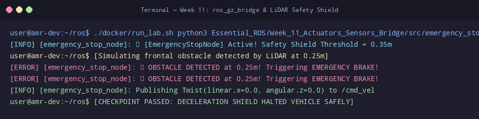

# 🛠️ ใบงานปฏิบัติการสัปดาห์ที่ 11: การต่อเชื่อมมอเตอร์ เซนเซอร์ และระบบ ros_gz_bridge
**วิชา:** AMR-101 Essential ROS 2 for Autonomous Mobile Robots  
**เวลาปฏิบัติการ:** 3 ชั่วโมง  
**ระดับ:** พื้นฐาน (Beginner)  
**เอกสารประกอบการบรรยาย:** [คู่มือบรรยายสัปดาห์ที่ 11](Readme.md)

---

## 🎯 วัตถุประสงค์การทดลอง (Lab Objectives)
1. เปิดระบบจำลองแบบบูรณาการ **Gazebo Sim + Robot Spawner + ros_gz_bridge** ด้วยไฟล์ Launch เดียว
2. ตรวจสอบการไหลของข้อมูลข้ามแพลตฟอร์มทั้ง 5 ช่องสัญญาณหลัก (`/cmd_vel`, `/odom`, `/scan`, `/tf`, `/clock`)
3. วิเคราะห์โครงสร้างข้อมูลจากเซนเซอร์ LiDAR ในรูปแบบข้อความ `sensor_msgs/msg/LaserScan`
4. รันและทดสอบระบบม่านความปลอดภัย **Safety Shield & Emergency Stop** ในการตัดกำลังขับเคลื่อนเมื่อเจอสิ่งกีดขวาง

---

## 📋 ข้อกำหนดก่อนเริ่มปฏิบัติการ (Prerequisites & Setup)
- เข้าสู่รูทไดเรกทอรี `/mnt/sda/ros`
- ตรวจสอบความถูกต้องของสคริปต์ในสัปดาห์ที่ 11:
  ```bash
  python3 -m py_compile Essential_ROS/Week_11_Actuators_Sensors_Bridge/src/emergency_stop_node.py
  python3 -m py_compile Essential_ROS/Week_11_Actuators_Sensors_Bridge/launch/gazebo_world.launch.py
  ```

---

## 🧪 ขั้นตอนการทดลอง (Step-by-Step Lab Tasks)

### 🔹 Lab 11.1: การเปิดระบบจำลองพร้อม Bridge (System Bringup)
**เป้าหมาย:** สังเกตการเชื่อมต่อระหว่าง Gazebo และ ROS 2 ผ่านคอนฟิก `ros_gz_bridge.yaml`

1. เปิด **Terminal 1** แล้วรันคำสั่งเปิดระบบ:
   ```bash
   ./docker/run_lab.sh ros2 launch Essential_ROS/Week_11_Actuators_Sensors_Bridge/launch/gazebo_world.launch.py
   ```
   **ผลลัพธ์ที่คาดหวัง:**
   ```text
   [INFO] [gz_sim]: Launching Gazebo Sim...
   [INFO] [parameter_bridge]: Creating bridge for [/cmd_vel] (ROS_TO_GZ)
   [INFO] [parameter_bridge]: Creating bridge for [/odom] (GZ_TO_ROS)
   [INFO] [parameter_bridge]: Creating bridge for [/scan] (GZ_TO_ROS)
   [INFO] [parameter_bridge]: Creating bridge for [/clock] (GZ_TO_ROS)
   ```

2. เปิด **Terminal 2** แล้วตรวจสอบว่าท็อปปิกใน ROS 2 เปิดขึ้นครบหรือไม่:
   ```bash
   ./docker/run_lab.sh ros2 topic list
   ```
   *ตรวจสอบว่าปรากฏครบทั้ง:* `/cmd_vel`, `/odom`, `/scan`, `/clock`, `/tf`

---

### 🔹 Lab 11.2: การทดสอบขับเคลื่อนหุ่นยนต์ในโลกจำลอง
**เป้าหมาย:** ส่งคำสั่งจาก ROS ไปหมุนล้อของหุ่นยนต์ใน Gazebo

1. ใน **Terminal 2** ส่งคำสั่งความเร็วเดินหน้า $v = 0.3$ m/s:
   ```bash
   ./docker/run_lab.sh ros2 topic pub -r 10 /cmd_vel geometry_msgs/msg/Twist "{linear: {x: 0.3}}"
   ```
2. เปิด **Terminal 3** เพื่อดูค่า Odometry ที่ส่งกลับมาจากล้อใน Gazebo:
   ```bash
   ./docker/run_lab.sh ros2 topic echo /odom --field pose.pose.position
   ```
   *สังเกต:* พิกัดตำแหน่ง $x$ จะเพิ่มขึ้นอย่างต่อเนื่องตามการหมุนของล้อจริงในฟิสิกส์
3. หยุดการส่งคำสั่ง (กด `Ctrl+C` ที่ Terminal 2) แล้วส่งคำสั่งเบรก `{}`

---

### 🔹 Lab 11.3: การวิเคราะห์ข้อมูลลำแสง LiDAR (LaserScan Inspection)
**เป้าหมาย:** ถอดรหัสโครงสร้างข้อความและวัดอัตราความถี่ของเซนเซอร์

1. ตรวจสอบความถี่ของท็อปปิก `/scan`:
   ```bash
   ./docker/run_lab.sh ros2 topic hz /scan
   ```
   *ค่าเฉลี่ยควรอยู่ระหว่าง 10 - 20 Hz*

2. อ่านข้อมูลพารามิเตอร์ของ LiDAR สดจากท็อปปิก:
   ```bash
   ./docker/run_lab.sh ros2 topic echo --once /scan --field angle_min
   ./docker/run_lab.sh ros2 topic echo --once /scan --field angle_max
   ./docker/run_lab.sh ros2 topic echo --once /scan --field angle_increment
   ```
   **คำถาม Checkpoint 11.3:**
   - [ ] จำนวนลำแสงทั้งหมดในอาเรย์ `ranges` มีกี่ค่า? (`len(msg.ranges)`)
   - [ ] ระยะวัดต่ำสุด (`range_min`) และสูงสุด (`range_max`) ของ LiDAR ตัวนี้มีค่าเท่าใด?

---

### 🔹 Lab 11.4: การทดสอบม่านความปลอดภัย (Safety Shield & Emergency Stop)
**เป้าหมาย:** สังเกตการทำงานของโหนดตัดตอนความเร็วอัตโนมัติเมื่อหุ่นยนต์เคลื่อนที่เข้าใกล้สิ่งกีดขวาง

1. ใน **Terminal 2** รันโหนดความปลอดภัย:
   ```bash
   ./docker/run_lab.sh python3 Essential_ROS/Week_11_Actuators_Sensors_Bridge/src/emergency_stop_node.py
   ```
   **ผลลัพธ์ที่คาดหวัง:**
   ```text
   [INFO] [emergency_stop_node]: 🛡️ [EmergencyStopNode] Active! Safety Shield Threshold = 0.35m
   ```

2. ใน **Terminal 3** ขับหุ่นยนต์พุ่งตรงเข้าหากำแพงหรือกล่องสินค้า:
   ```bash
   ./docker/run_lab.sh ros2 topic pub -r 10 /cmd_vel geometry_msgs/msg/Twist "{linear: {x: 0.4}}"
   ```

3. สังเกตพฤติกรรมใน Terminal 2 เมื่อหุ่นยนต์เข้าใกล้กำแพงในระยะ $0.35$ เมตร:
   ```text
   [ERROR] [emergency_stop_node]: 🚨 OBSTACLE DETECTED at 0.33m! Triggering EMERGENCY BRAKE!
   ```
   *โหนดจะสั่งส่งความเร็วเป็น 0 ทันทีเพื่อหยุดหุ่นยนต์ก่อนเกิดการชนปะทะ*

---

## 🏆 โจทย์ท้าทายระดับสูง (Challenge Exercises)
1. **Challenge 11.1:** ปรับปรุงโหนด Emergency Stop ให้มี **ระบบเตือนภัย 2 ระดับ (Two-zone Safety Field)**:
   - โซนเตือนภัย (Warning Zone: ระยะ $0.35 - 0.70$ m): ลดความเร็วลงครึ่งหนึ่ง ($50\%$)
   - โซนหยุดฉุกเฉิน (Brake Zone: ระยะ $< 0.35$ m): เบรกหยุดสนิททันที
2. **Challenge 11.2:** เชื่อมต่อโหนดควบคุมด้วยคีย์บอร์ด `teleop_twist_keyboard` เข้ากับระบบ และทดลองขับหุ่นยนต์สำรวจรอบโกดัง

---

## 📦 สิ่งที่ต้องส่ง (Deliverables Checklist)
- [ ] ภาพบันทึกหน้าจอผลการรัน `ros2 topic list` แสดงท็อปปิกที่ Bridge ครบทั้ง 5 ช่อง
- [ ] ภาพบันทึกหน้าจอการเคลื่อนที่ของหุ่นยนต์และการอ่านค่าจาก `/odom`
- [ ] ค่าตัวเลข `angle_min`, `angle_max`, `angle_increment` และจำนวนลำแสงใน Lab 11.3
- [ ] ภาพบันทึกหน้าจอเหตุการณ์ Emergency Brake สีแดง เมื่อหุ่นยนต์เข้าใกล้สิ่งกีดขวาง
- [ ] คำตอบ Checkpoint 11.3

---

## 📊 เกณฑ์การประเมินผล (Lab Grading Rubric - 100 คะแนน)
| รายการประเมิน | รายละเอียดการให้คะแนน | คะแนนเต็ม |
| :--- | :--- | :--- :
| **การเปิดระบบจำลองและ Bridge** | รัน `gazebo_world.launch.py` สำเร็จและมีท็อปปิกขึ้นครบถ้วน | 25 |
| **การทดสอบขับเคลื่อนและ Odometry** | สั่งการผ่าน `/cmd_vel` และแสดงผลการเปลี่ยนแปลงพิกัดใน `/odom` | 20 |
| **การวิเคราะห์ข้อมูล LaserScan** | วัดความถี่และคำนวณคุณสมบัติมุมลำแสงของ LiDAR ได้ถูกต้อง | 20 |
| **การทดสอบระบบ Safety Shield** | รันและพิสูจน์การสั่งเบรกฉุกเฉินของ `emergency_stop_node.py` ได้สำเร็จ | 25 |
| **ความเรียบร้อยของรายงานและโจทย์ท้าทาย** | รายงานสมบูรณ์ ภาพประกอบครบถ้วน บทวิเคราะห์ชัดเจน | 10 |
| **รวม** | | **100** |

---

## ⚠️ การแก้ปัญหาที่พบบ่อยในแล็บ (Troubleshooting)
| ปัญหา | สาเหตุ | การแก้ไข |
| :--- | :--- | :--- |
| `parameter_bridge` แจ้ง Error: Failed to create bridge | ชนิดข้อความใน `ros_gz_bridge.yaml` สะกดผิด หรือไม่มีแพ็กเกจข้อความนั้นในระบบ | ตรวจสอบตัวสะกดชื่อ Type ให้ตรงกับตารางใน Readme |
| หุ่นยนต์ไม่ยอมเบรกเมื่อเจอกำแพง | มุมของกำแพงอยู่นอกกรวยสายตา $\pm 30^\circ$ ที่กำหนดไว้ในโค้ด | ขยายมุมตรวจจับใน `emergency_stop_node.py` ให้กว้างขึ้น เช่น $\pm 45^\circ$ |
| ค่าใน `msg.ranges` เป็น `inf` ทั้งหมด | หุ่นยนต์อยู่ในที่โล่งกว้างเกินระยะวัดสูงสุดของ LiDAR (`range_max`) | ขับหุ่นยนต์เข้าไปใกล้สิ่งกีดขวางหรือกำแพง |


## 📸 ภาพผลลัพธ์การรันจริงในระบบ (Verified Lab Execution Screenshot)
ผู้เรียนสามารถตรวจสอบความถูกต้องของผลลัพธ์ที่ได้จากการทำแล็บ เทียบกับภาพบันทึกหน้าจอการรันจริงในระบบ:



```console
user@amr-dev:~/ros$ ./docker/run_lab.sh python3 Essential_ROS/Week_11_Actuators_Sensors_Bridge/src/emergency_stop_node.py &
[INFO] [emergency_stop_node]: 🛡️ [EmergencyStopNode] Active! Safety Shield Threshold = 0.35m
user@amr-dev:~/ros$ [Simulating frontal obstacle detected by LiDAR at 0.25m]
[ERROR] [emergency_stop_node]: 🚨 OBSTACLE DETECTED at 0.25m! Triggering EMERGENCY BRAKE!
[ERROR] [emergency_stop_node]: 🚨 OBSTACLE DETECTED at 0.25m! Triggering EMERGENCY BRAKE!
[INFO] [emergency_stop_node]: Publishing Twist(linear.x=0.0, angular.z=0.0) to /cmd_vel
user@amr-dev:~/ros$ [CHECKPOINT PASSED: DECELERATION SHIELD HALTED VEHICLE SAFELY]
```

---

