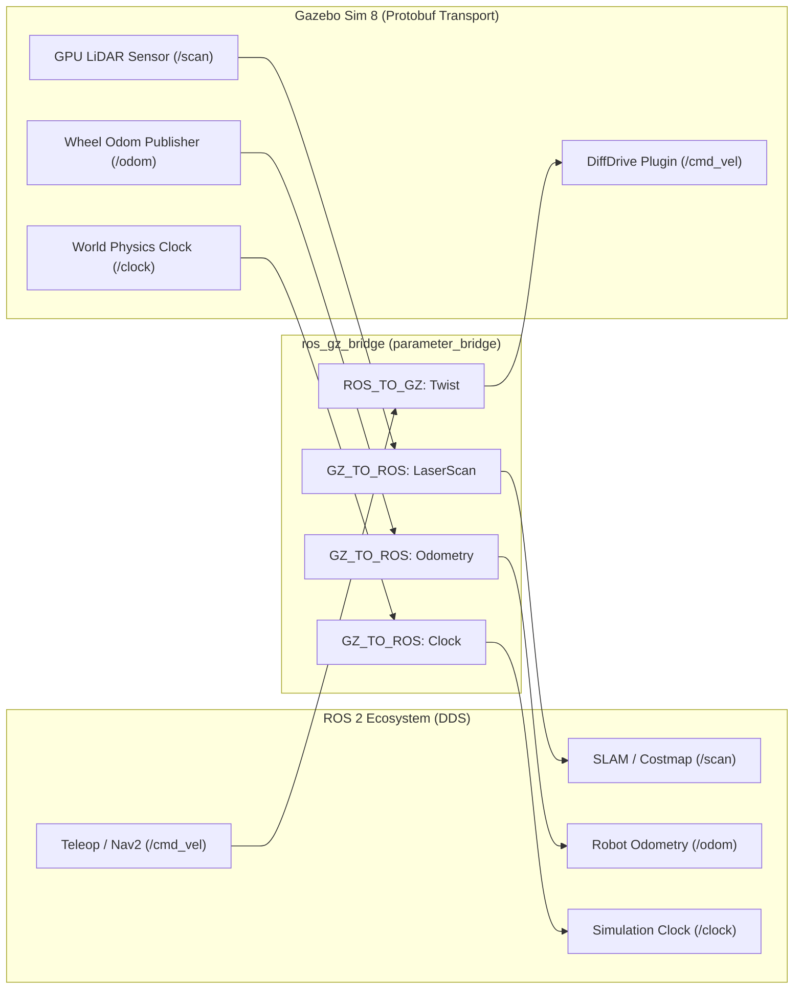

# 📖 Week 11: การต่อเชื่อมมอเตอร์ เซนเซอร์ และระบบ ros_gz_bridge
**เวลาเรียน:** บรรยาย 2 ชั่วโมง | ปฏิบัติการ 3 ชั่วโมง | ศึกษาค้นคว้าด้วยตนเอง 4 ชั่วโมง  
**วิชาบังคับก่อน:** [สัปดาห์ที่ 10: สภาพแวดล้อมจำลอง 3 มิติด้วย Gazebo Sim (Harmonic)](../Week_10_Gazebo_Sim_Harmonic/Readme.md)  
**เอกสารปฏิบัติการ:** [ใบงานแล็บสัปดาห์ที่ 11](Lab_Exercises.md)

---

## 🎯 วัตถุประสงค์การเรียนรู้ (Learning Objectives)
เมื่อจบบทเรียนนี้ ผู้เรียนจะสามารถ:
1. วิเคราะห์กลไกการแปลงโปรโตคอลระหว่าง Gazebo Transport และ ROS 2 ผ่าน **`ros_gz_bridge`**
2. กำหนดทิศทางการไหลของข้อมูล (**Bridge Directions**: `ROS_TO_GZ`, `GZ_TO_ROS`, `BIDIRECTIONAL`) ได้อย่างถูกต้อง
3. ติดตั้งปลั๊กอินควบคุมมอเตอร์ **DiffDrive System** และปลั๊กอินอ่านมุมล้อ **JointStatePublisher**
4. ถอดรหัสโครงสร้างข้อความเซนเซอร์ **`sensor_msgs/msg/LaserScan`** และคำนวณตำแหน่งองศาของลำแสงเลเซอร์
5. พัฒนาระบบม่านความปลอดภัย (**Safety Shield & Emergency Stop**) สำหรับเบรกหุ่นยนต์อัตโนมัติเมื่อพบสิ่งกีดขวางระยะประชิด

---

## ⏱️ แผนการสอน 2 ชั่วโมง (Lecture Outline)
| ช่วงเวลา | หัวข้อ | กิจกรรมการเรียนรู้ |
| :---: | :--- | :--- |
| **00:00 - 00:30** | สถาปัตยกรรม ros_gz_bridge และการจับคู่ Data Types ข้ามมิดเดิลแวร์ | บรรยายพร้อมตารางจับคู่ ROS 2 Type $\leftrightarrow$ Gazebo Msg Type |
| **00:30 - 01:00** | ปลั๊กอินควบคุมมอเตอร์ (DiffDrive) และการปิดลูปคำสั่งความเร็ว `/cmd_vel` | วิเคราะห์โครงสร้างปลั๊กอินใน URDF/SDF และพารามิเตอร์ Odom |
| **01:00 - 01:30** | โครงสร้าง LaserScan และคณิตศาสตร์การประมวลผลลำแสง LiDAR | เขียนสมการ index-to-angle และตัวอย่างคำนวณองศาตรวจจับ |
| **01:30 - 02:00** | การสร้างม่านความปลอดภัย (Safety Shield), Command Mux และเตรียมเข้าสู่ Lab | วิเคราะห์โค้ด `emergency_stop_node.py` และการทดสอบในแบบจำลอง |

---

## 🏛️ สถาปัตยกรรมระบบ (Architectural Deep Dive)

### 1. สถาปัตยกรรมระบบบริดจ์ (ros_gz_bridge Architecture)
เนื่องจาก Gazebo Sim 8 (Harmonic) ใช้ระบบการสื่อสารภายในความเร็วสูงของตนเอง (Gazebo Transport) ซึ่งใช้ Serialization แบบ Google Protobuf ทำให้ไม่สามารถคุยกับ DDS ของ ROS 2 ได้โดยตรง จึงต้องมีโหนดตัวกลางที่เรียกว่า **`parameter_bridge`**:



#### ตารางการจับคู่ประเภทข้อมูล (Topic & Message Mapping):
| ท็อปปิก | ทิศทาง (Direction) | ประเภทใน ROS 2 | ประเภทใน Gazebo Sim |
| :--- | :---: | :--- | :--- |
| `/cmd_vel` | `ROS_TO_GZ` | `geometry_msgs/msg/Twist` | `gz.msgs.Twist` |
| `/odom` | `GZ_TO_ROS` | `nav_msgs/msg/Odometry` | `gz.msgs.Odometry` |
| `/scan` | `GZ_TO_ROS` | `sensor_msgs/msg/LaserScan` | `gz.msgs.LaserScan` |
| `/tf` | `GZ_TO_ROS` | `tf2_msgs/msg/TFMessage` | `gz.msgs.Pose_V` |
| `/clock` | `GZ_TO_ROS` | `rosgraph_msgs/msg/Clock` | `gz.msgs.Clock` |

---

### 2. ปลั๊กอินควบคุมการขับเคลื่อน (Gazebo DiffDrive System)
ในโมเดลหุ่นยนต์ การขับเคลื่อนล้อจำเป็นต้องมีปลั๊กอิน `gz-sim-diff-drive-system`:
- **หน้าที่:** รับค่า Twist $(v, \omega)$ จากท็อปปิก `/cmd_vel` นำไปคำนวณทอร์กและความเร็วรอบของล้อซ้ายและขวาตามสมการจลนศาสตร์ และส่งแรงขับเคลื่อนไปยังข้อต่อทางฟิสิกส์จริง
- **การป้อนกลับ (Odometry Feedback):** คำนวณระยะการหมุนของล้อและแปลงเป็นค่าตำแหน่งในโลกจำลอง เผยแพร่ออกมาทาง `/odom` และทรานส์ฟอร์ม `/tf`

---

### 3. โครงสร้างและการประมวลผลข้อความ LaserScan
ข้อความ `sensor_msgs/msg/LaserScan` บรรจุข้อมูลการยิงแสงเลเซอร์รอบตัว:
```text
std_msgs/Header header
float32 angle_min        # มุมเริ่มต้นของลำแสง (เรเดียน) เช่น -3.14159 (-180°)
float32 angle_max        # มุมสิ้นสุดของลำแสง (เรเดียน) เช่น +3.14159 (+180°)
float32 angle_increment  # ความละเอียดมุมระหว่างแต่ละลำแสง (เรเดียน)
float32 time_increment   # เวลาหน่วงระหว่างแต่ละลำแสง
float32 scan_time        # เวลาที่ใช้สแกนครบ 1 รอบ
float32 range_min        # ระยะวัดต่ำสุดที่เซนเซอร์เชื่อถือได้ (เช่น 0.12 m)
float32 range_max        # ระยะวัดสูงสุด (เช่น 12.0 m)
float32[] ranges         # อาเรย์ระยะทางที่วัดได้ (เมตร)
```

#### การแปลงดัชนีอาเรย์ (Array Index) สู่มุมองศาจริง:
สำหรับข้อมูลช่องที่ $i$ ในอาเรย์ `ranges[i]`:
$$\theta_i = \text{angle\_min} + (i \times \text{angle\_increment})$$

**ตัวอย่างการคำนวณ:**  
หาก LiDAR สแกน $360^\circ$ โดยมี $\text{angle\_min} = -\pi$, $\text{angle\_max} = +\pi$, และมีข้อมูลทั้งหมด 720 ลำแสง:
$$\text{angle\_increment} = \frac{2\pi}{720} \approx 0.008726 \text{ rad } (0.5^\circ)$$
- ลำแสงด้านหน้าตรงของหุ่นยนต์ ($\theta = 0^\circ$ หรือ $0$ rad) จะอยู่ที่ดัชนี:
  $$i_{\text{front}} = \frac{0 - (-\pi)}{\text{angle\_increment}} = \frac{\pi}{0.008726} = 360$$

---

## 🛠️ การวิเคราะห์โค้ดตัวอย่างในโมดูล (Code Walkthrough)

### 1. `emergency_stop_node.py`
โหนดนี้ทำหน้าที่เป็น **ม่านความปลอดภัย (Safety Shield)**:
- กำหนดระยะปลอดภัย `self.safety_distance = 0.35` เมตร
- ใน `scan_callback`:
  - วนลูปอ่านข้อมูลทุกรัศมีใน `msg.ranges`
  - กรองเฉพาะลำแสงที่อยู่ในกรวยมุมด้านหน้า $\pm 30^\circ$ ($[-0.5236, +0.5236]$ rad):
    ```python
    angle = msg.angle_min + (i * msg.angle_increment)
    if -math.radians(30) <= angle <= math.radians(30):
        if msg.range_min < dist < msg.range_max:
            if dist < min_front_dist:
                min_front_dist = dist
    ```
  - หาก `min_front_dist < 0.35` เมตร จะพิมพ์ Error Log สีแดง และส่งคำสั่งเบรกฉุกเฉิน `Twist(linear.x=0.0, angular.z=0.0)` ไปยัง `/cmd_vel` ทันที

### 2. `gazebo_world.launch.py`
- รวมการเปิด Gazebo World, การ Spawn หุ่นยนต์จาก URDF และการเปิดโหนด `parameter_bridge` เข้าด้วยกันในคำสั่งเดียว

---

## ⌨️ ตารางคำสั่ง CLI สำคัญ
| คำสั่ง | วัตถุประสงค์ | ตัวอย่างการใช้งาน |
| :--- | :--- | :--- |
| `ros2 run ros_gz_bridge parameter_bridge --help` | ดูรูปแบบไวยากรณ์และรายการ Message Types ที่ Bridge รองรับ | `ros2 run ros_gz_bridge parameter_bridge --help` |
| `ros2 topic echo /scan --field ranges` | ดูข้อมูลระยะทางที่ LiDAR วัดได้สดๆ | `ros2 topic echo /scan --field ranges` |
| `ros2 topic hz /scan` | วัดความถี่ของเซนเซอร์ LiDAR ใน ROS (เป้าหมาย 10 - 20 Hz) | `ros2 topic hz /scan` |
| `ros2 topic pub /cmd_vel ...` | สั่งขับหุ่นยนต์ในโลกจำลองผ่าน ROS | `ros2 topic pub -r 10 /cmd_vel geometry_msgs/msg/Twist "{linear: {x: 0.3}}"` |

---

## ⚠️ ปัญหาที่พบบ่อยและการแก้ไข (Troubleshooting)
| อาการ | สาเหตุที่เป็นไปได้ | วิธีแก้ไข |
| :--- | :--- | :--- |
| หุ่นยนต์ใน Gazebo ไม่ยอมขยับตามคำสั่ง `/cmd_vel` | ทิศทางใน `ros_gz_bridge.yaml` ผิด หรือชื่อ Topic ไม่ตรงกับปลั๊กอิน | ตรวจสอบว่าตั้งทิศทางเป็น `ROS_TO_GZ` และชนิดข้อความเป็น `geometry_msgs/msg/Twist` |
| ท็อปปิก `/scan` ใน ROS 2 ว่างเปล่า | โลกจำลองใน Gazebo ขาดปลั๊กอิน `Sensors` หรือขาด Render Engine `ogre2` | ตรวจสอบว่าใน `warehouse.sdf` มีแท็ก `<plugin filename="gz-sim-sensors-system" ...>` |
| Emergency Stop เบรกแล้วหุ่นยนต์ยังไถลชน | ความถี่ของโหนดเบรกต่ำเกินไป หรือไม่ได้ดักจับ Command Mux | ให้รันโหนดเบรกที่ความถี่สูง และควรใช้ `twist_mux` ในการตัดสิทธิ์ Teleop ถาวร |

---

## 📝 แบบทดสอบท้ายบท (Self-Assessment Quiz)
1. เหตุใดโปรแกรม ROS 2 และ Gazebo Sim (Harmonic) จึงต้องอาศัย `ros_gz_bridge` ในการเชื่อมต่อ?
2. สำหรับการส่งคำสั่งขับเคลื่อนจาก Teleop ไปยัง Gazebo ต้องกำหนด Bridge Direction เป็นอะไร?
3. ในข้อความ `LaserScan` หากต้องการทราบระยะทางของวัตถุที่อยู่ทางด้านซ้ายตรง ($+90^\circ$ หรือ $+\pi/2$ rad) ต้องคำนวณหาดัชนีช่องอย่างไร?
4. สัญญาณเวลา `/clock` มีความสำคัญอย่างไรในการทำงานร่วมกันระหว่างแบบจำลองฟิสิกส์กับโหนดใน ROS 2?
5. ปลั๊กอินใดใน Gazebo Sim ที่ทำหน้าที่จำลองกลไกขับเคลื่อนสองล้อและคำนวณ Odometry?

<details>
<summary>🔍 ดูเฉลยคำตอบ</summary>

1. **ตอบ:** เพราะทั้งสองระบบใช้เทคโนโลยีมิดเดิลแวร์และการแปลงข้อมูล (Serialization) คนละมาตรฐานกัน (ROS 2 ใช้ DDS ส่วน Gazebo Sim ใช้ Gazebo Transport บน Protobuf) จึงต้องมีตัวกลางคอยแปลความหมาย
2. **ตอบ:** `ROS_TO_GZ`
3. **ตอบ:** ดัชนี $i = \frac{(\pi/2) - \text{angle\_min}}{\text{angle\_increment}}$
4. **ตอบ:** เพื่อให้โหนดใน ROS 2 ซิงโครไนซ์เวลากับเวลาจำลอง (Simulation Time) แทนเวลาจริงบนโลก (Wall Time) ผ่านพารามิเตอร์ `use_sim_time: true` ป้องกันปัญหา TF Timeout เมื่อการจำลองทำงานช้ากว่าเวลาจริง
5. **ตอบ:** `gz-sim-diff-drive-system` (`gz::sim::systems::DiffDrive`)
</details>

---

## 📚 แหล่งอ้างอิงและศึกษาเพิ่มเติม
- [ros_gz Official Documentation & Tutorials](https://github.com/gazebosim/ros_gz)
- [ROS 2 LaserScan Message Specification](https://docs.ros2.org/latest/api/sensor_msgs/msg/LaserScan.html)
- [Gazebo Sim Sensors Guide](https://gazebosim.org/docs/harmonic/sensors)
