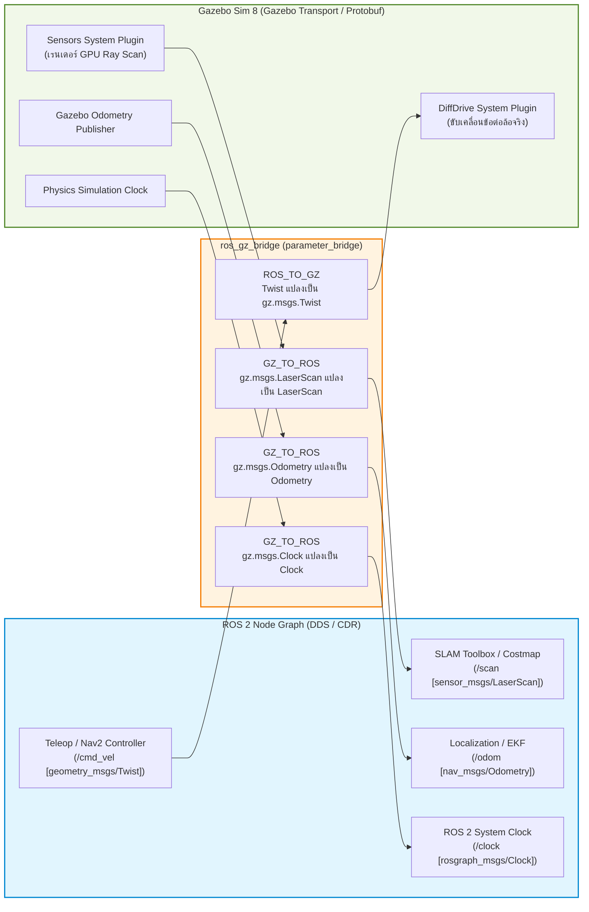
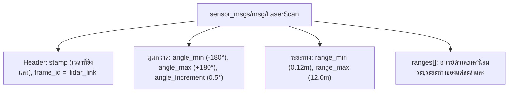

# 📖 Week 11: การต่อเชื่อมมอเตอร์ เซนเซอร์ และระบบ ros_gz_bridge
**เวลาเรียน:** บรรยาย 2 ชั่วโมง | ปฏิบัติการ 3 ชั่วโมง | ศึกษาค้นคว้าด้วยตนเอง 4 ชั่วโมง  
**วิชาบังคับก่อน:** [สัปดาห์ที่ 10: สภาพแวดล้อมจำลอง 3 มิติด้วย Gazebo Sim (Harmonic)](../Week_10_Gazebo_Sim_Harmonic/Readme.md)  
**เอกสารปฏิบัติการ:** [ใบงานแล็บสัปดาห์ที่ 11](Lab_Exercises.md)

---

## 🎯 วัตถุประสงค์การเรียนรู้ (Learning Objectives)
เมื่อจบบทเรียนนี้ ผู้เรียนจะสามารถ:
1. **วิเคราะห์สถาปัตยกรรมการแปลงโปรโตคอล** ระหว่าง Google Protobuf (Gazebo Transport) และ Common Data Representation / CDR (ROS 2 DDS) ผ่านสะพาน `ros_gz_bridge`
2. **กำหนดทิศทางการเชื่อมต่อ (Bridge Direction)**: `ROS_TO_GZ`, `GZ_TO_ROS`, และ `BIDIRECTIONAL` ในไฟล์ YAML ได้อย่างถูกต้องและปลอดภัย
3. **กำหนดค่าปลั๊กอินควบคุมการขับเคลื่อนสองล้อ (Gazebo DiffDrive Plugin)** พร้อมเชื่อมโยงการอ่านค่า Odometry และความเร็วรอบล้อกลับเข้าสู่ ROS 2
4. **คำนวณคณิตศาสตร์แปลงพิกัดของลำแสงเลเซอร์ (LaserScan Angle-to-Index & Polar-to-Cartesian Math)** จากข้อความ `sensor_msgs/msg/LaserScan`
5. **พัฒนาระบบม่านความปลอดภัยอัตโนมัติ (Safety Shield & Emergency Braking)** ที่คำนวณระยะหยุดขั้นต่ำตามหลักการหน่วงความเร็ว (Deceleration Physics)

---

## ⏱️ แผนการสอน 2 ชั่วโมง (Lecture Outline)
| ช่วงเวลา | หัวข้อ | กิจกรรมการเรียนรู้ |
| :---: | :--- | :--- |
| **00:00 - 00:30** | สถาปัตยกรรม ros_gz_bridge: การจับคู่ Serialization Protobuf $\leftrightarrow$ CDR | บรรยายพร้อมตารางจับคู่ ROS 2 Type vs Gazebo Msg Type และบทบาทของ `parameter_bridge` |
| **00:30 - 01:00** | ปลั๊กอินควบคุมมอเตอร์ (DiffDrive) และสัญญาณเวลาจำลอง `/clock` | วิเคราะห์ความสำคัญของ `use_sim_time: true` และการปิดลูปคำสั่ง `/cmd_vel` |
| **01:00 - 01:30** | โครงสร้าง LaserScan, คณิตศาสตร์ลำแสง LiDAR และพิกัดคาร์ทีเซียน | แสดงสมการแปลงดัชนีเป็นมุม, การแปลง Polar เป็น $(x, y)$, และการกรองระยะปลอดภัย |
| **01:30 - 02:00** | Code Walkthrough: `ros_gz_bridge.yaml`, `emergency_stop_node.py` และสรุปก่อนเข้า Lab | วิเคราะห์การประยุกต์ใช้วงจรม่านนิรภัย และการทดสอบตัดคำสั่งขับขี่ |

---

## 🏛️ สถาปัตยกรรมระบบ (Architectural Deep Dive)

### 1. สถาปัตยกรรมระบบบริดจ์ (ros_gz_bridge Architecture)
Gazebo Sim (Harmonic) ใช้ระบบเครือข่ายภายใน **Gazebo Transport** ซึ่งใช้ฟอร์แมตข้อมูลเป็น Google Protobuf (น้ำหนักเบาและประมวลผลเร็วมากในระดับ C++) ในขณะที่ ROS 2 ใช้มาตรฐาน **OMG DDS** ซึ่งเข้ารหัสข้อมูลเป็น Common Data Representation (CDR) 

เพื่อให้ทั้งสองระบบสื่อสารกันได้ แพ็กเกจ `ros_gz_bridge` จะสร้างโปรเซสตัวแปลงข้อมูลสองทาง (Bidirectional Translation Process) ชื่อว่า **`parameter_bridge`**:



---

### 2. บทบาทสำคัญของ `/clock` และพารามิเตอร์ `use_sim_time`
ในระบบจำลองฟิสิกส์ ความเร็วของการคำนวณขึ้นอยู่กับภาระของเครื่องคอมพิวเตอร์ ซึ่งมักจะช้ากว่าเวลาจริงบนโลกมนุษย์ (เช่น Real-Time Factor: $\text{RTF} = 0.50$):
- **หากตั้ง `use_sim_time: false`:** โหนดใน ROS 2 จะยึดเวลาจากนาฬิกาของเครื่องคอมพิวเตอร์ (System Wall Time) ในขณะที่ Gazebo ปล่อยข้อมูลเซนเซอร์ออกมาด้วยเวลาจำลอง (Simulation Time) ผลลัพธ์คือ **TF Buffer จะแจ้งเตือน Extrapolation Error ทันที** เพราะเวลาของเซนเซอร์ล้าหลังเวลาในระบบไปเรื่อยๆ
- **หากตั้ง `use_sim_time: true`:** โหนดทุกตัวใน ROS 2 จะหยุดใช้นาฬิกาคอมพิวเตอร์ และเปลี่ยนไปฟังข้อความเวลาจากท็อปปิก `/clock` ที่ Gazebo ปล่อยออกมา ทำให้เวลาของอัลกอริทึม SLAM, Navigation, และ TF ซิงโครไนซ์ตรงกันอย่างสมบูรณ์แบบ $100\%$

---

### 3. โครงสร้างและการประมวลผลข้อความ LaserScan
ข้อความ `sensor_msgs/msg/LaserScan` ประกอบด้วยข้อมูลเรดาร์เลเซอร์ 2 มิติ:



#### ก. การแปลงดัชนีอาเรย์ (Array Index $i$) สู่มุมองศา ($\theta_i$):
$$\theta_i = \text{angle min} + (i \cdot \text{angle increment})$$

#### ข. การแปลงจากมุมเป้าหมาย ($\theta$) กลับเป็นดัชนีอาเรย์ ($i$):
$$i = \left\lfloor \frac{\theta - \text{angle min}}{\text{angle increment}} \right\rfloor$$

#### ค. การแปลงจากระบบพิกัดเชิงขั้ว (Polar) สู่พิกัดคาร์ทีเซียน (Cartesian $x, y$):
จุดตรวจจับสิ่งกีดขวางในระนาบของ LiDAR:
$$x_i = r_i \cos(\theta_i)$$
$$y_i = r_i \sin(\theta_i)$$
โดยที่ $r_i = \text{ranges}[i]$

---

### 4. ฟิสิกส์การเบรกฉุกเฉินและม่านความปลอดภัย (Safety Shield Dynamics)
การตั้งระยะปลอดภัยของม่านนิรภัยหุ่นยนต์ (Safety Shield) ไม่ควรใช้ค่าสุ่ม แต่ต้องคำนวณจากกฎการเคลื่อนที่ของนิวตัน:
$$d_{\text{stop}} = d_{\text{reaction}} + d_{\text{braking}} = (v \cdot t_{\text{reaction}}) + \frac{v^2}{2 a_{\text{max}}}$$

โดยที่:
- $v$: ความเร็วสูงสุดของหุ่นยนต์ ($m/s$)
- $t_{\text{reaction}}$: คาบเวลาหน่วงของระบบประมวลผลรวมกับการส่งคำสั่งผ่านเครือข่าย (Latency เช่น $100\text{ ms} = 0.1\text{ s}$)
- $a_{\text{max}}$: ความหน่วงเบรกสูงสุดของล้อก่อนเกิดการลื่นไถล ($m/s^2$)

**ตัวอย่างการคำนวณ:**  
หากหุ่นยนต์วิ่งด้วยความเร็ว $v = 0.6\text{ m/s}$, เบรกหน่วงได้ $a_{\text{max}} = 1.2\text{ m/s}^2$, และ $t_{\text{reaction}} = 0.1\text{ s}$:
$$d_{\text{stop}} = (0.6 \times 0.1) + \frac{0.6^2}{2 \times 1.2} = 0.06 + \frac{0.36}{2.4} = 0.06 + 0.15 = \mathbf{0.21\text{ m}}$$
ดังนั้น ค่าระยะตรวจจับปลอดภัยในโค้ดจึงควรกำหนดไว้ที่อย่างน้อย $0.35\text{ m}$ เพื่อเป็นระยะเผื่อฉุกเฉิน (Safety Margin) — ในการรันจริงที่ 0.3 m/s gate ตัดที่ระยะ 0.33 m และหุ่นยนต์หยุดห่างกำแพงประมาณ 0.30 m

---

## 🛠️ การวิเคราะห์โค้ดตัวอย่างในโมดูล (Code Walkthrough)

### 1. [`launch/gazebo_world.launch.py`](launch/gazebo_world.launch.py)
Launch file หลักของสัปดาห์นี้ (แพ็กเกจ `amr_week11`) ประกอบระบบจากแพ็กเกจของสัปดาห์ก่อนหน้าผ่าน `get_package_share_directory()`:
1. **Gazebo Sim** — include `amr_week10/launch/warehouse_world.launch.py` (อาร์กิวเมนต์ `headless:=true` = `gz sim -s -r --headless-rendering`)
2. **`robot_state_publisher`** — include `amr_week07/launch/display_urdf.launch.py` ด้วย `use_sim_time:=true use_jsp:=false` (Gazebo เป็นผู้ส่ง `/joint_states`) จึงได้ TF `base_footprint → base_link → lidar_link / ล้อ / กล้อง`
   - ถ้าขาดโหนดนี้ จะมีเพียง TF `odom → base_footprint` จาก DiffDrive แต่ `/scan` ใช้ `frame_id: lidar_link` → SLAM และ Nav2 จะ **ทิ้ง scan ทุกอัน** เพราะแปลงพิกัดไม่ได้
3. **`ros_gz_sim create`** — spawn URDF เดียวกันเข้าโลก
4. **`parameter_bridge`** — อ่าน `config/ros_gz_bridge.yaml`
5. **`emergency_stop_node`** (เมื่อ `estop:=true`)

```bash
ros2 launch amr_week11 gazebo_world.launch.py                         # GUI
ros2 launch amr_week11 gazebo_world.launch.py headless:=true          # Docker / CI
ros2 launch amr_week11 gazebo_world.launch.py headless:=true estop:=true rviz:=false
```

### 2. [`config/ros_gz_bridge.yaml`](config/ros_gz_bridge.yaml)
ไฟล์คอนฟิกกำหนดช่องสัญญาณบริดจ์ระหว่าง ROS 2 และ Gazebo Sim:
- **คำสั่งขับเคลื่อนความเร็ว:**
  ```yaml
  - ros_topic_name: "/cmd_vel"
    gz_topic_name: "/cmd_vel"
    ros_type_name: "geometry_msgs/msg/Twist"
    gz_type_name: "gz.msgs.Twist"
    direction: ROS_TO_GZ
  ```
  กำหนดให้คำสั่งความเร็วเดินทางจากโหนด ROS 2 (เช่น แป้นพิมพ์ หรือ Nav2) เข้าสู่ Gazebo Transport เพื่อส่งต่อให้ปลั๊กอิน DiffDrive
- **เซนเซอร์ LiDAR, Odometry และ TF `odom → base_footprint`:** ทิศทาง `GZ_TO_ROS` (`/scan`, `/odom`, `/tf`)
- **`/joint_states` (`gz.msgs.Model → sensor_msgs/msg/JointState`):** มุมล้อจริงจาก Gazebo ให้ `robot_state_publisher` คำนวณ TF ของล้อ
- **การเชื่อมต่อสัญญาณนาฬิกา `/clock`:** บริดจ์ `rosgraph_msgs/msg/Clock` เข้าสู่ ROS 2 ให้ทุกโหนดที่ตั้ง `use_sim_time: true` ใช้เวลาจำลองเดียวกัน

---

### 3. [`src/emergency_stop_node.py`](src/emergency_stop_node.py) — Safety Gate
โหนดกั้นความเร็วอัตโนมัติแบบ **gate** คั่นระหว่างผู้สั่งงานกับหุ่นยนต์:

```
teleop / Nav2 ──► /cmd_vel_in ──► [emergency_stop_node] ──► /cmd_vel ──► ros_gz_bridge ──► DiffDrive
                                          ▲
                                /scan (qos_profile_sensor_data)
```
- **ทำไมต้องเป็น gate:** ถ้าโหนดเบรกส่ง `Twist()` ศูนย์เข้า `/cmd_vel` ซึ่งเป็นท็อปปิกเดียวกับที่ teleop/Nav2 ส่งอยู่ ข้อความใหม่ของ teleop (10 Hz) จะทับคำสั่งเบรกทันที (last-writer race) — การเบรกจะได้ผลจริงก็ต่อเมื่อโหนดความปลอดภัยเป็น **ผู้ส่ง `/cmd_vel` เพียงผู้เดียว**
- **พารามิเตอร์:** `safety_distance` (0.35 m), `sector_half_angle_deg` (30°), `scan_timeout` (0.5 s)
- **ฟังก์ชันบริสุทธิ์ที่ทดสอบได้โดยไม่ต้องมี ROS graph:**
  ```python
  def front_min_range(ranges, angle_min, angle_increment, range_min, range_max, half_angle_rad):
      """Closest valid range (m) with |beam angle| <= half_angle_rad; inf if none."""

  def gate_command(linear_x, angular_z, min_front, safety_distance):
      if min_front < safety_distance and linear_x > 0.0:
          return 0.0, angular_z, True      # block forward motion only
      return linear_x, angular_z, min_front < safety_distance
  ```
  มุมของลำแสงคำนวณจาก $\theta_i = \text{angle\_min} + i \cdot \text{angle\_increment}$ แล้ว normalize เข้า $(-\pi, \pi]$ และกรองค่าที่อยู่นอก `[range_min, range_max]` (เช่น `inf`) ออก
- **พฤติกรรม:** ทางโล่ง → ส่งต่อคำสั่งเดิม; สิ่งกีดขวาง < 0.35 m ด้านหน้า → ตัดเฉพาะความเร็วเดินหน้า (ยังหมุน/ถอยได้) และเบรกทันทีแม้ผู้สั่งงานหยุดส่งข้อความ (DiffDrive ของ Gazebo จำคำสั่งล่าสุด); ไม่มี `/scan` เกิน 0.5 s → หยุดทั้งหมด (fail-safe)
- **Log ที่โหนดพิมพ์จริง:** `Safety gate ready: ...` ตอนเริ่ม, `Obstacle at 0.33 m (< 0.35 m) in front: forward motion BLOCKED` เมื่อเข้าเขต และ `Path clear (...)` เมื่อพ้นเขต
- ในระบบ Nav2 (สัปดาห์ที่ 14–16) บทบาทเดียวกันนี้ทำโดย `nav2_collision_monitor` (`cmd_vel_smoothed → collision_monitor → cmd_vel`)

### 4. [`src/ground_truth.py`](src/ground_truth.py)
`ros2 run amr_week11 ground_truth_pose` อ่านตำแหน่ง **จริง** ของหุ่นยนต์จาก Gazebo (`/world/warehouse/pose/info`) ใช้เทียบกับ `/odom` เพื่อดู Drift และใช้ในชุดทดสอบของสัปดาห์ที่ 14–16

### 5. การ build และทดสอบ
```bash
./docker/run_lab.sh colcon build --base-paths Essential_ROS --packages-up-to amr_week11
./docker/run_lab.sh colcon test  --base-paths Essential_ROS --packages-select amr_week11
```
- [`test/test_emergency_stop.py`](test/test_emergency_stop.py): unit test ด้วย LaserScan สังเคราะห์ (สิ่งกีดขวาง 0.25 m → `/cmd_vel` = 0 ขณะที่ `/cmd_vel_in` = 0.4)
- [`test/test_sim_launch.py`](test/test_sim_launch.py): launch_testing แบบ headless — `/scan`, `/odom`, `/clock` มาครบ, TF `odom → lidar_link` ต่อกัน และสั่ง 0.3 m/s นาน 3 วินาที (เวลาจำลอง) แล้ว odom ต้องเคลื่อน > 0.5 m

---

## ⌨️ ตารางคำสั่ง CLI สำคัญ
| คำสั่ง | คำอธิบาย | ตัวอย่างการใช้งาน |
| :--- | :--- | :--- |
| `ros2 launch amr_week11 gazebo_world.launch.py headless:=true` | เปิดโลก + หุ่นยนต์ + RSP + บริดจ์ ในคำสั่งเดียว | `ros2 launch amr_week11 gazebo_world.launch.py headless:=true estop:=true` |
| `ros2 run ros_gz_bridge parameter_bridge --ros-args -p config_file:=<path>` | เปิดโหนดบริดจ์ด้วยไฟล์ YAML | `ros2 run ros_gz_bridge parameter_bridge --ros-args -p config_file:=Essential_ROS/Week_11_Actuators_Sensors_Bridge/config/ros_gz_bridge.yaml` |
| `ros2 topic echo /scan --field ranges` | แสดงข้อมูลระยะทางที่เซนเซอร์ LiDAR ยิงได้แบบสดๆ | `ros2 topic echo /scan sensor_msgs/msg/LaserScan --field ranges` |
| `ros2 topic hz /scan` | วัดความถี่ของเซนเซอร์ LiDAR (ตั้งไว้ 10 Hz) | `ros2 topic hz /scan` |
| `ros2 run tf2_ros tf2_echo odom lidar_link` | ตรวจว่า TF ต่อกันครบถึงเฟรมของ LiDAR | `ros2 run tf2_ros tf2_echo odom lidar_link` |
| `ros2 topic pub /cmd_vel ...` | สั่งเคลื่อนที่หุ่นยนต์ในโลกจำลองผ่านบรรทัดคำสั่ง (ผ่าน gate ให้ใช้ `/cmd_vel_in`) | `ros2 topic pub -r 10 /cmd_vel_in geometry_msgs/msg/Twist "{linear: {x: 0.3}}"` |
| `ros2 topic echo /clock` | ตรวจสอบการเดินของสัญญาณเวลาจำลอง | `ros2 topic echo /clock` |

---

## 📟 ผลการรันจริง (Real Run Output)
บันทึกจากการรันจริงใน ros:lab-runner (ROS 2 Jazzy, Gazebo Sim 8.15.0) บน Linux 7.0 เมื่อ 2026-10-29
(ฉบับเต็ม: [`results/gazebo_bridge_estop_run.txt`](results/gazebo_bridge_estop_run.txt))

```console
$ ros2 launch amr_week11 gazebo_world.launch.py headless:=true estop:=true   # terminal 1
$ ros2 topic hz /scan
WARNING: topic [/scan] does not appear to be published yet
average rate: 9.888
$ ros2 run amr_week11 ground_truth_pose
diff_drive_robot ground truth: x=-0.000 y=0.000 yaw=0.000 rad (0.0 deg)
# drive forward at 0.3 m/s through the safety gate (/cmd_vel_in) towards the east wall (x = 4.9 m)
sim t=  24.6s  /cmd_vel_in linear.x=0.30 -> /cmd_vel linear.x=0.30  odom x=0.00 m
sim t=  27.9s  /cmd_vel_in linear.x=0.30 -> /cmd_vel linear.x=0.30  odom x=0.84 m
sim t=  30.8s  /cmd_vel_in linear.x=0.30 -> /cmd_vel linear.x=0.30  odom x=1.73 m
sim t=  33.8s  /cmd_vel_in linear.x=0.30 -> /cmd_vel linear.x=0.30  odom x=2.62 m
sim t=  36.8s  /cmd_vel_in linear.x=0.30 -> /cmd_vel linear.x=0.30  odom x=3.51 m
sim t=  39.8s  /cmd_vel_in linear.x=0.30 -> /cmd_vel linear.x=0.30  odom x=4.41 m
sim t=  42.7s  /cmd_vel_in linear.x=0.30 -> /cmd_vel linear.x=0.00  odom x=4.52 m
sim t=  45.8s  /cmd_vel_in linear.x=0.30 -> /cmd_vel linear.x=0.00  odom x=4.52 m
...
$ ros2 run amr_week11 ground_truth_pose
diff_drive_robot ground truth: x=4.522 y=-0.000 yaw=-0.000 rad (-0.0 deg)
```
Log ของ gate ในการรันเดียวกัน:
```text
[emergency_stop_node-5] [INFO] [1793245680.135688811] [emergency_stop_node]: Safety gate ready: cmd_vel_in -> cmd_vel, stop distance 0.35 m, sector +-30 deg, scan timeout 0.5 s
[emergency_stop_node-5] [WARN] [1793245723.268663174] [emergency_stop_node]: Obstacle at 0.33 m (< 0.35 m) in front: forward motion BLOCKED
```

---

## ⚠️ ปัญหาที่พบบ่อยและการแก้ไข (Troubleshooting)

| ที่ | อาการที่พบ (Symptom) | สาเหตุรากเหง้า (Root Cause) | แนวทางแก้ไข (Resolution) |
|:---:| :--- | :--- | :--- |
| 1 | **หุ่นยนต์ใน Gazebo ไม่ยอมขยับตามคำสั่ง `/cmd_vel`** | ทิศทางใน `ros_gz_bridge.yaml` ผิด หรือตั้งชื่อ Topic ไม่ตรงกับปลั๊กอิน | ตรวจสอบว่าระบุทิศทางเป็น `ROS_TO_GZ` และชนิดข้อความเป็น `geometry_msgs/msg/Twist` |
| 2 | **ท็อปปิก `/scan` ใน ROS 2 ไม่มีข้อมูลส่งมาเลย** | ในโลกจำลองลืมโหลด `gz-sim-sensors-system` หรือลืมใส่ Render Engine `ogre2` | ตรวจสอบไฟล์ `.sdf` ของโลกจำลองว่ามีปลั๊กอิน Sensors สมบูรณ์ |
| 3 | **TF Buffer ฟ้อง Error: `Extrapolation into the past/future`** | โหนดใน ROS 2 ไม่ได้เปิดใช้งานเวลาจำลอง ทำให้เทียบเวลากับเวลาจริงบนโลก | เติมพารามิเตอร์ `use_sim_time: true` ให้กับทุกโหนดในระบบ |
| 4 | **เซนเซอร์ LiDAR รายงานค่า `inf` หรือ `0.0` ทั้งหมด** | โมเดลเซนเซอร์ติดตั้งอยู่ข้างในตัวถังหุ่นยนต์ ทำให้ลำแสงเลเซอร์ชนกับ Collision Box ของตัวเอง | ปรับตำแหน่งยกเซนเซอร์ LiDAR ให้สูงพ้นหลังคาตัวถัง หรือเว้นช่องเปิดให้ลำแสง |
| 5 | **Emergency Stop สั่งเบรกแล้วแต่หุ่นยนต์ยังคงวิ่งต่อ** | มีโหนดอื่น (เช่น Teleop) ส่งข้อความทับลงบน `/cmd_vel` เดียวกัน (last-writer race) | ให้โหนดความปลอดภัยเป็นผู้ส่ง `/cmd_vel` เพียงผู้เดียว (gate: ผู้สั่งงานส่ง `/cmd_vel_in`) หรือใช้ `twist_mux` / `nav2_collision_monitor` |
| 7 | **SLAM/Nav2 แจ้ง `Message Filter dropping message: frame 'lidar_link'`** | ไม่มี TF `base_footprint → base_link → lidar_link` (ไม่ได้รัน `robot_state_publisher`) | ใช้ `gazebo_world.launch.py` ซึ่งรวม `robot_state_publisher` แล้ว ตรวจด้วย `tf2_echo odom lidar_link` |
| 6 | **บริดจ์ล่มพร้อมแจ้งเตือน: `Failed to create bridge for topic`** | ชื่อประเภทข้อความ (Message Type) ใน YAML พิมพ์สะกดผิด | ตรวจสอบชื่อแพ็กเกจและประเภทข้อมูลตามตารางจับคู่มาตรฐาน |

---

## 📝 แบบทดสอบท้ายบท (Self-Assessment Quiz)

1. **คำถาม:** เหตุใดโปรแกรม ROS 2 และ Gazebo Sim (Harmonic) จึงจำเป็นต้องมี `ros_gz_bridge` คอยเป็นตัวกลางในการส่งผ่านข้อมูล?
2. **คำถาม:** การตั้งค่า `direction: ROS_TO_GZ` เหมาะสมสำหรับท็อปปิกใดในระบบควบคุมหุ่นยนต์ AMR?
3. **คำถาม:** หากไม่เปิดใช้งานพารามิเตอร์ `use_sim_time: true` ในโหนด ROS 2 ขณะจำลองใน Gazebo จะเกิดผลกระทบอย่างไรต่อระบบพิกัด TF?
4. **คำถาม:** ในข้อความ `sensor_msgs/msg/LaserScan` หาก $\text{angle min} = -\pi$, $\text{angle max} = +\pi$, และมีลำแสงรวม 360 เส้น ดัชนีช่องใดคือลำแสงที่ชี้ตรงไปข้างหน้าของหุ่นยนต์พอดี?
5. **คำถาม:** จากข้อ 4 ลำแสงที่ทำมุม $+90^\circ$ (ชี้ไปทางซ้ายของหุ่นยนต์) จะอยู่ที่ดัชนีช่องใดในอาเรย์ `ranges`?
6. **คำถาม:** กำหนดให้หุ่นยนต์วิ่งด้วยความเร็ว $v = 0.5\text{ m/s}$ และมีความหน่วงเบรกสูงสุด $a_{\text{max}} = 1.0\text{ m/s}^2$ หากไม่คิดเวลาตอบสนอง ระยะเบรกขั้นต่ำทางทฤษฎีมีค่าเท่าใด?
7. **คำถาม:** ในการแปลงข้อมูลพิกัดเชิงขั้วของ LiDAR ($r, \theta$) เข้าสู่พิกัดคาร์ทีเซียนของจุดสัมผัส $(x, y)$ สมการที่ใช้คืออะไร?
8. **คำถาม:** สัญญาณเวลาจาก Gazebo ที่ส่งผ่านท็อปปิก `/clock` ใช้ข้อความประเภทใดในฝั่ง ROS 2?
9. **คำถาม:** ทำไมโหนด Emergency Stop จึงควรกรองเฉพาะมุมมองด้านหน้า ($\pm 30^\circ$) แทนที่จะตรวจจับรอบตัว 360 องศา?
10. **คำถาม:** คำสั่ง CLI ใดที่ใช้ในการวัดความถี่ของการปล่อยข้อมูลในท็อปปิก `/scan` ว่าทำงานสม่ำเสมอหรือไม่?

<details>
<summary>🔍 ดูเฉลยคำตอบพร้อมคำอธิบายอย่างละเอียด</summary>

1. **ตอบ:** เนื่องจากทั้งสองระบบใช้เทคโนโลยีมิดเดิลแวร์และการเข้ารหัสข้อมูลคนละมาตรฐานกัน (ROS 2 ใช้มาตรฐาน OMG DDS แบบ CDR ในขณะที่ Gazebo Sim ใช้ Gazebo Transport แบบ Google Protobuf) จึงต้องมี `parameter_bridge` คอยถอดรหัสและแปลงโครงสร้างข้อมูลข้ามไปมาระหว่างสองโปรโตคอล
2. **ตอบ:** เหมาะสำหรับ **คำสั่งขับเคลื่อนหรือควบคุม (Control Commands)** เช่น `/cmd_vel` เพื่อส่งค่าความเร็วจาก ROS 2 ไปยังมอเตอร์ในโลกจำลอง
3. **ตอบ:** โหนด ROS 2 จะใช้เวลาจากนาฬิกาของเครื่องคอมพิวเตอร์จริง (Wall Time) ซึ่งเดินเร็วกว่าเวลาจำลองของฟิสิกส์ (Simulation Time) ทำให้เกิดปัญหาเวลาเหลื่อมล้ำ ส่งผลให้ **TF2 เกิดข้อผิดพลาด Extrapolation Error** และระบบ SLAM หรือ Navigation ไม่สามารถคำนวณตำแหน่งได้
4. **ตอบ:**
   - $\text{angle increment} = \frac{2\pi}{360}\text{ rad}$
   - ดัชนีหน้าตรง ($\theta = 0$): $i = \frac{0 - (-\pi)}{2\pi / 360} = \frac{\pi}{2\pi / 360} = \mathbf{180}$
5. **ตอบ:**
   - $+90^\circ = +\frac{\pi}{2}\text{ rad}$
   - ดัชนีทางซ้าย: $i = \frac{\frac{\pi}{2} - (-\pi)}{2\pi / 360} = \frac{\frac{3\pi}{2}}{2\pi / 360} = \frac{3}{4} \times 360 = \mathbf{270}$
6. **ตอบ:**
   - สูตร: $d_{\text{stop}} = \frac{v^2}{2 a_{\text{max}}}$
   - แทนค่า: $d_{\text{stop}} = \frac{0.5^2}{2 \times 1.0} = \frac{0.25}{2.0} = \mathbf{0.125\text{ m}}$ (12.5 เซนติเมตร)
7. **ตอบ:**
   - $x = r \cos(\theta)$
   - $y = r \sin(\theta)$
8. **ตอบ:** ข้อความประเภท **`rosgraph_msgs/msg/Clock`**
9. **ตอบ:** เพื่อป้องกันไม่ให้หุ่นยนต์เบรกโดยไม่จำเป็นเมื่อเคลื่อนที่ผ่านกำแพงด้านข้าง หรือเมื่อมีสิ่งกีดขวางอยู่ด้านหลังในขณะที่หุ่นยนต์กำลังเคลื่อนที่ไปข้างหน้า การจำกัดกรอบเฉพาะทิศทางการเคลื่อนที่จะช่วยให้หุ่นยนต์นำทางได้อย่างราบรื่น
10. **ตอบ:** คำสั่ง **`ros2 topic hz /scan`**
</details>

---

## 📚 แหล่งอ้างอิงและศึกษาเพิ่มเติม
- [ros_gz Official Repository & Tutorials](https://github.com/gazebosim/ros_gz)
- [ROS 2 LaserScan Message Documentation](https://docs.ros2.org/latest/api/sensor_msgs/msg/LaserScan.html)
- [Gazebo Sim DiffDrive Plugin Specification](https://gazebosim.org/api/sim/8/classgz_1_1sim_1_1systems_1_1DiffDrive.html)
- [Autonomous Mobile Robot Safety Standards (ISO 3691-4)](https://www.iso.org/standard/70381.html)
